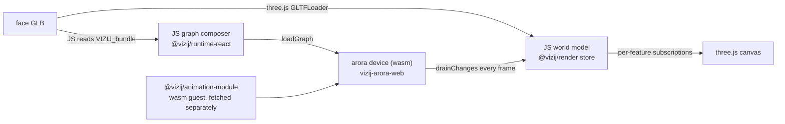
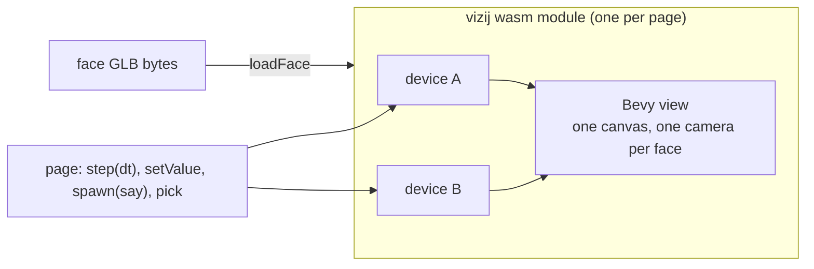
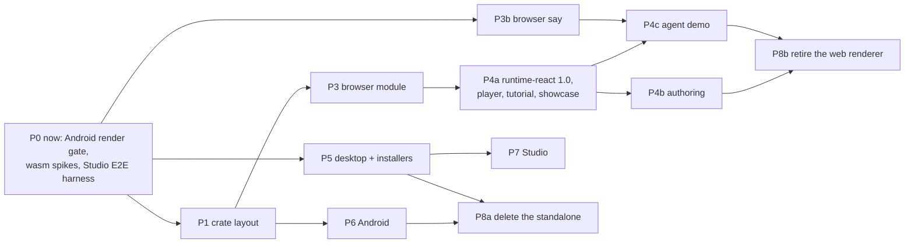

# One Bevy view for every Vizij face, in sixteen slides
<!-- tags: family=project; type=reference; project_status=proposal; topics=runtime,standalone,bevy,wasm,android,authoring -->
> **Last updated:** 2026-09-18
> **Related documents:** [Central plan](bevy_everywhere-plan.md) · [Tickets](bevy_everywhere-tickets.md) · [Sub-studies](studies/)

A reading guide to the plan for people who were not in the study. Each slide
links to the section or study that carries the evidence. Nothing is
implemented yet; every choice is open to challenge in the pull request. The
code shapes below show how the stack would be used; the exact names are
settled during the work.

---

## 1. What we are doing

One renderer for every Vizij face: the Bevy view in `crates/vizij`, run
natively on desktop and Android, headless on a robot, and in the browser
through wasm. `vizij-standalone`, the Tauri app that stitches a browser face
to a native device, goes away.

What we get out of it:

- **One stack instead of three.** Today a face runs as a native Bevy app, as a
  three.js page, or as both at once inside Tauri. After: one device, one view,
  four entry points.
- **The cleanup.** A store mirror, a JavaScript graph composer, a second
  device, a second lipsync, a second renderer and a second GLB reader are
  deleted, not rewritten.
- **The same face everywhere.** What renders on the robot renders in the
  authoring app, pixel for pixel, checked by one golden set.
- **A face is a component, not a device.** The `vizij` binary spawns a device
  whose whole hardware is a face; as a library, Vizij is a view, a face
  composition and a set of modules that any Arora device folds in — a robot
  adds a face as one more piece of hardware, and a face grows into a robot by
  adding a HAL. Studio sees one device either way.

Source: [plan §1](bevy_everywhere-plan.md#1-goal), [§1.1](bevy_everywhere-plan.md#11-the-face-is-a-component-of-a-device-not-the-device).

---

## 2. Today: what a browser face is made of



Every value the device writes crosses into JavaScript, is filtered, converted
and written into a React store, and reaches the GPU through a subscription
per feature. The rig graphs are composed in JavaScript from the bundle the
Rust side could read itself. In the Tauri standalone a second native device
sits next to this one and the two stores are mirrored over IPC.

Sources: [browser-device-anatomy](studies/browser-device-anatomy.md),
[standalone-anatomy](studies/standalone-anatomy.md).

---

## 3. After: one crate, one wasm module, one canvas per page



- The view reads the device's actuation state directly; no mirror, no store.
- The bundle is read once, in Rust, by the same code the native app uses.
- Several faces share one App and one WebGL context; each face is a viewport.
- The animation module is linked in, as it is natively.

Sources: [plan §3.1](bevy_everywhere-plan.md#31-one-crate-four-entry-points),
[§3.2](bevy_everywhere-plan.md#32-the-browser-one-module-instance-per-page-faces-as-viewports).

---

## 4. The packages after

| Package | Role | What changes |
| --- | --- | --- |
| `vizij` (crate, vizij-rs) | the face: device + view; binary for desktop, cdylib for Android and wasm | absorbs `vizij-arora-web`; gains `web`, `android`, `panel` modules |
| `@vizij/runtime` 3.0 (npm) | the wasm module and its JS shim: device API, `mount`, `loadFace`, `spawn`/`halt`, audio hook | major: no namespace prefix, no guest modules, one instance per page |
| `@vizij/render` (npm) | `<Vizij>` = a face slot on the page's canvas; the GLB loader, exporter and world model for editors | the three.js renderer is removed; the React API stays |
| `@vizij/runtime-react` 1.0 (npm) | the provider: bundle metadata, controls, transport, React hooks | the mirror and the JS composer are removed |
| retired | `vizij-arora-web`, `@vizij/speech-react`, `@vizij/animation-module`'s browser artifact, the Tauri standalone, semio_studio's `apps/vizij-app` | |

Sources: [plan §3.1](bevy_everywhere-plan.md#31-one-crate-four-entry-points),
[§3.10](bevy_everywhere-plan.md#310-what-is-retired).

---

## 5. How it feels: a face in a web page

```ts
import { init, mount, startRuntime } from "@vizij/runtime";

await init();
const page = await mount(document.getElementById("faces")); // once per page
const face = await startRuntime(await fetch("quori.glb").then(r => r.arrayBuffer()));
page.loadFace(face);                       // its own viewport in the container

face.setValue("standard/vizij/left_eye/pos/x", { f32: 0.3 });
const run = await face.spawn({ method: "say", args: { text: "Hello" } });
```

With React, the same through `@vizij/runtime-react` and `@vizij/render`:

```tsx
<VizijRuntimeProvider assetBundle={{ glb: { kind: "url", src: "quori.glb" } }} autostart>
  <Vizij />   {/* a slot on the shared canvas, not a canvas of its own */}
</VizijRuntimeProvider>
```

The runtime's entry is bytes (`loadFace(id, bytes)`); the provider's `glb`
takes them as `kind: "url"` (fetched — a `blob:` URL included), `kind:
"blob"` (an asset already in hand, as in Studio) or `kind: "world"` (an
authored world, exported to bytes first).

The provider API that `demo-vizij-player` and the tutorials use today is kept;
what they lose is the namespace prefix on paths.

Sources: [plan §3.2](bevy_everywhere-plan.md#32-the-browser-one-module-instance-per-page-faces-as-viewports),
[demos-inventory](studies/demos-inventory.md).

---

## 6. How it feels: the authoring app

The panels do not change. The viewport is a `<Vizij>` slot; the world model
stays in JavaScript, in `@vizij/render`'s store, as today.

| The author does | What happens |
| --- | --- |
| loads a GLB | `@vizij/render` parses it into the world model; the bytes go to `loadFace` |
| moves a control, plays a pose | `setValue` on the device; the view draws it next frame |
| edits the hierarchy or a material | the world model is exported to bytes and reloaded, the reload path the app already uses for structural edits |
| scrubs a static feature | `setStaticFeature` on the view, no reload |
| clicks an element | the view raises `picked(id)`; the app sets its selection; `setSelection` draws the glow |
| locks an output | `hold(paths)`: the view holds the drawn value; the device keeps running |
| exports | the same exporter, headless, writing the authored defaults (verified on Quori, Hugo, Toasty) |

Sources: [plan §3.3](bevy_everywhere-plan.md#33-the-authoring-app-keeps-its-world-model-in-javascript),
[authoring-viewport](studies/authoring-viewport.md), [challenge-headless-export](studies/challenge-headless-export.md).

---

## 7. How it feels: an agent talking to a face

```ts
// the agent, in the page: microphone -> STT -> LLM -> the face
const face = await startRuntime(glbBytes, { audio: webAudio(ctx) }); // ctx unlocked on click
face.setValue("standard/vizij/conversation/user_speaking", { f32: 1 });
const reply = await llm(transcript);
face.setValue("standard/vizij/expression/happy", { f32: 1 });
face.setValue("standard/vizij/conversation/speaking", { f32: 1 });
const run = await face.spawn({ method: "say", args: { text: reply, voice: "Ruth" } });
// lips: the device's viseme players write standard/vizij/viseme/* from the audio playhead
await run.done;   // or face.halt(run) on barge-in
```

The agent writes standard keys only: visemes come from `say`, states from the
conversation tier, expressions by ROS4HRI name. The same code drives any face
that carries the adaptation. Speech-to-text and the language model never enter
the face.

Sources: [plan §3.4](bevy_everywhere-plan.md#34-speech-say-on-every-device-the-agent-outside),
[VIZ-135](https://linear.app/semio-ai/issue/VIZ-135), [speech-and-agent](studies/speech-and-agent.md).

---

## 8. How it feels: desktop and robot

```sh
cargo run -p vizij -- --glb quori.glb                 # window + local WS bridge + control panel
cargo run -p vizij -- --glb quori.glb --studio        # the device appears in Semio Studio
cargo run -p vizij --features ros2 -- --glb quori.glb --ros2 --headless   # ROS4HRI face on a robot
vizij --glb https://faces/quori.glb --fullscreen --display 2               # a kiosk
```

- The control panel is served at `http://127.0.0.1:9000/` and lists the
  face's inputs; `write_values`, `reset`, `look_at` and `say` work over WS.
- A face can be dropped onto the window or opened from a dialog.
- Installers (dmg, deb, rpm, exe) come from a tagged release.

Sources: [plan §3.5](bevy_everywhere-plan.md#35-desktop),
[challenge-ws-bridge-and-operator](studies/challenge-ws-bridge-and-operator.md).

---

## 9. How it feels: a tablet, and Semio Studio

Android (the face draws on the API 34/35 emulator under Vulkan): install the
APK; open a GLB from the file picker or from any app's "open with"; the face
fills the screen; a panel asks once who owns the device
and shows where it is reachable; the tablet reboots into the same face and the
same Studio identity.

Studio: a face is hardware of a device — the whole of it for a stand-alone
`vizij --studio`, one more HAL of a robot's device otherwise, one registration
either way. Studio drives a scalar (a morph) and a compound (a translation)
animatable through a key profile the device carries. The scene's screen shows
the face as the image the device's view publishes into its store, so the
screen pixels are the robot's pixels and Studio keeps no face renderer of its
own; the upload modal previews the GLB through the same `@vizij/render`.

Sources: [plan §3.6](bevy_everywhere-plan.md#36-android), [§3.7](bevy_everywhere-plan.md#37-semio-studio),
[bevy-android-spike](studies/bevy-android-spike.md), [studio-consumers](studies/studio-consumers.md).

---

## 10. What gets deleted

- The Tauri standalone: its shell, its second native device, the IPC mirror,
  nine WS app methods, five speech flags, its Android workflow.
- `@vizij/runtime-react`: the value mirror, the JavaScript graph composer, the
  namespace prefix, the guest-module loader, the three.js bundle reader.
- `@vizij/render`: the r3f canvas, the renderables, the selection glow effect,
  the feature hooks.
- `@vizij/speech-react` and three private copies of the same lipsync.
- `vizij-arora-web` (into the `vizij` crate), `@vizij/animation-module`'s
  browser artifact and its CI job.
- semio_studio's `apps/vizij-app`.

Source: [plan §3.10](bevy_everywhere-plan.md#310-what-is-retired).

---

## 11. Performance: what changes, what costs

Structural gains, by construction:

- A device write reaches the GPU in the same frame, without crossing into
  JavaScript; today it is drained, filtered, converted and stored first.
- One WebGL context per page instead of one per face.
- The animation module is linked in: no separate fetch, no guest instantiation.
- Native: a 100 Hz device on a thread, a vsync view, as `crates/vizij` runs today.

Measured costs, device and view in one module:

- Payload: 8.2 MB gzipped after wasm-opt, against 0.76 MB for the device alone
  today.
- Memory: 138 MB of wasm linear memory with one face resident, 196 MB with
  two, flat over 25 load/unload cycles.
- A step's writes are drawn one frame after they are made.
- Face-ready on a software GPU: 2 s for Quori, 16 s for Toasty (unexplained).
- Cold build: 27 CPU-minutes; a source change: 14 to 37 s.

Not measured yet: frame time on a real GPU with several faces.

Sources: [wasm one-module](studies/challenge-wasm-one-module.md), [bevy-wasm-spike](studies/bevy-wasm-spike.md).

---

## 12. What breaks, found before writing code

- Blender-exported faces render black under the view's unlit materials: a lit
  material path and a golden for that preset are required.
- Lips through the standard need a viseme adaptation that only Quori carries;
  the four shipped faces are re-exported with one.
- Studio animates a face it renders itself, but over the bridge its writes do
  not reach a device's face (`<id>.target_position`, per-axis keys), in any
  app; a key profile in the device fixes it.
- On Android, arora's app-data discovery fails and the cloud TTS panics
  without the platform verifier; both need a change. No GLES build draws and
  SwiftShader loses the device; Vulkan on the API 34/35 images does draw.
- Every consumer that builds `namespace/...` paths changes.

Source: [challenge verdicts](studies/challenge-verdicts.md).

---

## 13. The plan and its gates



Each phase ends on something checkable: the snapshot goldens, a 25-cycle
memory test in the browser, a tagged release with installers, an adb script
on the tablet, a Studio-side writer moving two animatables.

Source: [plan §4](bevy_everywhere-plan.md#4-plan).

---

## 14. Risks

1. Android hardware: the emulator draws under Vulkan, but a tablet whose
   swapchain lists no sRGB format fails in Bevy 0.19.1 (an upstream fix), and
   a frame over 1 s becomes a device loss unless recovery is configured.
2. Payload and memory in the browser (slide 11).
3. Studio-capable builds ship wasmtime until arora splits `studio-bridge`
   from `native`.
4. Installers gate the retirement while no signing credentials exist.
5. The say contract has no stop and no run id.

Each has a mitigation or a fallback in the plan.

Source: [plan §5](bevy_everywhere-plan.md#5-risks-and-open-questions).

---

## 15. Decided, and what is asked of you

Decided on 2026-09-18: emulator images before any tablet; the view is vizij's
own renderer; `apps/vizij-app` dissolves; the scene screen keeps three.js as
its surface and shows the face as the image the device's view produces; the
showcase is ported; one text-agent demo; authored defaults on export;
`@vizij/render` kept and reworked; `studio-arora` is a dependency of the
in-page path, not this project's work; a conversation-state tier in the
standard; installers gate the retirement. Decided on 2026-09-21: the face is
a component of a device, not the device — `view`, `face`, `modules`,
`native`; a `Runtime` in JavaScript; arora to hold several HALs.

Asked of reviewers: challenge these, and the structural choices of slides 3 to
7. A comment against the plan section it concerns is the most useful form.

Source: [plan §1](bevy_everywhere-plan.md#1-goal).

---

## 16. Next

P0 needs no decision: the Android smoke in its CI shape (x86_64 image,
lavapipe, KVM), the Studio bridge harness, the hygiene items, two arora-sdk
items; the render gate, the one-module spike and the TTS browser test are
done. The plan's status becomes
`planning` when this PR merges with the review's changes applied.

Source: [plan §4](bevy_everywhere-plan.md#4-plan).
