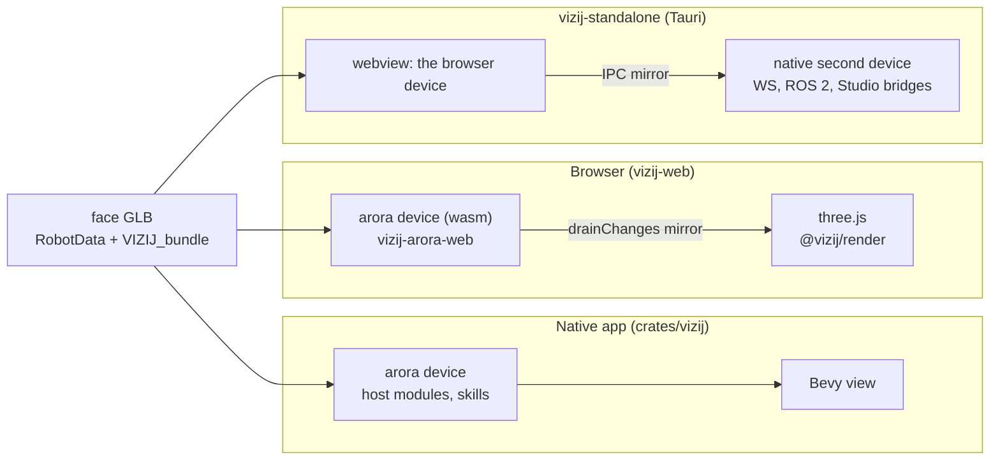
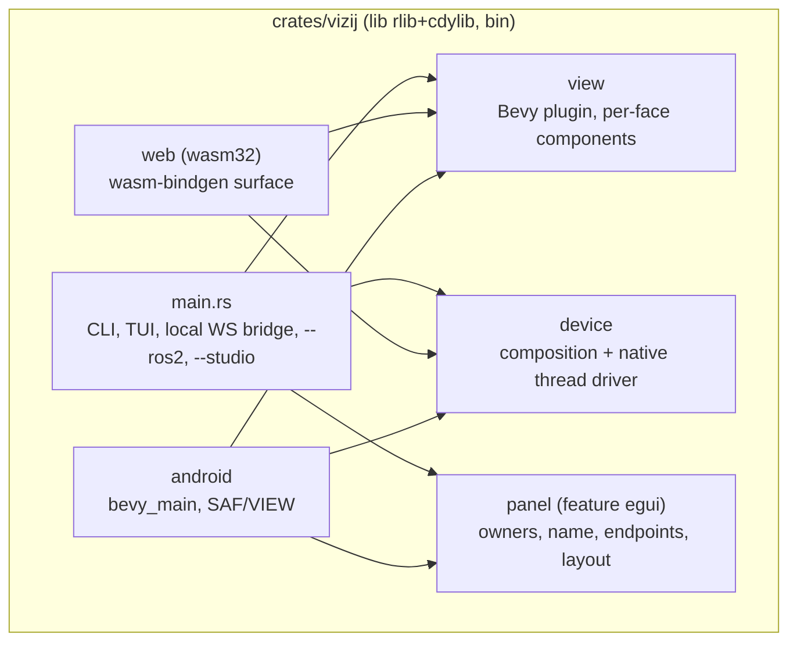
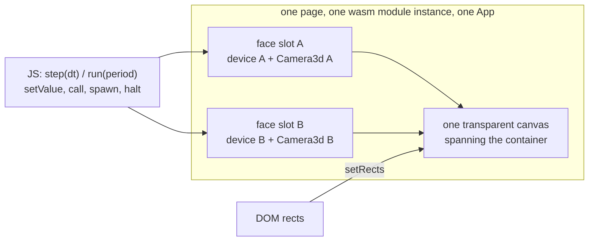
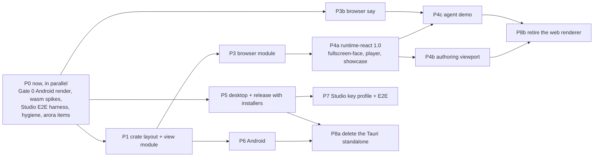

# One Bevy view for every Vizij face, in eighteen slides
<!-- tags: family=project; type=reference; project_status=proposal; topics=runtime,standalone,bevy,wasm,android,authoring -->
> **Last updated:** 2026-09-18
> **Related documents:** [Central plan](bevy_everywhere-plan.md) · [Sub-studies](studies/)

A reading guide to the plan for people who were not in the study. Each slide
links to the section or study that carries the evidence. The plan is a dry
run: nothing is implemented yet, and every choice below is open to challenge
in the pull request.

---

## 1. The proposal in one sentence

The Bevy renderer in `crates/vizij` (vizij-rs) becomes the one way a Vizij
face is drawn: native desktop, Android, headless, and the browser through
wasm, including the authoring app's viewport. `vizij-standalone` (the Tauri
app) is retired, and its folder becomes a browser demo of an agent talking to
a face.

Why one renderer: today two renderers (three.js in the browser, Bevy natively)
implement the same contract from the same GLB, and the standalone stitches two
devices together to serve both. The study measures what removing the second
renderer costs and what it breaks.

Source: [plan §1](bevy_everywhere-plan.md#1-goal).

---

## 2. How the plan was made

- Twelve sub-studies of the current state, each answering fixed questions
  with file references; two of them build spikes (Bevy on wasm32, Bevy on
  Android), one a compile spike (arora on wasm32).
- A first target picture and plan, then a challenge: each load-bearing claim
  attacked through two or three lenses, three verification spikes, three
  judges. No claim survived unchanged; one was refuted.
- Eleven decisions taken with Victor on 2026-09-18 and recorded in the plan.

What is not there: three spikes did not finish (the one-module wasm device +
view test, Android on newer emulator images, the browser test run of the TTS
branch). Their questions are the first work items.

Sources: [studies/](studies/), [challenge verdicts](studies/challenge-verdicts.md).

---

## 3. Today: three runtimes, two renderers, one contract

The standalone runs two devices and mirrors one store into the other; its WS
"methods" are app methods, not device methods; Studio can read and write its
keys but cannot call anything.

Sources: [plan §2.1–2.2](bevy_everywhere-plan.md#21-three-face-runtimes-two-renderers-one-contract),
[standalone-anatomy](studies/standalone-anatomy.md).

---

## 4. What the browser stack is made of

- `@vizij/render` is 6,045 lines, of which 1,884 draw; the rest is a world
  model, a GLB loader and an exporter the authoring app depends on.
- Every browser app draws through one component, `VizijRuntimeFace`.
- `@vizij/runtime-react` composes graphs in JavaScript, prefixes every path
  with a namespace, and mirrors device outputs into the three.js store.
- The animation module runs as a separate wasm guest in the browser; natively
  it is linked as a host module.

Sources: [web-render-anatomy](studies/web-render-anatomy.md),
[browser-device-anatomy](studies/browser-device-anatomy.md).

---

## 5. What was verified by building

| Question | Result |
| --- | --- |
| Bevy 0.19 renders a face GLB with morph targets in a browser canvas? | Yes, over WebGL2; headless Chromium composites it with no flags |
| Cost of that build | 27 CPU-minutes cold, 26 MB / 7.6 MB gzipped after wasm-opt, about 90 MB of wasm memory per module instance |
| arora and the interop crates compile for wasm32? | Yes without arora's default features; the bridges do not |
| Bevy 0.19 builds and installs as an Android APK? | Yes; it drew no frame on the one emulator image tried (API 32) |
| The local WS bridge can be made usable without an arora change? | Yes, verified over the wire |
| GLB export works from the world model without a renderer? | Yes, three faces round-trip with zero differences |
| The TTS provider has a wasm32 branch? | Compile-verified; its browser test run is not recorded |

Sources: [plan §2.10](bevy_everywhere-plan.md#210-portability-verified-by-builds),
[bevy-wasm-spike](studies/bevy-wasm-spike.md), [bevy-android-spike](studies/bevy-android-spike.md),
[arora-wasm-constraints](studies/arora-wasm-constraints.md),
[challenge-ws-bridge-and-operator](studies/challenge-ws-bridge-and-operator.md),
[challenge-headless-export](studies/challenge-headless-export.md),
[challenge-tts-wasm](studies/challenge-tts-wasm.md).

---

## 6. Target: one crate, four entry points

No consumer takes the view without the device or the device without the view,
so there is no crate split. `vizij-arora-web` retires into the `web` module.
Bevy's features are trimmed per target; arora is taken without its default
features, and `studio-bridge` still implies `native` until arora splits them.

Source: [plan §3.1](bevy_everywhere-plan.md#31-one-crate-four-entry-points).

---

## 7. Browser: one module per page, faces as viewports

- The JS drive stays the pacer; no Bevy system steps the device (a hidden tab
  halts `requestAnimationFrame`; the Node tests run the device with no canvas).
- One module instance per page: a running face pins about 90 MB per instance
  for the page's lifetime, and the authoring app mounts and unmounts faces
  25 times in its memory test.
- The `namespace/` path prefix is retired: one face is one device with its
  own store. That is a protocol change for the consumers that build such paths.

Source: [plan §3.2](bevy_everywhere-plan.md#32-the-browser-one-module-instance-per-page-faces-as-viewports).

---

## 8. Authoring: the world model stays in JavaScript

- The viewport swaps at the `VizijRuntimeFace` seam; the panels do not change.
- `@vizij/render` is kept and reworked: its `Vizij` component becomes a face
  slot on the shared canvas; the loader, exporter, bundle helpers and world
  types stay; the three.js renderables go.
- Structural edits reach the view the way they reach the device today: by
  reload, now as exported bytes.
- Export from the world model without a renderer is verified; it writes the
  authored defaults rather than a runtime pose snapshot.
- The editor contract: `picked`, `pointerMissed`, `setSelection`,
  `showSelectionGlow`, `hold` (output locks), `setStaticFeature`.

Sources: [plan §3.3](bevy_everywhere-plan.md#33-the-authoring-app-keeps-its-world-model-in-javascript),
[authoring-viewport](studies/authoring-viewport.md).

---

## 9. Speech: `say` on every device, the agent outside

- The device keeps the `say` skill and the viseme players; speech-to-text and
  the language model are an agent outside the face.
- The TTS provider gets a wasm32 branch under one skeleton: fetch transport
  unchanged, playback through a page-supplied hook whose clock is the audio
  output's clock.
- One agent demo, a text agent, in the standalone's folder;
  `tutorial-agent-face` folds into it.
- The face standard gains a conversation-state tier (`speaking`,
  `user_speaking`, `thinking`) so an agent targets any face by standard names
  (a separate ticket).

Sources: [plan §3.4](bevy_everywhere-plan.md#34-speech-say-on-every-device-the-agent-outside),
[speech-and-agent](studies/speech-and-agent.md), [challenge-tts-wasm](studies/challenge-tts-wasm.md).

---

## 10. Desktop and Android

Desktop: the binary composes its own local WS bridge (registry, `reset`, the
HTTP control panel, a bind address), a file dialog, the standalone's window
flags, and Studio registration through arora's public seams. No arora change is
needed for the bridge.

Android: the ros-viz-rs recipe (cargo-ndk, Gradle, `NativeActivity`), one
Kotlin `Activity` subclass for the file picker and the VIEW intent, the egui
panel for owners and endpoints, an app-data-directory override in arora, and
a TLS root-store decision for the cloud TTS. Rendering is validated before
anything else, on newer emulator images first, then on a plugged-in tablet
over adb; both are scripted.

Sources: [plan §3.5](bevy_everywhere-plan.md#35-desktop), [§3.6](bevy_everywhere-plan.md#36-android),
[bevy-android-spike](studies/bevy-android-spike.md).

---

## 11. Semio Studio

- `apps/vizij-app` dissolves: a stand-alone `vizij --studio` is what Studio
  connects to, the way it connected to that app.
- Studio's writes do not reach a face's animatables today (`<id>.target_position`,
  per-axis split versus bare UUIDs), in the Tauri app either. A Studio-key
  profile in the device is a deliverable, and a bridge end-to-end test its gate.
- Studio adopts the reworked `@vizij/render`; the scene's face-on-a-screen
  keeps three.js.
- `studio-arora` (draft PR #256) is out of scope.

Sources: [plan §3.7](bevy_everywhere-plan.md#37-semio-studio),
[studio-consumers](studies/studio-consumers.md).

---

## 12. What breaks, found before writing code

- Blender-exported faces render black under the view's unlit materials
  (colour in `emissiveFactor`, black base, metallic 1): a lit material path
  and a golden for that preset are required.
- Lips through the standard need a viseme adaptation that only Quori has; the
  four shipped faces are re-exported with one.
- The seven-feature Bevy list does not compile on Linux (no window backend)
  and lacks picking.
- `arora::studio::connect()` cannot run on Android as is (no writable app-data
  directory); the cloud TTS panics without the platform verifier.
- The say contract has no stop and no run id: interruption is a convention;
  a repeated sentence collides.

Source: [challenge verdicts](studies/challenge-verdicts.md), [plan §5](bevy_everywhere-plan.md#5-risks-and-open-questions).

---

## 13. Fate of every app

| App | Fate |
| --- | --- |
| vizij-standalone | Tauri shell and second device deleted; folder becomes the agent demo |
| tutorial-fullscreen-face, demo-vizij-player, vizij-showcase | ported, in that order |
| vizij-authoring | viewport ported through the reworked `@vizij/render` |
| tutorial-agent-face | folded into the agent demo |
| five demos with no face | unchanged |
| semio_studio `apps/vizij-app` | dissolves |
| semio_studio `packages/vizij` | replaced by `@vizij/render` except the scene-screen renderables |

Source: [plan §3.8](bevy_everywhere-plan.md#38-fate-of-every-app).

---

## 14. The plan, as a dependency graph

Sizes: S days, M one to two weeks, L several weeks of one person. P4b and
P6 are the L items.

Source: [plan §4](bevy_everywhere-plan.md#4-plan).

---

## 15. Gates, so that "done" is checkable

- P1: snapshot regression unchanged; wasm32 and Android checks green; a
  headless test drives the composition and reads a pose.
- P3: Quori and Toasty on a plain page within the golden tolerance; 25
  load/unload cycles with bounded memory; the five Node tests green.
- P4a per app: build, its e2e, a `ready` signal and a non-uniform canvas pixel
  sample.
- P5: a tagged release with dmg, deb, rpm, exe; the owner prompt registers.
- P6: an adb script against the tablet: install, load by picker and by VIEW
  intent, reboot, recover the Studio identity, move two animatables from Studio.
- P7: the Studio-side writer moves a scalar and a compound animatable.

Source: [plan §4](bevy_everywhere-plan.md#4-plan), [§6](bevy_everywhere-plan.md#6-acceptance-criteria).

---

## 16. Risks, most severe first

1. Android rendering is unproven on Bevy 0.19 (one image tried, drew nothing).
2. Browser payload and memory: 7.6 MB gzipped per page, 90 MB per instance.
3. Studio's writes do not reach the face until the key profile lands.
4. Lips need adaptations the shipped faces lack.
5. Studio-capable builds ship wasmtime until arora splits `studio-bridge`
   from `native`.
6. Installers are on the critical path with no signing credentials.

Each has a mitigation or a fallback in the plan.

Source: [plan §5](bevy_everywhere-plan.md#5-risks-and-open-questions).

---

## 17. Decisions already taken, and what is asked of reviewers

Taken on 2026-09-18: emulator images before any tablet; the view is vizij's
own renderer, not the STUDIO-256 spike; `apps/vizij-app` dissolves; the scene
screen keeps three.js; the showcase is ported; one text-agent demo; authored
defaults on export; `@vizij/render` kept and reworked; `studio-arora` out of
scope; a conversation-state tier in the standard; installers gate the
retirement.

Asked of reviewers: challenge any of these, and the target picture's
structural choices (one crate; JS-paced device; one module per page; the
Studio-key profile; the crate boundaries with STUDIO-256). Comments on the
PR against the section they concern are the most useful form.

Source: [plan §1](bevy_everywhere-plan.md#1-goal).

---

## 18. What happens next

P0 needs no decision: run Gate 0 on API 34 and 35 emulator images with the
existing spike APKs; finish the three unfinished spikes on the compiled
targets; build the Studio bridge end-to-end harness; land the hygiene items;
open the two arora-sdk items (app-data-directory override; the
`studio-bridge`/`native` split if a wasmtime-free Android build is wanted).

The plan is a proposal; its status becomes `planning` when this PR merges
with the review's changes applied.
