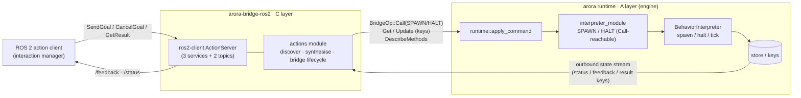
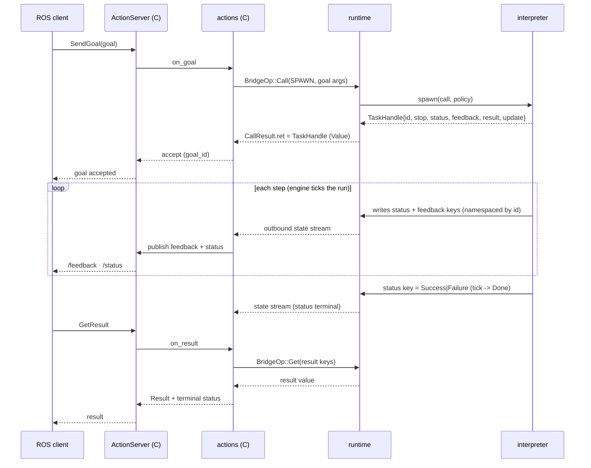
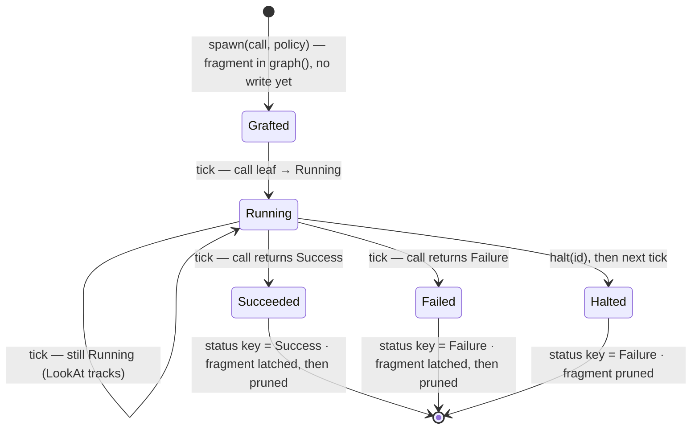

# Task Runs & ROS 2 Actions on Arora — proposal

Status: **implemented end to end.** The A layer (engine execution) is on
arora-sdk main; the C layer (the ROS bridge's `actions` module) is built and
live-validated on [#201]; the node graph hosts runs too ([vizij-rs #84]). What carries it:

- `BehaviorStatus` terminal-fault case ([arora-sdk #189]) — §2.1.
- `TaskId`/`RunPolicy`/`TaskHandle` as built-in Arora types ([#195]) — §§2.3–2.5.
- `interpreter_module` `SPAWN`/`HALT` ([#197]) and the runtime wiring ([#199]) —
  §§2.6–2.7.
- **`BehaviorInterpreter::spawn`/`halt` in the behavior tree** ([#200]) — runs
  as tree structure under a permanent runner root; state and call diagrams in
  §2.2.1.
- **The node graph as a run host** — the same contract on Vizij's
  `ProcessingGraph` (§2.2.2).
- The `actions` module in `arora-bridge-ros2` ([#201]): discovery over
  `DescribeMethods`, runtime message synthesis, and a **raw** action server on
  both backends (§2.11 — the typed `ActionServer` cannot carry
  runtime-synthesised types), validated by a live DDS LookAt lifecycle.
- **Skill endpoints** — profile-bound *standard* actions
  (`ActionBinding`, [#214]) over the vendored skill packages and their
  `.action` codegen ([#213]) — §2.12.
- **Task fragments** — a skill's behavior as graph content, grafted per run
  ([vizij-rs #91]: the fragment registry and the shipped `look_at`) — §2.2.3.

[arora-sdk #189]: https://github.com/semio-ai/arora-sdk/pull/189
[#195]: https://github.com/semio-ai/arora-sdk/pull/195
[#197]: https://github.com/semio-ai/arora-sdk/pull/197
[#199]: https://github.com/semio-ai/arora-sdk/pull/199
[#200]: https://github.com/semio-ai/arora-sdk/pull/200
[#201]: https://github.com/semio-ai/arora-sdk/pull/201
[#213]: https://github.com/semio-ai/arora-sdk/pull/213
[#214]: https://github.com/semio-ai/arora-sdk/pull/214
[vizij-rs #84]: https://github.com/vizij-ai/vizij-rs/pull/84
[vizij-rs #91]: https://github.com/vizij-ai/vizij-rs/pull/91

Companion to [`ros4hri_face-proposal.md`](./ros4hri_face-proposal.md), which is
the driving use case: the ROS4HRI face needs exactly one action, `LookAt`
(`interaction_skills/action/LookAt`), while `set_expression` stays a
fire-and-forget topic (`ros4hri_face-proposal.md:13`). The mechanism below is
general — "Arora gains a general mechanism for exposing long-running,
cancellable behaviors ('task runs') to any bridge" (`ros4hri_face-proposal.md:1`).

## 0. Thesis: C-over-A, with C only in the ROS layer

Two layers, and the engine never learns the word "action":

- **A — execution (engine).** A *task run* is a long-running, cancellable
  behavior. The `BehaviorInterpreter` gains a way to **spawn** a run from a
  `Call` and **halt** it, returning a serializable **`TaskHandle`**. Runs tick
  concurrently under the one interpreter; how they are hosted (a behavior-tree
  subtree, a node-graph subgraph) is the interpreter's private business.
- **C — mapping (ROS bridge).** A new `actions` module in `arora-bridge-ros2`
  maps ROS 2 actions to task runs: it discovers action-shaped functions,
  synthesises the ROS `Goal`/`Feedback`/`Result` messages, runs a
  `ros2-client` `ActionServer`, and drives the goal lifecycle over the existing
  `BridgeOp` command plane and the store's key stream. C is entirely
  ROS-specific and lives entirely in the bridge.

Explicitly **out of scope / not built now**: a native `Action` export kind in
the engine; a new `BridgeOp` variant; a conflict scheduler with
resource-claims (default policy only — see §2.4); async `CallBridge`.

Why this split — a ROS action decomposes (per
[the spec](https://design.ros2.org/articles/actions.html)) into three services
(`SendGoal`, `CancelGoal`, `GetResult`) and two topics (`feedback`, `status`).
`ros2-client` already implements that protocol (`ActionServer`), and #188
already established the pattern for exposing an engine surface to ROS (module
methods → services). Actions are the long-running generalisation of #188, one
notch up, on the same `Bridge` plane — never the HAL, which has no command,
method, or discovery surface.

## 1. Architecture

### 1.1 Layer / data-flow diagram



Two planes cross the bridge, and they land differently:

- **Lifecycle plane** (start / cancel) → `BridgeOp::Call` (to `SPAWN` / `HALT`).
  No new `BridgeOp` variant.
- **Data plane** (feedback / status / result) → store **keys**, which the
  bridge already consumes as the outbound state stream (the topic plane). No new
  op; `Result` is a `Get` at terminal.

### 1.2 Call sequence — SendGoal → spawn → stream → GetResult



### 1.3 Call sequence — CancelGoal → halt, and live goal update

```mermaid
sequenceDiagram
  participant Cli as ROS client
  participant AS as ActionServer (C)
  participant ACT as actions (C)
  participant RT as runtime
  participant BI as interpreter
  Cli->>AS: CancelGoal(goal_id)
  AS->>ACT: on_cancel
  ACT->>RT: BridgeOp::Call(handle.stop)
  RT->>BI: halt(id)
  BI-->>RT: status key -> canceled/terminal; run dropped next tick
  ACT-->>AS: CANCELED
  AS-->>Cli: canceled
  Note over Cli,ACT: A moving LookAt target: Cli republishes goal -> ACT: BridgeOp::Update(handle.update keys)
```

### 1.4 How the interfaces communicate

- **`BehaviorInterpreter`** (engine trait) — `spawn`/`halt`/`tick`; the only
  thing that knows how its graph hosts a run.
- **`interpreter_module`** — the seam that makes `spawn`/`halt` reachable as
  `Call`s (exactly as `LOAD`/`EDIT` are today), so the bridge drives them over
  `BridgeOp::Call`.
- **`BridgeOp`** — the command plane: `Call` (spawn/halt), `Get`/`Update`
  (result/live inputs), `DescribeMethods` (discovery). Unchanged.
- **store / key stream** — the data plane: feedback/status/result are keys; the
  bridge already receives every state change.
- **`ros2-client` `ActionServer`** — the ROS protocol (services + topics +
  `GoalStatus`); C fills its callbacks, never re-implements it.

## 2. Components — names, locations, intent, spec

### 2.1 `BehaviorStatus` — the interpreter's *scheduling* status (gains a terminal-fault case)

`enum BehaviorStatus { Running, Done }` today — `crates/arora-behavior/src/lib.rs:48`,
returned by `tick`. **Intent:** tells the runtime whether to tick the behavior
again or drop it. **Spec / caveat:** this is *not* the action outcome — it
carries no `Success`/`Failure`. The `Running`/`Success`/`Failure` tri-status
that ROS needs is the behavior-tree node `Status` (behavior-tree schema), an
*application* value, and for a run it is surfaced on the run's **status key**
(§2.3). Do not map `BehaviorStatus` to `GoalStatus`; map the status key. (This
corrects the sparring shorthand "the tick returns `Status`.")

**The prerequisite change (decided, its own PR before any task-run type lands):**
`BehaviorStatus` gains a *terminal-fault* case:

```rust
pub enum BehaviorStatus {
    Running,                          // non-terminal: tick me again next step
    Done(Result<(), BehaviorError>),  // terminal: Ok(()) clean; Err(_) faulted (dropped, NOT retried)
}
```

**Shape (decided in sparring).** Liveness is *one bit* — `Running` vs terminal
`Done` — and the terminal outcome is the *payload* of `Done`, not a parallel
`Error` variant. `T` is `()`: a behavior does not *return* a value, it writes its
outputs to store keys, so there is no success payload to carry (and the runtime
would have nowhere to route one). `E` is the diagnostic `BehaviorError`.

**Why this is needed and what it is *not*.** The runtime already proves the gap:
in `tick_behavior` (`crates/arora/src/runtime.rs`), an `Err(BehaviorError)` from
`tick` is a **transient/retry** channel — the interpreter stays installed and
ticks again next step, the failure only raised on the standing `behavior_error`
watch. There is therefore no way today to say *"I finished, and I failed."*
`Done(Err(e))` is exactly that missing **terminal** fault: `Ok(Done(Err(e)))`
drops the interpreter (like `Done(Ok(()))`) **and** surfaces `e` on the
`behavior_error` watch (like `Err`), whereas `Err(e)` keeps-and-retries. Two
dispositions that differ in what the runtime does — the whole justification for
both channels existing. `BehaviorStatus` therefore drops `Copy` (`Clone` stays);
`tick` keeps its `Result<BehaviorStatus, BehaviorError>` signature.

**Scope boundary — this is liveness + disposition, not outcome.** `Done` is
deliberately *not* split into `Success`/`Failure`. The feature this proposal
builds (spawn → *N* concurrent runs under one `tick()`, §2.2) forces per-run
outcomes onto per-run **status keys**: one interpreter-level `tick()` cannot
return one run's success/failure while hosting many. So the `Running`/`Success`/
`Failure`(/`Error`) *outcome* is the **`Status` value** on the run's status key,
and that is the type C maps to `GoalStatus`. `BehaviorStatus` carries only what
the *runtime* must act on — keep / drop-clean / drop-faulted — because the
runtime is indifferent to success-vs-failure but not to clean-vs-faulted.

**The second, separate "error case" — the `Status` *value*.** The
behavior-tree `Status` enum (`{Running, Success, Failure}`,
`crates/arora-behavior-tree-types/src/status.rs`, a registered Arora Value type
id `325a5767-…`) is the one a run writes to its status key and the one C maps to
ROS. For ROS `ABORTED`-with-a-reason (LookAt's Result is an errno,
`ros4hri_face-proposal.md:14`) it wants an `Error(Value)` variant carrying a
*structured* payload. This is a distinct change (a new registered variant in
`arora-behavior-tree-types`, versioned per [[semio-rust-crate-versioning]]) from
the `BehaviorStatus` change above — do not conflate them. It is the value the
`status`-key decorator/filter of §2.3-Q2 forwards.

### 2.2 `BehaviorInterpreter` — gains `spawn` / `halt`

`pub trait BehaviorInterpreter` — `crates/arora-behavior/src/lib.rs`. Alongside
`tick` (→ `BehaviorStatus`), `apply(GraphDiff)` (default impl), and `load(Graph)`
(default impl), the trait gained these two — default-rejecting, so only an
interpreter that opts in hosts runs; the behavior tree does so in [#200]
(see §2.2.1):

```rust
/// Spawn `call` as a concurrent run under `policy`; return its handle.
/// Non-blocking — the run advances with `tick()`; its lifecycle is observed
/// through the handle's keys. Realised however the interpreter hosts graphs
/// (a parallel BT subtree; a node-graph subgraph) — often internally an
/// `apply(GraphDiff)` of an interpreter-specific fragment.
fn spawn(&mut self, call: Call, policy: RunPolicy) -> Result<TaskHandle, BehaviorError>;

/// Halt a run (idempotent). Behavior-tree-native "halt": a clean stop that may
/// run compensation, not a hard kill.
fn halt(&mut self, task: TaskId) -> Result<(), BehaviorError>;
```

**Intent:** the one interpreter-agnostic abstraction for "add a concurrent,
tracked, cancellable run." **Spec:** `spawn` is non-blocking and returns
immediately; the run ticks with the normal `tick()`, so concurrency lives in the
interpreter hosting *N* runs (this dissolves the "single interpreter cell"
concern — the cell was only ever limited to one *interpreter*, not one *run*).
Naming rationale: `spawn` names the *concept* (a concurrent unit returning a
handle, per `thread::spawn`/`tokio::spawn`), not the *mechanism* (a graph
apply) — naming it `apply_task` would leak exactly what `TaskHandle` hides.
`halt` is BT-native and free of `abort`'s ROS-failure connotation and `drop`'s
`Drop`-trait overload. `cancel`/`abort` stay ROS-side in C (§2.9).

### 2.2.1 How the behavior tree hosts a run (implemented, [#200])

The `BehaviorTreeInterpreter` (`crates/arora-behavior-tree/src/behavior.rs`)
hosts runs as **tree structure**. The interpreter permanently owns a parallel
**runner** root: `load` grafts the main behavior as the runner's child, `spawn`
grafts a run fragment beside it, `halt` prunes — all through the same
`apply(GraphDiff)` an editor uses, so the tree an introspector reads
(`graph()`) *is* the execution state, runs included.

- **A run is a two-node fragment: a run-status decorator over a run-call
  leaf.** The leaf carries the whole spawned `Call` as one literal link and
  invokes it through the call bridge each tick, yielding the call's `Status`;
  the decorator forwards that status to the run's status key (its output is
  predetermined to the key — the store-binding convention every output uses)
  and **latches** at a terminal status, going inert. This is §3-Q2's "status
  decorator", literally.
- **`spawn` is a graft, `halt` a deferred prune.** `spawn` allocates the
  `TaskId`, namespaces the handle's keys, and applies the fragment diff —
  store-less, exactly like `load`/`apply`. `halt` queues; the next tick (which
  owns the store) writes `Failure` to the status key and prunes the fragment
  (the engine has no "canceled" outcome of its own; the ROS layer that issued
  the cancel is what reports `CANCELED`, §2.9). A terminal run's fragment is
  pruned before the next re-lowering — lowering resets node state, so a
  latched fragment must not survive into one. Its keys persist in the store
  for the observer.
- **One runtime tick is one tree tick.** The runner ticks main and every run
  fragment together, reactively; `Running` spans ticks. A terminal main
  behavior re-evaluates on the next tick — the tree is a standing,
  continuously re-evaluated policy — while a terminal run latches: run-once is
  the run's semantics, not the tree's. The interpreter always reports
  `Running`; it is never dropped.

Actuation (the gaze the LookAt run drives) is written by the run's *function*,
which a device wires as a host function capturing the store/HAL — not by the
interpreter, which only owns the status key. That keeps actuation on the shared
LWW keys (§2.4) and off the per-run handle.

Where this is minimal, on purpose: a run's fragment hosts *one* call leaf, not
yet an arbitrary mounted subtree. Feedback/result keys are declared on the
handle but populated by the run's function (or, later, by a mounted subgraph);
the **status key is the load-bearing signal** the ROS layer maps. Richer
hosting (mounted subtrees, compensation on halt, `RunPolicy` as visible runner
structure, resource claims) is future work behind the same unchanged
`spawn`/`halt` interface.

#### Run lifecycle — state diagram

The status key an observer watches moves through exactly these states:



`Grafted` is the gap between `spawn` (which returns the handle, the fragment
already visible through `graph()`) and the first `tick` (which makes the first
write) — a run is observable on the store only from its first tick. `Halted`
writes `Failure`; C distinguishes it from a spontaneous `Failed` because C is
the one that issued the halt (it maps its own cancel → `CANCELED`).

#### Drive path — call diagram (behavior-tree implementation)

How a spawn, the per-step advance, and a halt flow through the device:

```mermaid
sequenceDiagram
  participant C as bridge / caller
  participant RT as runtime (step)
  participant IM as interpreter_module
  participant BT as BehaviorTreeInterpreter
  participant FN as run's Call (e.g. look_at)
  participant ST as store
  C->>RT: BridgeOp::Call(SPAWN, call, policy)
  RT->>IM: decode_spawn
  IM->>BT: spawn(call, policy)
  BT->>BT: graft fragment under the runner (status decorator over call leaf), new TaskId
  BT-->>IM: TaskHandle
  IM-->>RT: CallResult.ret = TaskHandle (Value)
  RT-->>C: TaskHandle (namespaced keys + stop call)
  loop each step — phase 4 (one tree tick)
    RT->>BT: tick(ctx)
    BT->>FN: run-call leaf → call_bridge.arora_call(call)
    FN->>ST: write actuation keys (gaze)
    FN-->>BT: Value → Status
    BT->>ST: status decorator → run's status key
    Note over BT: terminal Status → latch; fragment pruned before the next re-lowering
  end
  C->>RT: BridgeOp::Call(handle.stop = HALT, id)
  RT->>IM: decode_halt
  IM->>BT: halt(id) — queued
  Note over BT,ST: next tick → status = Failure, fragment pruned
```

### 2.2.2 How the node graph hosts a run (implemented, vizij-rs)

Vizij's `ProcessingGraph` (vizij-rs, `crates/interop/vizij-arora-behavior`)
implements the same contract on the node graph — the "node-graph subgraph"
hosting §2.2 anticipates. The mapping is near-isomorphic to the tree's:

- **A run is a two-node fragment: a `taskrun` node wired into an `output`
  node on the run's status key.** The `taskrun` node is self-contained — the
  spawned call rides its params (module, function, and the args as one literal
  bundle) — so a graft needs no argument-feeder wiring. Each evaluation it
  dispatches the call through the graph's function host (honouring the call's
  own module id, where an `externalfunction` node resolves through the
  function→module map), coerces the return to a `Status`, and emits it; the
  ordinary `output` convention writes the status key.
- **The latch lives in node state.** A terminal status latches in the node's
  runtime state, which survives re-lowering (the graph runtime is kept warm
  across edits), so a finished run never re-invokes its function; the
  interpreter sweeps terminal fragments out of the graph after their final
  write. `halt` queues, and the next tick writes `Failure` and prunes — the
  tree's semantics exactly.
- **Same keys, same handle, same status vocabulary.**
  `arora/tasks/<module>/<function>/<run_id>/*`, the same `TaskHandle`, and the
  behavior-tree `Status` enumeration as the one cross-interpreter status
  vocabulary (§2.1; the graph core takes its ids from
  `arora-behavior-tree-types`). An observer — the ROS action plane included —
  cannot tell which interpreter hosts its run. That is §2.2's point: hosting
  is the interpreter's private business.

A dataflow graph has no tick-gating parent, so there is no runner node: the
graph itself is the concurrent runner, and a grafted fragment simply evaluates
with everything else. `RunPolicy` arbitration as visible structure remains
future work here too.

### 2.2.3 Task fragments — a skill's behavior as graph content (implemented, vizij-rs)

The `taskrun` wrapper of §2.2.2 calls a module function each tick — fine for
behaviors that genuinely live in host code, but a **skill** should not be a
module feature: its behavior belongs in the same editable, introspectable
substrate as everything else the face runs (decision #8's dynamic tier —
graphs as data). `ProcessingGraph` therefore carries a **task-fragment
registry** (`TaskFragment`, `set_task_fragment`): when a spawned call's
function has a registered fragment, `spawn` grafts *that asset content*
instead of the wrapper.

The fragment is a plain graph spec speaking a placeholder-path convention,
rewritten to the run's key prefix at graft time:

- `task/<param>` **inputs** are the function's parameters — the spawn-time
  arguments become their defaults, and each gets a per-parameter update key
  on the `TaskHandle`, so a live goal update steers the running fragment
  through the store (no graph edit per update);
- the `task/status` **output** (required — a fragment that cannot report its
  lifecycle is refused at registration) is the run's `Status`;
- `task/result` / `task/feedback` outputs land on the handle's result and
  feedback keys — an integer on the result key is the `std_skills` errno the
  ROS skill endpoint (§2.12) answers verbatim.

Everything else is unchanged: node ids are namespaced per run, the whole
grafted set prunes together at terminal or halt, and an observer still cannot
tell how the run is hosted. The first shipped skill is `look_at`
(vizij-arora-host `skills/look_at.json`, generated and drift-tested like the
ros4hri profile): track runs until halted, glance/reset hold a store-latched
fixation clock then succeed, unimplemented policies fail with `ROS_ENOTSUP`
written by the fragment itself.

### 2.3 `TaskHandle` — the serializable contract (NEW)

**Location (decided): `crates/arora-behavior`**, beside `BehaviorInterpreter`
(it is that trait's return type). It is **exported as a built-in Arora type**
(registered like the behavior-tree `Status`, so it has a stable type id and
round-trips through `value_serde`) — that is what lets the bridge name it in a
`CallResult.ret` without an `arora-behavior` *code* dependency: the bridge reads
it as a `Value` off the value plane, not as a Rust struct. See §3-Q3.

```rust
struct TaskHandle {
    id: TaskId,
    stop: Call,          // how to stop it — a Call the caller issues (→ halt(id))
    status: Key,         // the run's lifecycle (Running/Success/Failure); C watches for terminal
    feedback: Vec<Key>,  // Feedback-message fields (homogeneous)
    result: Vec<Key>,    // Result-message fields, written at terminal
    update: Vec<Key>,    // live goal inputs the caller may push (e.g. a moving target)
}
```

**Intent:** everything the bridge needs to run the goal lifecycle, as *data*, so
it crosses `BridgeOp` (returned as a `value_serde` `Value` in `CallResult.ret`,
exactly like `MethodSignature`). **Spec:**

- `stop` is a `Call`, not a callback — that is what makes "how to stop it"
  serializable and lets C issue `BridgeOp::Call(handle.stop)` on cancel with no
  knowledge of interpreter internals.
- `status` is singular and special *by position* (not a tag type): C observes it
  for `EXECUTING → SUCCEEDED/ABORTED` and to know when to resolve `GetResult`.
  (Earlier draft used a role-tagged `Vec<Keyed>`; pulling the one special role
  into its own field leaves `feedback` a plain `Vec<Key>` — strictly more
  minimal.)
- `feedback`/`result`/`update` are plain `Vec<Key>`: within each, keys are peers
  (the fields of one message — one struct-key, or several field-keys under the
  exposure binding: "a structured message → several keys",
  `ros4hri_face-proposal.md:30`).
- All of `status`/`feedback`/`result` keys are **per-run namespaced** (allocated
  by the interpreter under `id`) so concurrent goals demux; the run's
  **actuation** writes (gaze) stay on the *shared* standard keys (last-write-wins
  — §2.4) and are **not** in the handle (they belong to the topic plane).

### 2.4 `RunPolicy` — reserved, `Concurrent`-only for v1 (NEW)

```rust
enum RunPolicy { Concurrent /*, Preempt, Queue, Blend, Reject … (reserved) */ }
```

**Intent:** future-proof the interface for conflict resolution without building
it. **Spec (v1):** only `Concurrent` is honoured — runs tick together and
overlapping actuation keys are last-write-wins (two `LookAt`s will fight and
jitter; acceptable for v1). Richer policies need resource-claims (a run's
*claim* = its bound actuation keys; conflict = claim overlap), deferred; when
they land, the **interpreter** arbitrates, because it is the only thing that
sees all runs. ROS hands us the per-request override channel already:
`Meta.priority` is replace-or-reject (`ros4hri_face-proposal.md:14`).

### 2.5 `TaskId` (NEW)

A serializable run identity (e.g. a `Uuid`). **Intent:** correlate the handle,
its namespaced keys, and `halt`. **Spec:** unique per live run; the namespacing
root for the run's status/feedback/result keys.

### 2.6 `interpreter_module` — `SPAWN` / `HALT` (NEW consts + decoders)

`crates/arora-behavior/src/interpreter_module.rs`. Today: `ID` (`:33`), `EDIT`
(`:36`) + `EDIT_ARG` (`:40`), `LOAD` (`:43`) + `LOAD_ARG` (`:47`), `decode_edit`
(`:55`), `decode_load` (`:65`). **Intent:** make `spawn`/`halt` reachable as
`Call`s, so the bridge (and any behavior) drives them through the normal
dispatch — the same trick `LOAD`/`EDIT` use. **Spec:** add `SPAWN`/`HALT` (+
their arg ids) and `decode_spawn`/`decode_halt`; the runtime routes a `Call` to
`interpreter_module::ID`+`SPAWN` into `BehaviorInterpreter::spawn` via
`with_interpreter`, returning the `TaskHandle` as the `CallResult.ret`.

### 2.7 Runtime dispatch — `apply_command` / `with_interpreter`

`crates/arora/src/runtime.rs`: `apply_command` (dispatches `BridgeOp`) and
`with_interpreter` (borrows the single interpreter cell to run
`interpreter_module` functions). **Intent:** the existing seam that turns a
`BridgeOp::Call` targeting the interpreter module into an interpreter method
call. **Spec:** no new `BridgeOp` arm; `SPAWN`/`HALT` ride the existing
`BridgeOp::Call(call) => call_bridge.arora_call(call)` path, and
`with_interpreter` gains `spawn`/`halt` closures beside `load`/`apply`
(`crates/arora/src/lib.rs`, where the interpreter module is built with `LOAD`/
`EDIT`).

### 2.8 `BridgeOp`, `MethodSignature`, `DescribeMethods` — reused

`crates/arora-bridge/src/lib.rs`. `BridgeOp::{Get, Update, Call, ListKeys,
DescribeMethods}` and `MethodSignature { module_id, id, name, function:
frozen::Function }`; `DescribeMethods` encodes `Vec<MethodSignature>` over the
value plane via `value_serde::to_value` (landed in #188 / `809b26e1`).
**Intent:** discovery + the lifecycle/data ops, unchanged. **Spec for actions:**
C filters `DescribeMethods` for the **action shape** (§2.10). No new op or
struct is required in `arora-bridge` for actions.

### 2.9 `actions` module in `arora-bridge-ros2` (NEW, mirrors `services`)

Proposed `crates/arora-bridge-ros2/src/actions.rs`, a sibling to
`crates/arora-bridge-ros2/src/services.rs` (the #188 method→service plane, which
it mirrors one notch up). **Intent:** the whole C layer. **Spec — four jobs:**

1. **Discover:** filter `DescribeMethods` for action-shaped functions (§2.10),
   as `services::resolve` filters methods.
2. **Synthesise the three ROS messages:** `Goal` from the in-args, `Feedback`
   from the feedback outbounds, `Result` from the result outbound — each a
   `ty::low::Type` through the same `arora_msgs_ros2::cdr` codec + `registry`
   `services.rs` uses (`services::request_type`/`response_type` are the
   template; there are three messages here, not a request/response pair).
3. **Serve:** create a `ros2-client` `ActionServer` (§2.11); fill its callbacks.
4. **Bridge the lifecycle:** `on_goal → BridgeOp::Call(SPAWN, goal) →
   TaskHandle`; feedback/status ride the `TaskHandle` keys on the outbound
   stream → `/feedback` + `/status`; `on_result → BridgeOp::Get(handle.result)`
   at terminal; `on_cancel → BridgeOp::Call(handle.stop)`; live goals →
   `BridgeOp::Update(handle.update)`. Maps `Status ↔ GoalStatus`
   (`Running→EXECUTING`, `Success→SUCCEEDED`, `Failure→ABORTED`, halt→`CANCELED`)
   — the ROS words `cancel`/`abort` live *here*, not in the engine.

### 2.10 The action-shape convention — the Result marker is ROS-side (decided)

For C to reconstruct `Goal`/`Feedback`/`Result`, it needs two bits:

- **"this function is an action":** it produces a run — i.e. its call yields a
  `TaskHandle` (a `spawn`-exposed run). C keys off that, engine-side, not off a
  plain return type. This is the one thing A must express.
- **"which outbound carries the Result":** **decided — this lives ROS-side, not
  in the engine.** The engine has no `Result` concept; it exposes a run with a
  set of outbound keys (`TaskHandle.feedback`/`result`/`status`). *Which* of
  those outbounds carries the ROS `Result` value is a selection made in the
  bridge's action binding — "simply selecting the outbound variable that will
  carry that value." So C's action config names the result outbound; everything
  else outbound is `Feedback`; `Goal` is the in-args. This keeps A free of any
  ROS-specific "this is the result" marker (it would otherwise pull ROS
  vocabulary into the engine — [[feedback-private-by-default]] / keep the engine
  ROS-agnostic). The corresponding `TaskHandle.result` field is therefore
  *populated by C from its binding*, or left for C to pick among the run's
  outbound keys — see §3-Q1.

### 2.11 `ros2-client` `ActionServer` / `AsyncActionServer`

`ros2-client` (fork `ros2-client-multi-rmw`) `src/action/server.rs`,
`src/action/client.rs`, `src/action.rs` — `ActionServer`, `AsyncActionServer`,
goal handles (`AcceptedGoalHandle`/`ExecutingGoalHandle`/`CancelHandle`),
`FeedbackMessage`, `GoalStatusEnum`, `CancelGoal`. **Intent:** the ROS action
protocol (3 services + 2 topics + status machine) on both backends.

**Correction — the typed `ActionServer` cannot be the surface here.**
`ActionServer<A>` is generic over a *compile-time* `A: ActionTypes` whose
`Goal`/`Result`/`Feedback` are `Message + Clone` Rust types. The bridge
synthesises those message types **at runtime** from `DescribeMethods`, so it has
no static `A` to instantiate — exactly the wall #188 hit for services, which is
why #35 added `RawServer`. So C must stand up the action's endpoints **raw**,
decomposing the action the way ROS itself does (see `create_action_server`):

| endpoint | kind | message type | raw? |
| --- | --- | --- | --- |
| `…/_action/send_goal` | service | `SendGoal_{Request,Response}` (wraps the synthesised **Goal**) | **raw** (`RawServer`, #35) |
| `…/_action/cancel_goal` | service | `action_msgs/CancelGoal` (fixed) | raw or typed |
| `…/_action/get_result` | service | `GetResult_{Request,Response}` (wraps the synthesised **Result**) | **raw** (`RawServer`) |
| `…/_action/feedback` | topic | `FeedbackMessage` (wraps the synthesised **Feedback**) | **raw publisher** — see below |
| `…/_action/status` | topic | `action_msgs/GoalStatusArray` (fixed) | typed publisher (`create_publisher`) |

The three synthesised messages are built as `ty::low::Type`s and driven through
the same `arora_msgs_ros2::cdr` codec + registry `services.rs` uses. Two wire
details to get right: the `SendGoal`/`GetResult` request/response wrappers carry
a `GoalId` (`unique_identifier_msgs/UUID` = `uint8[16]`), which must be a
**`TypeRef::FixedArray`** (16 bytes inline, no CDR length prefix), not a
sequence; and the `GetResult` response leads with an `int8` status before the
result struct.

**Gap: there is no raw publisher yet.** `ros2-client` has `RawServer` (for the
three services) and typed publishers (for the fixed-type `status`), but no raw
*publisher* for `feedback`'s synthesised type. Two ways forward: (a) add a
`create_raw_publisher` to `ros2-client`, mirroring `RawServer` (the clean fix,
upstream, its own release); or (b) ship the goal/cancel/result/status lifecycle
first and defer `feedback` (LookAt's feedback is "near-vestigial",
`ros4hri_face-proposal.md:14`) — logging that it is not yet published (no silent
cap). `status` — the load-bearing lifecycle signal — is a typed publish and needs
neither.

### 2.12 Skill endpoints — profile-bound standard actions (implemented)

§2.9's synthesised plane names actions after the device's own methods
(`arora/<method>` on `/{ns}/actions/<method>`) — correct for discovery, but a
**skill** is an exterior contract: a standard `.action` type on a well-known
name (`interaction_skills/LookAt` on `/skill/look_at`). The exposure profile
(ARORA-86) therefore gained **`ActionBinding`** — `{action, ros_type,
function, goal_routes}` — the systematic association of that contract with
the task-run method that implements it, **with proper checking**: at startup
the bridge resolves each binding against `DescribeMethods` (the function
exists, is action-shaped, every goal field routes onto a parameter of a
compatible type — the x/y/z→vec3 coercion included — and every parameter is
routed) and refuses it loudly otherwise. Bound actions ride the *same*
`GoalBook` lifecycle as §2.9, only with registry message types on the wire;
`coverage()` reports the skill plane next to the key planes.

Two decisions live here rather than deeper in the stack:

- **`Meta.priority` arbitrates at the binding** (decision #11): one active
  goal per binding; an equal-or-higher replacement preempts the active run
  (its result reports `ROS_EINTR`), a lower one is rejected at SendGoal. The
  engine keeps no priority concept.
- **The errno is lifecycle-derived unless the run speaks**: success →
  `ROS_ENOERR`, caller cancel → `ROS_ECANCELED`, preemption → `ROS_EINTR`,
  spontaneous failure → `ROS_EOTHER` — but a run that wrote the Result
  message itself, or an integer errno (how a fragment says `ROS_ENOTSUP`),
  is answered verbatim. This is §2.10's "the Result marker is ROS-side"
  carried to its conclusion.

**Where the `.action` files live — decided.** The vendored skill packages
(`std_skills`, `interaction_skills`, from github.com/ros4hri) sit in
`arora-msgs-ros2`, and its `.action` support is *only* codegen of the three
payload messages (`<pkg>/action/<Name>_{Goal,Result,Feedback}`, the REP-2016
action namespace kept for type identity). Alternatives considered and
rejected: synthesising the ROS action *protocol* types (SendGoal wrappers
etc.) in the msgs crate — protocol assembly is the bridge's business, and the
CDR-flat equivalence makes wrapper types unnecessary; and expressing actions
in the module interface — no module-ABI feature is involved anywhere, the
engine still only knows spawnable methods (§2.10). `set_expression` stays a
topic: setting a target state is not a task (§0's doctrine); the
settle-run-as-action shape remains a documented pattern, not a shipped
endpoint.

## 3. Consistency review (proof-read)

Corrected while writing:

- **`BehaviorStatus` is liveness + disposition, not outcome.** Today
  `{Running, Done}`; this proposal makes the terminal case carry a fault —
  `Done(Result<(), BehaviorError>)` (§2.1) — but it never carries
  `Success`/`Failure`. The
  sparring line "the tick returns `Status`, which is the action status" is wrong.
  Resolution baked into the design: the ROS-relevant `Success`/`Failure`/errno is
  an *application* status carried on the run's **status key** as the `Status`
  *value* (which itself gains `Error(Value)`, §2.1), not the interpreter's tick
  return. This is the single most important distinction here, and it is why
  there are two independent "add an error case" changes.
- **`Result` shape:** settled as `Vec<Key>` (a message's fields), consistent
  with `feedback`/`update`; earlier prose that wrote `result: Key` (singular) is
  superseded by §2.3.
- **`spawn` vs `apply`:** `spawn` is the *interface*; an `apply(GraphDiff)` of an
  interpreter-specific fragment is one valid *implementation*. Naming it after
  the mechanism (`apply_task`) is rejected (§2.2). Consistent.
- **Single interpreter cell vs concurrency:** resolved — the cell hosts *N*
  runs, ticked by one `tick()`; concurrency is not blocked by the single cell
  (§2.2).

Open questions — **all resolved in sparring (2026-07-28)**; kept here with the
decision and its rationale:

1. **The Result-vs-Feedback outbound marker → RESOLVED: ROS-side (§2.10).** A
   carries only "this is a run" (yields a `TaskHandle`). *Which* outbound is the
   ROS `Result` is selected in C's action binding — "selecting the outbound
   variable that will carry that value." No engine-side Result marker; the
   engine stays ROS-agnostic. Implementation: C's per-action config names the
   result outbound key; `TaskHandle.result` is filled from that binding.
2. **How a run writes its `status` key → RESOLVED: the interpreter writes it,
   arbitrarily, by construction.** "The status key is written arbitrarily by the
   `BehaviorInterpreter`." Concretely, per interpreter kind:
   - **Behavior tree:** a dedicated **status decorator** wrapping the run's root
     that *redirects the node's status return value* (`Status` — now
     `{Running, Success, Failure, Error(Value)}`, §2.1) to the run's `status`
     key.
   - **Node graph:** a **type-dependent filter** node that *forwards an existing
     `Status`-typed value* to the `status` key, or **emits `Running`
     indefinitely** when the graph produces no terminal status (matches LookAt's
     indefinite tracking).
   So `status` is not a new engine primitive — it is an ordinary graph
   construct the interpreter inserts when it hosts a run. The `Status`-value
   `Error(Value)` case (§2.1) is what carries LookAt's errno to `Result`.
3. **`TaskHandle` home → RESOLVED: `arora-behavior`, exported as a built-in
   Arora type** (§2.3). The bridge names it as a `Value` off the value plane, so
   no `arora-behavior` code dependency in `arora-bridge-ros2`.
4. **Key namespacing → RESOLVED: `arora/tasks/<module>/<function>/<run_id>/*`**
   for a run's own keys (`status`/`feedback`/`result`/`update` live under this
   prefix, demuxing concurrent goals by `run_id`). The run's **actuation** writes
   (gaze) stay on the *shared* standard keys (LWW, §2.4) and are not under the
   task prefix. `<module>`/`<function>` identify the action-behavior; `<run_id>`
   is the `TaskId`. The exposure profile (`ros4hri_face-proposal.md:30`) binds
   goal fields to the `update` keys under this prefix.
5. **`RunPolicy` surface → RESOLVED: reserve it on `spawn` now** (§2.4). `spawn`
   takes `policy: RunPolicy`; v1 honours only `Concurrent`; the enum reserves the
   richer variants. The interface is the expensive thing to change, so it takes
   the parameter from day one.

## 4. Worked example — `LookAt`

- ROS: `interaction_skills/action/LookAt`. Goal = a policy (`random`/`social`/…)
  or a `PointStamped` target; `Meta.priority` for preempt-or-reject; Feedback =
  a near-vestigial scalar; Result = an errno code; tracks *indefinitely*
  (`ros4hri_face-proposal.md:14`).
- A: a `look_at` action-behavior spawned via `Call(SPAWN, {policy|target, meta})`
  → `TaskHandle`. It writes shared **gaze** actuation keys (LWW) and per-run
  `status`/`feedback`/`result` keys. It returns `Running` forever (indefinite
  tracking) — no `Success` on its own; termination is the caller's `CancelGoal`
  (→ `halt` → `status` = canceled → Result errno `ROS_ECANCELED`) or a `Failure`
  it decides. A moving target arrives as `BridgeOp::Update(handle.update)`.
- C: the `actions` module stands up the `LookAt` `ActionServer`, maps the
  lifecycle as in §1.2/§1.3.

`set_expression` is the deliberate contrast: it stays a topic
(`ros4hri_face-proposal.md:13`), even though it runs a ~200 ms blend internally
(`:19`) — internal execution ≠ external interface. It needs none of this.

## 5. Function surfaces — how a call maps to a face's graph (discussion)

Running the LookAt action against the *real* vizij device (rather than a
scripted runtime) surfaced three gaps between "the mechanism exists" and "it
works out of the box". They are fixed or fixable — and they point at the one
piece of architecture still to settle.

### 5.1 What the live device surfaced

1. **Nothing fed the method index.** `DescribeMethods` — the discovery both
   the service and action planes stand on — serves a per-device function
   index that no build path populated: every real device answered discovery
   with an empty list ([#202] fixes it for host modules —
   `ModuleBuilder::described_function` attaches a frozen signature, and the
   builder folds every host module's descriptions into the index). Guest
   module headers remain unindexed: a header's `TypeRef` carries no type
   versions, so freezing its signatures takes registry resolution — its own
   change.
2. **Result and Feedback types are synthesised from observed values.** The
   bridge types a run's Result message lazily, from the first value seen on
   the result key — so a typed peer cannot know the Result type before one
   exists, and a run that never writes its result keys yields a status-only
   Result. The declared world (§2.10 keeps the *selection* ROS-side) needs
   declared *candidates*: the outbound keys and their types belong in the
   spawnable function's signature, not in observation.
3. **A bare function cannot populate feedback or result keys at all.** A
   module function returns a value; only graph structure writes the store.
   The v1 fragment routes the return to the status key and nothing else —
   feedback/result keys are declared on the handle but nothing can write
   them. Richer runs need richer *structure*, not richer functions.

### 5.2 The systematic mapping: a function is a parameterized fragment

`ros4hri_face-proposal.md` Decision 3 already names the general form:
**behavior fragments register as live modules**, their exported functions
synthesised from the fragment's parameter `Io`s. That is the systematic
answer to "how does a function call map to a target set of values":

- **Parameters** are the call's args — bound as literals when the fragment is
  grafted (and rebound through the handle's `update` keys later: the graph
  edits literals through the same EDIT path).
- **Target values** are the fragment's outputs, written onto **standard
  keys** (`standard/…`): the face's adaptation layer — not the fragment —
  maps standard controls onto this face's rig. That is what makes a `look_at`
  fragment face-independent.
- **Status, feedback, result** are fragment outputs too, onto the handle's
  per-run keys — which closes gap 3 structurally: a fragment that publishes
  `gaze_error` *is* the feedback declaration, and its type is written in the
  fragment, resolving gap 2's "declared, not observed".

The scaffold shipped in [#200] and vizij-rs is the degenerate case of exactly
this: a fragment of one call node plus one status output. Spawning a
fragment-module export grafts a bigger body through the same `spawn`/`halt`,
the same handle, the same keys — no interface change.

**GLBs stay content.** The face plan's separation holds: exposure profiles
are deployment config, semantic controls are asset content, callability is a
property of registered fragments/modules. A bundle may legitimately *ship*
fragments (they are content — authored graphs), and loading the face
registers them as live modules; the asset never declares ROS endpoints. The
authoring app's role is authoring fragments and their parameter `Io`s — the
pose-editor precedent — not endpoint tables.

### 5.3 Open to sparring

- **Who owns fragment registration?** An interpreter-module `REGISTER` call
  (the LOAD/EDIT/SPAWN family grows one member), or host-side composition at
  face load? The former makes it a runtime capability any bridge can drive;
  the latter keeps the interpreter module minimal.
- **Where do declared outbounds live?** The frozen `Function` signature has
  parameters and one return type; feedback/result/actuation outbounds need a
  declared home (an extended signature? the fragment's output `Io`s serving
  as the declaration?) so the bridge types messages without observing values.
- **`Status` should move down.** The run-status enumeration lives in
  `arora-behavior-tree-types` but is the cross-interpreter contract — the
  node graph now depends on a behavior-*tree* types crate for it. It belongs
  in `arora-behavior` (or a types crate below both interpreters).
- **Guest-header indexing.** `TypeRef` needs versions (or an index-time
  registry freeze) before wasm modules join `DescribeMethods` — until then a
  guest module's functions dispatch but stay undiscoverable.
- **Live goal updates.** `handle.update` keys exist but nothing rebinds them
  into the running fragment's parameters; on the node graph a rebind is an
  EDIT of the fragment's literals — the natural first implementation.

[#202]: https://github.com/semio-ai/arora-sdk/pull/202
