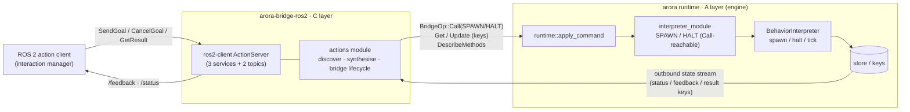
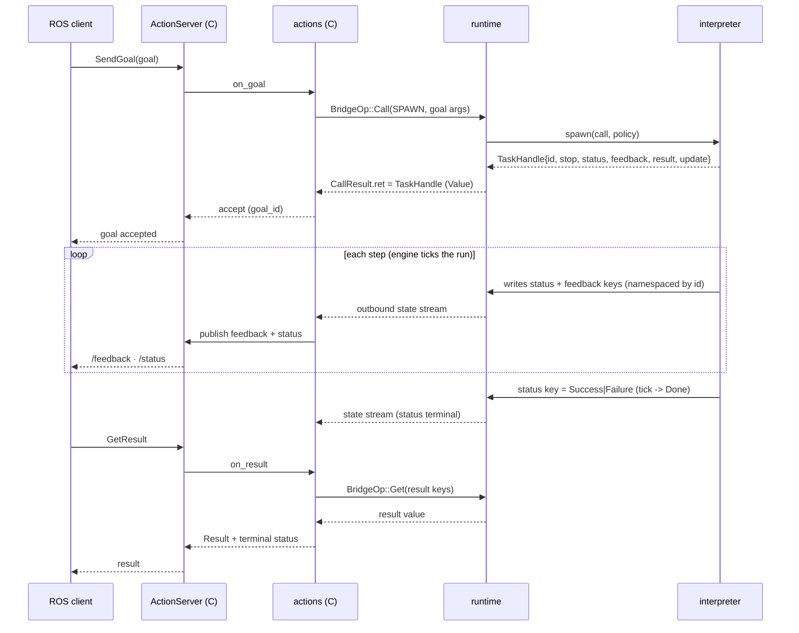
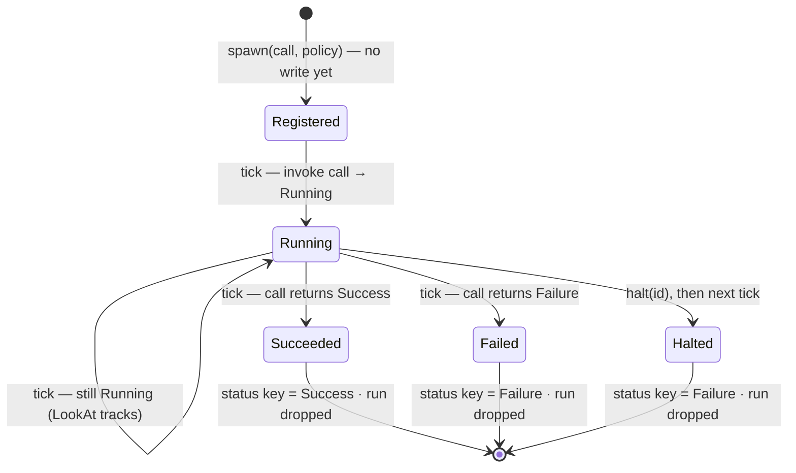
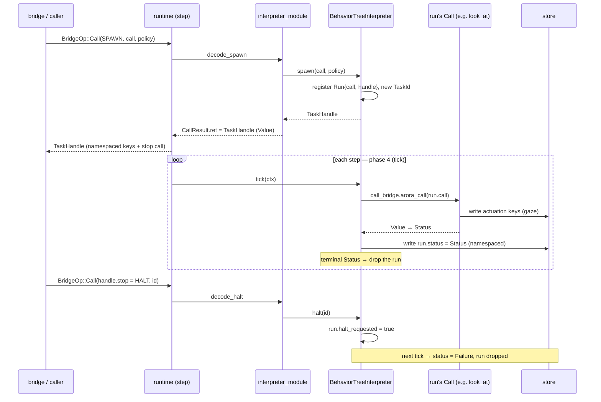

# Task Runs & ROS 2 Actions on Arora — proposal

Status: **the A layer (engine execution) is implemented; the C layer (ROS
bridge) is not yet built.** What has landed:

- `BehaviorStatus` terminal-fault case ([arora-sdk #189]) — §2.1.
- `TaskId`/`RunPolicy`/`TaskHandle` as built-in Arora types ([#195]) — §§2.3–2.5.
- `interpreter_module` `SPAWN`/`HALT` ([#197]) and the runtime wiring ([#199]) —
  §§2.6–2.7.
- **`BehaviorInterpreter::spawn`/`halt` implemented in the behavior tree**
  ([#200]) — §2.2, with the state and call diagrams in §2.2.1. This is what
  makes a run *live*: before it, the trait methods default-rejected.

Still to build: the `actions` module in `arora-bridge-ros2` (§2.9), i.e. the ROS
mapping itself. See the note in §2.11 — the typed `ActionServer` cannot carry
the runtime-synthesised message types, so C must stand up the action's endpoints
**raw** (a correction to the original sketch).

[arora-sdk #189]: https://github.com/semio-ai/arora-sdk/pull/189
[#195]: https://github.com/semio-ai/arora-sdk/pull/195
[#197]: https://github.com/semio-ai/arora-sdk/pull/197
[#199]: https://github.com/semio-ai/arora-sdk/pull/199
[#200]: https://github.com/semio-ai/arora-sdk/pull/200

Companion to [`ros4hri_face-proposal.md`](./ros4hri_face-proposal.md), which is
the driving use case: the ROS4HRI face needs exactly one action, `LookAt`
(`interaction_skills/action/LookAt`), while `set_expression` stays a
fire-and-forget topic (`ros4hri_face-proposal.md:13`). The mechanism below is
general — "Arora gains a general mechanism for exposing long-running,
cancellable behaviors ('task runs') to any bridge" (`ros4hri_face-proposal.md:1`).

## 0. Thesis: C-over-A, with C only in the ROS layer

Two layers, and the engine never learns the word "action":

- **A — execution (engine).** A *task run* is a long-running, cancellable
  behavior. The `BehaviorInterpreter` gains a way to **spawn** a run from a
  `Call` and **halt** it, returning a serializable **`TaskHandle`**. Runs tick
  concurrently under the one interpreter; how they are hosted (a behavior-tree
  subtree, a node-graph subgraph) is the interpreter's private business.
- **C — mapping (ROS bridge).** A new `actions` module in `arora-bridge-ros2`
  maps ROS 2 actions to task runs: it discovers action-shaped functions,
  synthesises the ROS `Goal`/`Feedback`/`Result` messages, runs a
  `ros2-client` `ActionServer`, and drives the goal lifecycle over the existing
  `BridgeOp` command plane and the store's key stream. C is entirely
  ROS-specific and lives entirely in the bridge.

Explicitly **out of scope / not built now**: a native `Action` export kind in
the engine; a new `BridgeOp` variant; a conflict scheduler with
resource-claims (default policy only — see §2.4); async `CallBridge`.

Why this split — a ROS action decomposes (per
[the spec](https://design.ros2.org/articles/actions.html)) into three services
(`SendGoal`, `CancelGoal`, `GetResult`) and two topics (`feedback`, `status`).
`ros2-client` already implements that protocol (`ActionServer`), and #188
already established the pattern for exposing an engine surface to ROS (module
methods → services). Actions are the long-running generalisation of #188, one
notch up, on the same `Bridge` plane — never the HAL, which has no command,
method, or discovery surface.

## 1. Architecture

### 1.1 Layer / data-flow diagram



Two planes cross the bridge, and they land differently:

- **Lifecycle plane** (start / cancel) → `BridgeOp::Call` (to `SPAWN` / `HALT`).
  No new `BridgeOp` variant.
- **Data plane** (feedback / status / result) → store **keys**, which the
  bridge already consumes as the outbound state stream (the topic plane). No new
  op; `Result` is a `Get` at terminal.

### 1.2 Call sequence — SendGoal → spawn → stream → GetResult



### 1.3 Call sequence — CancelGoal → halt, and live goal update

```mermaid
sequenceDiagram
  participant Cli as ROS client
  participant AS as ActionServer (C)
  participant ACT as actions (C)
  participant RT as runtime
  participant BI as interpreter
  Cli->>AS: CancelGoal(goal_id)
  AS->>ACT: on_cancel
  ACT->>RT: BridgeOp::Call(handle.stop)
  RT->>BI: halt(id)
  BI-->>RT: status key -> canceled/terminal; run dropped next tick
  ACT-->>AS: CANCELED
  AS-->>Cli: canceled
  Note over Cli,ACT: A moving LookAt target: Cli republishes goal -> ACT: BridgeOp::Update(handle.update keys)
```

### 1.4 How the interfaces communicate

- **`BehaviorInterpreter`** (engine trait) — `spawn`/`halt`/`tick`; the only
  thing that knows how its graph hosts a run.
- **`interpreter_module`** — the seam that makes `spawn`/`halt` reachable as
  `Call`s (exactly as `LOAD`/`EDIT` are today), so the bridge drives them over
  `BridgeOp::Call`.
- **`BridgeOp`** — the command plane: `Call` (spawn/halt), `Get`/`Update`
  (result/live inputs), `DescribeMethods` (discovery). Unchanged.
- **store / key stream** — the data plane: feedback/status/result are keys; the
  bridge already receives every state change.
- **`ros2-client` `ActionServer`** — the ROS protocol (services + topics +
  `GoalStatus`); C fills its callbacks, never re-implements it.

## 2. Components — names, locations, intent, spec

### 2.1 `BehaviorStatus` — the interpreter's *scheduling* status (gains a terminal-fault case)

`enum BehaviorStatus { Running, Done }` today — `crates/arora-behavior/src/lib.rs:48`,
returned by `tick`. **Intent:** tells the runtime whether to tick the behavior
again or drop it. **Spec / caveat:** this is *not* the action outcome — it
carries no `Success`/`Failure`. The `Running`/`Success`/`Failure` tri-status
that ROS needs is the behavior-tree node `Status` (behavior-tree schema), an
*application* value, and for a run it is surfaced on the run's **status key**
(§2.3). Do not map `BehaviorStatus` to `GoalStatus`; map the status key. (This
corrects the sparring shorthand "the tick returns `Status`.")

**The prerequisite change (decided, its own PR before any task-run type lands):**
`BehaviorStatus` gains a *terminal-fault* case:

```rust
pub enum BehaviorStatus {
    Running,                          // non-terminal: tick me again next step
    Done(Result<(), BehaviorError>),  // terminal: Ok(()) clean; Err(_) faulted (dropped, NOT retried)
}
```

**Shape (decided in sparring).** Liveness is *one bit* — `Running` vs terminal
`Done` — and the terminal outcome is the *payload* of `Done`, not a parallel
`Error` variant. `T` is `()`: a behavior does not *return* a value, it writes its
outputs to store keys, so there is no success payload to carry (and the runtime
would have nowhere to route one). `E` is the diagnostic `BehaviorError`.

**Why this is needed and what it is *not*.** The runtime already proves the gap:
in `tick_behavior` (`crates/arora/src/runtime.rs`), an `Err(BehaviorError)` from
`tick` is a **transient/retry** channel — the interpreter stays installed and
ticks again next step, the failure only raised on the standing `behavior_error`
watch. There is therefore no way today to say *"I finished, and I failed."*
`Done(Err(e))` is exactly that missing **terminal** fault: `Ok(Done(Err(e)))`
drops the interpreter (like `Done(Ok(()))`) **and** surfaces `e` on the
`behavior_error` watch (like `Err`), whereas `Err(e)` keeps-and-retries. Two
dispositions that differ in what the runtime does — the whole justification for
both channels existing. `BehaviorStatus` therefore drops `Copy` (`Clone` stays);
`tick` keeps its `Result<BehaviorStatus, BehaviorError>` signature.

**Scope boundary — this is liveness + disposition, not outcome.** `Done` is
deliberately *not* split into `Success`/`Failure`. The feature this proposal
builds (spawn → *N* concurrent runs under one `tick()`, §2.2) forces per-run
outcomes onto per-run **status keys**: one interpreter-level `tick()` cannot
return one run's success/failure while hosting many. So the `Running`/`Success`/
`Failure`(/`Error`) *outcome* is the **`Status` value** on the run's status key,
and that is the type C maps to `GoalStatus`. `BehaviorStatus` carries only what
the *runtime* must act on — keep / drop-clean / drop-faulted — because the
runtime is indifferent to success-vs-failure but not to clean-vs-faulted.

**The second, separate "error case" — the `Status` *value*.** The
behavior-tree `Status` enum (`{Running, Success, Failure}`,
`crates/arora-behavior-tree-types/src/status.rs`, a registered Arora Value type
id `325a5767-…`) is the one a run writes to its status key and the one C maps to
ROS. For ROS `ABORTED`-with-a-reason (LookAt's Result is an errno,
`ros4hri_face-proposal.md:14`) it wants an `Error(Value)` variant carrying a
*structured* payload. This is a distinct change (a new registered variant in
`arora-behavior-tree-types`, versioned per [[semio-rust-crate-versioning]]) from
the `BehaviorStatus` change above — do not conflate them. It is the value the
`status`-key decorator/filter of §2.3-Q2 forwards.

### 2.2 `BehaviorInterpreter` — gains `spawn` / `halt`

`pub trait BehaviorInterpreter` — `crates/arora-behavior/src/lib.rs`. Alongside
`tick` (→ `BehaviorStatus`), `apply(GraphDiff)` (default impl), and `load(Graph)`
(default impl), the trait gained these two — default-rejecting, so only an
interpreter that opts in hosts runs; the behavior tree does so in [#200]
(see §2.2.1):

```rust
/// Spawn `call` as a concurrent run under `policy`; return its handle.
/// Non-blocking — the run advances with `tick()`; its lifecycle is observed
/// through the handle's keys. Realised however the interpreter hosts graphs
/// (a parallel BT subtree; a node-graph subgraph) — often internally an
/// `apply(GraphDiff)` of an interpreter-specific fragment.
fn spawn(&mut self, call: Call, policy: RunPolicy) -> Result<TaskHandle, BehaviorError>;

/// Halt a run (idempotent). Behavior-tree-native "halt": a clean stop that may
/// run compensation, not a hard kill.
fn halt(&mut self, task: TaskId) -> Result<(), BehaviorError>;
```

**Intent:** the one interpreter-agnostic abstraction for "add a concurrent,
tracked, cancellable run." **Spec:** `spawn` is non-blocking and returns
immediately; the run ticks with the normal `tick()`, so concurrency lives in the
interpreter hosting *N* runs (this dissolves the "single interpreter cell"
concern — the cell was only ever limited to one *interpreter*, not one *run*).
Naming rationale: `spawn` names the *concept* (a concurrent unit returning a
handle, per `thread::spawn`/`tokio::spawn`), not the *mechanism* (a graph
apply) — naming it `apply_task` would leak exactly what `TaskHandle` hides.
`halt` is BT-native and free of `abort`'s ROS-failure connotation and `drop`'s
`Drop`-trait overload. `cancel`/`abort` stay ROS-side in C (§2.9).

### 2.2.1 How the behavior tree hosts a run (implemented, [#200])

The `BehaviorTreeInterpreter` (`crates/arora-behavior-tree/src/behavior.rs`) is
the first interpreter to implement `spawn`/`halt`. Its model is deliberately the
minimal faithful one:

- **A run is a `Call` invoked once per `tick`.** The interpreter keeps a map of
  live runs beside its one main tree. `spawn` allocates a `TaskId`, namespaces
  the handle's keys, and registers the run — it does **not** tick it (spawn holds
  no store). `halt` sets a flag. Both are cheap and store-less, exactly like
  `load`/`apply`.
- **The value the call returns is the run's `Status`, redirected to its status
  key.** This *is* the "status decorator" of §3-Q2: rather than a decorator node
  in a subtree, the interpreter itself performs the redirection when it advances
  the run. `Running` keeps the run live; `Success`/`Failure` is terminal.
- **The run advances in `tick` (which owns the store).** Each tick, for every
  live run, the interpreter invokes the run's `Call` through the call bridge,
  converts the result to a `Status`, and writes it to the run's status key. A
  `halt`ed run is not invoked — it ends `Failure` (the engine has no "canceled"
  outcome of its own; the ROS layer that issued the cancel is what reports
  `CANCELED`, §2.9). A terminal run is dropped after its final write; its keys
  persist in the store for the observer to read.
- **Liveness.** While any run is live the interpreter reports `Running`, so the
  runtime keeps it installed to keep ticking the runs. A loaded main tree keeps
  its run-once semantics — it runs once, then is dropped so it does not re-run
  each tick while a run holds the interpreter open.

Actuation (the gaze the LookAt run drives) is written by the run's *function*,
which a device wires as a host function capturing the store/HAL — not by the
interpreter, which only owns the status key. That keeps actuation on the shared
LWW keys (§2.4) and off the per-run handle.

Where this is minimal, on purpose: a run is *one* `Call`, not yet an arbitrary
mounted subtree. Feedback/result keys are declared on the handle but populated by
the run's function (or, later, by a mounted subgraph); the **status key is the
load-bearing signal** the ROS layer maps. Richer hosting (a real parallel
subtree, compensation on halt, resource-claim policies) is future work behind the
same unchanged `spawn`/`halt` interface.

#### Run lifecycle — state diagram

The status key an observer watches moves through exactly these states:



`Registered` is the gap between `spawn` (which returns the handle) and the first
`tick` (which makes the first write) — a run is observable only from its first
tick. `Halted` writes `Failure`; C distinguishes it from a spontaneous `Failed`
because C is the one that issued the halt (it maps its own cancel → `CANCELED`).

#### Drive path — call diagram (behavior-tree implementation)

How a spawn, the per-step advance, and a halt flow through the device:



### 2.3 `TaskHandle` — the serializable contract (NEW)

**Location (decided): `crates/arora-behavior`**, beside `BehaviorInterpreter`
(it is that trait's return type). It is **exported as a built-in Arora type**
(registered like the behavior-tree `Status`, so it has a stable type id and
round-trips through `value_serde`) — that is what lets the bridge name it in a
`CallResult.ret` without an `arora-behavior` *code* dependency: the bridge reads
it as a `Value` off the value plane, not as a Rust struct. See §3-Q3.

```rust
struct TaskHandle {
    id: TaskId,
    stop: Call,          // how to stop it — a Call the caller issues (→ halt(id))
    status: Key,         // the run's lifecycle (Running/Success/Failure); C watches for terminal
    feedback: Vec<Key>,  // Feedback-message fields (homogeneous)
    result: Vec<Key>,    // Result-message fields, written at terminal
    update: Vec<Key>,    // live goal inputs the caller may push (e.g. a moving target)
}
```

**Intent:** everything the bridge needs to run the goal lifecycle, as *data*, so
it crosses `BridgeOp` (returned as a `value_serde` `Value` in `CallResult.ret`,
exactly like `MethodSignature`). **Spec:**

- `stop` is a `Call`, not a callback — that is what makes "how to stop it"
  serializable and lets C issue `BridgeOp::Call(handle.stop)` on cancel with no
  knowledge of interpreter internals.
- `status` is singular and special *by position* (not a tag type): C observes it
  for `EXECUTING → SUCCEEDED/ABORTED` and to know when to resolve `GetResult`.
  (Earlier draft used a role-tagged `Vec<Keyed>`; pulling the one special role
  into its own field leaves `feedback` a plain `Vec<Key>` — strictly more
  minimal.)
- `feedback`/`result`/`update` are plain `Vec<Key>`: within each, keys are peers
  (the fields of one message — one struct-key, or several field-keys under the
  exposure binding: "a structured message → several keys",
  `ros4hri_face-proposal.md:30`).
- All of `status`/`feedback`/`result` keys are **per-run namespaced** (allocated
  by the interpreter under `id`) so concurrent goals demux; the run's
  **actuation** writes (gaze) stay on the *shared* standard keys (last-write-wins
  — §2.4) and are **not** in the handle (they belong to the topic plane).

### 2.4 `RunPolicy` — reserved, `Concurrent`-only for v1 (NEW)

```rust
enum RunPolicy { Concurrent /*, Preempt, Queue, Blend, Reject … (reserved) */ }
```

**Intent:** future-proof the interface for conflict resolution without building
it. **Spec (v1):** only `Concurrent` is honoured — runs tick together and
overlapping actuation keys are last-write-wins (two `LookAt`s will fight and
jitter; acceptable for v1). Richer policies need resource-claims (a run's
*claim* = its bound actuation keys; conflict = claim overlap), deferred; when
they land, the **interpreter** arbitrates, because it is the only thing that
sees all runs. ROS hands us the per-request override channel already:
`Meta.priority` is replace-or-reject (`ros4hri_face-proposal.md:14`).

### 2.5 `TaskId` (NEW)

A serializable run identity (e.g. a `Uuid`). **Intent:** correlate the handle,
its namespaced keys, and `halt`. **Spec:** unique per live run; the namespacing
root for the run's status/feedback/result keys.

### 2.6 `interpreter_module` — `SPAWN` / `HALT` (NEW consts + decoders)

`crates/arora-behavior/src/interpreter_module.rs`. Today: `ID` (`:33`), `EDIT`
(`:36`) + `EDIT_ARG` (`:40`), `LOAD` (`:43`) + `LOAD_ARG` (`:47`), `decode_edit`
(`:55`), `decode_load` (`:65`). **Intent:** make `spawn`/`halt` reachable as
`Call`s, so the bridge (and any behavior) drives them through the normal
dispatch — the same trick `LOAD`/`EDIT` use. **Spec:** add `SPAWN`/`HALT` (+
their arg ids) and `decode_spawn`/`decode_halt`; the runtime routes a `Call` to
`interpreter_module::ID`+`SPAWN` into `BehaviorInterpreter::spawn` via
`with_interpreter`, returning the `TaskHandle` as the `CallResult.ret`.

### 2.7 Runtime dispatch — `apply_command` / `with_interpreter`

`crates/arora/src/runtime.rs`: `apply_command` (dispatches `BridgeOp`) and
`with_interpreter` (borrows the single interpreter cell to run
`interpreter_module` functions). **Intent:** the existing seam that turns a
`BridgeOp::Call` targeting the interpreter module into an interpreter method
call. **Spec:** no new `BridgeOp` arm; `SPAWN`/`HALT` ride the existing
`BridgeOp::Call(call) => call_bridge.arora_call(call)` path, and
`with_interpreter` gains `spawn`/`halt` closures beside `load`/`apply`
(`crates/arora/src/lib.rs`, where the interpreter module is built with `LOAD`/
`EDIT`).

### 2.8 `BridgeOp`, `MethodSignature`, `DescribeMethods` — reused

`crates/arora-bridge/src/lib.rs`. `BridgeOp::{Get, Update, Call, ListKeys,
DescribeMethods}` and `MethodSignature { module_id, id, name, function:
frozen::Function }`; `DescribeMethods` encodes `Vec<MethodSignature>` over the
value plane via `value_serde::to_value` (landed in #188 / `809b26e1`).
**Intent:** discovery + the lifecycle/data ops, unchanged. **Spec for actions:**
C filters `DescribeMethods` for the **action shape** (§2.10). No new op or
struct is required in `arora-bridge` for actions.

### 2.9 `actions` module in `arora-bridge-ros2` (NEW, mirrors `services`)

Proposed `crates/arora-bridge-ros2/src/actions.rs`, a sibling to
`crates/arora-bridge-ros2/src/services.rs` (the #188 method→service plane, which
it mirrors one notch up). **Intent:** the whole C layer. **Spec — four jobs:**

1. **Discover:** filter `DescribeMethods` for action-shaped functions (§2.10),
   as `services::resolve` filters methods.
2. **Synthesise the three ROS messages:** `Goal` from the in-args, `Feedback`
   from the feedback outbounds, `Result` from the result outbound — each a
   `ty::low::Type` through the same `arora_msgs_ros2::cdr` codec + `registry`
   `services.rs` uses (`services::request_type`/`response_type` are the
   template; there are three messages here, not a request/response pair).
3. **Serve:** create a `ros2-client` `ActionServer` (§2.11); fill its callbacks.
4. **Bridge the lifecycle:** `on_goal → BridgeOp::Call(SPAWN, goal) →
   TaskHandle`; feedback/status ride the `TaskHandle` keys on the outbound
   stream → `/feedback` + `/status`; `on_result → BridgeOp::Get(handle.result)`
   at terminal; `on_cancel → BridgeOp::Call(handle.stop)`; live goals →
   `BridgeOp::Update(handle.update)`. Maps `Status ↔ GoalStatus`
   (`Running→EXECUTING`, `Success→SUCCEEDED`, `Failure→ABORTED`, halt→`CANCELED`)
   — the ROS words `cancel`/`abort` live *here*, not in the engine.

### 2.10 The action-shape convention — the Result marker is ROS-side (decided)

For C to reconstruct `Goal`/`Feedback`/`Result`, it needs two bits:

- **"this function is an action":** it produces a run — i.e. its call yields a
  `TaskHandle` (a `spawn`-exposed run). C keys off that, engine-side, not off a
  plain return type. This is the one thing A must express.
- **"which outbound carries the Result":** **decided — this lives ROS-side, not
  in the engine.** The engine has no `Result` concept; it exposes a run with a
  set of outbound keys (`TaskHandle.feedback`/`result`/`status`). *Which* of
  those outbounds carries the ROS `Result` value is a selection made in the
  bridge's action binding — "simply selecting the outbound variable that will
  carry that value." So C's action config names the result outbound; everything
  else outbound is `Feedback`; `Goal` is the in-args. This keeps A free of any
  ROS-specific "this is the result" marker (it would otherwise pull ROS
  vocabulary into the engine — [[feedback-private-by-default]] / keep the engine
  ROS-agnostic). The corresponding `TaskHandle.result` field is therefore
  *populated by C from its binding*, or left for C to pick among the run's
  outbound keys — see §3-Q1.

### 2.11 `ros2-client` `ActionServer` / `AsyncActionServer`

`ros2-client` (fork `ros2-client-multi-rmw`) `src/action/server.rs`,
`src/action/client.rs`, `src/action.rs` — `ActionServer`, `AsyncActionServer`,
goal handles (`AcceptedGoalHandle`/`ExecutingGoalHandle`/`CancelHandle`),
`FeedbackMessage`, `GoalStatusEnum`, `CancelGoal`. **Intent:** the ROS action
protocol (3 services + 2 topics + status machine) on both backends.

**Correction — the typed `ActionServer` cannot be the surface here.**
`ActionServer<A>` is generic over a *compile-time* `A: ActionTypes` whose
`Goal`/`Result`/`Feedback` are `Message + Clone` Rust types. The bridge
synthesises those message types **at runtime** from `DescribeMethods`, so it has
no static `A` to instantiate — exactly the wall #188 hit for services, which is
why #35 added `RawServer`. So C must stand up the action's endpoints **raw**,
decomposing the action the way ROS itself does (see `create_action_server`):

| endpoint | kind | message type | raw? |
| --- | --- | --- | --- |
| `…/_action/send_goal` | service | `SendGoal_{Request,Response}` (wraps the synthesised **Goal**) | **raw** (`RawServer`, #35) |
| `…/_action/cancel_goal` | service | `action_msgs/CancelGoal` (fixed) | raw or typed |
| `…/_action/get_result` | service | `GetResult_{Request,Response}` (wraps the synthesised **Result**) | **raw** (`RawServer`) |
| `…/_action/feedback` | topic | `FeedbackMessage` (wraps the synthesised **Feedback**) | **raw publisher** — see below |
| `…/_action/status` | topic | `action_msgs/GoalStatusArray` (fixed) | typed publisher (`create_publisher`) |

The three synthesised messages are built as `ty::low::Type`s and driven through
the same `arora_msgs_ros2::cdr` codec + registry `services.rs` uses. Two wire
details to get right: the `SendGoal`/`GetResult` request/response wrappers carry
a `GoalId` (`unique_identifier_msgs/UUID` = `uint8[16]`), which must be a
**`TypeRef::FixedArray`** (16 bytes inline, no CDR length prefix), not a
sequence; and the `GetResult` response leads with an `int8` status before the
result struct.

**Gap: there is no raw publisher yet.** `ros2-client` has `RawServer` (for the
three services) and typed publishers (for the fixed-type `status`), but no raw
*publisher* for `feedback`'s synthesised type. Two ways forward: (a) add a
`create_raw_publisher` to `ros2-client`, mirroring `RawServer` (the clean fix,
upstream, its own release); or (b) ship the goal/cancel/result/status lifecycle
first and defer `feedback` (LookAt's feedback is "near-vestigial",
`ros4hri_face-proposal.md:14`) — logging that it is not yet published (no silent
cap). `status` — the load-bearing lifecycle signal — is a typed publish and needs
neither.

## 3. Consistency review (proof-read)

Corrected while writing:

- **`BehaviorStatus` is liveness + disposition, not outcome.** Today
  `{Running, Done}`; this proposal makes the terminal case carry a fault —
  `Done(Result<(), BehaviorError>)` (§2.1) — but it never carries
  `Success`/`Failure`. The
  sparring line "the tick returns `Status`, which is the action status" is wrong.
  Resolution baked into the design: the ROS-relevant `Success`/`Failure`/errno is
  an *application* status carried on the run's **status key** as the `Status`
  *value* (which itself gains `Error(Value)`, §2.1), not the interpreter's tick
  return. This is the single most important distinction here, and it is why
  there are two independent "add an error case" changes.
- **`Result` shape:** settled as `Vec<Key>` (a message's fields), consistent
  with `feedback`/`update`; earlier prose that wrote `result: Key` (singular) is
  superseded by §2.3.
- **`spawn` vs `apply`:** `spawn` is the *interface*; an `apply(GraphDiff)` of an
  interpreter-specific fragment is one valid *implementation*. Naming it after
  the mechanism (`apply_task`) is rejected (§2.2). Consistent.
- **Single interpreter cell vs concurrency:** resolved — the cell hosts *N*
  runs, ticked by one `tick()`; concurrency is not blocked by the single cell
  (§2.2).

Open questions — **all resolved in sparring (2026-07-28)**; kept here with the
decision and its rationale:

1. **The Result-vs-Feedback outbound marker → RESOLVED: ROS-side (§2.10).** A
   carries only "this is a run" (yields a `TaskHandle`). *Which* outbound is the
   ROS `Result` is selected in C's action binding — "selecting the outbound
   variable that will carry that value." No engine-side Result marker; the
   engine stays ROS-agnostic. Implementation: C's per-action config names the
   result outbound key; `TaskHandle.result` is filled from that binding.
2. **How a run writes its `status` key → RESOLVED: the interpreter writes it,
   arbitrarily, by construction.** "The status key is written arbitrarily by the
   `BehaviorInterpreter`." Concretely, per interpreter kind:
   - **Behavior tree:** a dedicated **status decorator** wrapping the run's root
     that *redirects the node's status return value* (`Status` — now
     `{Running, Success, Failure, Error(Value)}`, §2.1) to the run's `status`
     key.
   - **Node graph:** a **type-dependent filter** node that *forwards an existing
     `Status`-typed value* to the `status` key, or **emits `Running`
     indefinitely** when the graph produces no terminal status (matches LookAt's
     indefinite tracking).
   So `status` is not a new engine primitive — it is an ordinary graph
   construct the interpreter inserts when it hosts a run. The `Status`-value
   `Error(Value)` case (§2.1) is what carries LookAt's errno to `Result`.
3. **`TaskHandle` home → RESOLVED: `arora-behavior`, exported as a built-in
   Arora type** (§2.3). The bridge names it as a `Value` off the value plane, so
   no `arora-behavior` code dependency in `arora-bridge-ros2`.
4. **Key namespacing → RESOLVED: `arora/tasks/<module>/<function>/<run_id>/*`**
   for a run's own keys (`status`/`feedback`/`result`/`update` live under this
   prefix, demuxing concurrent goals by `run_id`). The run's **actuation** writes
   (gaze) stay on the *shared* standard keys (LWW, §2.4) and are not under the
   task prefix. `<module>`/`<function>` identify the action-behavior; `<run_id>`
   is the `TaskId`. The exposure profile (`ros4hri_face-proposal.md:30`) binds
   goal fields to the `update` keys under this prefix.
5. **`RunPolicy` surface → RESOLVED: reserve it on `spawn` now** (§2.4). `spawn`
   takes `policy: RunPolicy`; v1 honours only `Concurrent`; the enum reserves the
   richer variants. The interface is the expensive thing to change, so it takes
   the parameter from day one.

## 4. Worked example — `LookAt`

- ROS: `interaction_skills/action/LookAt`. Goal = a policy (`random`/`social`/…)
  or a `PointStamped` target; `Meta.priority` for preempt-or-reject; Feedback =
  a near-vestigial scalar; Result = an errno code; tracks *indefinitely*
  (`ros4hri_face-proposal.md:14`).
- A: a `look_at` action-behavior spawned via `Call(SPAWN, {policy|target, meta})`
  → `TaskHandle`. It writes shared **gaze** actuation keys (LWW) and per-run
  `status`/`feedback`/`result` keys. It returns `Running` forever (indefinite
  tracking) — no `Success` on its own; termination is the caller's `CancelGoal`
  (→ `halt` → `status` = canceled → Result errno `ROS_ECANCELED`) or a `Failure`
  it decides. A moving target arrives as `BridgeOp::Update(handle.update)`.
- C: the `actions` module stands up the `LookAt` `ActionServer`, maps the
  lifecycle as in §1.2/§1.3.

`set_expression` is the deliberate contrast: it stays a topic
(`ros4hri_face-proposal.md:13`), even though it runs a ~200 ms blend internally
(`:19`) — internal execution ≠ external interface. It needs none of this.
