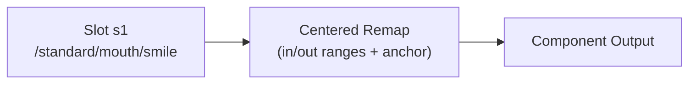
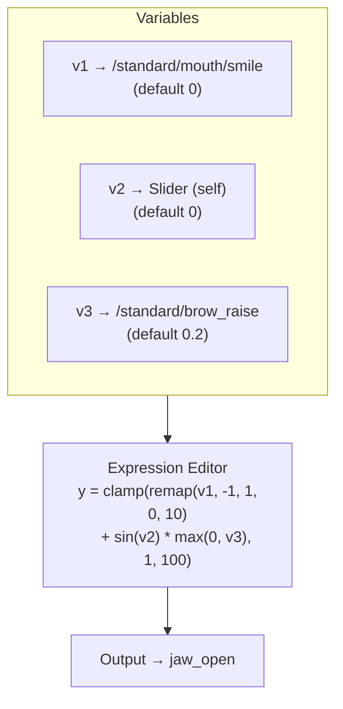
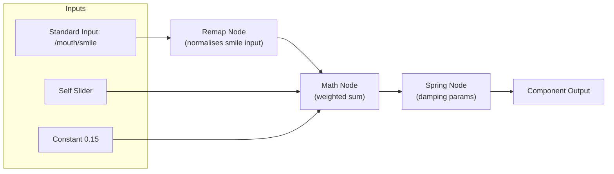
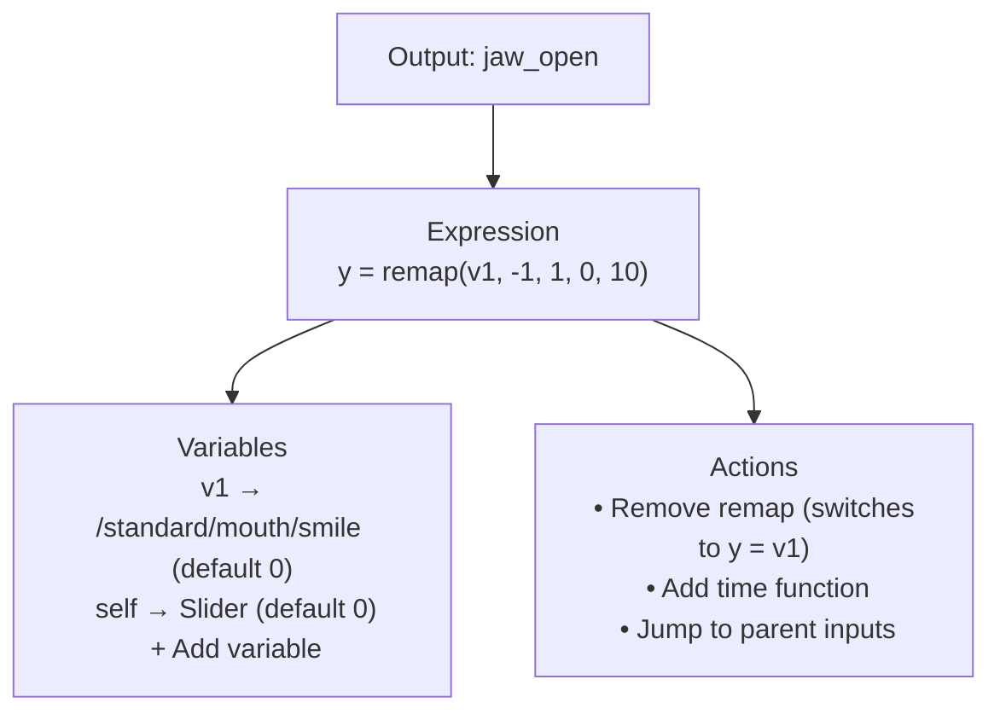
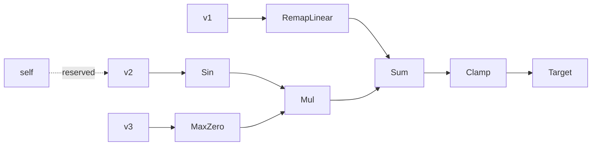

# Expression-Driven Binding Authoring Proposal
<!-- tags: status=proposal; topics=graph-ir,ui-ux,workflow,tooling -->

## Overview
- Shift the authoring mental model from “each binding tweaks a remap” to “each animatable output is described by an expression composed from variables.”
- Auto-create a single variable/input per animatable property (matching today’s behaviour), including a recommended remap that authors can remove with one click.
- Let authors add more variables bound to other inputs, intermediate nodes, or the reserved `self` source, then build expressions using the full graph vocabulary (math, logic, time functions, remaps, vector helpers).
- Preserve neutral pose behaviour by keeping defaults on the nodes/variables and updating them when remaps are toggled.
- Provide an incremental migration path so existing projects load unchanged while we unlock richer expression authoring.

## Background
The Vizij authoring app currently builds rig bindings that look like:

1. **Animatable component** creates a binding with one primary slot pointing at either a standard input or self slider.
2. The binding stores `RemapSettings` on the binding and slot, forcing every author to deal with remap fields up front.
3. Optional operator arrays (`spring`, `damp`, `slew`) attach to the binding.
4. An expression string references slot aliases to drive the target component or child binding.

At runtime, driver graphs translate each binding into a `RigDriver` with one `centered-remap` transform node between the selected source and target component. Bindings technically support multiple slots/inputs today, but the tooling assumes a single “primary” slot, reinforcing the single-input mental model.

This structure works, but the UI and state shape make the remap appear to be *the* definition of a binding rather than *one* possible transform in the pipeline.

## Pain Points
- **Limited mental model:** Authors equate “binding = remap,” which makes it hard to explain richer processing chains or new node types.
- **Poor extensibility:** Adding new transforms (noise, offsets, gating) would require bolting them onto the binding object rather than composing nodes.
- **Defaults locked to containers:** Input/output defaults live in helper functions, but the binding itself owns the values. This scatters “neutral pose” logic across several utilities.
- **Expression opacity:** Expressions are simple alias math, with no reflection of the underlying nodes or parameters. That makes evaluating or visualising the pipeline difficult.

## Goals
1. Present bindings as **expression-driven outputs**: `Output = f(v1, v2, …)` with variables bound to inputs or other graph nodes.
2. Keep variable defaults and transform parameters **close to their sources** so neutral pose reasoning stays simple.
3. Support the full node graph vocabulary (math, logic, vector, time) without schema churn.
4. Preserve existing projects seamlessly during migration.
5. Give authors clearer insight into how defaults propagate from inputs through expressions to outputs.

## Proposed Concept

### Core Entities
- **Animatable Outputs:** Every animatable property (or intermediate node) owns an expression `y = …`. Outputs carry metadata (range, default value, component reference).
- **Variables:** Named aliases (`v1`, `mouthSmile`, `self`, etc.) bound to sources. Sources can be standard inputs, other outputs’ results, constants, or graph parents. Variables expose their own defaults.
- **Expression Language:** Extended scalar/vector expression syntax that maps to graph nodes (`remap`, `clamp`, `sin`, `log`, `damp`, `slew`, `oscillator`, `if`, `case`, vector constructors, etc.).
- **Transforms as Functions:** Instead of forcing a remap node in the binding schema, transforms appear as expression helpers. The recommended linear remap is inserted by default but can be removed.
- **Targets / Outputs:** Evaluating the expression produces the target output value, which is written to an animatable component or passed to another graph node.
- **Intermediate Representation (IR):** A TypeScript data model mirrors the expression and variable bindings, then compiles to the final `GraphSpec` once authors finish editing.

### Visual Overview

**Today’s Mental Model**



The UI reinforces a single primary slot, making the remap feel like the entire binding.

**Proposed Expression Model**



Bindings become expressions assembled from variables; remap is a recommended helper rather than a forced slot property.



Bindings become pipelines composed of multiple inputs and ordered transform nodes, ending in an output target.

### Binding Representation Sketch
```ts
interface BindingExpression {
  targetId: string;                   // animatable component or intermediate node id
  variables: Record<string, VariableBinding>;
  expression: string;                 // e.g. "y = clamp(remap(v1, -1, 1, 0, 10) + sin(v2), 0, 1)"
  metadata: {
    defaultOutput: number;            // derived from animatable range/default
    recommendedRemap?: RemapParams;   // used to seed expression and defaults
  };
}

interface VariableBinding {
  sourcePath: string;                 // canonical path to input/output in graph tree
  kind: "input" | "output" | "constant" | "self";
  defaultValue: number;
  editableDefault: boolean;
  warnings?: string[];
}
```
Expressions are the authoritative binding; the IR compiler translates the variables and functions into graph nodes.

### Example Expression Snapshot

| Variable | Source Path / Meaning             | Default | Notes                                              |
|----------|-----------------------------------|---------|----------------------------------------------------|
| `v1`     | `/standard/mouth/smile`           | 0.0     | Auto-created; recommended remap seeded in `y`.     |
| `v2`     | `/standard/slider/self`           | 0.0     | Reserved `self` alias, always available.           |
| `v3`     | `/standard/brow_raise`            | 0.2     | Added by author to incorporate parent behaviour.   |

Expression:  
```
y = clamp(remap(v1, -1, 1, 0, 10) + sin(v2) * max(0, v3), 1, 100)
```

Removing the remap via the “Remove remap” action rewrites the expression to `y = v1` and updates `v1`’s default so the output still matches the component’s neutral value.

### Graph Hierarchies & Variable Binding
- **Source paths:** Every animatable output and standard input exposes a canonical path (`rig/<faceId>/…`). Variables reference these paths so bindings survive imports and can form hierarchies.
- **Parent/child wiring:** Authors can bind a variable to any upstream node. Intermediate inputs can form trees that eventually feed an output; the expression treats them uniformly as variables.
- **Intermediate results:** Expressions may reference other outputs’ results. The IR compiler recognises dependencies and generates the correct evaluation order.
- **New inputs:** Authors may create custom inputs that aren’t tied to existing outputs. These inputs appear in the variable manager with editable defaults and optional groups.
- **Confirmation workflow:** When editing a variable bound to a shared source, a confirmation modal lists affected outputs before applying the new default.

### Defaults & Neutral Pose
- **Auto-generated defaults:** When a GLB loads, we create one variable per animatable property pointing at the corresponding standard input. The expression starts as `y = remap(v1, inLow, inHigh, outLow, outHigh)` with ranges derived from the animatable metadata. Removing the remap updates `v1`’s default so that `y` still evaluates to the component’s neutral value.
- **Variable defaults:** Each variable keeps a `defaultValue`; editing a variable linked to a shared input prompts for confirmation if other children depend on it, preventing accidental cascades.
- **Transform defaults:** Functions such as `remap`, `clamp`, `damp`, `slew`, `oscillator`, vector ops, and math operators have metadata-driven default parameters exposed in tooltips or inspector panels.
- **Neutral pose tracking:** Pose rig continues to maintain `neutralInputs`, but the expression editor surfaces neutral values directly. A neutral badge appears for variables whose default keeps `y` at the component default.
- **Reserved aliases:** `self` is always available, enabling authors to blend existing output behaviour with new parents without extra slots.

### Authoring UX Shifts
1. **Expression-first Canvas:** Highlight the output expression at the top (`y = …`). Variables list sits alongside the editor for quick binding.
2. **Variable Manager:** Shows each variable’s source path, default value, and warning state. Authors can add variables (suggesting parents or other outputs) and remove the recommended remap with a single click.
3. **Function Palette:** Provides autocomplete/tooltips for supported functions (including time-based helpers) with parameter defaults.
4. **Default Guardrails:** Editing a variable default that affects multiple children prompts for confirmation before the change applies.
5. **Future Node Canvas:** A visual node graph can arrive later, generated from the same expression/variable data. The proposal keeps near-term UI text-based for iteration speed.

### UI Walkthrough (Conceptual)

**1. Output Sheet Overview**



**2. Expression Expansion**

After adding two more variables and editing the expression:

```
Variables:
  v1 → /standard/mouth/smile (default 0)
  v2 → self (default 0)
  v3 → /standard/brow_raise (default 0.2) ⚠️ affects 2 bindings

Expression:
  y = clamp(
        remap(v1, -1, 1, 0, 10)
        + sin(v2) * max(0, v3),
        1,
        100
      )
```

Attempting to change `v3`’s default prompts: “This input drives 2 other outputs. Update defaults anyway?” (confirmation required).

**3. Function Palette & Autocomplete**

```
damp(value, rate, target?)        // default rate from metadata
slew(value, rise, fall)           // default rise/fall shown
oscillator(freq, amp, phase)      // time-based helper
if(cond, whenTrue, whenFalse)
case(cond1: value1, ..., default)
vec3(x, y, z)                     // vector constructor
remap(value, inMin, inMax, outMin, outMax) // recommended helper
```

Inline tooltips show default parameter values and whether the function maps to a scalar or vector node in the IR.

**4. Future Visualisation (Optional)**



This sketch illustrates how the expression could translate into a node graph for future visual editing.

### Intermediate Representation & GraphSpec Emission
- **Expression parser:** Converts the author’s expression into an abstract syntax tree, mapping functions/operators to node templates (e.g., `remap` → linear remap node, `damp` → damping node).
- **Variable resolver:** Looks up each variable’s bound source path, default, and type (scalar/vector). It injects constant nodes if the variable represents a literal.
- **IR graph builder:** Uses shared node metadata (mirroring the Rust registry) to assemble an intermediate graph describing nodes, ports, and parameters.
- **Compiler:** Transforms the IR into `GraphSpec`, reusing existing optimisation passes (constant folding, slot reuse).
- **Validation:** Ensures the compiled graph matches the expression’s expected outputs and flags unsupported constructs early with actionable errors.

### Authoring Mental Model
- **Start with the output:** Every animatable property loads with `y = remap(v1, …)` seeded for neutral behaviour.
- **Introduce more context:** Add variables bound to parents, self, or other outputs via the variable manager.
- **Compose behaviour:** Use expression helpers (`remap`, math functions, logic operators, time functions) to craft the desired output.
- **Guard defaults:** Confirm changes when altering shared input defaults, keeping downstream bindings stable.
- **Iterate visually later:** Optional node visualisation can always be generated from the same expression data, ensuring consistency.

## Migration Plan
1. **Schema Compatibility Layer**
   - Continue storing bindings in the current format.
   - Introduce a derived `BindingExpression` view computed on load (`bindingToExpression`).
   - Editing through the new expression UI rewrites the legacy binding structure via `expressionToBinding`, preserving compatibility with existing graph builders.
2. **Gradual Adoption**
   - Start with read-only expression previews so authors can verify the auto-generated `y = remap(v1, …)` behaviour.
   - Enable expression editing (including the “remove remap” action) once parity with existing remap editing is validated.
   - Expand the expression language incrementally (math parity → logic/time → vector helpers) while updating the IR compiler.
3. **Future Storage Migration**
   - Persist the expression/variable schema directly once stable, with a migration script that backfills older bindings and regenerates legacy fields as needed.

## Impact Assessment
- **Runtime:** Minimal. Driver graph builders already emit remap/math nodes; the IR compiler will assemble equivalent node chains from expressions.
- **Authoring State:** Adds an expression/variable layer computed lazily so existing state objects stay intact during migration.
- **UI:** Significant rework of the binding editor (expression editor, variable manager, function palette, confirmation dialogs).
- **Documentation/Onboarding:** Updated guides to explain outputs, default remaps, variable binding, and the extended expression language.

## Risks & Mitigations
- **Risk: Expression editing feels harder than the current remap sliders.**  
  *Mitigation:* Auto-generate the initial expression with a simple remap, provide quick actions (“remove remap”, “add parent”), and surface inline warnings before errors occur.
- **Risk: Migration bugs causing parameter drift.**  
  *Mitigation:* Build round-trip tests (`binding → expression → binding`) and snapshot evaluations confirming outputs stay identical.
- **Risk: Runtime regressions with new functions.**  
  *Mitigation:* Expand integration tests that compile expressions into graphs and compare node lists/outputs against the previous builder.
- **Risk: Timeline creep due to UI overhaul.**  
  *Mitigation:* Deliver in stages (read-only expression view → editable remap experience → full variable manager → advanced functions).

## Open Questions
1. How do we version/calibrate the expression language so saved projects survive future function additions?
2. What UX affordances do we need for vector outputs (multi-component expressions, shared variables)?
3. How should we visualise shared inputs with many children so confirmation dialogs stay clear?
4. What analytics/logging will help gauge adoption of advanced functions (time-based, logic)?

## Next Steps
1. Align with design on the expression/variable editor flows and confirmation dialogs.
2. Spike a `bindingToExpression` converter covering default remap generation, variable binding, and self alias handling.
3. Prototype a read-only expression panel behind a feature flag for internal feedback.
4. Document updated onboarding flows (default remap removal, variable management, time-based functions).
