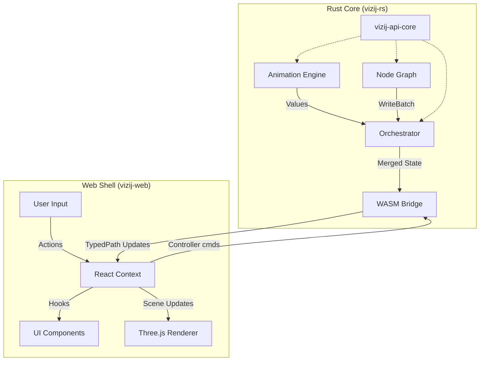

# Vizij Runtime Architecture (2025)

> **Status**: Living Document
> **Last Updated**: 2025-12-04

This document provides a comprehensive report on the architecture of the Vizij runtime. It covers the core Rust logic, the WebAssembly (WASM) bridge, and the React-based consumption layer.

## Table of Contents

1.  [High-Level Overview](#1-high-level-overview)
2.  [System Architecture Diagram](#2-system-architecture-diagram)
3.  [The Rust Core (`vizij-rs`)](#3-the-rust-core-vizij-rs)
    *   [Animation Stack](#animation-stack)
    *   [Node Graph Stack](#node-graph-stack)
    *   [Orchestrator Stack](#orchestrator-stack)
    *   [Shared Tooling & API](#shared-tooling--api)
4.  [The Web Shell (`vizij-web`)](#4-the-web-shell-vizij-web)
    *   [React Runtime](#react-runtime)
    *   [Renderer & Visuals](#renderer--visuals)
    *   [Authoring & Applications](#authoring--applications)
5.  [Strategic Goals & Future Roadmap](#5-strategic-goals--future-roadmap)
6.  [Data Flow & Contracts](#6-data-flow--contracts)
7.  [Build & Release Lifecycle](#7-build--release-lifecycle)
8.  [Runtime Observability](#8-runtime-observability)

---

## 1. High-Level Overview

Vizij is designed as a **"Rust Core, Web Shell"** system. This architecture prioritizes performance, determinism, and portability for the core logic, while leveraging the rich ecosystem of the web for UI and rendering.

*   **Rust Core (`vizij-rs`)**: The "brain" of the system. It handles all math, graph evaluation, animation sampling, and state management. It is designed to be engine-agnostic (usable in Bevy, Godot, or server-side) and compiles to WebAssembly for the browser.
*   **Web Shell (`vizij-web`)**: The "body" of the system. It consumes the WASM artifacts via standard NPM packages. It handles user input, 3D rendering (via Three.js), and application state (via React).

**Key Benefit**: The web application *never* compiles Rust. It consumes pre-built WASM binaries as standard dependencies, decoupling the build pipelines and allowing web developers to work without a Rust toolchain.

---

## 2. System Architecture Diagram

---

## 3. The Rust Core (`vizij-rs`)

**Summary**: The `vizij-rs` workspace is the single source of truth for all runtime semantics. It owns the definition of "Values", "Shapes", and "TypedPaths". It is organized into three primary stacks, each with a `*-core` crate (logic) and a `*-wasm` crate (bridge).

### Animation Stack
*   **`vizij-animation-core`**: A deterministic, engine-agnostic animation engine. It handles:
    *   **Track Sampling**: Interpolating values over time.
    *   **Accumulation**: Blending multiple animation layers.
    *   **Binding Reports**: `prebind_with_report` analyzes animation clips against a target hierarchy to report missing or invalid bindings *before* playback starts.
*   **`vizij-animation-wasm`**: Exposes the engine to JS, providing methods to `step` the time and retrieve `updateValuesAndDerivatives`.

### Node Graph Stack
*   **`vizij-graph-core`**: A high-performance node evaluation engine.
    *   **Typed Inputs/Outputs**: Enforces shape safety at runtime.
    *   **URDF/IK Support**: Includes optional features (`urdf_ik`) for robotic inverse kinematics using the `k` and `urdf-rs` crates.
*   **`vizij-graph-wasm`**: Handles the normalization of Graph Specs (JSON) into the internal binary representation and bridges the execution output (WriteBatches) to JS.

### Orchestrator Stack
*   **`vizij-orchestrator-core`**: The coordinator that ties everything together.
    *   **Blackboard**: A shared state container (Map of TypedPaths to Values).
    *   **Scheduling**: Manages execution passes (e.g., `Animation -> Graph -> Physics`).
    *   **Conflict Resolution**: Detects when multiple controllers (graphs/animations) try to write to the same path and applies resolution logic (currently "last write wins" with logging).
*   **`vizij-orchestrator-wasm`**: Mirrors the core API for the web, allowing JS to register controllers and step the simulation.

### Shared Tooling & API
*   **`vizij-api-core`**: Defines the fundamental data types (`Value`, `Shape`, `TypedPath`) used across the entire system.
*   **`vizij-test-fixtures`**: A shared library of test assets (graphs, animations) used by both Rust unit tests and Web integration tests to ensure parity.

---

## 4. The Web Shell (`vizij-web`)

**Summary**: The `vizij-web` monorepo is a standard TypeScript/React environment. Its primary function is to house the packages that support the runtime and tooling applications. It treats the Rust core as a "black box" dependency, interacting with it solely through the defined WASM APIs.

### React Runtime
*   **`@vizij/runtime-react`**: The central integration point for the web application. It bridges the renderer assets with the orchestrator controllers, providing a unified runtime environment for React apps.
*   **`@vizij/orchestrator-react`**: Provides the `<OrchestratorProvider>` which initializes the WASM module, runs the main loop, and distributes state updates.
*   **`@vizij/animation-react`**: Manages the `requestAnimationFrame` loop and syncs the React clock with the Rust simulation time.

### Renderer & Visuals
*   **`@vizij/render`**: A Three.js-based renderer optimized for Vizij. It maps Vizij `TypedPaths` directly to Three.js object properties (morph targets, bone rotations) for high performance without React re-renders.

### Authoring & Tooling
*   **`vizij-authoring`**: The flagship application for creating Vizij content. It is a Vite-based SPA that serves as the primary authoring tool.
*   **`@vizij/node-graph-authoring`**: A library focused on the **Graph Intermediate Representation (IR)**. It provides utilities for building, inspecting, and reporting on node graphs at authoring time, independent of any specific UI.

---

## 5. Strategic Goals & Future Roadmap

The development of Vizij is guided by four primary goals:

1.  **Code Quality & Foundation**: Solidify the existing codebase on both Rust and Web sides.
    *   **Refactoring**: Simplify, modularize, and DRY out code.
    *   **Testing**: Improve coverage and benchmarking (speed, memory).
    *   **Process**: Enhance CI/CD pipelines and AI agent workflows.

2.  **Runtime Capabilities**: Extend the core functionality to support richer experiences.
    *   **Native Integration**: Implement Bevy modules.
    *   **Media**: Add audio and video processing hooks.
    *   **Logic**: Develop more graph nodes (Compound, Expression) and Behavior Trees.
    *   **Control**: Improve namespacing and add puppeteering support.

3.  **Authoring UI**: Improve the creative workflow for power users.
    *   **Dedicated Workflows**: Face editing, rigging, posing, animating, and interaction authoring.
    *   **UI Polish**: Better number controls, context menus, and visual feedback.

4.  **Website & Ecosystem**: Establish a central hub for learning and community.
    *   **New Website**: A dedicated CMS-backed site for documentation and tutorials.
    *   **Content**: "Zero to Hero" interactive tutorials, generated Rust/TS docs, and video guides.
    *   **Migration**: Move existing minimal demos to the new site as learning examples.
    *   **Standards**: Define easy-to-use standards for community content (e.g., standard faces).

---

## 6. Data Flow & Contracts

The boundary between Rust and Web is strictly defined to maintain performance and stability.

1.  **TypedPaths**: The "Address". Both sides agree on a path string format (e.g., `anim/player/head/rotation`). This allows decoupled systems to talk to each other.
2.  **WriteBatches**: The "Payload". To avoid the overhead of crossing the WASM boundary for every single value update, the core aggregates updates into `WriteBatch` objects. These are serialized once per frame and consumed by the JS runtime.
3.  **ABI Versioning**: Each WASM crate exposes an `abi_version()`. The JS loaders check this against their expected version and throw a clear error if there is a mismatch (e.g., "WASM binary is v2 but JS expects v3"), preventing subtle runtime bugs.

---

## 7. Build & Release Lifecycle

1.  **Rust Compilation**: `cargo build --target wasm32-unknown-unknown` compiles the core logic.
2.  **WASM Generation**: `wasm-bindgen` generates the JavaScript glue code and TypeScript definitions.
3.  **NPM Packaging**: The artifacts are packaged into standard NPM modules (`@vizij/*-wasm`) and published.
4.  **Web Consumption**: `vizij-web` installs these packages via `pnpm`. It treats them like any other library (e.g., `lodash` or `three`), completely abstracting the underlying Rust toolchain.

---

## 8. Runtime Observability

*   **Conflict Logging**: The Orchestrator actively monitors for "write conflicts". If a Graph and an Animation both try to drive `anim/head/rotation`, the Orchestrator logs a warning to the console, identifying the conflicting controllers.
*   **Performance Metrics**: The runtime exposes hooks to measure:
    *   **Frame Time**: Total time to step the simulation.
    *   **Pass Time**: Time spent in each phase (Animation vs. Graph).
    *   **Render Time**: Time spent updating the Three.js scene.

