# Vizij Conceptual Walkthrough

<!-- tags: status=reference; topics=concepts,workflow,rigging,graphs,poses -->

This walkthrough builds the Vizij mental model step‑by‑step. The goal is to
show how a face evolves into a controllable runtime system by stacking layers:
face → animatables → rig → standard inputs → poses → pose graph(s) → runtime.

## 1. Start With a Face

The face is the visual asset and its hierarchy. It contains all the visual
parts and their animatable properties.

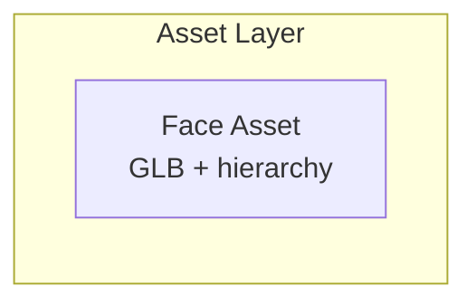

## 2. Discover Animatables

Animatables are the renderer‑level values that can be driven. They are the raw
control surface exposed by the face.

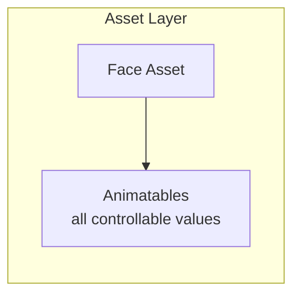

## 3. Build a Rig

A rig is a graph that maps inputs into typed‑path outputs, with the final layer
writing to animatables. Rigs can be layered.

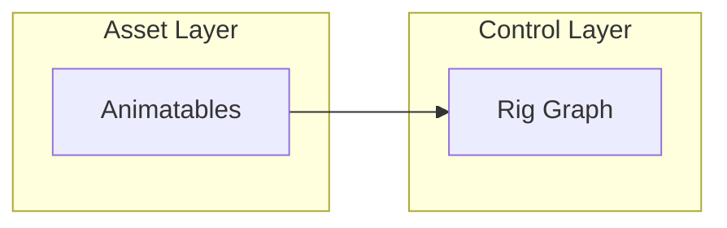

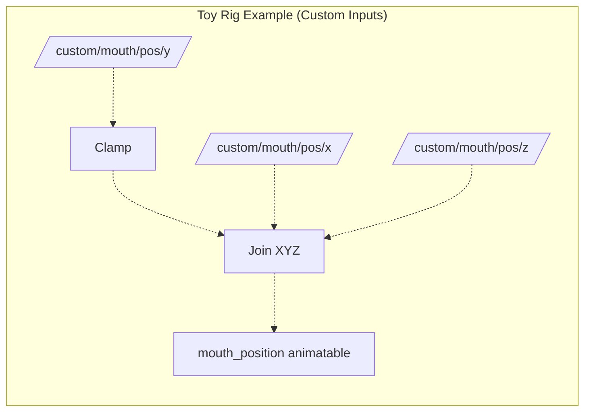

## 4. Map Standard Inputs

Standard inputs are a portable control schema. Mapping them into the rig makes
the rig reusable across faces.

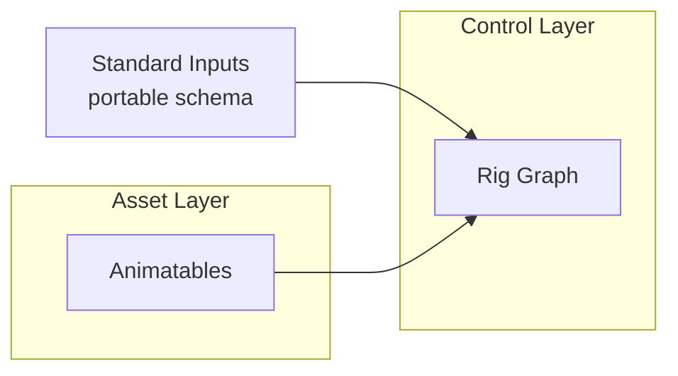

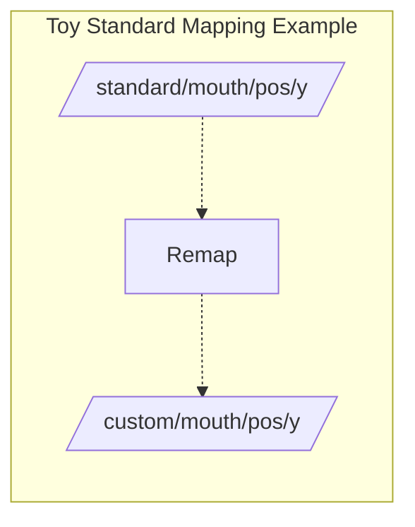

## 5. Define Poses

Poses are named target value sets. Each pose has a weight; weights blend toward
those targets relative to neutral inputs.

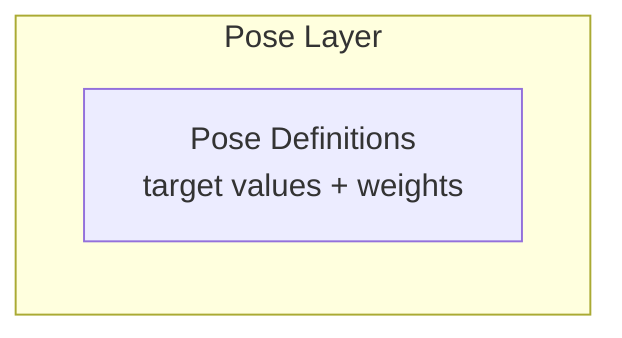

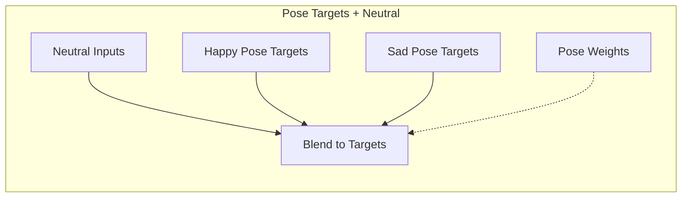

## 6. Blend Poses With Pose Graphs

Pose graphs combine pose weights and neutral values into concrete inputs that
feed the rig.

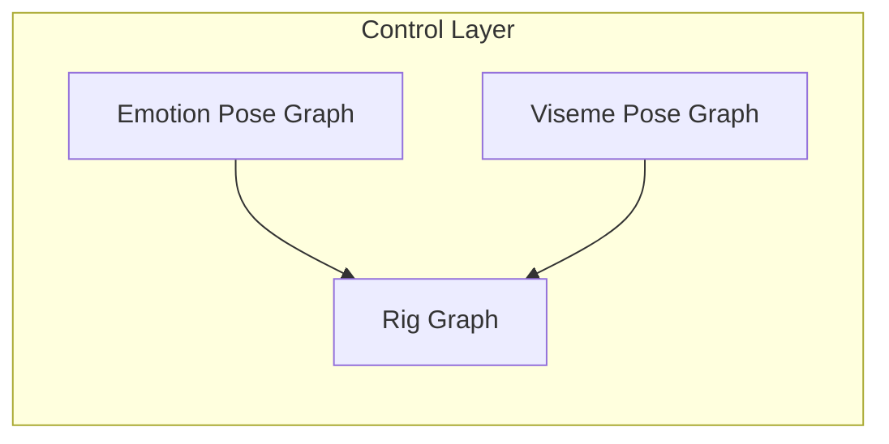

## 7. Run in the Runtime

The runtime stages live inputs, executes graphs/animations via the orchestrator,
and applies outputs to the renderer.

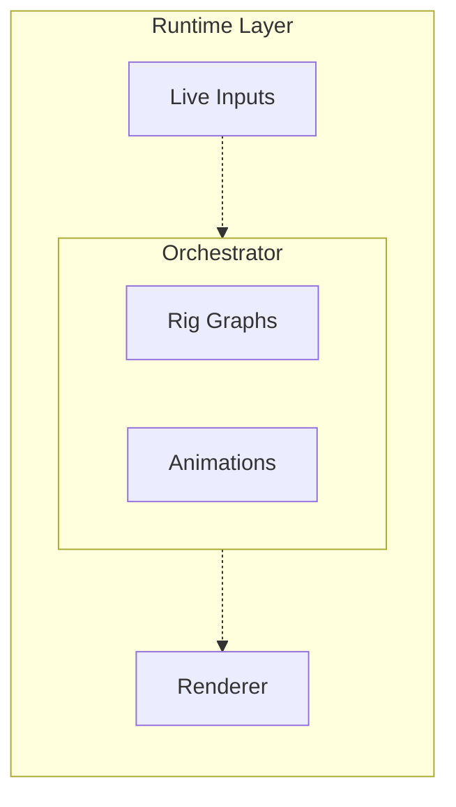

## 8. The Full Stack (Expanded Structure)

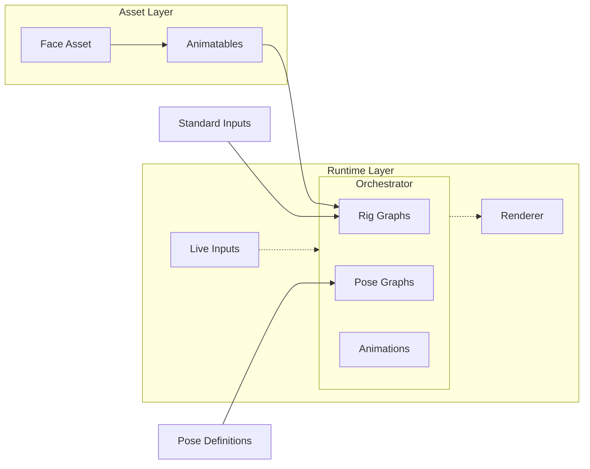

This diagram is intentionally layered: each block builds on the previous one,
and the runtime ties all blocks together into a single, executable system.
