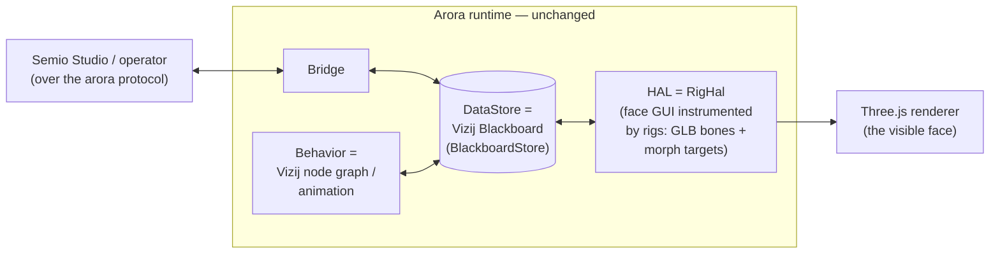

<!-- tags: family=reference; type=concept; topics=arora,interop,runtime,architecture -->
> **Last updated:** 2026-07-06

# Vizij On Arora

Vizij runs on the Arora device runtime instead of maintaining a parallel
runtime of its own. Arora structures a device as one blackboard with four
seams — data store, HAL, bridge, behavior — advanced by a single-owner step
loop (drain inputs → tick behavior → flush changes). Vizij and Arora turned
out to be the same shape: Vizij's blackboard, connection layer, and renderer
map one-to-one onto three of those seams, so a Vizij face is an ordinary
Arora device whose **HAL is the face GUI, instrumented by rigs** — everything
else is the stock Arora runtime.

## The interop crates (`vizij-rs/crates/interop/`)

| Crate | Arora seam | What it does |
| --- | --- | --- |
| `vizij-arora` | value vocabulary | Converts Vizij values (`vizij-api-core`) to/from Arora `Value`: composites become `Structure`s under stable Vizij type UUIDs; `Shape.meta` rides a `meta/<path>` sidecar key. |
| `vizij-arora-hal` | HAL | `RigHal` implements `Hal` + `HalAssets`: the "device" is a GLB rig; behavior writes actuator targets (bone transforms, morph weights) into it, and `RigHal::pose` exposes them as native Vizij values for the renderer to apply. |
| `vizij-arora-store` | data store | `BlackboardStore` implements Arora's `DataStore` over Vizij's `Blackboard`, so the blackboard *is* the memory the runtime is spawned with; provenance (epoch, source, conflict logs) stays on the Vizij side. |

The remaining seam, behavior, is where the node graph plugs in: Arora's
`Behavior` trait accepts any interpreter, and a `ProcessingGraph` ticking
`GraphRuntime` against the shared store is the planned adapter. The websocket
control path (`@vizij/arora-types`, `arora-connection`/`arora-websocket` in
vizij-web) is the same convergence on the bridge seam: Vizij already speaks
"the arora protocol", and the target is a `WsBridge` implementing
`arora_bridge::Bridge` rather than a bespoke connection type.

## Where the full design lives

The complete proposal — value strategy, merge semantics, migration phases and
risks — is `docs/proposal-vizij-on-arora.md` in the `vizij-rs` repository,
next to the interop crates it specifies.
