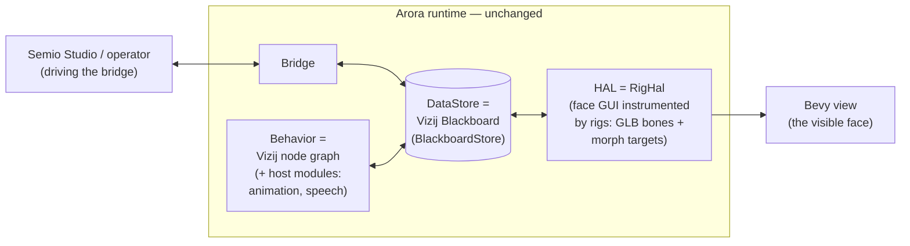

<!-- tags: family=reference; type=concept; topics=arora,interop,runtime,architecture -->
> **Last updated:** 2026-10-23

# Vizij On Arora

Vizij runs on the Arora device runtime instead of maintaining a parallel
runtime of its own. Arora structures a device as one blackboard with four
seams — data store, HAL, bridge, behavior — advanced by a single-owner step
loop (drain inputs → tick behavior → flush changes). Vizij and Arora turned
out to be the same shape: Vizij's blackboard, connection layer, and rig
map one-to-one onto three of those seams, so a Vizij face is an ordinary
Arora device whose **HAL is the face GUI, instrumented by rigs** — everything
else is the stock Arora runtime.

## The interop crates (`vizij-rs/crates/interop/`)

| Crate | Arora seam | What it does |
| --- | --- | --- |
| `vizij-arora` | value vocabulary | Converts Vizij values (`vizij-api-core`) to/from Arora `Value`: composites become `Structure`s under stable Vizij type UUIDs; `Shape.meta` rides a `meta/<path>` sidecar key. |
| `vizij-arora-hal` | HAL | `RigHal` implements `Hal` + `HalAssets`: the "device" is a GLB rig; behavior writes actuator targets (bone transforms, morph weights) into it, and `RigHal::pose` exposes them as native Vizij values for the view to draw. |
| `vizij-arora-store` | data store | `BlackboardStore` implements Arora's `DataStore` over Vizij's `Blackboard`, so the blackboard *is* the memory the runtime is spawned with; provenance (epoch, source, conflict logs) stays on the Vizij side. |
| `vizij-arora-behavior` | behavior | `ProcessingGraph` is a Vizij node graph as an Arora `BehaviorInterpreter`, evaluating the face's composed graph against the shared store; programs and skills run beside it as runs of the interpreter. |

The bridge seam is the stock Arora one: the published arora-sdk bridges
(`arora-bridge-ws`, `arora-bridge-ros2`) and the Semio Studio bridge client
(`arora-studio-bridge-client`, from semio-ai/studio-bridge, which the `vizij`
binary takes through arora's `studio-bridge` feature) carry a face's keys and
methods as they carry any device's.

The view is the vizij-rs `vizij` crate's Bevy renderer. It reads the pose
`RigHal` holds each frame and draws it, in the native `vizij` binary and, in
a browser, on the page's one canvas through `@vizij/runtime`; the
[architecture](../ARCHITECTURE.md) places it among the crates.

## Where the full design lives

The complete proposal — value strategy, merge semantics, migration phases and
risks — is `docs/proposal-vizij-on-arora.md` in the `vizij-rs` repository,
next to the interop crates it specifies.
