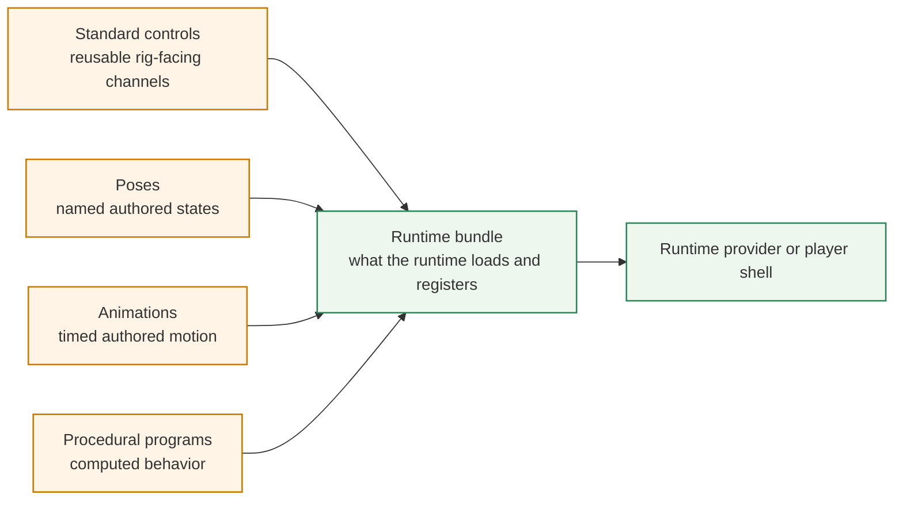
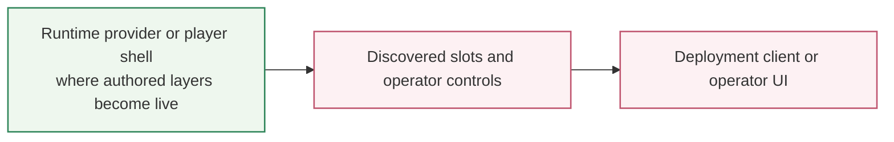

<!-- tags: type=guidebook-module; status=written; topics=guidebook,control,configuration,control-surfaces -->

> **Last updated:** 2026-03-15
> **Purpose:** explain the main control and configuration surfaces readers encounter and what each one is for

# Control Surfaces and Configuration Layers

## Guidebook Context

| Axis | Position |
| --- | --- |
| Bucket chain | Previous: [Experience](../experience/README.md) Current: [Control](README.md) Next: [Customize](../customize/README.md) on the customization route or [Integrate](../integrate/README.md) on the fast route |
| Depth ladder in this bucket | Above: [First Control Interactions](first-control-interactions.md) Current: `Fundamentals` Below: [Orchestration and Diagnostics](orchestration-and-diagnostics.md) |
| Module position in this bucket | Previous in bucket: [Runtime Inputs and Semantics](runtime-inputs-and-semantics.md) Current module: `Control Surfaces and Configuration Layers` Next in bucket: [Orchestration and Diagnostics](orchestration-and-diagnostics.md) |
| Reference bridges | [Renderer and Rigging Reference](../reference/renderer-and-rigging-reference.md) [Runtime Quickstart Reference](../reference/runtime-quickstart-reference.md) [Glossary and Terminology Bridge](../support/glossary-and-terminology-bridge.md) |
| Module type | concept page |
| Bucket overview | [Control](README.md) |

## Reader Outcome

After this page, you should be able to explain the main control and configuration surfaces in Vizij and say what each one is responsible for.

## Module Notes

This page is for readers who already understand paths and runtime semantics and now need to see where those controls and configurations actually show up across the system.

Vizij does not have only one control surface. Readers encounter standard controls, pose and animation configuration, procedural logic, bundle configuration, and deployment-facing operator surfaces, and this page keeps those layers distinct instead of collapsing them into one generic idea of "controls."

## What You Need

It helps if you have already read:

1. [Paths and Standard Controls](paths-and-standard-controls.md),
2. [Runtime Inputs and Semantics](runtime-inputs-and-semantics.md).

## The Main Surfaces

### Authored Layers Into Runtime Packaging

### Runtime Surface To Deployment Surface

The first diagram explains where authored control layers become loadable runtime capability.

The second explains what part of that capability becomes visible to an operator-facing deployment surface.

Read this stack from bottom to top when authoring capability and from top to bottom when diagnosing an operator-facing endpoint.

### Standard Controls

Standard controls are the reusable rig channels that expose common face behavior in a normalized way.

These are the controls most readers first encounter in runtime examples such as gaze or other predictable rig channels.

### Pose Configuration

Pose configuration describes the named facial states that can later be triggered or blended.

This is different from standard controls because the configuration is about authored semantic states, not just continuous low-level channels.

### Animation Configuration

Animation configuration describes authored motion over time.

This includes the clips, tracks, and playback-related data that let the runtime drive a face through an authored sequence.

### Procedural Program or Graph Configuration

Procedural program configuration describes authored behavior that computes values rather than storing only fixed states or fixed clips.

This is the graph-like configuration surface that lets behavior be authored as logic and dataflow.

### Runtime Bundle Configuration

Runtime bundle configuration is the layer that packages rig, pose, and animation information alongside the asset so the runtime can load and register the right controllers.

This is not a user-facing control widget. It is the configuration layer that helps later runtime surfaces stay truthful to what was authored.

### Deployment-Facing Slots and Operator Surfaces

Deployment-facing slots are the exposed controllable paths that an operator or external client can actually drive in a deployment endpoint.

This is the control surface readers see later in `vizij-standalone` and related deployment flows.

## A Useful Stacking Order

The most useful way to think about these layers is:

1. standard controls expose reusable rig channels,
2. poses expose named authored states over those channels,
3. animations expose authored motion over time,
4. procedural programs expose computed behavior,
5. bundles carry authored configuration into runtime,
6. operator-facing slots expose some of that controllable behavior to deployment clients.

Not every app shows all of these layers equally, but they are all part of the broader control story.

## Why This Matters

Without this distinction, a reader can confuse:

1. a runtime hook with an authored pose definition,
2. an animation clip with a procedural graph,
3. a bundle override with a user-facing control,
4. a deployment slot with the entire authoring model.

Those are different surfaces with different responsibilities.

## Control Family, Controller, Driver, And Slot Are Not The Same Thing

Use these distinctions when a page starts to blur authored capability with live execution:

| Term | Use it for | Do not collapse it into |
| --- | --- | --- |
| control family | the reusable target being addressed, such as gaze, jaw, or brows | a widget, service loop, or deployment slot |
| pose, animation, or procedural layer | the authored structure that defines what can happen | the live runtime write happening now |
| controller or driver | the thing producing writes over time inside the runtime | the authored rig definition alone |
| runtime bundle/configuration layer | the package that carries authored truth into the runtime | the operator surface |
| deployment slot | the operator-facing entry exposed by an endpoint | the full runtime path, the authored graph, or the whole rig model |

## Where Readers Encounter These Layers

| Surface | Standard controls | Poses | Animations | Procedural programs | Runtime bundle/config | Deployment slots |
| --- | --- | --- | --- | --- | --- | --- |
| `tutorial-fullscreen-face` | direct | direct trigger path | no | no | implicit through one bundle | no |
| `tutorial-agent-face` | indirect through app logic | indirect | indirect | indirect or service-triggered | direct runtime shell | no |
| `demo-vizij-player` | direct | direct | direct | direct | direct | no |
| `vizij-authoring` | inspect and organize | author | author | author | export and bundle authoring | no |
| `@vizij/runtime-react` | API surface | API surface | API surface | API surface | direct | no |
| `vizij-standalone` | direct through discovered slots | direct through discovered slots when exported by the bundle | transport or invoke surface | transport or invoke surface | loaded runtime status | direct |

Current maintained anchors illustrate different parts of this stack:

1. `tutorial-fullscreen-face` exposes standard controls and pose-trigger behavior,
2. `tutorial-agent-face` adds richer runtime and speech-linked behavior,
3. `vizij-authoring` exposes pose, animation, and procedural authoring surfaces directly,
4. `@vizij/runtime-react` exposes bundle-level loading and override behavior,
5. `vizij-standalone` exposes deployment-facing slots and operator control paths.

## Success Check

You are done with this page when:

1. you can name the major control and configuration layers in Vizij,
2. you can explain how they differ,
3. you can explain why not every control surface is the same kind of thing.

## Implementation Anchors

Use these when you need the current implementation truth:

1. `current_documentation/concepts/ARCHITECTURE_PRIMER.md`
2. `vizij-web/packages/@vizij/runtime-react/README.md`
3. `vizij-web/packages/@vizij/runtime-react/src/updatePolicy.ts`
4. `vizij-web/apps/tutorial-fullscreen-face/src/FaceApp.tsx`
5. `vizij-web/apps/vizij-authoring/README.md`
6. `vizij-web/apps/vizij-authoring/docs/Authoring_Blueprint.md`
7. `vizij-web/apps/vizij-standalone/src/hooks/useWebSocketSync.ts`

## Recommended Next Steps

1. If you want the authoring concepts behind pose, animation, and procedural work, read [Customization Concepts Primer](../introduction/customization-concepts-primer.md).
2. If you want deeper runtime debugging and richer behavior shaping, continue to [Orchestration and Diagnostics](orchestration-and-diagnostics.md).
