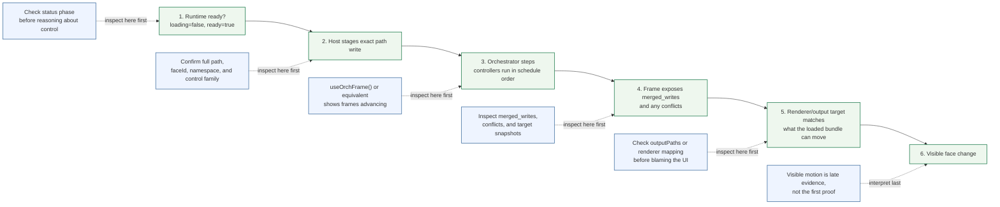

<!-- tags: family=guidebook; type=guidebook-module; editorial_status=completed; publication_status=planned; topics=guidebook,control,orchestration,diagnostics -->

> **Last updated:** 2026-03-31
> **Purpose:** teach how Vizij runtime control actually executes frame to frame and how to diagnose control failures without drifting into deployment or authoring runbooks

# Orchestration and Diagnostics

## Guidebook Context

| Axis | Position |
| --- | --- |
| Bucket chain | Previous: [Experience](../experience/README.md)<br>Current: [Control](README.md)<br>Next: [Customize](../customize/README.md) on the customization route or [Integrate](../integrate/README.md) on the fast route |
| Depth ladder in this bucket | Above: [First Control Interactions](first-control-interactions.md), [Paths and Standard Controls](paths-and-standard-controls.md), [Runtime Inputs and Semantics](runtime-inputs-and-semantics.md), [Control Surfaces and Configuration Layers](control-surfaces-and-configuration-layers.md)<br>Current: `Advanced`<br>Below: none, this is the deepest current depth in this bucket |
| Module position in this bucket | Previous in bucket: [Control Surfaces and Configuration Layers](control-surfaces-and-configuration-layers.md)<br>Current module: `Orchestration and Diagnostics`<br>Next in bucket: none, this is the last module in the bucket sequence |
| Reference bridges | [Renderer and Rigging Reference](../reference/renderer-and-rigging-reference.md)<br>[Runtime Quickstart Reference](../reference/runtime-quickstart-reference.md)<br>[Glossary and Terminology Bridge](../support/glossary-and-terminology-bridge.md) |
| Module type | operational guide |
| Bucket overview | [Control](README.md) |

## Reader Outcome

After this page, you should be able to trace a control action through the Vizij runtime in the right order:

1. readiness,
2. staged input writes,
3. orchestrator scheduling and merge,
4. blackboard updates,
5. renderer outputs,
6. visible face behavior.

You should also be able to recognize where that chain is breaking when control does not behave as expected.

## Module Notes

- Read this after [Paths and Standard Controls](paths-and-standard-controls.md), [Runtime Inputs and Semantics](runtime-inputs-and-semantics.md), and [Control Surfaces and Configuration Layers](control-surfaces-and-configuration-layers.md).
- The page focuses on the runtime execution chain: readiness, staged writes, orchestrator merge, blackboard state, renderer output, and the diagnostic surfaces that reveal where that chain breaks.
- Use `Integrate` or `Support` for path grammar refreshers, packaging steps, or deployment runbooks.

## What You Need

It helps if you have already looked at:

1. `tutorial-fullscreen-face`,
2. `@vizij/runtime-react`,
3. one operational control surface such as `vizij-standalone`.

You do not need to know authoring internals or deployment packaging details to use this page.

## The Runtime Control Chain



Read this left to right as a diagnostic sequence, not as a UI flow.

The practical execution model is:

```text
ready runtime
-> host stages inputs
-> orchestrator steps controllers
-> controller writes are merged
-> blackboard state advances
-> renderer-facing values are applied
-> visible face output changes
```

That sequence matters. A failure earlier in the chain can make later surfaces look broken even when they are healthy.

### 1. Readiness gates whether control is meaningful

In `tutorial-fullscreen-face`, `FaceApp.tsx` distinguishes three learner-visible states before successful control:

1. `Loading face…`
2. `Initialising orchestrator…`
3. ready runtime

It also renders an error state when initialization fails.

This is not cosmetic. The runtime hooks are only trustworthy once the provider is ready. The app also calls `stagePoseNeutral()` after readiness so the bundle's neutral pose baseline is staged before interaction.

The first diagnostic rule is therefore:

If the runtime is not ready, do not reason about hotkeys, pointer control, or external slot updates yet.

### 2. Host code stages writes, not scene mutations

In `useMouseGaze.ts`, pointer movement is converted into normalized values and written through `setInput(...)` to paths like:

1. `rig/{faceId}/standard/vizij/left_eye/pos/x`
2. `rig/{faceId}/standard/vizij/right_eye/pos/y`

In `usePoseHotkeys.ts`, key presses call `animateValue(...)` against pose-derived paths such as:

1. `rig/{faceId}/{group}/{pose_slug}.weight`

The runtime-react README makes the staging rule explicit: inputs are buffered in a per-frame buffer and flushed together before each `step()`.

That means a hook can look correct in UI code and still fail later because:

1. it wrote the wrong path,
2. it wrote under the wrong face id or namespace,
3. the runtime never stepped,
4. a later controller or merge policy overrode the result.

### 3. The orchestrator is the execution coordinator

The architecture and concepts references define the orchestrator as the
coordinator between controllers and the renderer.

Its responsibilities are:

1. schedule graphs and animations,
2. apply their writes deterministically,
3. merge results into a consistent frame,
4. emit the frame's merged writes and conflicts.

The current documented schedules are:

1. `SinglePass`: animations then graphs,
2. `TwoPass`: graphs then animations then graphs.

That distinction matters when diagnosing behavior that seems one frame late, overridden, or dependent on feedback between controllers.

### 4. Merge behavior determines what survives conflicts

Two different layers of merge matter in the current implementation:

1. controller execution inside an orchestrator frame, where conflicts are surfaced in frame diagnostics,
2. explicit merged-graph registration, where strategies such as `error`, `namespace`, and blend-like policies decide how overlapping outputs are handled.

For guidebook readers, the practical lesson is simple:

If multiple controllers can produce the same target path, you must assume merge behavior can change what finally reaches the blackboard.

Do not assume the last UI event automatically wins.

### 5. Blackboard state is the shared runtime truth between controllers

The blackboard is the shared typed-path state that graphs and animations read and write.

This is why Vizij control can span multiple surfaces:

1. a pointer hook can stage inputs,
2. a graph can transform them,
3. an animation can add or blend time-based changes,
4. the renderer can then apply the resolved values.

The blackboard is also why diagnosis should ask:

`Did the path get staged?`

then:

`Did the orchestrator produce the expected merged write?`

and only then:

`Did the renderer show the intended change?`

### 6. Renderer outputs are the end of the chain, not the whole chain

The visible face is evidence, but it is late evidence.

`@vizij/runtime-react` exposes `outputPaths`, and `@vizij/orchestrator-react` exposes frame and path subscriptions such as `useOrchFrame()` and `useOrchTarget(path)`.

Those are the surfaces that let you distinguish:

1. no input staged,
2. input staged but no merged output,
3. merged output exists but does not correspond to the expected face or animatable,
4. renderer output changed but the visible effect is subtle or filtered.

## A Reliable Diagnostic Order

Keep this compact checklist beside the longer explanations:

| Step | Question | Healthy evidence | If not |
| --- | --- | --- | --- |
| 1. readiness | is the runtime actually ready | `ready` is true and load/registration errors are absent | stop here and inspect lifecycle or load failure first |
| 2. exact path | am I writing the exact path I think I am | the full path string matches the expected face and control family | fix the path before inspecting merge or render behavior |
| 3. face and namespace | am I writing into the right runtime identity | `faceId`, namespace, and any slot-normalization boundary all agree | correct identity before testing further |
| 4. constraints and defaults | does this path exist and what should reset/default behavior do | `inputConstraints` exposes the path and its defaults | stop guessing and use discovered constraints |
| 5. orchestrator evidence | did the runtime actually step and merge a write | frames advance and the path appears in `merged_writes` or target snapshots | inspect controller output and merge policy |
| 6. renderer target | does the loaded face have a matching renderable target | output paths and visible animatables line up with the loaded bundle | inspect bundle mismatch or renderer mapping next |

When control fails, inspect in this order.

### 1. Confirm lifecycle status first

Check the runtime status surface before inspecting paths.

In current runtime-react docs and types, the useful fields are:

1. `loading`
2. `ready`
3. `error`
4. `errors`
5. `outputPaths`
6. `controllers`

For failures, the documented error `phase` values are:

1. `assets`
2. `orchestrator`
3. `registration`
4. `animation`
5. `bridge`
6. `driver`
7. `unknown`

Use those phases to narrow the failure domain quickly.

Examples:

1. `assets` means do not start debugging control paths yet.
2. `registration` suggests the bundle or controller registration did not complete cleanly.
3. `driver` points at input-driver lifecycle problems rather than rig semantics.
4. `animation` means time-based control may be failing even if direct `setInput` writes still work.

### 2. Verify the exact path being written

Do not debug "gaze" or "a pose" abstractly. Debug the actual path string.

Minimal checks:

1. does the path include the expected `rig/{faceId}/...` prefix,
2. is the face id lowercased the same way the current hooks expect,
3. is the group or channel name the one the loaded bundle actually exported,
4. if the surface is namespace-aware, are you looking at a namespaced path or a short path.

This prevents a common advanced mistake:

The control surface looks correct conceptually, but the runtime write is landing on a path no registered controller or renderer output actually uses.

### 3. Check namespace and face identity together

Namespace mismatch and face mismatch are easy to confuse.

The runtime-react docs describe namespacing for shared orchestrators. The standalone WebSocket hook also normalizes incoming slot paths and rebuilds a full runtime path as:

`rig/${faceId}/${normalizedPath}`

It then uses `${namespace}/${fullPath}` when reading from orchestrator snapshots.

That gives you a concrete diagnostic rule:

1. if writes appear to vanish in a shared runtime, inspect namespace first,
2. if writes target the wrong or a nonexistent face, inspect `faceId`,
3. if short slot paths work in one surface but not another, inspect the normalization boundary between external slot names and internal rig paths.

### 4. Check constraints, defaults, and reset behavior

The standalone hook uses `inputConstraints` as a source of:

1. slot discovery,
2. default values,
3. min and max metadata,
4. reset behavior.

This is useful well beyond standalone.

Minimal diagnostics:

1. if a slot never appears, inspect whether the runtime exposed any matching input constraints,
2. if reset behaves strangely, compare current values against constraint defaults,
3. if a surface initializes local values from defaults, confirm the defaults match the loaded face rather than an older bundle,
4. if the system "works once" and then returns to neutral, inspect whether a reset or neutral-stage flow is intentionally writing zeros or default values back in.

This is exactly the kind of issue that can feel like a renderer bug when it is actually a slot/default lifecycle issue.

### 5. Check whether the orchestrator is stepping and merging

If paths and status look correct but nothing visible changes, inspect orchestrator evidence.

The current observability anchors are:

1. `useOrchFrame()` for latest frame data,
2. `useOrchTarget(path)` for a single blackboard path,
3. frame fields such as `merged_writes` and `conflicts`,
4. runtime `outputPaths`.

Healthy questions to ask:

1. did a new frame step at all,
2. does the expected path show up in `merged_writes`,
3. are there conflicts on that path,
4. is the write present only under a namespaced key you were not watching,
5. is the expected output absent because no controller publishes that path.

If `merged_writes` is empty, the orchestrator-wasm README explicitly points to a useful first check: confirm that a controller actually emits output paths.

### 6. Check whether the renderer side has a matching target

A merged write is necessary, but it is not sufficient.

You still need a renderer-facing path or animatable bridge that corresponds to the loaded face.

This is where face mismatch and bundle mismatch often show up:

1. writes are present,
2. the runtime appears healthy,
3. but the loaded GLB or bundle metadata does not line up with the control paths you are producing.

That is why the architecture docs warn that face identity must stay consistent
across rig graphs, pose configs, and bundles.

## Common Failure Patterns

### Worked Example: Slot Write Succeeds But Nothing Visible Changes

Use this trace when an external client reports success but the face still looks static.

1. the deployment client sends `set_slot_values` and receives `{ "success": true }`,
2. the standalone bridge normalizes the discovered slot name and writes `rig/{faceId}/{slot}` with `setInput(...)`,
3. `getPathSnapshot` or `useOrchTarget(...)` confirms the path value changed,
4. but `outputPaths` or the visible face still does not show the expected motion.

At that point, the failure is no longer "socket is broken."

The higher-value next checks are:

1. whether the discovered slot mapped to the control family you intended,
2. whether the loaded bundle actually exported a matching animatable target,
3. whether merge or reset/default behavior immediately diluted the visible result,
4. whether the face or namespace identity was different from the one the client assumed.

This is the concrete reason the guidebook keeps the chain ordered:

successful transport does not prove successful rendering.

### Runtime never becomes ready

Likely checks:

1. inspect `error` and `errors` before touching control code,
2. use `phase` to separate asset load failure from orchestrator creation or registration failure,
3. do not trust downstream diagnostics until `ready` is true.

### Pointer or hotkey control does nothing in the tutorial app

Likely checks:

1. confirm the UI is past `Loading face…` and `Initialising orchestrator…`,
2. verify the face bundle included pose data if hotkeys are expected,
3. inspect the full `rig/{faceId}/...` path being written,
4. confirm no neutral-stage or key-up flow is resetting the same path immediately.

### External slot updates arrive but the face does not change

Likely checks:

1. inspect how the incoming slot name is normalized,
2. confirm the short slot path maps to the same face and namespace the runtime uses,
3. compare against `inputConstraints` to see whether the slot exists and what its default is,
4. inspect `getPathSnapshot`, `useOrchTarget`, or `merged_writes` before blaming rendering.

### The wrong control appears to move or nothing obvious changes

Likely checks:

1. inspect path mismatch first,
2. inspect namespace and face mismatch second,
3. inspect whether the value is being written to a subtle channel rather than a pose-like channel,
4. inspect whether a blend or conflict policy is diluting the visible result.

### Control works in one app but not another

Likely checks:

1. compare lifecycle handling,
2. compare namespace and face resolution,
3. compare whether the app writes short slot paths or fully qualified rig paths,
4. compare whether one app stages neutral or reset values automatically.

## What Good Observability Looks Like

For advanced control work, a healthy runtime surface usually gives you at least:

1. visible `loading`, `ready`, and `error` status,
2. the current `namespace` and `faceId`,
3. error history with `phase`,
4. controller registration visibility,
5. a way to inspect `outputPaths`,
6. a way to inspect frame-level writes and conflicts,
7. a way to compare current values against defaults or constraints.

Without those surfaces, you are forced to debug from the visible face alone, which is the least informative stage in the pipeline.

## Route Forward

Once you understand this execution model:

1. go to `Integrate` if you need to build richer application shells around the runtime,
2. go to `Support` if you need broader recovery patterns and route-level troubleshooting,
3. go to `Customize` only if the issue is really authored rig or bundle content rather than runtime execution.

## Success Check

You are done with this page when:

1. you can explain why readiness is part of control diagnosis rather than a separate concern,
2. you can describe the runtime chain from staged input to renderer output,
3. you know where merge and blackboard state fit into that chain,
4. you can name the first checks for path mismatch, namespace mismatch, face mismatch, and slot/default/reset problems,
5. you can say when an issue belongs in `Integrate` or `Support` rather than deeper control reasoning.

## Implementation Anchors

Use these when you need the current implementation truth:

1. [REFERENCE_GUIDE.md](/home/chris/Code/Semio/vizij_ws/vizij-docs/current_documentation/concepts/REFERENCE_GUIDE.md)
2. [runtime-react README.md](/home/chris/Code/Semio/vizij_ws/vizij-web/packages/@vizij/runtime-react/README.md)
3. [FaceApp.tsx](/home/chris/Code/Semio/vizij_ws/vizij-web/apps/tutorial-fullscreen-face/src/FaceApp.tsx)
4. [useMouseGaze.ts](/home/chris/Code/Semio/vizij_ws/vizij-web/apps/tutorial-fullscreen-face/src/hooks/useMouseGaze.ts)
5. [usePoseHotkeys.ts](/home/chris/Code/Semio/vizij_ws/vizij-web/apps/tutorial-fullscreen-face/src/hooks/usePoseHotkeys.ts)
6. [vizij-standalone README.md](/home/chris/Code/Semio/vizij_ws/vizij-web/apps/vizij-standalone/README.md)
7. [useWebSocketSync.ts](/home/chris/Code/Semio/vizij_ws/vizij-web/apps/vizij-standalone/src/hooks/useWebSocketSync.ts)
8. [orchestrator-react README.md](/home/chris/Code/Semio/vizij_ws/vizij-web/packages/@vizij/orchestrator-react/README.md)

## Recommended Next Steps

If your next problem is application assembly, continue to the `Integrate` bucket, especially the maintained integration modules that explain loading and embedding around the runtime.

If your next problem is broader recovery or failure triage, continue to [Troubleshooting Matrix](../support/troubleshooting-matrix.md).
