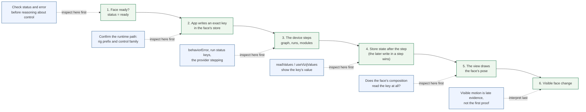

<!-- tags: family=guidebook; type=guidebook-module; editorial_status=completed; publication_status=planned; topics=guidebook,control,orchestration,diagnostics -->

> **Last updated:** 2026-10-23
> **Purpose:** teach how Vizij runtime control actually executes frame to frame and how to diagnose control failures without drifting into deployment or authoring runbooks

# Orchestration and Diagnostics

## Guidebook Context

| Axis | Position |
| --- | --- |
| Bucket chain | Previous: [Experience](../experience/README.md)<br>Current: [Control](README.md)<br>Next: [Customize](../customize/README.md) on the customization route or [Integrate](../integrate/README.md) on the fast route |
| Depth ladder in this bucket | Above: [First Control Interactions](first-control-interactions.md), [Paths and Standard Controls](paths-and-standard-controls.md), [Runtime Inputs and Semantics](runtime-inputs-and-semantics.md), [Control Surfaces and Configuration Layers](control-surfaces-and-configuration-layers.md)<br>Current: `Advanced`<br>Below: none, this is the deepest current depth in this bucket |
| Module position in this bucket | Previous in bucket: [Control Surfaces and Configuration Layers](control-surfaces-and-configuration-layers.md)<br>Current module: `Orchestration and Diagnostics`<br>Next in bucket: none, this is the last module in the bucket sequence |
| Reference bridges | [Renderer and Rigging Reference](../reference/renderer-and-rigging-reference.md)<br>[Runtime Quickstart Reference](../reference/runtime-quickstart-reference.md)<br>[Glossary and Terminology Bridge](../support/glossary-and-terminology-bridge.md) |
| Module type | operational guide |
| Bucket overview | [Control](README.md) |

## Reader Outcome

After this page, you should be able to trace a control action through a Vizij face in the right order:

1. readiness,
2. the write to the face's store,
3. the device's step: the composed graph, the runs beside it, the modules,
4. the store state the step leaves,
5. the view drawing the face's pose,
6. visible face behavior.

You should also be able to recognize where that chain is breaking when control does not behave as expected.

## Module Notes

- Read this after [Paths and Standard Controls](paths-and-standard-controls.md), [Runtime Inputs and Semantics](runtime-inputs-and-semantics.md), and [Control Surfaces and Configuration Layers](control-surfaces-and-configuration-layers.md).
- The page focuses on the runtime execution chain: readiness, store writes, the device's step, store state, the view, and the diagnostic surfaces that reveal where that chain breaks.
- Use `Integrate` or `Support` for path grammar refreshers, packaging steps, or deployment runbooks.

## What You Need

It helps if you have already looked at:

1. `tutorial-fullscreen-face`,
2. `@vizij/runtime-react`,
3. `demo-vizij-player`, whose panels read and write a face's keys.

You do not need to know authoring internals or deployment packaging details to use this page.

## The Runtime Control Chain



Read this left to right as a diagnostic sequence, not as a UI flow.

The practical execution model is:

```text
ready face
-> the app writes keys in the face's store
-> the device steps: the composed graph evaluates, runs and modules advance
-> each key holds the last value written to it in the step
-> the view reads the face's pose and draws it on the page's canvas
-> visible face output changes
```

That sequence matters. A failure earlier in the chain can make later surfaces look broken even when they are healthy.

### 1. Readiness gates whether control is meaningful

`useVizijRuntime()` reports the face's `status`: `loading`, `ready`, or `error`, with the `error` when loading failed. In `tutorial-fullscreen-face`, the hotkeys bind only once `status` is `ready`, and an error shows over the page. The face's slot shows a loading view until the face is first drawn, and carries `data-vizij-ready="true"` once it is.

The first diagnostic rule is therefore:

If the face is not ready, do not reason about hotkeys, panels, or bridge writes yet.

### 2. Host code writes keys, not scene mutations

An app moves a face by writing keys of its store or by calling the methods it declares, never by touching the drawn scene. In `tutorial-fullscreen-face`, `useFaceHotkeys.ts`:

1. fades `runtime.path("standard/vizij/expression/<name>")` with `useAnimateValue`, one `setValue` per animation frame,
2. calls `runtime.invoke("play_viseme", { shape, weight })` for a viseme.

The store holds a `setValue` at once; the device's next step carries it to the face.

That means a hook can look correct in UI code and still fail later because:

1. it wrote the wrong path,
2. it built the path for the wrong face, by hand instead of with `runtime.path(...)`,
3. the device is not stepping,
4. one of the face's graphs or programs writes the same key every step.

### 3. The device's step is the execution coordinator

Each face is an Arora device. Its behavior is the face's graphs composed into one: the rig, the pose driver, the poses, and the standard adaptation, unless the page loads a subset. Programs and skills such as `say` run beside the composed graph as runs of the device's interpreter, and host modules such as the animation module advance with it.

`VizijRuntimeProvider` steps the device every animation frame while the page is visible, and on a timer while it is hidden. Each step:

1. evaluates the composed graph in composition order, reading its inputs from the store,
2. advances the runs and the modules,
3. writes the results back to store keys,
4. leaves the face's pose in the rig, which the view reads and draws.

A value crosses one store key per step on its way from one of the face's graphs to the next, so a value that passes through several graphs reaches the rig a few steps after it was written. That matters when diagnosing behavior that seems a frame late.

### 4. Which write survives

The face standard's rule is one writer per key. When one of the face's graphs or programs writes a key every step, a write from the app to that key is overwritten on the next step:

1. a face's program that moves its eyes writes the eye positions every step, so an app steers the gaze through the gaze target (`standard/vizij/gaze/target/{x,y,weight}`), which the program reads,
2. a face's standard adaptation writes its pose weights every step, so an app that drives such a face writes the standard's expression keys, not the pose weights.

Where two of a face's own sources write one key, the later write in the step wins: Quori's program and its standard adaptation both write some of its brow, lower-lid and mouth keys. [VIZ-58](https://linear.app/semio-ai/issue/VIZ-58) tracks an explicit combiner for such collisions. A client that must keep a value against the face's own writers holds the key with `runtime.holdKeys(...)`, as the authoring app does while it edits.

For guidebook readers, the practical lesson is simple:

Command the face through the keys its graphs read, not the ones they write. Do not assume the last UI event wins.

### 5. Store state is the shared runtime truth

The store is the face's shared path-value state: the app, the composed graph, the runs and the modules all read and write it.

This is why Vizij control can span multiple surfaces:

1. a hook can write a standard key,
2. the face's program can react to it,
3. an animation can play over it,
4. the view can then draw the resulting pose.

The store is also why diagnosis should ask:

`Did the key get written?`

then:

`Did the step leave the expected value on the key?`

and only then:

`Did the view show the intended change?`

### 6. The view is the end of the chain, not the whole chain

The visible face is evidence, but it is late evidence. The view draws what the rig holds after the step; a key that no graph of the face reads moves nothing, however healthy the write.

The surfaces that let you look inside the chain:

1. `runtime.readValues(paths)` reads keys once; `useVizijValues(paths)` re-renders on their change,
2. `runtime.listKeys(runtime.rigPrefix)` lists the face's keys, each with what the store says of it in `__meta`: its shape, range, the value it rests at, and whether a client may write it,
3. `description` from `useVizijRuntime()` (the face's `describe()`): its graphs, rig inputs with their ranges and defaults, poses, programs and animations,
4. `runtime.behaviorError`: the device's standing behavior error, cleared when a step recovers,
5. a run's status key (`RunHandle.status`), which says whether a program or `say` is running, succeeded or failed.

Those are the surfaces that let you distinguish:

1. no write landed,
2. a write landed but another writer took the key back,
3. the key holds the value but the face's composition does not read it,
4. the pose changed but the visible effect is subtle.

## A Reliable Diagnostic Order

Keep this compact checklist beside the longer explanations:

| Step | Question | Healthy evidence | If not |
| --- | --- | --- | --- |
| 1. readiness | is the face actually ready | `status` is `ready` and `error` is absent | stop here and inspect the load failure first |
| 2. exact path | am I writing the exact key I think I am | the runtime path matches `runtime.path(...)` for the expected control | fix the path before inspecting anything later |
| 3. face identity | am I writing into the right face | the path starts with the face's `runtime.rigPrefix` | correct the prefix before testing further |
| 4. declared range and rest | does this key exist and what does it rest at | `listKeys` or `description.rigInputs` show the key, its range and its rest | stop guessing and use what the face declares |
| 5. writer | does something else write this key every step | the value you wrote stays on the key after a step | write the key the writer reads instead |
| 6. composition | does the face read this key at all | the face's adaptation or rig reads the key | inspect the face's bundle or adaptation next |

When control fails, inspect in this order.

### 1. Confirm lifecycle status first

Check the face's status before inspecting paths: `status`, `error`, and `behaviorError`.

1. `status` `error` means the face did not load: do not start debugging control paths yet.
2. a `behaviorError` means the face loaded but its behavior fails on each step; the message names the failure.
3. a graph that `loadGraph` or `applyGraphEdits` refuses rejects with the node at fault, and the running graph goes on as it was.

### 2. Verify the exact path being written

Do not debug "gaze" or "an expression" abstractly. Debug the actual path string.

Minimal checks:

1. does the path start with the face's rig prefix, `rig/{faceId}/`,
2. was it built with `runtime.path(...)` rather than by hand,
3. is the control a key of the face standard, or a rig input or pose the loaded face actually declares.

This prevents a common advanced mistake:

The control surface looks correct conceptually, but the write lands on a key no graph of the face reads.

### 3. Check face identity

Each face is its own device, and its keys live under its rig prefix, taken from the `faceId` its bundle declares. Quori's is `quori_latest`, not `quori`. A path built by hand with another id lands on a key nothing reads.

That gives you a concrete diagnostic rule:

1. if writes appear to vanish, compare the path's prefix with `runtime.rigPrefix`,
2. if two faces share a page, check that each write uses its own face's runtime.

### 4. Check declared ranges, rests, and reset behavior

A face states what it accepts: `listKeys` lists each key with its range and the value it rests at, and `describe()` lists the rig inputs with theirs. `invoke("reset")` returns every key the face's graphs read to its rest; `invoke("reset_keys", { keys: { strs } })` returns the keys it names.

Minimal diagnostics:

1. if a key never appears in `listKeys`, the face does not declare it,
2. if reset behaves strangely, compare current values against the rests `listKeys` states,
3. if a surface initializes local values from defaults, confirm they come from the loaded face rather than an older one,
4. if the face "works once" and then returns to rest, inspect whether a reset or a program writes the same key.

This is exactly the kind of issue that can feel like a rendering bug when it is actually a writer or reset issue.

### 5. Check whether the device is stepping and what it writes

If paths and status look correct but nothing visible changes, inspect the store.

Healthy questions to ask:

1. is the provider stepping the device (`run` is not `false`, or the page calls `runtime.step(dtMs)` itself),
2. does `readValues` show the value you wrote, after a step,
3. does a program or graph write the same key every step,
4. is a run you expected still running, according to its status key.

### 6. Check whether the face reads the key

A write that holds is necessary, but it is not sufficient.

The face's composition has to read the key. A face covers the standard's tiers its author implemented: its rig reads some of the standard's keys directly, and its standard adaptation maps others onto its poses and inputs. Quori's rig reads the eye positions, the lids and `mouth/morph/jaw_open` itself, and its adaptation maps the expressions, the visemes, the blink and the conversation state. `vizij-bundle validate` reports which keys of each tier a face listens on.

This is where face mismatch shows up:

1. writes are present,
2. the runtime appears healthy,
3. but the loaded face does not implement the control you are writing.

## Common Failure Patterns

### Worked Example: A Bridge Write Succeeds But Nothing Visible Changes

Use this trace when a client of a device's bridge reports success but the face still looks static.

1. the client lists the device's keys (`list_keys`) and writes one listed as writable, and the device accepts it: a writable key is one of the face's free inputs, which no graph of the face's composition writes,
2. a read of the same key returns the value written,
3. but the visible face does not change.

At that point, the failure is no longer "the socket is broken."

The higher-value next checks are:

1. whether the endpoint's device shows a face at all: the Tauri shell of `vizij-standalone` runs a device of its own beside its page, which the page does not render, so its keys move no face,
2. whether the face reads that key (`vizij-bundle validate`),
3. whether a running program writes over the key every step: a program runs beside the composed graph, so the keys it writes stay free inputs,
4. whether a reset or another client writes the key back,
5. whether the client wrote under the prefix of the face it meant.

On the native `vizij` binary, the ROS4HRI mapping is composed unless the binary runs with `--no-ros4hri`. The mapping writes the face's eye positions, lids and ROS4HRI's expressions every step, so those keys are not free inputs there: a client drives them through the mapping's own inputs, the `standard/ros4hri/*` keys, which are device-scoped and carry no rig prefix.

This is the concrete reason the guidebook keeps the chain ordered:

successful transport does not prove successful rendering.

### The face never becomes ready

Likely checks:

1. inspect `error` before touching control code,
2. check that the page renders `<VizijCanvas>`: the provider waits for the page's canvas before it loads the face,
3. do not trust downstream diagnostics until `status` is `ready`.

### Hotkeys do nothing in the tutorial app

Likely checks:

1. confirm the face is ready: the hotkeys bind only then,
2. confirm the face carries its standard adaptation, which maps the expression keys onto its poses,
3. inspect the full `rig/{faceId}/...` path being written,
4. confirm no key-up or reset flow writes the same key back immediately.

### A bridge write is refused

Likely checks:

1. list the device's keys: a client may write only the keys listed as writable, the face's free inputs, each with its type, and the device refuses a write to any other key,
2. check whether one of the face's graphs writes that key every step: such a key is the graph's, and the client writes the key the graph reads instead (on a device with the ROS4HRI mapping, the eye, lid and expression keys are the mapping's, driven through `standard/ros4hri/*`),
3. check the value's type against what `listKeys` states.

### The wrong control appears to move or nothing obvious changes

Likely checks:

1. inspect path mismatch first,
2. inspect face identity second,
3. inspect whether the value is being written to a subtle channel rather than an expression,
4. inspect whether another writer takes the key back.

### Control works in one app but not another

Likely checks:

1. compare lifecycle handling,
2. compare which face each app loaded, and with which graphs (`options.graphs`),
3. compare whether one app runs the face's program and the other does not,
4. compare whether one app resets keys automatically.

## What Good Observability Looks Like

For advanced control work, a healthy runtime surface usually gives you at least:

1. visible `loading`, `ready`, and `error` status,
2. the face's `faceId` and rig prefix,
3. the standing behavior error,
4. the face's graphs and programs, and which runs are going,
5. a way to read the keys you write,
6. a way to see which keys a graph writes (`outputKeys(graph)`),
7. a way to compare current values against the rests the face declares.

`demo-vizij-player` shows most of these in its panels. Without those surfaces, you are forced to debug from the visible face alone, which is the least informative stage in the pipeline.

## Route Forward

Once you understand this execution model:

1. go to `Integrate` if you need to build richer application shells around the runtime,
2. go to `Support` if you need broader recovery patterns and route-level troubleshooting,
3. go to `Customize` only if the issue is really authored rig or bundle content rather than runtime execution.

## Success Check

You are done with this page when:

1. you can explain why readiness is part of control diagnosis rather than a separate concern,
2. you can describe the chain from a store write to the drawn face,
3. you know the face standard's one-writer rule, which write survives when two writers meet, and what that means for an app,
4. you can name the first checks for path mismatch, face mismatch, a competing writer, and reset problems,
5. you can say when an issue belongs in `Integrate` or `Support` rather than deeper control reasoning.

## Implementation Anchors

Use these when you need the current implementation truth:

1. [REFERENCE_GUIDE.md](../../concepts/REFERENCE_GUIDE.md)
2. [runtime-react README.md](https://github.com/vizij-ai/vizij-web/blob/main/packages/@vizij/runtime-react/README.md)
3. [runtime-react DESIGN-1.0.md](https://github.com/vizij-ai/vizij-web/blob/main/packages/@vizij/runtime-react/DESIGN-1.0.md), section 4: every intent and its key or method
4. [FaceApp.tsx](https://github.com/vizij-ai/vizij-web/blob/main/apps/tutorial-fullscreen-face/src/FaceApp.tsx)
5. [useFaceHotkeys.ts](https://github.com/vizij-ai/vizij-web/blob/main/apps/tutorial-fullscreen-face/src/hooks/useFaceHotkeys.ts)
6. [demo-vizij-player runtime walkthrough](https://github.com/vizij-ai/vizij-web/blob/main/apps/demo-vizij-player/docs/runtime-react-walkthrough.md)
7. [`@vizij/runtime` README](https://github.com/vizij-ai/vizij-rs/blob/main/npm/@vizij/runtime/README.md)

## Recommended Next Steps

If your next problem is application assembly, continue to the `Integrate` bucket, especially the maintained integration modules that explain loading and embedding around the runtime.

If your next problem is broader recovery or failure triage, continue to [Troubleshooting Matrix](../support/troubleshooting-matrix.md).
