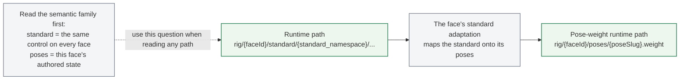
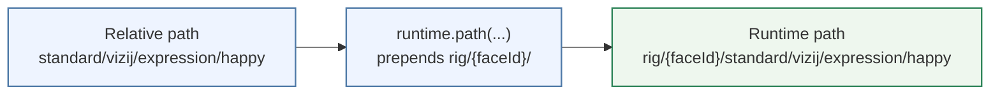

<!-- tags: family=guidebook; type=guidebook-module; editorial_status=completed; publication_status=live; topics=guidebook,control,paths,standard-controls -->

> **Last updated:** 2026-10-23
> **Purpose:** explain the core path and standard-control vocabulary behind visible runtime behavior

# Paths and Standard Controls

## Guidebook Context

| Axis | Position |
| --- | --- |
| Bucket chain | Previous: [Experience](../experience/README.md)<br>Current: [Control](README.md)<br>Next: [Customize](../customize/README.md) on the customization route or [Integrate](../integrate/README.md) on the fast route |
| Depth ladder in this bucket | Above: [First Control Interactions](first-control-interactions.md)<br>Current: `Fundamentals`<br>Below: [Orchestration and Diagnostics](orchestration-and-diagnostics.md) |
| Module position in this bucket | Previous in bucket: [First Control Interactions](first-control-interactions.md)<br>Current module: `Paths and Standard Controls`<br>Next in bucket: [Runtime Inputs and Semantics](runtime-inputs-and-semantics.md) |
| Reference bridges | [Renderer and Rigging Reference](../reference/renderer-and-rigging-reference.md)<br>[Runtime Quickstart Reference](../reference/runtime-quickstart-reference.md)<br>[Glossary and Terminology Bridge](../support/glossary-and-terminology-bridge.md) |
| Module type | concept page |
| Bucket overview | [Control](README.md) |

## Reader Outcome

After this page, you should be able to read common Vizij control paths, distinguish standard controls from pose-weight paths, and connect visible face behavior to the runtime values being written underneath it.

## Module Notes

This page is for readers who have already seen a face working and now need the mental model underneath it. It is especially useful after [Hello Face Quickstart](../experience/hello-face-quickstart.md).

The artifact here is the control vocabulary itself: runtime paths, the Vizij face standard's keys, and pose-weight paths. These are the stable handles that let different Vizij surfaces stay aligned.

## What You Need

You do not need to understand every runtime package to use this page.

It helps if you have already:

1. run `tutorial-fullscreen-face`,
2. looked briefly at its `useFaceHotkeys.ts`,
3. seen at least one face in `vizij-authoring`.

## The Core Idea

When you move a face in Vizij, you are usually writing a value to a path.

The visible UI or runtime surface may differ, but the underlying question stays the same:

1. what face is being controlled,
2. what path is being written,
3. what kind of control that path represents.

## Quick Term Bridge

Before you read the path grammar, keep these definitions nearby:

| Term | Read it as | Where it usually shows up first |
| --- | --- | --- |
| `path` | the runtime address a value is written to | hooks, diagnostics panels, bridge clients |
| `rig prefix` | `rig/{face}/`, the prefix every key of one face lives under | `runtime.rigPrefix`, `runtime.path(...)` |
| `standard control` | a key of the Vizij face standard, the same on every face: gaze, expressions, visemes, muscle controls | hotkeys, agent tools, player UIs |
| `pose weight` | the current strength of an authored facial state | pose panels, authored expression blending |
| `viseme` | a mouth shape of the face standard, `standard/vizij/viseme/<shape>` | speech and live-agent surfaces |

If you need the broader distinction between `runtime path`, `relative path`, `controller`, `driver`, `layer`, `mode`, and `stage`, use [Glossary and Terminology Bridge](../support/glossary-and-terminology-bridge.md).

## Three Forms of One Control

This page teaches how the same standard control appears in three forms: the
standard input path, the relative path, and the runtime path.

Keep those forms separate:

| Form | What you read or write | Example | Why it differs |
| --- | --- | --- | --- |
| standard input path | the authored form of a rig input | `/standard/vizij/left_eye/pos/x` | canonical inner `standard namespace` form, as the authoring app and a face's bundle carry rig inputs |
| relative path | a face's own key without its rig prefix | `standard/vizij/left_eye/pos/x` | the name the face standard gives the control, the same on every face; `runtime.path()` takes it |
| runtime path | the key in the face's device store | `rig/{face}/standard/vizij/left_eye/pos/x` | each face is an Arora device of its own, and its keys live under its rig prefix |

Use `standard namespace` for the inner `/standard/{standard_namespace}/...` segment.

In an app, build the runtime path from the relative one with `runtime.path(...)`
rather than by hand: `runtime.rigPrefix` is `rig/{face}/` for the face the
runtime loaded.

Over a bridge, write a key as the endpoint's key list (`list_keys`) gives it: a
bridge carries keys as they are, with no shorter alias in between. A client
writes only the keys listed as writable: the face's free inputs, which no graph
of its composition writes, by runtime path. A device that composes the ROS4HRI
mapping also opens the `standard/ros4hri/*` keys, which are device-scoped and
carry no rig prefix; the mapping writes the face's eye, lid and expression keys
from them, so those are not free inputs there.

## Canonical Mapping Table

Use this one control across all three forms:

| Form | Canonical shape | Example |
| --- | --- | --- |
| standard input path | `/standard/{standard_namespace}/{channel}/{track}/{attribute}` | `/standard/vizij/left_eye/pos/x` |
| relative path | `standard/{standard_namespace}/{channel}/{track}/{attribute}` | `standard/vizij/left_eye/pos/x` |
| runtime path | `rig/{face}/standard/{standard_namespace}/{channel}/{track}/{attribute}` | `rig/{face}/standard/vizij/left_eye/pos/x` |

## Standard Control Path Shape

The runtime-path shape for a standard control is:

```text
rig/{face}/standard/{standard_namespace}/{channel}/{track}/{attribute}
```

Examples:

1. `rig/{face}/standard/vizij/left_eye/pos/x`
2. `rig/{face}/standard/vizij/right_eye/pos/y`

Named keys of the Vizij face standard follow the same prefix:

1. `rig/{face}/standard/vizij/expression/happy`
2. `rig/{face}/standard/vizij/gaze/target/x`
3. `rig/{face}/standard/vizij/viseme/aa`

These keys are reusable across faces: each face maps them onto its own rig,
its rig reading some directly and its standard adaptation mapping the others
onto its poses and inputs (Quori's rig reads the eye positions, the lids and
`mouth/morph/jaw_open` itself). [Standard Inputs](../../concepts/deeper_exploration/STANDARD_INPUTS.md)
lists every key of the standard with its range.

The face standard's rule is one writer per key: a key one of the face's graphs
or programs writes every step is that writer's. A face whose program moves its
eyes writes the eye positions itself, so an app steers its gaze through the
gaze target (`standard/vizij/gaze/target/{x,y,weight}`) rather than the eye
positions. Where two of a face's sources do write one key (Quori's program and
its standard adaptation both write some of its brow, lower-lid and mouth keys),
the later write in the step wins.

## Pose Weight Path Shape

The common pose-weight shape is:

```text
rig/{face}/poses/{pose_slug}.weight
```

Examples:

1. `rig/{face}/poses/smile.weight`
2. `rig/{face}/poses/surprised.weight`

These are useful when you want a face's own authored poses, as a page that inspects one face's rig does (`demo-vizij-player`'s pose panel).

A face loaded with its standard adaptation writes its pose weights every step
from the standard's keys, so an app that drives such a face writes the standard's
expression and viseme keys, not the pose weights. A page that drives the pose
weights itself loads the face without the adaptation.

## Pose Groups Are Not Path Segments

Pose groups divide a face's poses into blend groups, such as visemes and
emotions. A group controls how its poses blend; it is not part of the input
path, which stays `rig/{face}/poses/{poseId}.weight` whatever group the pose
belongs to.

## Internal Pose-Control Routing

There is one other path family worth recognizing, but it is an internal runtime contract rather than a default face-facing control path:

```text
rig/{face}/pose/control/{inputId}
```

The face's pose-driver graph reads the pose weights (`poses/{poseId}.weight`) and writes one pose-control value per rig input its poses move; the rig graph reads those keys directly as inputs.

## Current Control-Family Inventory

At the route level, expect two face-facing runtime path families and one internal runtime-routing family, plus the authored form of the standard inputs:

| Family | Shape | Best used for | Common write sources | Do not collapse it into |
| --- | --- | --- | --- | --- |
| `standard input path` | `/standard/{standard_namespace}/{channel}/{track}/{attribute}` | the authored form of reusable standard controls | authoring, mapping tables | a runtime path |
| `runtime path` (standard) | `rig/{face}/standard/{standard_namespace}/...` | the face standard's controls at runtime: gaze, expressions, visemes, muscle controls, the conversation state | apps, agent tools, bridge clients, programs, `say` and `play_viseme` | a pose-weight path |
| `pose-weight path` | `rig/{face}/poses/{pose_slug}.weight` | a face's own authored poses | the standard adaptation, pose panels, animation tracks | a standard control |
| `internal pose-control path` | `rig/{face}/pose/control/{inputId}` | the pose-driver graph's outputs, which the rig graph reads as inputs | the pose-driver graph | a face-facing authored pose path |

Three rules keep this inventory readable:

1. animation tracks, programs, and skills are write sources, not separate face-facing path families by themselves,
2. pose groups define how subsets of poses blend, not separate path families or path segments,
3. a bridge client writes only the keys its endpoint lists as writable, by the same runtime path an app uses.

## Visible Interaction vs Runtime Meaning

In `Hello Face`, holding a key fades one of the face standard's expression
weights, `standard/vizij/expression/<name>`, up and back down, and a viseme key
calls the face's `play_viseme` method, which plays one mouth shape through the
face's lipsync envelope.

That difference matters:

1. an expression key is a standard control the app writes directly,
2. a viseme is played through a method, which writes the standard's viseme keys itself,
3. the face's standard adaptation turns both into the face's own pose weights,
4. both are runtime behavior, but they reach the face through different doors.

## Where These Paths Show Up

You will see these ideas repeated across Vizij:

1. in `tutorial-fullscreen-face` runtime hooks,
2. in `vizij-authoring` when inspecting or organizing controls,
3. in player panels that read and write a face's keys,
4. in bridge clients that drive a face from outside the page.

## Good Questions To Ask When Reading a Path

1. Is this path meant to be standard and reusable across faces?
2. Is this a named pose or a lower-level continuous control?
3. Does one of the face's graphs or programs already write it every step?
4. Would this path make sense to expose in a simple UI, or is it more diagnostic or advanced?

## Current Useful Visual

### Runtime Path Families

Understanding the two main runtime path families is more useful than trying to memorize every concrete path string first.



### From Relative Path To Runtime Path



The clearest current proof surface for this path vocabulary is the
`tutorial-fullscreen-face` app and its hook:

1. `apps/tutorial-fullscreen-face/src/hooks/useFaceHotkeys.ts`

## Success Check

You are done with this page when:

1. you can read a standard control path and say what kind of behavior it targets,
2. you can read a pose-weight path and say how it differs,
3. you can turn a relative path into the runtime path of one face,
4. you can explain why an expression key and a viseme reach the face through different doors.

## Implementation Anchors

Use these when you need the current implementation truth:

1. `vizij-web/packages/@vizij/runtime-react/README.md`
2. `vizij-web/packages/@vizij/runtime-react/DESIGN-1.0.md`, section 4: every intent and its key or method
3. `vizij-web/apps/tutorial-fullscreen-face/src/hooks/useFaceHotkeys.ts`
4. `vizij-rs/docs/face-standard.md`: every key of the Vizij face standard

## Recommended Next Steps

1. If you want the smallest runtime shell after understanding the path model, read [Minimal Web Player](../integrate/minimal-web-player.md).
2. If you want to understand how runtime meaning changes by control family, continue to [Runtime Inputs and Semantics](runtime-inputs-and-semantics.md).
3. If you want to make the face your own instead, branch later into the `Customize` bucket.
4. If you are already thinking about driving a face from outside the page, jump to [Operator and Deployment Model](../deploy/operator-and-deployment-model.md).
