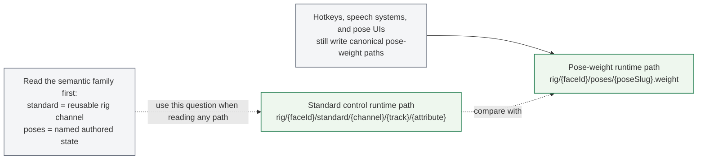
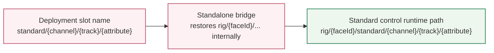

<!-- tags: type=guidebook-module; status=written; topics=guidebook,control,paths,standard-controls -->

> **Last updated:** 2026-03-15
> **Purpose:** explain the core path and standard-control vocabulary behind visible runtime behavior

# Paths and Standard Controls

## Guidebook Context

| Axis | Position |
| --- | --- |
| Bucket chain | Previous: [Experience](../experience/README.md)<br>Current: [Control](README.md)<br>Next: [Customize](../customize/README.md) on the customization route or [Integrate](../integrate/README.md) on the fast route |
| Depth ladder in this bucket | Above: [First Control Interactions](first-control-interactions.md)<br>Current: `Fundamentals`<br>Below: [Orchestration and Diagnostics](orchestration-and-diagnostics.md) |
| Module position in this bucket | Previous in bucket: [First Control Interactions](first-control-interactions.md)<br>Current module: `Paths and Standard Controls`<br>Next in bucket: [Runtime Inputs and Semantics](runtime-inputs-and-semantics.md) |
| Reference bridges | [Renderer and Rigging Reference](../reference/renderer-and-rigging-reference.md)<br>[Runtime Quickstart Reference](../reference/runtime-quickstart-reference.md)<br>[Glossary and Terminology Bridge](../support/glossary-and-terminology-bridge.md) |
| Module type | concept page |
| Bucket overview | [Control](README.md) |

## Reader Outcome

After this page, you should be able to read common Vizij control paths, distinguish standard controls from pose-weight paths, and connect visible face behavior to the runtime values being written underneath it.

## Module Notes

This page is for readers who have already seen a face working and now need the mental model underneath it. It is especially useful after [Hello Face Quickstart](../experience/hello-face-quickstart.md).

The artifact here is the control vocabulary itself: runtime input paths, standard control paths, pose-weight paths, and speech-facing pose labels that still write through the same pose path family. These are the stable handles that let different Vizij surfaces stay aligned.

## What You Need

You do not need to understand every runtime package to use this page.

It helps if you have already:

1. run `tutorial-fullscreen-face`,
2. looked briefly at `useMouseGaze.ts` or `usePoseHotkeys.ts`,
3. seen at least one face in `vizij-authoring`.

## The Core Idea

When you move a face in Vizij, you are usually writing a value to a path.

The visible UI or runtime surface may differ, but the underlying question stays the same:

1. what face is being controlled,
2. what path is being written,
3. what kind of control that path represents.

## Quick Term Bridge

Before you read the path grammar, keep these definitions nearby:

| Term | Read it as | Where it usually shows up first |
| --- | --- | --- |
| `path` | the runtime address a value is written to | hooks, diagnostics panels, transport clients |
| `standard control` | a reusable control family such as gaze, jaw, or brows | mouse gaze, resolved face controls, player UIs |
| `pose weight` | the current strength of an authored facial state | hotkeys, pose panels, authored expression blending |
| `viseme` | a speech-facing label for mouth-oriented poses, not a separate runtime path family | speech and live-agent surfaces |
| `slot` | a deployment-facing exposed control entry, not a synonym for every path | standalone operator control surfaces |

If you need the broader distinction between `runtime path`, `deployment slot name`, `controller`, `driver`, `layer`, `mode`, and `stage`, use [Glossary and Terminology Bridge](../support/glossary-and-terminology-bridge.md).

## Runtime Path Versus Deployment Slot

This page teaches the runtime-facing path grammar.

Keep that separate from the deployment-facing short slot names that the standalone endpoint exposes to clients:

| Surface | What you read or write | Example | Why it differs |
| --- | --- | --- | --- |
| runtime input path | full runtime path inside the face runtime | `rig/{face}/standard/left_eye/pos/x` | includes face identity because the runtime is writing into one specific face's control tree |
| deployment slot name | short operator-facing slot discovered from the endpoint | `standard/vizij/left_eye/pos/x` | the standalone bridge normalizes this external slot name into the runtime path it writes internally |
| namespaced observer key | runtime snapshot key in a shared orchestrator | `{namespace}/rig/{face}/standard/left_eye/pos/x` | shared orchestrator inspection can prefix the runtime path with namespace for observation and diagnostics |

If you are debugging the runtime itself, think in full runtime paths.

If you are driving `vizij-standalone`, copy the discovered slot name from the endpoint and let the bridge map it back into the internal runtime path.

## Standard Control Path Shape

The common standard-control shape is:

```text
rig/{face}/standard/{channel}/{track}/{attribute}
```

Examples:

1. `rig/{face}/standard/left_eye/pos/x`
2. `rig/{face}/standard/right_eye/pos/y`

In practice, these paths are useful when you want reusable, face-legible controls such as gaze and other common rig channels.

## Pose Weight Path Shape

The common pose-weight shape is:

```text
rig/{face}/poses/{pose_slug}.weight
```

Examples:

1. `rig/{face}/poses/smile.weight`
2. `rig/{face}/poses/surprised.weight`

These are useful when you want named facial states or authored expressions that can be triggered or blended.

## Speech-Facing Poses Still Use Pose Paths

Speech and live-agent surfaces often talk about `visemes` and `emotions`, but those labels do not create extra runtime path segments.

The current runtime-react contract is:

1. pose groups exist to divide poses into blend groups with group-specific blending behavior,
2. labels such as `viseme` or `emotion` may be useful for organizing those groups, but they are not the functional reason the groups exist,
3. speech-driven poses still write through the same per-pose path family,
3. the runtime-facing input path stays `rig/{face}/poses/{poseId}.weight`.

So if a speech system drives pose id `pose_p`, the write still lands on:

```text
rig/{face}/poses/pose_p.weight
```

The group controls how subsets of poses blend. It is not part of the input path.

## Internal Pose-Control Routing

There is one other path family worth recognizing, but it is an internal runtime contract rather than a default face-facing control path:

```text
rig/{face}/pose/control/{inputId}
```

Pose graphs emit these internal pose-control outputs. Runtime-react then inspects the registered rig inputs, auto-detects the matching runtime input path, and bridges the value onto the actual rig input when possible. That auto-detection prefers explicit direct rig inputs and falls back to the native `pose/control` input when needed.

## Current Control-Family Inventory

At the route level, expect two face-facing runtime path families, one internal runtime-routing family, and one external deployment alias:

| Family | Runtime shape or external alias | Best used for | Common write sources | Do not collapse it into |
| --- | --- | --- | --- | --- |
| `standard control path` | `rig/{face}/standard/{channel}/{track}/{attribute}` | reusable rig-facing channels such as gaze, jaw, and brows | hooks, sliders, operator clients, procedural outputs | a pose-weight path |
| `pose-weight path` | `rig/{face}/poses/{pose_slug}.weight` | authored named expression blending | hotkeys, pose panels, animation tracks, procedural outputs | a lower-level standard channel |
| `internal pose-control path` | `rig/{face}/pose/control/{inputId}` | pose-graph outputs that runtime-react bridges back onto the correct rig input | compiled pose graphs, runtime bridging | a face-facing authored pose path |
| `deployment slot name` | `standard/vizij/...` | external operator-facing writes through `vizij-standalone` | standalone clients and web control panels | the full internal runtime path |

Two rules keep this inventory readable:

1. animation tracks and procedural programs are common write sources, not separate face-facing path families by themselves,
2. pose groups define how subsets of poses blend, not separate path families or path segments,
3. deployment slot names are external aliases that the bridge maps back into internal runtime paths.

## Visible Interaction vs Runtime Meaning

In `Hello Face`, the mouse interaction is teaching standard control paths through eye movement.

The hotkeys are teaching pose-weight paths through visible expression changes.

That difference matters:

1. a standard path often represents a reusable channel like eye position,
2. a pose-weight path represents the strength of a named authored pose,
3. speech systems still stage pose weights, even when those poses belong to groups with different blend behavior,
4. both are runtime writes, but they describe different kinds of behavior.

## Where These Paths Show Up

You will see these ideas repeated across Vizij:

1. in `tutorial-fullscreen-face` runtime hooks,
2. in `vizij-authoring` when inspecting or organizing controls,
3. in player and deployment surfaces that send or receive typed values,
4. in operator and deployment surfaces where the face must be controlled predictably.

## Good Questions To Ask When Reading a Path

1. Is this path meant to be standard and reusable across faces?
2. Is this a named pose or a lower-level continuous control?
3. If this is speech-related, is it still writing a canonical pose-weight path while the pose groups continue to define blend behavior separately?
4. Would this path make sense to expose in a simple UI, or is it more diagnostic or advanced?

## Current Useful Visual

### Runtime Path Families

Understanding the two main runtime path families is more useful than trying to memorize every concrete path string first.



### Deployment Slot Mapping



The best wave-1 visual is still the existing `tutorial-fullscreen-face` screenshot plus the code in:

1. `apps/tutorial-fullscreen-face/src/hooks/useMouseGaze.ts`
2. `apps/tutorial-fullscreen-face/src/hooks/usePoseHotkeys.ts`

Those anchors remain the clearest current proof surface for this path vocabulary.

## Success Check

You are done with this page when:

1. you can read a standard control path and say what kind of behavior it targets,
2. you can read a pose-weight path and say how it differs,
3. you can explain why mouse gaze and pose hotkeys are not the same kind of control.

## Implementation Anchors

Use these when you need the current implementation truth:

1. `vizij-web/packages/@vizij/runtime-react/src/utils/posePaths.ts`
2. `vizij-web/packages/@vizij/runtime-react/src/utils/faceControls.ts`
3. `vizij-web/apps/tutorial-fullscreen-face/src/hooks/useMouseGaze.ts`
4. `vizij-web/apps/tutorial-fullscreen-face/src/hooks/usePoseHotkeys.ts`
5. `vizij-web/packages/@vizij/runtime-react/README.md`

## Recommended Next Steps

1. If you want the smallest runtime shell after understanding the path model, read [Minimal Web Player](../integrate/minimal-web-player.md).
2. If you want to understand how runtime meaning changes by control family, continue to [Runtime Inputs and Semantics](runtime-inputs-and-semantics.md).
3. If you want to make the face your own instead, branch later into the `Customize` bucket.
4. If you are already thinking about operator-facing slots, jump to [Operator and Deployment Model](../deploy/operator-and-deployment-model.md).
