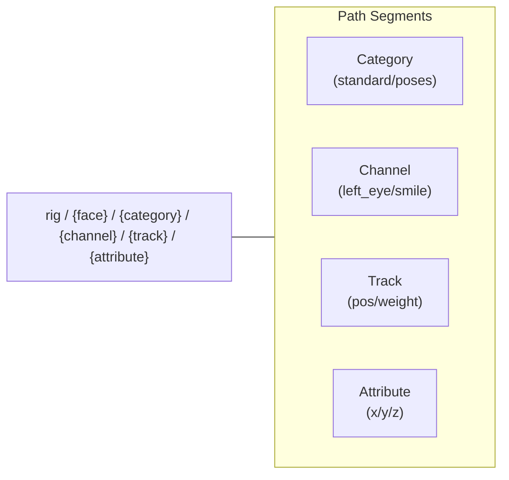

<!-- tags: type=guidebook-module; status=written; topics=guidebook,control,paths,standard-controls -->

> **Last updated:** 2026-03-12
> **Purpose:** explain the core path and standard-control vocabulary behind visible runtime behavior

# Paths and Standard Controls

## Guidebook Context

| Axis | Position |
| --- | --- |
| Bucket chain | Previous: [Experience](../experience/README.md)<br>Current: [Control](README.md)<br>Next: [Customize](../customize/README.md) on the customization route or [Integrate](../integrate/README.md) on the fast route |
| Depth ladder in this bucket | Above: [First Control Interactions](first-control-interactions.md)<br>Current: `Fundamentals`<br>Below: [Orchestration and Diagnostics](orchestration-and-diagnostics.md) |
| Module position in this bucket | Previous in bucket: [First Control Interactions](first-control-interactions.md)<br>Current module: `Paths and Standard Controls`<br>Next in bucket: [Runtime Inputs and Semantics](runtime-inputs-and-semantics.md) |
| Reference bridges | [Renderer and Rigging Reference](../reference/renderer-and-rigging-reference.md)<br>[Runtime Quickstart Reference](../reference/runtime-quickstart-reference.md)<br>[Glossary and Terminology Bridge](../support/glossary-and-terminology-bridge.md) |
| Module type | concept page |
| Bucket overview | [Control](README.md) |

## Reader Outcome

After this page, you should be able to read common Vizij control paths, distinguish standard controls from pose-weight paths, and connect visible face behavior to the runtime values being written underneath it.

## Module Notes

### Intended Audience

This page is for readers who have already seen a face working and now need the mental model underneath it.

It is especially useful after [Hello Face Quickstart](../experience/hello-face-quickstart.md).

### Artifact Being Touched

The artifact here is the control vocabulary itself:

1. runtime input paths,
2. standard control paths,
3. pose-weight paths,
4. related categories like visemes.

These are the stable handles that let different Vizij surfaces stay aligned.

## What You Need

You do not need to understand every runtime package to use this page.

It helps if you have already:

1. run `tutorial-fullscreen-face`,
2. looked briefly at `useMouseGaze.ts` or `usePoseHotkeys.ts`,
3. seen at least one face in `vizij-authoring`.

## The Core Idea

When you move a face in Vizij, you are usually writing a value to a path.

The visible UI or runtime surface may differ, but the underlying question stays the same:

1. what face is being controlled,
2. what path is being written,
3. what kind of control that path represents.

## Standard Control Path Shape

The common standard-control shape is:

```text
rig/{face}/standard/{channel}/{track}/{attribute}
```

Examples:

1. `rig/{face}/standard/left_eye/pos/x`
2. `rig/{face}/standard/right_eye/pos/y`

In practice, these paths are useful when you want reusable, face-legible controls such as gaze and other common rig channels.

## Pose Weight Path Shape

The common pose-weight shape is:

```text
rig/{face}/poses/{pose_name}.weight
```

Examples:

1. `rig/{face}/poses/smile.weight`
2. `rig/{face}/poses/surprised.weight`

These are useful when you want named facial states or authored expressions that can be triggered or blended.

## Viseme Weight Path Shape

### Control Category Comparison

| Category | Path Component | Use Case | Implementation |
| :--- | :--- | :--- | :--- |
| **Standard** | `/standard/` | Reusable gaze, jaw, brows | Consistent across rigs |
| **Poses** | `/poses/` | Named facial expressions | Authored in Customize |
| **Visemes** | `/visemes/` | Speech shaping / Lip sync | Mapped to phonemes |

Another common category is visemes:

```text
rig/{face}/visemes/{viseme_id}.weight
```

This matters later when speech or live conversation is involved, but the path idea is the same: named behavior mapped to a stable runtime address.

## Visible Interaction vs Runtime Meaning

In `Hello Face`, the mouse interaction is teaching standard control paths through eye movement.

The hotkeys are teaching pose-weight paths through visible expression changes.

That difference matters:

1. a standard path often represents a reusable channel like eye position,
2. a pose-weight path represents the strength of a named authored pose,
3. both are runtime writes, but they describe different kinds of behavior.

## Where These Paths Show Up

You will see these ideas repeated across Vizij:

1. in `tutorial-fullscreen-face` runtime hooks,
2. in `vizij-authoring` when inspecting or organizing controls,
3. in player and deployment surfaces that send or receive typed values,
4. in workshop and operator discussions where the face must be controlled predictably.

## Good Questions To Ask When Reading a Path

1. Is this path meant to be standard and reusable across faces?
2. Is this a named pose or a lower-level continuous control?
3. Does this path describe a visible movement, an expression state, or speech-related behavior?
4. Would this path make sense to expose in a simple UI, or is it more diagnostic or advanced?

## Current Useful Visual

### Path Anatomy

Understanding the segments of a path helps you navigate any Vizij face:



The best wave-1 visual is still the existing `tutorial-fullscreen-face` screenshot plus the code in:

1. `apps/tutorial-fullscreen-face/src/hooks/useMouseGaze.ts`
2. `apps/tutorial-fullscreen-face/src/hooks/usePoseHotkeys.ts`

Wave 2 can add a dedicated path-anatomy diagram.

## Success Check

You are done with this page when:

1. you can read a standard control path and say what kind of behavior it targets,
2. you can read a pose-weight path and say how it differs,
3. you can explain why mouse gaze and pose hotkeys are not the same kind of control.

## Implementation Anchors

Use these when you need the current implementation truth:

1. `current_documentation/guidebook/reference/renderer-and-rigging-reference.md`
2. `current_documentation/guidebook/reference/runtime-quickstart-reference.md`
3. `vizij-web/apps/tutorial-fullscreen-face/src/hooks/useMouseGaze.ts`
4. `vizij-web/apps/tutorial-fullscreen-face/src/hooks/usePoseHotkeys.ts`
5. `vizij-web/packages/@vizij/runtime-react/src/VizijRuntimeProvider.tsx`

## Recommended Next Steps

1. If you want the smallest runtime shell after understanding the path model, read [Minimal Web Player](../integrate/minimal-web-player.md).
2. If you want to make the face your own instead, branch later into the `Customize` bucket.
