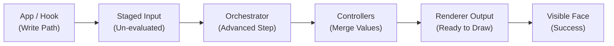

<!-- tags: type=guidebook-module; status=written; topics=guidebook,control,inputs,semantics -->

> **Last updated:** 2026-03-13
> **Purpose:** explain what runtime inputs mean, where they are written, and how visible face behavior maps to runtime semantics

# Runtime Inputs and Semantics

## Guidebook Context

| Axis | Position |
| --- | --- |
| Bucket chain | Previous: [Experience](../experience/README.md) Current: [Control](README.md) Next: [Customize](../customize/README.md) on the customization route or [Integrate](../integrate/README.md) on the fast route |
| Depth ladder in this bucket | Above: [First Control Interactions](first-control-interactions.md) Current: `Fundamentals` Below: [Orchestration and Diagnostics](orchestration-and-diagnostics.md) |
| Module position in this bucket | Previous in bucket: [Paths and Standard Controls](paths-and-standard-controls.md) Current module: `Runtime Inputs and Semantics` Next in bucket: [Control Surfaces and Configuration Layers](control-surfaces-and-configuration-layers.md) |
| Reference bridges | [Renderer and Rigging Reference](../reference/renderer-and-rigging-reference.md) [Runtime Quickstart Reference](../reference/runtime-quickstart-reference.md) [Glossary and Terminology Bridge](../support/glossary-and-terminology-bridge.md) |
| Module type | concept page |
| Bucket overview | [Control](README.md) |

## Reader Outcome

After this page, you should be able to explain what a Vizij runtime input is, how it relates to typed paths and values, and how visible behavior on a face maps to a more stable runtime meaning underneath.

## Module Notes

### Intended Audience

This page is for readers who already understand the basic path vocabulary from [Paths and Standard Controls](paths-and-standard-controls.md) and now need the next layer of runtime reasoning.

### Artifact Being Touched

The artifact here is not a single app screen. It is the runtime contract that multiple Vizij surfaces rely on:

1. typed paths,
2. typed values,
3. staged runtime inputs,
4. blackboard reads and writes,
5. output paths that can later be observed or rendered.

## What You Need

It helps if you have already:

1. completed [Hello Face Quickstart](../experience/hello-face-quickstart.md),
2. read [Paths and Standard Controls](paths-and-standard-controls.md),
3. seen at least one runtime app show loading, ready, and error states.

## The Core Semantic Chain

Visible face behavior is usually the end of a longer chain:

1. an app or hook decides to set an input,
2. the input is staged under a path,
3. graphs and animations read and write values against the shared runtime state,
4. the renderer receives the resulting animatable values,
5. the user sees a face change.

That is why the same visual behavior can show up in multiple apps. The UI is not the whole story. The runtime meaning is more stable than the surface.

## What A Runtime Input Actually Is

A runtime input is a value written with an explicit meaning.

The important parts are:

1. the path, which says what the input refers to,
2. the value, which says what data is being written,
3. the shape or expected kind of data, which keeps the runtime deterministic.

In the architecture primer, this is the `TypedPath` plus `Value` plus `Shape` contract.

That contract matters because Vizij does not want a control system that only works inside one UI. Inputs have to survive movement across apps, bundles, runtime controllers, and deployment surfaces.

## Staging, Reading, and Writing

The runtime is designed so inputs are staged first and then consumed during the runtime step.

At a high level:

1. the app stages a value,
2. the orchestrator advances a frame,
3. graphs and animations evaluate against the current state,
4. output values are merged deterministically,
5. the renderer applies the resulting values.

This is different from directly mutating a scene or attaching view-only state to a slider. Vizij is intentionally closer to a runtime control pipeline.

## Common Semantic Categories

### Semantic Categories

| Category | Meaning | Encountered In |
| :--- | :--- | :--- |
| **Standard** | Reusable rig channels (Gaze) | `Hello Face` / `useMouseGaze` |
| **Poses** | Authored expressions | `Hello Face` / `usePoseHotkeys` |
| **Speech-timed poses** | Speech-driven pose weights that still use canonical pose paths | `Agent Face` / `STT` |
| **Animations** | Time-based motion | `Authoring` / `Player` |
| **Outputs** | Derived runtime values | `Player` / `Diagnostics` |

The most useful categories for guidebook readers are:

1. standard controls, which expose reusable channels such as gaze or shared rig movement,
2. pose weights, which expose named authored states,
3. speech-timed pose driving, which still stages pose weights even when authoring groups those poses for different blend behavior,
4. animation controls, which drive authored time-based motion,
5. renderer outputs, which can be observed for UI, diagnostics, or logging.

These categories can all show up as paths, but they do not mean the same thing.

### Choose The Semantic Family First

Use this chooser before you start wiring a control or debugging a write:

| If you are trying to... | Likely semantic family | Why | Best next page |
| --- | --- | --- | --- |
| steer a reusable eye, brow, jaw, or similar channel | standard control | you are driving a reusable rig-facing channel directly | [Paths and Standard Controls](paths-and-standard-controls.md) |
| blend a named facial state such as `smile` | pose weight | you are changing the strength of an authored expression | [Poses](../customize/poses.md) |
| play or inspect motion over time | animation control | the main question is clip transport, timing, or playback | [Animations](../customize/animations.md) |
| drive speech-shaped mouth motion | speech-timed pose weight | the speech layer still writes a canonical pose-weight path, while pose groups continue to define how subsets of poses blend | [Animation, Integration, and Deployment Reference](../reference/animation-integration-and-deployment-reference.md) |
| inspect what the runtime resolved after evaluation | output path | you are validating the result of orchestration, not only the staged input | [Orchestration and Diagnostics](orchestration-and-diagnostics.md) |
| expose operator control through a deployment endpoint | deployment slot over runtime input | the client sees a deployment slot name, but the runtime still resolves it into the same typed input semantics underneath | [Operator and Deployment Model](../deploy/operator-and-deployment-model.md) |

## Why Semantics Matter More Than UI Labels

Two controls can look similar in a UI and still represent different semantics.

For example:

1. a slider that writes `rig/{face}/standard/left_eye/pos/x` is steering a reusable rig channel,
2. a slider that writes `rig/{face}/poses/smile.weight` is blending a named authored state,
3. a speech-driven system may still write `rig/{face}/poses/{poseId}.weight` without the user touching a control at all.

The visible widget is just a surface. The runtime meaning is the important teaching target.

Pose groups matter here because they determine how different subsets of poses blend together. They are not part of the runtime input path syntax.

## Where Readers See These Semantics In Practice

You can already see the semantic layers in the maintained apps:

1. `tutorial-fullscreen-face` stages gaze and pose inputs through tutorial hooks,
2. `tutorial-agent-face` layers conversation-driven viseme and expression behavior on top of the same runtime concepts,
3. `demo-vizij-player` exposes loading state, controllers, and output paths in a more application-like shell,
4. `vizij-standalone` maps externally driven values into deployment-facing control slots.

Those apps are different surfaces, but the runtime language underneath them is continuous.

That continuity is the main reason the guidebook keeps separating runtime meaning from surface labels:

1. a deployment client may discover and write slot names such as `standard/vizij/left_eye/pos/x`,
2. the standalone bridge then resolves those names into runtime paths such as `rig/{faceId}/standard/vizij/left_eye/pos/x`,
3. the underlying semantic family is still "standard control" even though the operator surface does not expose the full runtime path directly.

## A Useful Mental Model

If a reader gets lost, return to this question:

`What value is being written, to which path, by which part of the runtime, and why?`

That question usually clarifies whether the reader is dealing with:

1. a user input,
2. an authored pose or animation,
3. a derived controller output,
4. a deployment-facing control signal.

## Current Useful Diagram

### The Semantic Chain

Visible face behavior follows a structured multi-layer evaluation:

The screenshot shows the "ready" state where the face is active and responding to standard control writes.

Until then, the architecture primer is the best current textual diagram.

## Success Check

You are done with this page when:

1. you can explain why runtime inputs are more stable than any one UI,
2. you can distinguish staged inputs from rendered outputs,
3. you can describe how standard controls, poses, visemes, and animation-related values differ semantically.

## Implementation Anchors

Use these when you need the current implementation truth:

1. `current_documentation/concepts/ARCHITECTURE_PRIMER.md`
2. `vizij-web/packages/@vizij/runtime-react/README.md`
3. `vizij-web/apps/tutorial-fullscreen-face/src/hooks/useMouseGaze.ts`
4. `vizij-web/apps/tutorial-agent-face/src/FaceApp.tsx`
5. `vizij-web/apps/vizij-standalone/src/hooks/useWebSocketSync.ts`

## Recommended Next Steps

1. If you want to see how these runtime ideas become an application shell, continue to [Loading, Playback, and Embedding](../integrate/loading-playback-and-embedding.md).
2. If you want to stay on the fundamentals path inside `Control`, keep [Paths and Standard Controls](paths-and-standard-controls.md) nearby as the simpler vocabulary bridge.
3. If you need to reason about which surface owns each category, continue to [Control Surfaces and Configuration Layers](control-surfaces-and-configuration-layers.md).
