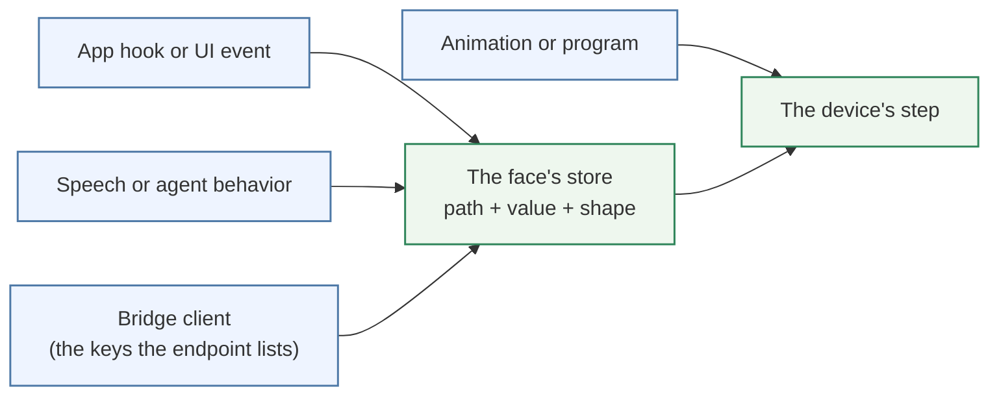
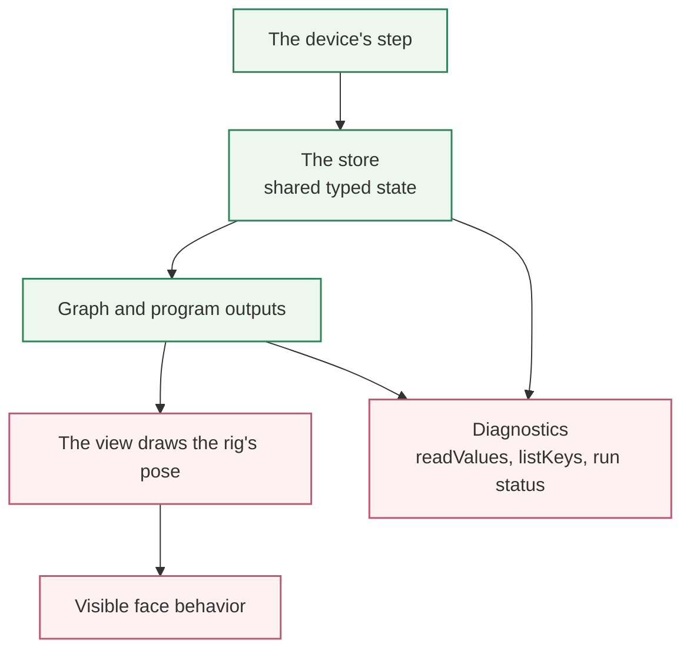

<!-- tags: family=guidebook; type=guidebook-module; editorial_status=completed; publication_status=live; topics=guidebook,control,inputs,semantics -->

> **Last updated:** 2026-10-23
> **Purpose:** explain what runtime inputs mean, where they are written, and how visible face behavior maps to runtime semantics

# Runtime Inputs and Semantics

## Guidebook Context

| Axis | Position |
| --- | --- |
| Bucket chain | Previous: [Experience](../experience/README.md) Current: [Control](README.md) Next: [Customize](../customize/README.md) on the customization route or [Integrate](../integrate/README.md) on the fast route |
| Depth ladder in this bucket | Above: [First Control Interactions](first-control-interactions.md) Current: `Fundamentals` Below: [Orchestration and Diagnostics](orchestration-and-diagnostics.md) |
| Module position in this bucket | Previous in bucket: [Paths and Standard Controls](paths-and-standard-controls.md) Current module: `Runtime Inputs and Semantics` Next in bucket: [Control Surfaces and Configuration Layers](control-surfaces-and-configuration-layers.md) |
| Reference bridges | [Renderer and Rigging Reference](../reference/renderer-and-rigging-reference.md) [Runtime Quickstart Reference](../reference/runtime-quickstart-reference.md) [Glossary and Terminology Bridge](../support/glossary-and-terminology-bridge.md) |
| Module type | concept page |
| Bucket overview | [Control](README.md) |

## Reader Outcome

After this page, you should be able to explain what a Vizij runtime input is, how it relates to typed paths and values, and how visible behavior on a face maps to a more stable runtime meaning underneath.

## Module Notes

This page is for readers who already understand the basic path vocabulary from [Paths and Standard Controls](paths-and-standard-controls.md) and now need the next layer of runtime reasoning.

The artifact here is not a single app screen. It is the runtime contract that multiple Vizij surfaces rely on: typed paths, typed values, the face's store, and the graphs, programs and modules that read and write it before the view draws the result.

## What You Need

It helps if you have already:

1. completed [Hello Face Quickstart](../experience/hello-face-quickstart.md),
2. read [Paths and Standard Controls](paths-and-standard-controls.md),
3. seen at least one runtime app show loading, ready, and error states.

## The Core Semantic Chain

Visible face behavior is usually the end of a longer chain:

1. an app, a hook, or a bridge client writes a key of the face's store, or calls one of the face's methods,
2. the face's device steps: its composed graph, its programs and skills, and its animation module read and write values in the store,
3. the rig holds the face's resulting pose,
4. the view draws that pose,
5. the user sees a face change.

That is why the same visual behavior can show up in multiple apps. The UI is not the whole story. The runtime meaning is more stable than the surface.

## What A Runtime Input Actually Is

A runtime input is a value written with an explicit meaning.

The important parts are:

1. the path, which says what the input refers to,
2. the value, which says what data is being written,
3. the shape or expected kind of data, which keeps the runtime deterministic.

In the architecture and concepts references, this is the `TypedPath` plus
`Value` plus `Shape` contract.

That contract matters because Vizij does not want a control system that only works inside one UI. Inputs have to survive movement across apps, bundles, bridges, and deployment surfaces.

## Writing, Stepping, and Drawing

A write lands in the face's store at once, and the device's next step carries it to the face.

At a high level:

1. the app writes a key (`runtime.setValue`, `writeValues`, a tween from `useAnimateValue`) or calls a method (`runtime.invoke`),
2. the device steps, once per animation frame under `VizijRuntimeProvider`,
3. the composed graph evaluates against the store, and the runs and modules beside it advance,
4. each key holds the last value written to it in the step,
5. the view draws the pose the rig holds.

This is different from directly mutating a scene or attaching view-only state to a slider. Vizij is intentionally closer to a runtime control pipeline.

## Common Semantic Categories

### Semantic Categories

| Category | Meaning | Encountered In |
| :--- | :--- | :--- |
| **Standard** | The face standard's keys: gaze, expressions, visemes | `Hello Face` / `useFaceHotkeys` |
| **Poses** | A face's own authored poses | `Player` / pose panel |
| **Visemes** | Mouth shapes that `say` and `play_viseme` write on the standard's viseme keys | `Agent Face` / `Hello Face` |
| **Animations** | Time-based motion | `Authoring` / `Player` |
| **Outputs** | Keys a graph or program writes every step | `Player` / `Diagnostics` |

The most useful categories for guidebook readers are:

1. standard controls, the face standard's keys, the same on every face,
2. pose weights, which expose a face's named authored states,
3. visemes, which the face's `say` and `play_viseme` methods write over time,
4. animation controls, which drive authored time-based motion through the face's animation module,
5. outputs, keys a graph or program writes, which can be read for UI, diagnostics, or logging.

These categories can all show up as paths, but they do not mean the same thing.

### Choose The Semantic Family First

Use this chooser before you start wiring a control or debugging a write:

| If you are trying to... | Likely semantic family | Why | Best next page |
| --- | --- | --- | --- |
| steer the gaze or show an expression | standard control | you are writing a key of the face standard, which each face maps onto its own rig | [Paths and Standard Controls](paths-and-standard-controls.md) |
| blend a named facial state such as `smile` | pose weight | you are changing the strength of one face's authored pose | [Poses](../customize/poses.md) |
| play or inspect motion over time | animation control | the main question is animation transport, timing, or playback | [Animations](../customize/animations.md) |
| drive speech-shaped mouth motion | viseme | the face's `say` and `play_viseme` methods write the face standard's viseme keys, which the face's standard adaptation maps onto its own mouth poses | [Animation, Integration, and Deployment Reference](../reference/animation-integration-and-deployment-reference.md) |
| inspect what the runtime resolved after a step | output | you are validating what the face's graphs and programs wrote, not only what you wrote | [Orchestration and Diagnostics](orchestration-and-diagnostics.md) |
| expose operator control through a deployment endpoint | bridge-written key | a client writes only the keys the endpoint lists as writable: the face's free inputs, by runtime path, and, where the ROS4HRI mapping is composed, the device-scoped `standard/ros4hri/*` keys | [Operator and Deployment Model](../deploy/operator-and-deployment-model.md) |

## Why Semantics Matter More Than UI Labels

Two controls can look similar in a UI and still represent different semantics.

For example:

1. a slider that writes `rig/{face}/standard/vizij/expression/happy` commands an expression of the face standard, which any face maps onto its own poses,
2. a slider that writes `rig/{face}/poses/smile.weight` is blending one face's authored pose,
3. a `say` run writes `rig/{face}/standard/vizij/viseme/{shape}` over time without the user touching a control at all.

The visible widget is just a surface. The runtime meaning is the important teaching target.

Pose groups matter here because they determine how different subsets of poses blend together. They are not part of the runtime input path syntax.

## Where Readers See These Semantics In Practice

You can already see the semantic layers in the maintained apps:

1. `tutorial-fullscreen-face` fades the face standard's expression keys and plays visemes from its hotkeys,
2. `tutorial-agent-face` layers the conversation state, the gaze target, expressions and visemes from a live agent on top of the same runtime concepts,
3. `demo-vizij-player` exposes loading state, the face's rig inputs, poses, animations, programs and keys in a more application-like shell,
4. the native `vizij` binary exposes a face's free inputs to bridge clients.

Those apps are different surfaces, but the runtime language underneath them is continuous: a hook, an agent tool, and a bridge client all address a face's keys by runtime path.

## A Useful Mental Model

If a reader gets lost, return to this question:

`What value is being written, to which path, by which part of the runtime, and why?`

That question usually clarifies whether the reader is dealing with:

1. a user input,
2. an authored pose or animation,
3. a graph's or program's output,
4. a deployment-facing control signal.

## Current Useful Diagram

### Semantic Entry Points

Different surfaces can begin the same semantic write:

### Runtime Resolution And Observation

After entry, the runtime resolves those writes through the same shared chain:

The cross-repo architecture doc and the concepts reference guide are the best current textual bridges.

## Success Check

You are done with this page when:

1. you can explain why runtime inputs are more stable than any one UI,
2. you can distinguish the keys you write from the keys the face's graphs and programs write,
3. you can describe how standard controls, poses, visemes, and animation-related values differ semantically.

## Implementation Anchors

Use these when you need the current implementation truth:

1. `current_documentation/concepts/REFERENCE_GUIDE.md`
2. `vizij-web/packages/@vizij/runtime-react/README.md`
3. `vizij-web/apps/tutorial-fullscreen-face/src/hooks/useFaceHotkeys.ts`
4. `vizij-web/apps/tutorial-agent-face/src/FaceApp.tsx`
5. `vizij-web/packages/@vizij/runtime-react/DESIGN-1.0.md`, section 4: every intent and its key or method

## Recommended Next Steps

1. If you want to see how these runtime ideas become an application shell, continue to [Loading, Playback, and Embedding](../integrate/loading-playback-and-embedding.md).
2. If you want to stay on the fundamentals path inside `Control`, keep [Paths and Standard Controls](paths-and-standard-controls.md) nearby as the simpler vocabulary bridge.
3. If you need to reason about which surface owns each category, continue to [Control Surfaces and Configuration Layers](control-surfaces-and-configuration-layers.md).
