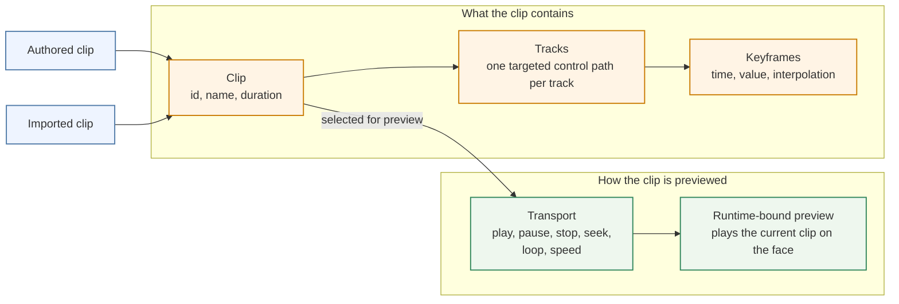
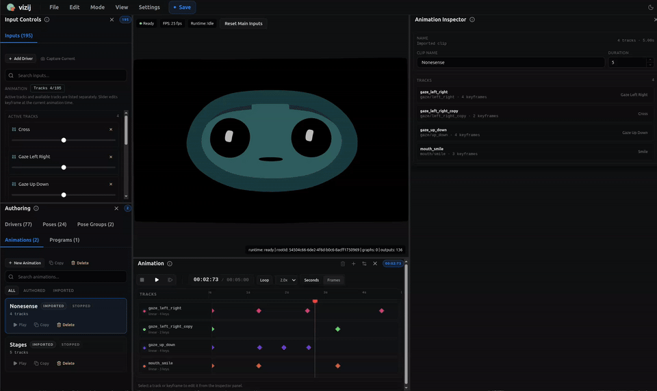
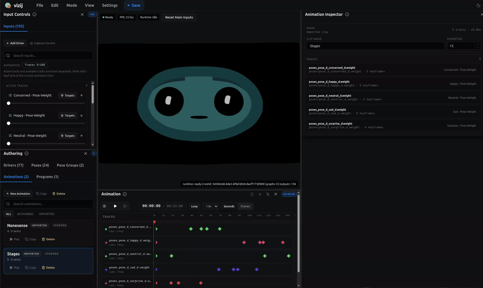

<!-- tags: type=guidebook-module; status=written; topics=guidebook,customize,animations,authoring -->

> **Last updated:** 2026-03-15
> **Purpose:** explain authored motion over time in Vizij and how animation authoring differs from poses before export

# Animations

## Guidebook Context

| Axis | Position |
| --- | --- |
| Bucket chain | Previous: [Control](../control/README.md)<br>Current: [Customize](README.md)<br>Next: [Integrate](../integrate/README.md) |
| Depth ladder in this bucket | Above: [Tweak an Existing Face](tweak-an-existing-face.md)<br>Current: `Fundamentals`<br>Below: [Deep Custom Pipeline](deep-custom-pipeline.md) |
| Module position in this bucket | Previous in bucket: [Poses](poses.md)<br>Current module: `Animations`<br>Next in bucket: [Procedural Programs](procedural-programs.md) |
| Reference bridges | [Renderer and Rigging Reference](../reference/renderer-and-rigging-reference.md)<br>[Validation Checkpoints](../support/validation-checkpoints.md)<br>[Troubleshooting Matrix](../support/troubleshooting-matrix.md) |
| Module type | concept page |
| Bucket overview | [Customize](README.md) |

## Reader Outcome

After this page, you should be able to explain what an animation is in Vizij, what a clip, track, and keyframe mean in the current authoring model, and how playback state and transport help you preview authored motion before export.

You should also be able to explain why animations are different from poses:

1. poses are named states,
2. animations are authored change over time.

## Module Notes

- Read this after [Rigging](rigging.md) and [Poses](poses.md) when you need authored motion instead of named static states.
- The page stays on the animation layer inside `vizij-authoring`: clips, tracks, keyframes, and transport preview, so readers can keep animation separate from poses, procedural logic, and runtime playback controls.
- Export packaging and runtime selection belong later in the route.

## What You Need

It helps if you have already read:

1. [Rigging](rigging.md)
2. [Poses](poses.md)
3. [Customization Concepts Primer](../introduction/customization-concepts-primer.md)

From `vizij-web`:

```bash
pnpm run dev:vizij-authoring
```

You do not need to understand export packaging or runtime embedding details yet.

## What Animation Means In Vizij

In Vizij, an animation is an authored clip of motion over time.

A clip answers questions that a pose does not:

1. which controls change,
2. when they change,
3. how long the motion lasts,
4. how values interpolate between authored moments.

The current authoring model represents this as an `AnimationClipIR` with:

1. a stable clip id,
2. an optional display name,
3. a duration,
4. one or more tracks,
5. clip metadata.

That is why animation authoring belongs after rigging and poses. It assumes there are already meaningful controls to animate.

## Poses Versus Animations

Keep this distinction sharp:

1. a pose is a named state,
2. an animation is a timed path through changing states.

A pose can describe `smile` or `blink` as a reusable state.

An animation can describe:

1. the face easing into a smile,
2. a blink happening quickly and then clearing,
3. a longer expression sequence across several seconds.

So poses answer "what state do I want?"

Animations answer "how does the face move through time?"

This page does not treat poses as obsolete. In current Vizij authoring, poses and animations are neighboring layers with different jobs.

## Clips, Tracks, and Keyframes



The authoring UI and store separate animation into a few learner-friendly parts.

### Clip

A clip is the whole authored animation unit.

In the current app, a clip has:

1. an id,
2. a name,
3. a duration in seconds,
4. a set of tracks.

The app supports both authored clips and imported clips. The inspector explicitly labels animation targets as `authored` or `imported`, which matters because you may be editing a locally authored timeline or inspecting animation that came in with a loaded bundle.

### Track

A track is the time-based history for one targeted control path.

In current implementation, each track stores:

1. a stable track id,
2. a `variableId`,
3. a resolved channel path,
4. interpolation mode,
5. a sequence of keyframes.

The practical meaning is simple: one track usually owns one thing you want to animate over time. The Animation panel builds tracks from visible, editable, selectable inputs, so the timeline stays tied to real authoring controls rather than loose labels.

### Keyframe

A keyframe is an authored value at a specific time.

Each keyframe stores at least:

1. an id,
2. a time,
3. a value,
4. optional interpolation override,
5. optional tangents for cubic shaping.

You can think of a keyframe as "at this moment, this control should be here."

The compiler then normalizes keyframes so the clip is deterministic:

1. times are clamped into clip duration,
2. interpolation values are normalized,
3. duplicate times are resolved predictably,
4. output channels are normalized to runtime-facing paths.

## What Playback State And Transport Mean

The playback controls in authoring are not the animation definition itself. They are the transport used to inspect and preview it.

Current animation transport state includes:

1. `playing`,
2. `paused`,
3. `stopped`.

The authoring app also tracks:

1. current time,
2. duration,
3. loop on or off,
4. play speed,
5. whether runtime transport is currently bound.

That means transport answers operational questions such as:

1. are we previewing right now,
2. where is the playback head,
3. should the clip loop,
4. should playback run faster or slower.

It does not answer the authored content question of what the clip contains. That comes from the tracks and keyframes.

## How Authoring Preview Connects To Runtime Transport

Current `vizij-authoring` does more than scrub values locally.

The animation transport hook can turn the authored timeline into a runtime animation asset, merge it with inherited bundle animations, and bind play, pause, stop, seek, and loop controls to the runtime preview surface.

That is useful for a learner because it explains why the playback controls matter:

1. they preview the authored motion against the actual runtime path,
2. they let authored and imported clips be inspected through the same playback model,
3. they surface real playback state instead of a fake editor-only timer.

This page still stays in `Customize` scope. You do not need to learn runtime integration details here. The important point is only that authoring preview is connected to the real playback path the system already knows how to consume later.

## What Readers Actually Do In The Current App

Current animation anchors:



_Caption: authoring a clip by creating timeline content, not just previewing an existing asset._



_Caption: transport controls driving playback and preview over the authored timeline._

These two loops are the strongest current teaching evidence for this page:

1. the creation capture shows clips, tracks, and keyframe editing as authored timeline work,
2. the player capture shows transport behavior in motion, including preview, pause, and clip playback inside the maintained authoring surface.

In the current authoring surface, animation work usually looks like this:

1. choose or create an animation clip,
2. set its duration,
3. add tracks for the visible inputs you want to animate,
4. place or adjust keyframes over time,
5. use play, pause, stop, seek, loop, step, and speed controls to preview the result,
6. inspect clip and track details in the inspector.

The inspector can show details such as:

1. clip name,
2. source as authored or imported,
3. duration,
4. track count,
5. track labels and channels.

That is enough for a reader to understand animation as an authored artifact rather than only a moving preview.

## A Useful Mental Model

Use this stack when you need to reason clearly:

1. rigging defines what can be driven,
2. poses define meaningful named states,
3. animations define how targeted values change over time,
4. transport lets you preview and inspect that motion,
5. export later packages the authored result for downstream use.

## Choose Animation When...

Use animation first when:

1. the behavior has a deliberate duration or beat,
2. the same motion should replay predictably,
3. the author needs clip, track, and transport control.

Do not use animation first when:

1. you only need a reusable named expression state; start with [Poses](poses.md),
2. the behavior should be computed continuously from live input; start with [Procedural Programs](procedural-programs.md).

If you keep that order clear, the Customize route stays teachable.

## Success Check

You are done with this page when:

1. you can explain the difference between a clip, a track, and a keyframe,
2. you can explain why an animation is not the same thing as a pose,
3. you can explain what `playing`, `paused`, and `stopped` describe,
4. you can explain why transport is a preview/control layer rather than the authored content itself,
5. you can explain why animation authoring belongs before export in the customization path.

## Implementation Anchors

Use these when you need the current implementation truth:

1. `vizij-web/apps/vizij-authoring/src/state/animationStore.ts`
2. `vizij-web/apps/vizij-authoring/src/types/animationClipIr.ts`
3. `vizij-web/apps/vizij-authoring/src/utils/animationClipCompiler.ts`
4. `vizij-web/apps/vizij-authoring/src/components/panels/AnimationPanel.tsx`
5. `vizij-web/apps/vizij-authoring/src/components/inspector/InspectorPanel.tsx`
6. `vizij-web/apps/vizij-authoring/src/hooks/useAnimationTransport.ts`
7. `vizij-web/apps/vizij-authoring/e2e/runtime-sessions.workflow.pw.ts`

## Recommended Next Steps

If you want to understand what artifact leaves authoring after rigging, poses, and animations are in place, continue to [Export](export.md).
