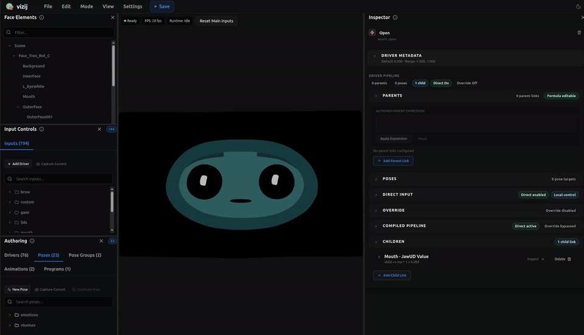
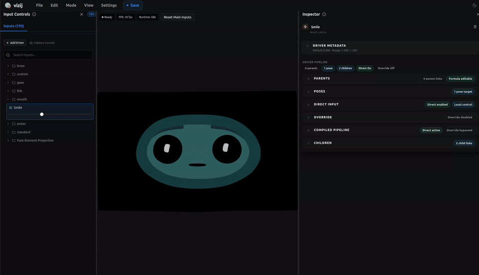

<!-- tags: type=guidebook-module; status=written; topics=guidebook,customize,advanced,pipeline,export -->

> **Last updated:** 2026-03-12
> **Purpose:** synthesize the full advanced customization route from supported input through export-ready artifact without collapsing the stages into one vague authoring task

# Deep Custom Pipeline

## Guidebook Context

| Axis | Position |
| --- | --- |
| Bucket chain | Previous: [Control](../control/README.md)<br>Current: [Customize](README.md)<br>Next: [Integrate](../integrate/README.md) |
| Depth ladder in this bucket | Above: [Tweak an Existing Face](tweak-an-existing-face.md), [Import](import.md), [Reference-Face Transfer](reference-face-transfer.md), [Rigging](rigging.md), [Poses](poses.md), [Animations](animations.md), [Procedural Programs](procedural-programs.md), [Export](export.md)<br>Current: `Advanced`<br>Below: none, this is the deepest current depth in this bucket |
| Module position in this bucket | Previous in bucket: [Export](export.md)<br>Current module: `Deep Custom Pipeline`<br>Next in bucket: none, this is the last module in the bucket sequence |
| Reference bridges | [Renderer and Rigging Reference](../reference/renderer-and-rigging-reference.md)<br>[Validation Checkpoints](../support/validation-checkpoints.md)<br>[Troubleshooting Matrix](../support/troubleshooting-matrix.md) |
| Module type | walkthrough |
| Bucket overview | [Customize](README.md) |

## Reader Outcome

After this page, you should be able to carry one believable face package through a full advanced customization pass:

1. start from a supported face or imported asset,
2. establish or repair controllable structure,
3. author meaningful states and behavior,
4. validate export readiness,
5. export a believable artifact and hand it off to `Integrate`.

## Module Notes

### Intended Audience

This page is for readers who have already gone through the `Customize` fundamentals and now need the whole route in one view.

It is especially for readers who might otherwise think advanced customization means:

1. doing more of the same UI work,
2. making many changes without staged validation,
3. treating export as an afterthought.

### Why This Page Exists

The fundamentals pages teach each stage separately because they need their own conceptual boundaries.

This page exists because advanced readers eventually need to see how those stages fit together as one route.

Without this synthesis page, the common failure mode is:

`I changed many things in authoring, so I must be near the finish line.`

That is not reliable enough.

The deep pipeline only works when each stage produces the right kind of artifact for the next one.

### Artifact Being Touched

The artifact here is the full authored face package as it moves through authoring:

1. imported or chosen face data,
2. authored control structure,
3. pose and motion behavior,
4. export validation state,
5. bundled output ready for later runtime use.

This is not one edit. It is a staged pipeline.

### What This Page Does And Does Not Cover

This page does cover:

1. the sequence of the full customization route,
2. the staged checkpoints between import and export,
3. the handoff from advanced customization into `Integrate`.

This page does not cover:

1. robot or ROS integration,
2. deployment topology,
3. low-level runtime namespacing work,
4. deep compile or IR internals beyond export-readiness signals.

Those belong in later buckets or deeper implementation docs.

## What You Need

You should already understand:

1. [Import](import.md),
2. [Reference-Face Transfer](reference-face-transfer.md),
3. [Rigging](rigging.md),
4. [Poses](poses.md),
5. [Animations](animations.md),
6. [Procedural Programs](procedural-programs.md),
7. [Export](export.md).

The current implementation anchors live mainly in `vizij-web/apps/vizij-authoring`.

## Starting State

Use the `vizij-web` workspace root:

```bash
cd /home/chris/Code/Semio/vizij_ws/vizij-web
pnpm run dev:vizij-authoring
```

This walkthrough assumes you are starting from one of two believable bases:

1. a maintained preset face that already loads cleanly in `vizij-authoring`,
2. an imported face that has already made it through the earlier `Customize` fundamentals.

If you do not have one of those yet, stop and go back to [Tweak an Existing Face](tweak-an-existing-face.md) or [Import](import.md).

## Walkthrough

Current pipeline motion anchor:



_Caption: the deep route crossing several authoring surfaces as the work moves from structure into behavior and validation._

This clip is not a full authored workflow map, but it is the best current route-faithful capture for this section because it shows the advanced pipeline crossing several real authoring surfaces instead of pretending deep customization happens in one undifferentiated panel.

Counterexample anchor:



_Caption: an unstable intermediate capture that looks active but does not represent a trustworthy pipeline milestone._

Keep this second clip in mind as the wrong shape for the deep route. It is useful here precisely because it records an unstable intermediate authoring moment: something is happening in the tool, but it is not the kind of clean, trustworthy stage transition you should treat as pipeline success.

### 1. Start from a supported base and name the route

Load the maintained preset or imported face you are going to carry through the rest of the pipeline.

Action:

1. load the face and wait for the preview plus side panels to populate,
2. decide whether this artifact is mainly headed toward `Control`, `Customize`, or `Integrate`,
3. state out loud what you expect this face to become by the end of the walkthrough.

Expected result:

1. the starting artifact is visible and stable,
2. you are not doing vague “more authoring” work,
3. the pipeline has a believable destination.

If the starting artifact is still unclear, every later stage becomes harder to trust.

### 2. Establish controllable structure before authoring more behavior

The next job is not visual polish. It is controllable structure.

Action:

1. inspect the loaded face and confirm the targets you need are actually present,
2. check whether copied or transferred structure landed where you expect,
3. stop immediately if the structure is still ambiguous.

Expected result:

1. the right targets exist,
2. the structure is mapped in a Vizij-usable way,
3. later authored behavior has something stable to drive.

If this stage is weak, later poses, animations, or procedural behavior will look more successful than they really are. Route back to [Reference-Face Transfer](reference-face-transfer.md) or [Rigging](rigging.md) rather than pushing forward.

### 3. Add one named state and one behavior layer

Once the structure is trustworthy, make the artifact do something more deliberate than a static edit.

Action:

1. create or confirm one named pose that expresses a meaningful state,
2. add one motion layer on top of that structure through [Animations](animations.md) or [Procedural Programs](procedural-programs.md),
3. verify that the visible behavior now reflects real authored intent rather than one-off tweaking.

Expected result:

1. the artifact has at least one named state,
2. it has at least one authored motion or computed behavior layer,
3. you can explain why you chose that behavior layer instead of treating all advanced authoring tools as interchangeable.

### 4. Run export readiness before you call the route complete

A deep custom pipeline becomes reliable only when export readiness is treated as a real checkpoint.

Action:

1. open the export flow,
2. read the audit and warning surfaces instead of treating export as a blind file write,
3. clear any blocker that means the artifact is still structurally or behaviorally untrustworthy.

Expected result:

1. the bundle is coherent enough to leave authoring,
2. unresolved structure mistakes are caught before handoff,
3. export is functioning as a route milestone rather than only a file operation.

If warnings still indicate unresolved structure, route back to [Rigging](rigging.md), [Poses](poses.md), [Animations](animations.md), [Procedural Programs](procedural-programs.md), or [Export](export.md) as appropriate.

### 5. Export one bundle and define the handoff

The output of this route is not deployment. It is an artifact that is believable enough to enter `Integrate`.

Action:

1. export one bundle you are willing to treat as the current handoff artifact,
2. note what this artifact now proves,
3. choose the first `Integrate` page you will use to validate the handoff.

Expected result:

1. the artifact has actually crossed the authoring boundary,
2. you know whether the next practical stop is [Loading, Playback, and Embedding](../integrate/loading-playback-and-embedding.md) or a later `Integrate` page,
3. the route has moved forward instead of stalling in endless authoring.

## Common Failure Points In This Walkthrough

Use these reroutes instead of pushing forward with a weak artifact:

1. if the starting artifact is not yet believable, go back to [Tweak an Existing Face](tweak-an-existing-face.md) or [Import](import.md),
2. if copied or transferred structure is still unreliable, go back to [Reference-Face Transfer](reference-face-transfer.md) or [Rigging](rigging.md),
3. if the face has structure but no convincing authored behavior, go back to [Poses](poses.md), [Animations](animations.md), or [Procedural Programs](procedural-programs.md),
4. if export still feels like guesswork, go back to [Export](export.md) before entering `Integrate`.

## Success Check

You are done with this page when:

1. you have carried one believable face package through structure, behavior, readiness, and export,
2. you can explain why controllable structure must come before authored behavior,
3. you can explain why export readiness is its own milestone,
4. you know that the next bucket after a successful deep custom pipeline is `Integrate`.

## Implementation Anchors

Use these when you need the current implementation truth:

1. `vizij-web/apps/vizij-authoring/README.md`
2. `vizij-web/apps/vizij-authoring/docs/Authoring_Blueprint.md`
3. `vizij-web/apps/vizij-authoring/src/hooks/useVizijExport.ts`
4. `vizij-web/apps/vizij-authoring/src/utils/bundleAudit.ts`
5. `current_documentation/guidebook/customize/export.md`
6. `current_documentation/guidebook/customize/procedural-programs.md`
7. `current_documentation/guidebook/integrate/loading-playback-and-embedding.md`

## Recommended Next Steps

1. If you still need to stabilize the artifact boundary, go back to [Export](export.md).
2. If the face is ready to leave authoring, continue to [Loading, Playback, and Embedding](../integrate/loading-playback-and-embedding.md).
3. If the next job is a richer app shell instead of a minimal handoff, continue later to [Rich Interactive Applications](../integrate/rich-interactive-applications.md).
