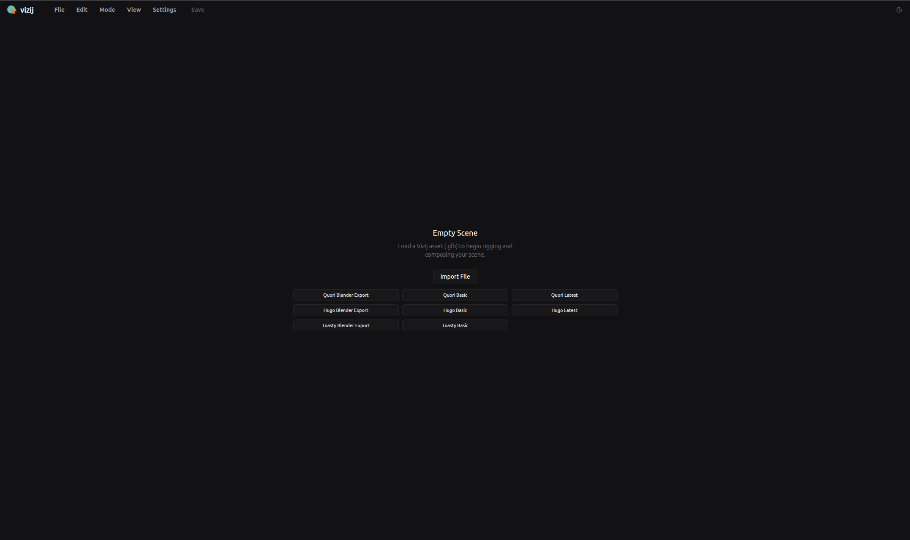
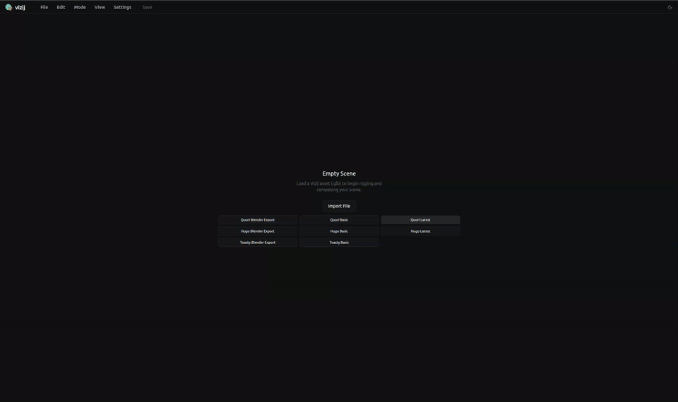

<!-- tags: family=guidebook; type=guidebook-module; editorial_status=completed; publication_status=planned; topics=guidebook,customize,import,authoring -->

> **Last updated:** 2026-03-31
> **Purpose:** explain what import brings into vizij-authoring, what the tool validates during import, and where import stops

# Import

## Guidebook Context

| Axis | Position |
| --- | --- |
| Bucket chain | Previous: [Control](../control/README.md)<br>Current: [Customize](README.md)<br>Next: [Integrate](../integrate/README.md) |
| Depth ladder in this bucket | Above: [Tweak an Existing Face](tweak-an-existing-face.md)<br>Current: `Fundamentals`<br>Below: [Deep Custom Pipeline](deep-custom-pipeline.md) |
| Module position in this bucket | Previous in bucket: [Tweak an Existing Face](tweak-an-existing-face.md)<br>Current module: `Import`<br>Next in bucket: [Reference-Face Transfer](reference-face-transfer.md) |
| Reference bridges | [Renderer and Rigging Reference](../reference/renderer-and-rigging-reference.md)<br>[Validation Checkpoints](../support/validation-checkpoints.md)<br>[Troubleshooting Matrix](../support/troubleshooting-matrix.md) |
| Module type | concept page |
| Bucket overview | [Customize](README.md) |

## Reader Outcome

After this page, you should be able to explain what `vizij-authoring` imports, what the import flow assumes about the incoming face and metadata, and why import is a separate concern from reference-face transfer.

## Module Notes

- This page is for the start of the authoring route: getting a face and its metadata into a usable session.
- The focus is import plus normalization and compatibility checks, not later transfer workflows.
- Treat [Reference-Face Transfer](reference-face-transfer.md) as a separate reuse step rather than part of import.

## What You Need

From `vizij-web`:

```bash
pnpm run dev:vizij-authoring
```

It also helps if you have already read:

1. [Tweak an Existing Face](tweak-an-existing-face.md)
2. [Customization Concepts Primer](../introduction/customization-concepts-primer.md)

You do not need to understand reference-face workflows yet.

Skip directly to [Reference-Face Transfer](reference-face-transfer.md) if your main face is already loaded and your real goal is to borrow variables or poses from a second face rather than establish a new authoring session.

## What Import Means In Vizij

Current import-state anchors:



_Caption: the empty-scene import boundary before any face or metadata is treated as a live authoring session._



_Caption: the staged transition from empty scene into a mounted, usable authoring session._

These captures are the most useful current visual proof for import because they show the session boundary clearly:

1. the empty-scene state before a face is trusted,
2. the centered import and preset actions,
3. the transition from "no artifact loaded yet" into a real authoring session.

In Vizij, import is the process of turning an incoming face plus any attached authored metadata into a usable `vizij-authoring` session.

That is broader than file selection alone.

The current authoring tool treats import as a staged workflow that has to:

1. read the source,
2. parse the scene and locate the Vizij root,
3. extract bundled metadata when present,
4. reset the current session state cleanly,
5. mount the face into the runtime preview,
6. synchronize rig and pose data into authoring state,
7. normalize imported graphs or mappings before the session is treated as ready.

That is why import belongs in `Customize`: it is where the editable authored artifact enters the tool.

## What Can Come Into Authoring

The current maintained authoring README describes four main entry shapes:

1. a local `.glb` file,
2. a pasted URL,
3. a GraphSpec JSON or IR import,
4. a bundled GLB that already carries Vizij metadata.

Those entry points do not all mean the same thing.

A bundled GLB can arrive with useful authored structure already attached. A graph or pose import can arrive needing remap or review. A raw face asset can require the tool to build or rehydrate more of the session around it.

The key teaching point is that import is about establishing a trustworthy authoring session, not merely accepting bytes.

## What The Import Flow Assumes

Import assumes that the incoming material can be related to the current runtime-truthful authoring model.

In the current architecture and hooks, that means import cares about questions such as:

1. can the tool find the Vizij root and mount the face,
2. does the incoming bundle contain rig or pose data that can be synchronized,
3. do imported rig paths and generated low-level channels line up with the current `/propsrig/...` contract,
4. do pose graph inputs and outputs map to real standard inputs on the loaded face,
5. does face identity need to be normalized or remapped before imported authored data can be trusted.

Import is therefore where compatibility begins to matter.

## Normalization, Remap, and Compatibility Checks

The current import hooks do not treat imported metadata as automatically correct.

### Asset load and session bootstrap

`useVizijAssetLoader.ts` makes import visible as a multi-stage session bootstrap. The current flow includes milestones and substeps for:

1. selecting the source,
2. loading the face asset,
3. validating the root,
4. resetting prior session state,
5. mounting the runtime world,
6. synchronizing bundle state,
7. stabilizing the runtime bridge.

That staged model is important because import is responsible for getting the face into a usable preview state before deeper authoring makes sense.

### Rig graph normalization

`useRigGraphImport.ts` shows that rig import is not blind ingestion.

It explicitly deals with:

1. canonical `/propsrig/...` paths,
2. imported-versus-rebuilt graph comparison,
3. face-id rewriting or namespace cleanup,
4. discrepancy review when imported and rebuilt structures do not line up cleanly,
5. deterministic normalization rather than silent drift.

This is why import has its own teaching boundary: the tool is trying to preserve author intent without allowing malformed graph state to become invisible.

### Pose graph remap

`usePoseGraphImport.ts` applies the same discipline to pose graphs.

The hook:

1. reads the imported graph,
2. remaps it into the current face segment,
3. inspects outputs and candidate inputs,
4. auto-matches safe rows where it can,
5. surfaces review rows when human judgment is still needed,
6. blocks application when remap conflicts are unresolved.

So import is not only “load pose data.” It is also “make sure the loaded pose data points at the current face truthfully.”

## What Import Does Not Do

Import is not the same as reference-face transfer.

That later module is about opening a second face as a reference context and copying or mapping variables or poses from that reference into the main face with explicit review and confirmation.

Import also does not, by itself, teach:

1. how to define rig structure,
2. how to reason about pose groups,
3. how to author animations,
4. how to export the finished result,
5. how to integrate the authored output into an application.

Those are separate modules because they prevent different mistakes.

## A Useful Mental Model

Use this sequence when reasoning about import:

1. bring a face and any existing authored metadata into authoring,
2. let the tool establish a clean runtime-truthful session,
3. normalize or remap imported rig and pose data where needed,
4. then move deeper into transfer, rigging, poses, animations, or export.

If you skip that sequence, later authoring work can be built on a session you do not actually trust.

## Success Check

You are done with this page when:

1. you can name the main things that may enter `vizij-authoring` during import,
2. you can explain why the import flow has validation, normalization, and remap stages,
3. you can explain why reference-face transfer is a different module,
4. you know that import establishes the authoring session rather than completing the whole customization pipeline.

## FAQ: Why Import Is Separate

### Why is import not the same as reference-face transfer?

Import establishes the main authoring session.

Reference-face transfer opens a second face as a helper context and copies selected authored information into the already-loaded main face with review gates.

### Why is import not the same as rigging?

Import gets the face and any carried metadata into a trustworthy working session.

Rigging explains and repairs the controllable structure that later authoring layers rely on inside that session.

### Why is import not the same as export?

Import is the entry boundary into authoring.

Export is the packaging boundary that carries authored work back out toward runtime consumers.

## Implementation Anchors

Use these when you need the current implementation truth:

1. `vizij-web/apps/vizij-authoring/README.md`
2. `vizij-web/apps/vizij-authoring/docs/Authoring_Blueprint.md`
3. `vizij-web/apps/vizij-authoring/docs/ARCHITECTURE.md`
4. `vizij-web/apps/vizij-authoring/src/App.tsx`
5. `vizij-web/apps/vizij-authoring/src/hooks/useVizijAssetLoader.ts`
6. `vizij-web/apps/vizij-authoring/src/hooks/useRigGraphImport.ts`
7. `vizij-web/apps/vizij-authoring/src/hooks/usePoseGraphImport.ts`

## Recommended Next Steps

1. If you want to understand controlled authoring-side copying between two faces, continue to [Reference-Face Transfer](reference-face-transfer.md).
2. If you want to understand what controllable structure the imported session is trying to preserve, continue to [Rigging](rigging.md).
