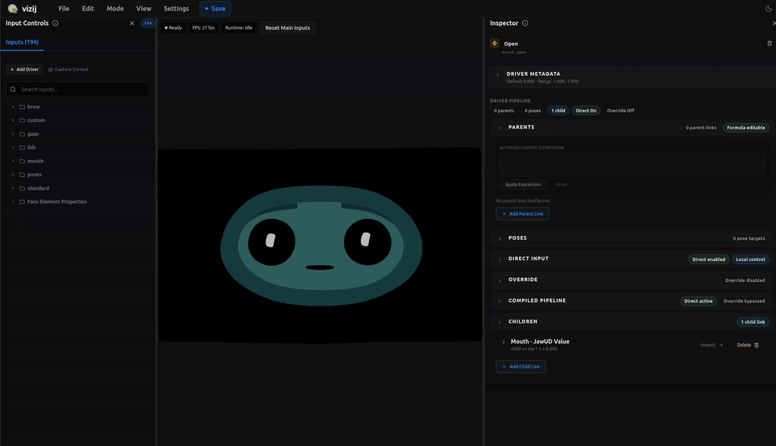
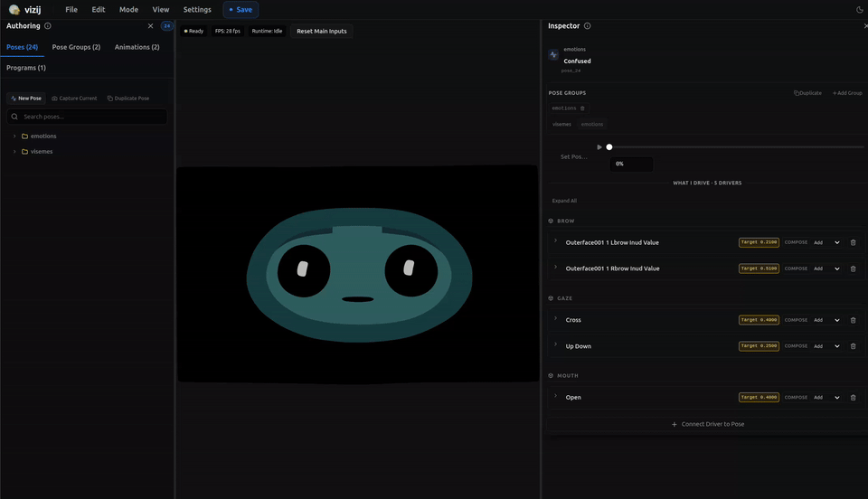
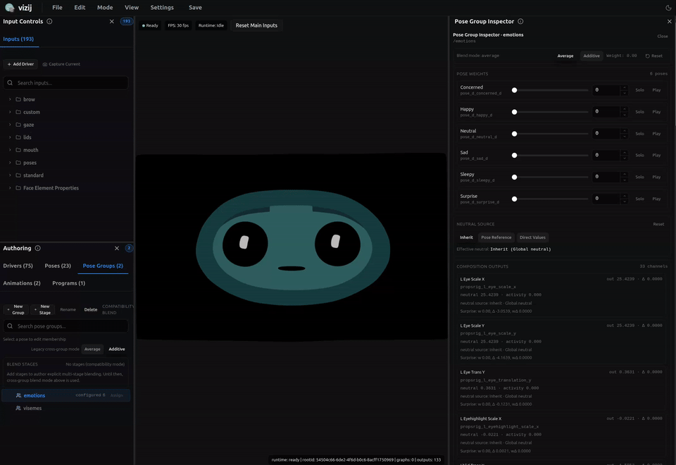

<!-- tags: type=guidebook-module; status=written; topics=guidebook,customize,poses,authoring -->

> **Last updated:** 2026-03-13
> **Purpose:** explain named authored states in Vizij and how pose semantics sit between rigging and animation

# Poses

## Guidebook Context

| Axis | Position |
| --- | --- |
| Bucket chain | Previous: [Control](../control/README.md)<br>Current: [Customize](README.md)<br>Next: [Integrate](../integrate/README.md) |
| Depth ladder in this bucket | Above: [Tweak an Existing Face](tweak-an-existing-face.md)<br>Current: `Fundamentals`<br>Below: [Deep Custom Pipeline](deep-custom-pipeline.md) |
| Module position in this bucket | Previous in bucket: [Rigging](rigging.md)<br>Current module: `Poses`<br>Next in bucket: [Animations](animations.md) |
| Reference bridges | [Renderer and Rigging Reference](../reference/renderer-and-rigging-reference.md)<br>[Validation Checkpoints](../support/validation-checkpoints.md)<br>[Troubleshooting Matrix](../support/troubleshooting-matrix.md) |
| Module type | concept page |
| Bucket overview | [Customize](README.md) |

## Reader Outcome

After this page, you should be able to explain what a pose is in Vizij, how poses are grouped and weighted, and why poses are different from both raw rig inputs and animations over time.

## Module Notes

- Read this after [Rigging](rigging.md) when you need named, reusable authored states rather than one-off slider edits.
- The page stays on the authored pose layer: named values, grouping, blend behavior, and the controls that later runtime surfaces can trigger consistently.
- Use [Animations](animations.md) for motion over time and [Procedural Programs](procedural-programs.md) for computed behavior.

## What You Need

From `vizij-web`:

```bash
pnpm run dev:vizij-authoring
```

It also helps if you have already read:

1. [Rigging](rigging.md),
2. [Customization Concepts Primer](../introduction/customization-concepts-primer.md).

You do not need to understand animation playback transport yet.

## Quick reference

| If you mean... | Stay here? | Better next page |
| --- | --- | --- |
| a named reusable facial state | yes | this page |
| a timed motion sequence | no | [Animations](animations.md) |
| a continuously computed response | no | [Procedural Programs](procedural-programs.md) |

## What A Pose Means In Vizij

In Vizij, a pose is a named facial state defined over rig inputs.

That state is semantic rather than purely mechanical. A pose gives a reader or runtime a meaningful handle such as:

1. smile,
2. blink,
3. surprised,
4. any other authored expression or state the face needs.

The important point is that a pose does not directly rewrite animatable scene leaves.

In the current authoring and runtime contract:

1. poses target rig inputs by identity,
2. pose authoring is compiled into pose graph behavior,
3. pose graph outputs feed internal pose-control paths,
4. the rig graph still owns final composition into effective channel values.

That is why poses belong after `Rigging`: they assume a trustworthy control structure already exists.

## How Poses Differ From Raw Rig Tweaking

Raw rig tweaking is about changing a live control value directly.

Pose authoring is about storing a named target state so that the same expression can be recalled and blended later.

That difference matters.

When you tweak a rig input directly, you are changing the face right now.

When you author a pose, you are defining:

1. which rig inputs matter for that state,
2. what target values those inputs should move toward,
3. how that state should be addressed later as a named concept.

So a pose is closer to a reusable authored state than to an isolated editor gesture.

## Identity, Grouping, and Weight

The current pose system treats identity and grouping as first-class behavior.

### Pose identity

Each pose has a stable identity rather than only a display label.

That matters for:

1. weight-control paths,
2. grouping and membership,
3. import and export round-trips,
4. later runtime triggering.

Current architecture docs call out canonical per-pose weight paths:

`rig/{face}/poses/{poseId}.weight`

That gives each pose one stable runtime-facing control regardless of how the pose is grouped in authoring.

### Pose groups

Poses can belong to one or more pose groups.

In the current model, group membership is identity-driven and normalized for compatibility rather than being only a loose path convention.

Groups matter because they let authoring express semantic collections such as:

1. related facial expressions,
2. shared composition contexts,
3. blend behavior that should apply inside a meaningful set of poses.

### Pose weights

Each pose can be blended by weight rather than only turned fully on or off.

That is why pose authoring is useful in runtime: it lets the system move toward named states with controlled intensity instead of only jumping between hard-coded facial presets.

## How Pose Composition Works

Current pose anchors:



_Caption: capturing a named pose as a reusable authored state._



_Caption: refining the stored pose after creation instead of treating it as a one-shot slider move._

This middle capture is the important bridge between creation and blending: it shows that a pose persists as an authored object you can adjust deliberately.



_Caption: blending named pose weights to produce a composed facial result._

These loops make the composition boundary clearer than a static before/after poster would:

1. pose creation shows that a pose is captured as a named authored state,
2. pose editing shows that the state stays editable after capture,
3. pose blending shows why poses are more than raw slider nudges, because named states can be mixed and re-used intentionally.

The current pose authoring model has more structure than "store some values and play them back."

At a high level:

1. a pose stores target values for one or more rig channels,
2. poses can be blended inside a group,
3. groups can then be composed across the wider pose system,
4. the resulting pose signal is combined with direct rig-control values later in the rig graph.

Two distinctions matter here.

### Group blend behavior

Current authoring docs describe local group blend modes such as:

1. `average`,
2. `additive`.

Those modes answer how multiple poses in the same group should combine.

### Per-channel compose behavior

Current pose-channel rows also expose compose behavior for how direct control and pose contribution meet later.

That is different from group blending.

It exists so the authored pose layer can stay semantic while still composing honestly with the rest of the rig runtime.

## What Poses Are Not

This page is easier to trust if the boundaries stay sharp.

Poses are not:

1. the rig layer itself,
2. raw animatable scene targets,
3. a timeline of keyframes,
4. a full animation clip,
5. the export package.

That means this page does not teach:

1. how to define the rig contract from scratch,
2. how to author tracks and timing over time,
3. how export serializes pose artifacts into later runtime bundles.

Those belong to neighboring modules because they prevent different misunderstandings.

## Choose The Next Layer From Here

1. If the expression should unfold over time, continue to [Animations](animations.md).
2. If the expression should react continuously to other values, continue to [Procedural Programs](procedural-programs.md).
3. If the state is right and you need to package it for runtime use, continue later to [Export](export.md).

## Why Pose Semantics Matter

Pose semantics matter because later tooling and runtime behavior need more than loose channel values.

They need a state the system can refer to meaningfully.

That supports:

1. clearer authoring language,
2. more reusable runtime triggers,
3. cleaner grouping and blending,
4. more trustworthy transfer and round-trip behavior.

Without pose semantics, the system would fall back toward anonymous channel manipulation, which is weaker for both teaching and authoring.

## How To Recognize Pose Work In The Current App

The three pose captures above are also the clearest current way to recognize pose work in the app:

1. pose creation marks the capture moment,
2. pose editing shows the maintained authoring surface for refining a named state,
3. pose blending shows the weight-driven behavior that distinguishes pose work from direct rig tweaking.

In the current `vizij-authoring` surface, pose work shows up as a distinct authoring layer:

1. the `Poses` tab lets you capture and manage named states,
2. the `Pose Groups` surface manages grouping and blend structure,
3. pose import and round-trip flows treat pose config as a real authored artifact,
4. pose-related diagnostics and normalization exist because the system is preserving authored meaning, not only transient UI values.

You do not need every internal file to use this page.

You do need the mental model that pose authoring is a semantic layer over the rig, not a side effect of moving sliders around.

## Success Check

You are done with this page when:

1. you can explain the difference between a pose and a raw rig-input tweak,
2. you can explain why a pose is different from an animation clip,
3. you can explain what pose groups and pose weights contribute,
4. you can explain why pose identity has to stay stable across authoring and runtime use.

## Implementation Anchors

Use these when you need the current implementation truth:

1. `vizij-web/apps/vizij-authoring/docs/Authoring_Blueprint.md`
2. `vizij-web/apps/vizij-authoring/docs/pose_grouping_explainer.md`
3. `vizij-web/apps/vizij-authoring/docs/ARCHITECTURE.md`
4. `vizij-web/apps/vizij-authoring/src/poseRig/store.tsx`
5. `vizij-web/apps/vizij-authoring/src/poseRig/groupMembership.ts`
6. `vizij-web/apps/vizij-authoring/src/poseRig/services/poseGraphService.ts`
7. `vizij-web/apps/vizij-authoring/src/components/panels/VariablesPanel.tsx`
8. `vizij-web/apps/vizij-authoring/e2e/pose-roundtrip.workflow.pw.ts`

## Recommended Next Steps

1. If you want to understand authored motion over time rather than named states, continue to [Animations](animations.md).
2. If you want to understand what later leaves authoring and crosses into runtime consumption, continue to [Export](export.md).
