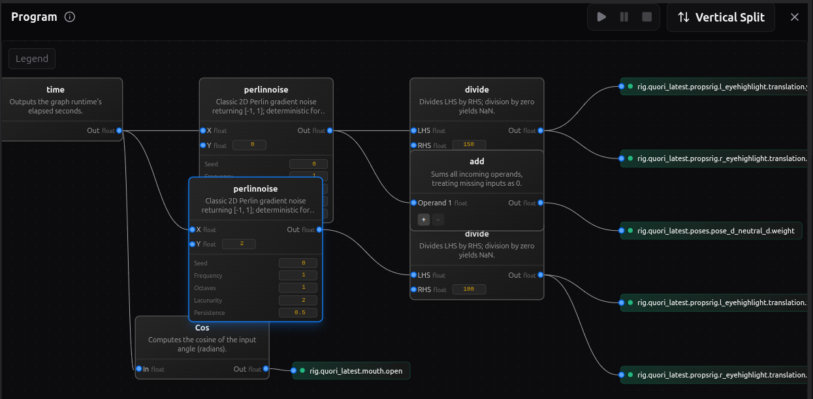
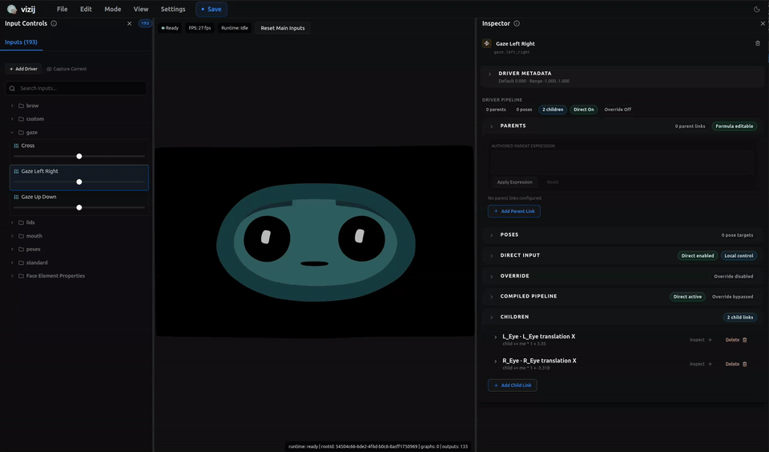
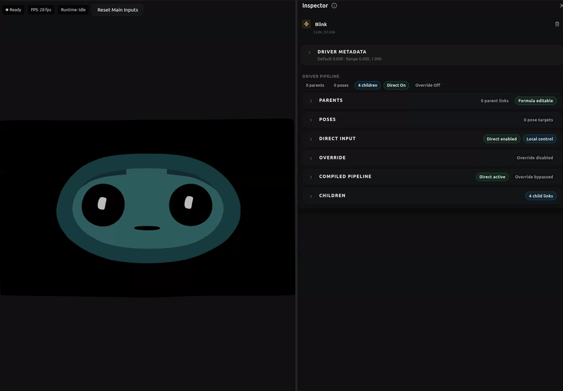
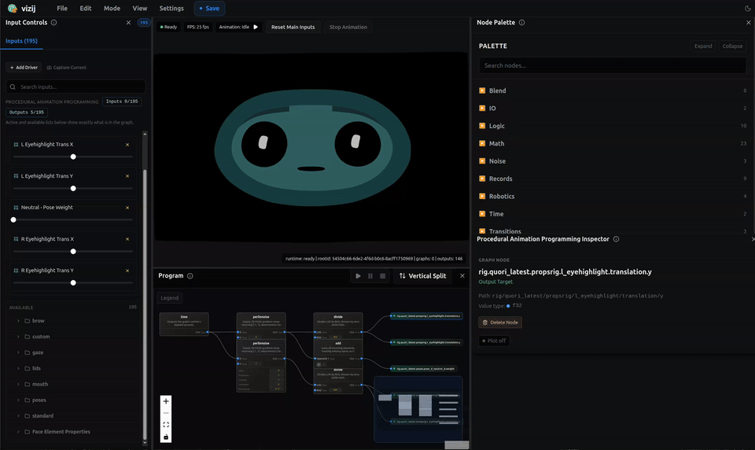

<!-- tags: type=guidebook-module; status=written; topics=guidebook,customize,procedural-programs,authoring -->

> **Last updated:** 2026-03-12
> **Purpose:** explain graph-driven authored behavior in Vizij without collapsing it into poses, timeline animation, or runtime internals

# Procedural Programs

## Guidebook Context

| Axis | Position |
| --- | --- |
| Bucket chain | Previous: [Control](../control/README.md)<br>Current: [Customize](README.md)<br>Next: [Integrate](../integrate/README.md) |
| Depth ladder in this bucket | Above: [Tweak an Existing Face](tweak-an-existing-face.md)<br>Current: `Fundamentals`<br>Below: [Deep Custom Pipeline](deep-custom-pipeline.md) |
| Module position in this bucket | Previous in bucket: [Animations](animations.md)<br>Current module: `Procedural Programs`<br>Next in bucket: [Export](export.md) |
| Reference bridges | [Renderer and Rigging Reference](../reference/renderer-and-rigging-reference.md)<br>[Validation Checkpoints](../support/validation-checkpoints.md)<br>[Troubleshooting Matrix](../support/troubleshooting-matrix.md) |
| Module type | concept page |
| Bucket overview | [Customize](README.md) |

## Reader Outcome

After this page, you should be able to explain what a procedural program is in Vizij, how it uses inputs, expressions, and graph logic to produce behavior, and when to choose procedural behavior instead of a pose or an animation clip.

## Module Notes

### Intended Audience

This page is for readers who already understand that Vizij can author named states and timed clips and now need the third behavior tool:

1. poses for named states,
2. animations for authored motion over time,
3. procedural programs for computed behavior.

It is especially for readers who might otherwise treat `procedural`, `graph`, `expression`, and `animation` as if they all mean the same thing.

### Artifact Being Touched

The artifact in this page is the authored procedural behavior layer inside `vizij-authoring`.

In current implementation terms, that means two closely related authoring surfaces:

1. derived rig-input logic authored through expressions and parent bindings,
2. procedural animation programs authored in the `Program` workspace canvas with nodes, edges, selected inputs, and selected outputs.

This matters because procedural behavior is not a loose idea. It is stored authored logic that computes values from other values.

### Why This Page Exists Separately

[`Procedural Programs`](procedural-programs.md) needs its own page because it protects a boundary the neighboring pages cannot protect by themselves.

[Poses](poses.md) answer: "what named state should this face have?"

[Animations](animations.md) answer: "how should values move over time?"

`Procedural Programs` answer: "what values should be computed from other values right now?"

If those ideas collapse together, readers make three common mistakes:

1. treating a pose like a little program,
2. treating a timeline clip like the only way to get dynamic behavior,
3. treating graph-driven logic like hidden runtime magic instead of authored behavior.

### What This Page Does And Does Not Cover

This page does cover:

1. the learner-facing meaning of graph-driven control logic,
2. inputs, expressions, outputs, and composition,
3. how procedural programs differ from poses and animations,
4. the current authoring surfaces where procedural behavior shows up.

This page does not cover:

1. GraphSpec structure,
2. GraphRuntime execution details,
3. scheduler order,
4. compile-plan or IR internals,
5. deep export packaging rules,
6. node-by-node runtime architecture.

Those are real implementation topics, but they are not the teaching job of this module.

## What You Need

It helps if you have already read:

1. [Customization Concepts Primer](../introduction/customization-concepts-primer.md),
2. [Poses](poses.md),
3. [Animations](animations.md).

From `vizij-web`:

```bash
pnpm run dev:vizij-authoring
```

You do not need to understand GraphSpec, GraphRuntime, scheduler order, or export internals yet.

## What Procedural Behavior Means In Vizij

In Vizij, procedural behavior means authored control logic that derives outputs from inputs instead of storing only a fixed state or fixed timeline.

That is the key distinction.

A pose stores target values for a named state.

An animation stores authored value changes over time.

A procedural program computes values from live inputs, relationships, and logic.

At the learner level, you can think of it like this:

1. inputs come in,
2. expressions or graph nodes transform them,
3. the result drives selected outputs,
4. the face updates from that computed result.

This page stays at that authoring surface. It does not turn into a runtime architecture page.

## The Authoring Building Blocks

Current procedural authoring anchors:



_Caption: a procedural graph with source nodes, transformation steps, and resolved outputs visible at once._



_Caption: the first input-control view showing which live values the program can listen to or drive._

Use this first controls view to see the program's vocabulary before any graph logic is changed.



_Caption: a second authoring view that makes the program's exposed inputs and outputs more explicit._

The follow-up controls view matters because it turns the abstract idea of "program inputs and outputs" into concrete rows a reader can inspect and select.



_Caption: editing graph-driven logic directly inside the maintained program workspace._

This capture set is the clearest current structural map for the page:

1. the screenshot shows a real graph with source nodes on the left, math or transformation steps in the middle, and resolved outputs on the right,
2. the input-control loops show how the program's readable and writable values are exposed in authoring,
3. the editing loop shows that the graph is an authored surface, not hidden runtime magic.

### Inputs

Procedural behavior starts with inputs.

In the current authoring app, those inputs can include live rig-facing controls and pose-weight controls that already exist in the face authoring flow. The `Input Controls` panel explicitly describes itself as a place to preview and adjust live rig and pose-weight inputs plus procedural animation I/O.

When procedural animation programming is active, input rows can be marked as procedural-program inputs from the variables panel. The current UI labels these actions `PAP In +` and `PAP In -`.

The practical mental model is simple:

1. choose which live values the program should listen to,
2. expose only the inputs you want the program to reason over,
3. treat those inputs as the vocabulary the program can react to.

### Expressions

At the smallest authoring level, Vizij already supports computed behavior through expressions.

The current `vizij-authoring` README is explicit that authoring supports formulas built from:

1. arithmetic such as `+`, `-`, `*`, `/`,
2. parentheses,
3. comparisons such as `>`, `<`, `==`, `!=`,
4. boolean logic such as `&&` and `||`,
5. unary negation `!`.

That matters because a procedural program is not only "draw some nodes." It is authored logic. Expressions are one of the current ways that logic is represented and edited.

### Graph Nodes And Edges

When you move into the dedicated `Program` workspace, that same idea becomes more visibly graph-driven.

In the current app, a procedural program snapshot stores:

1. nodes,
2. edges,
3. enabled inputs,
4. enabled outputs,
5. any custom input paths.

That gives the learner-friendly definition:

1. nodes are the processing steps,
2. edges are the value flow between those steps,
3. enabled inputs are the values the program can read,
4. enabled outputs are the values the program is allowed to drive.

The `Program` panel describes this surface as "Author procedural animation programs in the workspace canvas."

### Outputs

Procedural behavior also needs a clear destination.

In the current app, output rows can be marked from the variables panel while procedural programming is active. The UI labels these actions `PAP Out +` and `PAP Out -`.

That keeps the authoring workflow concrete:

1. pick the controls the program should read,
2. pick the controls the program should write,
3. author the logic between them.

For a learner, that is the key graph-driven control idea: a procedural program is a selected mapping from meaningful inputs to meaningful outputs.

## How To Reason About Procedural Programs

Use this mental model when a procedural behavior feels fuzzy.

### Think in relationships, not clips

Procedural programs are best when the interesting thing is the rule, not the prerecorded motion.

Examples:

1. one control should increase only when another control crosses a threshold,
2. several inputs should be mixed into one derived driver,
3. a behavior should react continuously to live values instead of replaying the same timed clip.

### Think in derived behavior

A procedural program is useful when the face should respond based on current conditions.

That is different from saying "play the blink clip" or "set the smile pose to 0.7."

It is closer to saying:

1. if these inputs change, recompute the result,
2. if this condition becomes true, drive a different output value,
3. if several signals matter, combine them into one controllable behavior.

### Think in composition

Procedural behavior does not replace rigging, poses, or animations.

It composes with them as another authored source of behavior.

The clean learner-facing stack is:

1. rigging defines what can be driven,
2. poses define named states,
3. animations define motion over time,
4. procedural programs define computed behavior from inputs and logic.

That separation is why this page exists.

## Pose Versus Animation Versus Procedural Program

Use this decision framing:

1. Use a [pose](poses.md) when you want a named reusable state such as `smile`, `blink`, or `surprised`.
2. Use an [animation](animations.md) when you want authored motion over time with clips, tracks, and keyframes.
3. Use a procedural program when you want behavior to be derived from current inputs, conditions, or combinations instead of only recalled as a state or replayed as a clip.

Another short version:

1. pose = state,
2. animation = timed motion,
3. procedural behavior = computed response.

## What Readers Actually Do In The Current App

### One Small Authored Rule

The simplest current-app example is not “build a giant behavior tree.” It is:

1. choose one visible control the program should write,
2. mark that row `PAP Out +`,
3. open the `Program` canvas and `Node Palette`,
4. add a `Time` node,
5. add a `cos` node,
6. connect `Time` into `cos`, then connect `cos` into the output target node,
7. use `Play` to see the output move over time without providing any other live input.

That walkthrough is implementation-backed, not hypothetical:

1. the node palette exposes a `Time` node,
2. motion-graph connection validation includes `cos` as a supported transform node,
3. the variables panel exposes `PAP Out +` so a selected control becomes a visible output target node,
4. the `Program` panel and `Node Palette` stay separate so you can keep graph editing and transport controls readable,
5. the panel exposes `Play`, `Pause`, and `Stop`, so this example can be previewed just by pressing `Play`.

So the smallest useful procedural rule in Vizij is not “write code.”

It is “pick an output you can see, feed it from a simple graph such as `Time -> cos`, and watch the behavior run.”

In the current authoring surface, procedural work usually looks like this:

1. switch into `procedural animation programming`,
2. create or select a program target,
3. mark relevant rows as procedural inputs or outputs,
4. open the `Program` canvas and `Node Palette`,
5. connect graph nodes to express the logic you want,
6. play, pause, or stop the active program to preview it,
7. inspect the selected program or node in the inspector.

This is why the page belongs in `Customize`: the reader is still authoring behavior, not yet embedding or deploying it.

## Success Check

You are done with this page when:

1. you can explain why a procedural program is not the same thing as a pose,
2. you can explain why a procedural program is not the same thing as a timeline animation,
3. you can describe a procedural program as inputs plus logic plus outputs,
4. you can decide when computed behavior is the better tool than a named state or a fixed clip.

## Implementation Anchors

Use these when you need the current implementation truth:

1. `vizij-web/apps/vizij-authoring/README.md`
2. `vizij-web/apps/vizij-authoring/docs/Authoring_Blueprint.md`
3. `vizij-web/apps/vizij-authoring/src/state/bindingAuthoringStore.tsx`
4. `vizij-web/apps/vizij-authoring/src/hooks/useRigController.ts`
5. `vizij-web/apps/vizij-authoring/src/hooks/useBindingManager.ts`
6. `vizij-web/apps/vizij-authoring/src/components/panels/VariablesPanel.tsx`
7. `vizij-web/apps/vizij-authoring/src/motiongraph/MotionGraphPanel.tsx`
8. `vizij-web/apps/vizij-authoring/src/motiongraph/components/EditorCanvas.tsx`
9. `vizij-web/apps/vizij-authoring/src/motiongraph/store/useEditorStore.ts`
10. `vizij-web/apps/vizij-authoring/src/motiongraph/utils/specToEditorState.ts`

## Recommended Next Steps

If you are ready to move from authored behavior to the artifact boundary, continue to [Export](export.md).

If you realize you actually need named states first, go back to [Poses](poses.md).

If you realize you actually need authored motion over time first, go back to [Animations](animations.md).
