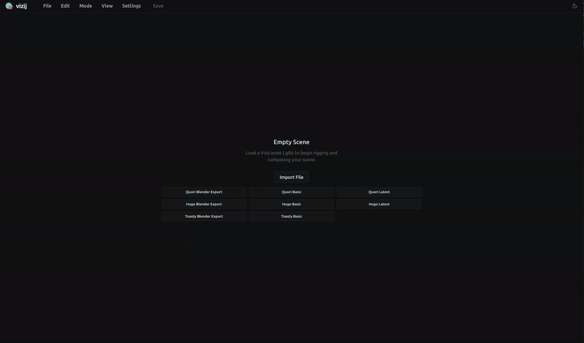

<!-- tags: type=guidebook-module; status=written; topics=guidebook,customize,reference-face,transfer -->

> **Last updated:** 2026-03-12
> **Purpose:** explain reference-face transfer as a deliberate authoring workflow rather than a generic import or runtime feature

# Reference-Face Transfer

## Guidebook Context

| Axis | Position |
| --- | --- |
| Bucket chain | Previous: [Control](../control/README.md)<br>Current: [Customize](README.md)<br>Next: [Integrate](../integrate/README.md) |
| Depth ladder in this bucket | Above: [Tweak an Existing Face](tweak-an-existing-face.md)<br>Current: `Fundamentals`<br>Below: [Deep Custom Pipeline](deep-custom-pipeline.md) |
| Module position in this bucket | Previous in bucket: [Import](import.md)<br>Current module: `Reference-Face Transfer`<br>Next in bucket: [Rigging](rigging.md) |
| Reference bridges | [Renderer and Rigging Reference](../reference/renderer-and-rigging-reference.md)<br>[Validation Checkpoints](../support/validation-checkpoints.md)<br>[Troubleshooting Matrix](../support/troubleshooting-matrix.md) |
| Module type | concept page |
| Bucket overview | [Customize](README.md) |

## Reader Outcome

After this page, you should be able to explain what reference-face transfer does in `vizij-authoring`, what it copies into the main face, what stays review-gated, and why transfer is different from import.

## Module Notes

### Intended Audience

This page is for readers who already understand how a face enters authoring and now want to reuse knowledge from a second, known-good face without confusing that process with runtime playback or deployment.

### Artifact Being Touched

The artifact in this page is the main face authoring session plus a separate reference face context.

That distinction matters.

Reference-face transfer is not about replacing the main face with another file. It is about opening a second face as a guide, comparing the two contexts, and copying selected authored information into the main face with explicit review.

In the current workflow, the reference face is a helper context, not a second full authoring target.

### Why This Page Exists Separately

Transfer needs its own page because it prevents a very specific misunderstanding:

1. import gets a face and its metadata into authoring,
2. transfer uses a second face to help author the first one,
3. integration and deployment consume the result later, but do not define this workflow.

If those boundaries blur, readers start using the word `transfer` for too many different things.

This page keeps transfer inside `Customize`, where it belongs.

### What Reference-Face Transfer Does Not Teach

This page does not teach:

1. how a new face asset enters the tool,
2. how rigging is defined for the main face,
3. how pose groups and animations work in depth,
4. how authored output is exported,
5. how a runtime app consumes the result.

Those belong to neighboring modules.

Reference-face transfer is narrower: it is the guided reuse of authored knowledge from one face to another.

## What You Need

From `vizij-web`:

```bash
pnpm run dev:vizij-authoring
```

It also helps if you have already read:

1. [Import](import.md)
2. [Customization Concepts Primer](../introduction/customization-concepts-primer.md)

You do not need to understand export or application integration yet.

## What Reference-Face Transfer Means In Vizij

The current reference-face workflow in `vizij-authoring` is a dual-face authoring mode:

1. a main face remains the editable destination,
2. a reference face is loaded in a separate pane,
3. variables or poses from the reference face can be proposed for copy into the main face,
4. the user reviews mappings before any write is committed.

This is not a blind cloning flow.

The current requirements, implementation plan, and SOP all emphasize the same rule: reference-assisted authoring must stay understandable, explicit, and non-destructive by default.

## What Actually Gets Transferred

Today, the maintained workflow is centered on copying authored information, not wholesale face replacement.

The current implemented transfer flows cover:

1. variable copy from reference to main,
2. pose copy from reference to main,
3. mapping review before commit,
4. side-by-side visual comparison after copy.

That means transfer is selective and author-facing.

It does not mean:

1. the reference face becomes the new main asset,
2. every structure is copied automatically,
3. unresolved mappings should silently write,
4. the reference face is edited as a peer authoring target.

## The Main and Reference Roles

The current requirements and SOP make the role split explicit:

1. the main face is the destination you are authoring,
2. the reference face is the source you are learning from or borrowing from,
3. panels must clearly label which context is which,
4. the inspector remains single-context rather than trying to edit both at once.

This role clarity is part of the teaching objective, not only a UI detail.

Without it, transfer feels like an ambiguous dual-editor rather than a guided copy workflow.

## Review, Mapping, and Confirmation

Current transfer review anchor:



_Caption: a reference-assisted copy flow that stays reviewable instead of writing blindly into the destination face._

This capture is the strongest current evidence for the review-gated teaching point on this page: the operator is not blindly overwriting the destination face, but stepping through a reference-assisted copy flow that stays visible and interruptible.

The strongest current implementation truth is that transfer is modal-review-driven.

The implemented SOP and tests establish these rules:

1. variable copy opens a mapping modal before writing,
2. pose copy opens a mapping modal before writing,
3. unresolved critical mappings block commit,
4. `Cancel` performs zero writes,
5. `Confirm` is the point where changes apply to the main face.

This is the core difference between “using a reference face” and “silently importing data.”

The workflow is designed to preserve author judgment.

## What Is Preserved, Mapped, or Not Preserved

> TODO(content-model): Add a comparison table here to separate what transfer copies directly, what it maps through review, and what it intentionally leaves unresolved. Best fit because this module turns on careful boundary reasoning and a three-way comparison would make those preservation rules easier to scan and remember.

Transfer is valuable precisely because not everything lines up automatically.

In the current workflow:

1. source identity is preserved well enough to review what you are copying,
2. proposed destination mappings are generated as best-effort suggestions,
3. unresolved or ambiguous rows stay visible,
4. the user can override mappings before commit,
5. pose copy is intentionally scoped to destination pose name plus mapped target values.

That means some information is preserved directly, some is mapped into the main face, and some cannot be safely applied until the user resolves it.

This is why transfer belongs after [Import](import.md): the main face has to exist first, and its controllable structure has to be the destination truth.

## A Useful Mental Model

Use this sequence when reasoning about transfer:

1. import or load the main face you are actually authoring,
2. load a separate reference face as a comparison source,
3. review proposed mappings for variables or poses,
4. commit only what you can explain and trust,
5. continue deeper into rigging or pose authoring on the main face.

That sequence keeps transfer from becoming vague “magic copying.”

## Success Check

You are done with this page when:

1. you can explain the difference between the main face and the reference face,
2. you can explain why transfer is review-gated rather than blind,
3. you can name the current authoring-side copy flows the tool supports,
4. you can explain why transfer is different from import.

## Implementation Anchors

Use these when you need the current implementation truth:

1. `vizij-web/apps/vizij-authoring/docs/references/authoring-reference-face-requirements.md`
2. `vizij-web/apps/vizij-authoring/docs/references/authoring-reference-face-workflow-sop.md`
3. `vizij-web/apps/vizij-authoring/docs/plans/authoring-reference-face-implementation-plan.md`
4. `vizij-web/apps/vizij-authoring/src/hooks/useReferenceFaceState.ts`
5. `vizij-web/apps/vizij-authoring/e2e/reference-face.smoke.pw.ts`
6. `vizij-web/apps/vizij-authoring/src/App.tsx`

## Recommended Next Steps

1. If you want to understand the controllable structure that copied variables and poses must land on, continue to [Rigging](rigging.md).
2. If you want to understand named authored states next, continue to [Poses](poses.md).
