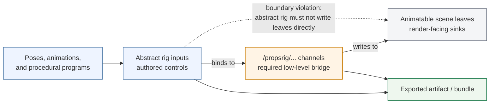
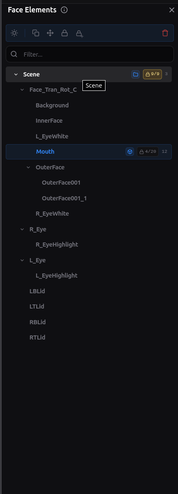
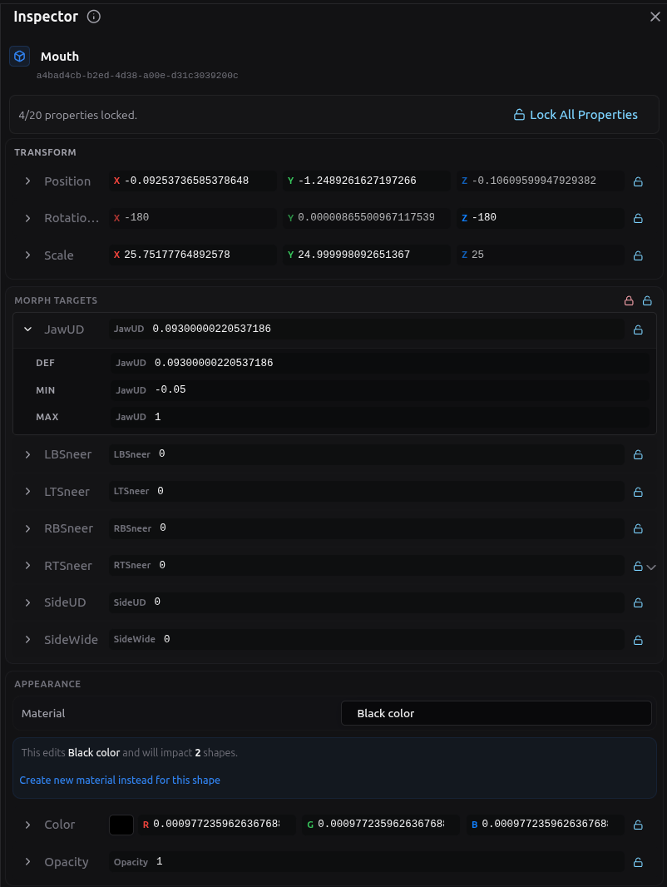

<!-- tags: family=guidebook; type=guidebook-module; editorial_status=completed; publication_status=planned; topics=guidebook,customize,rigging,propsrig -->

> **Last updated:** 2026-03-31
> **Purpose:** define what rigging means in Vizij and explain the controllable structure that later poses, animations, and exports depend on

# Rigging

## Guidebook Context

| Axis | Position |
| --- | --- |
| Bucket chain | Previous: [Control](../control/README.md) Current: [Customize](README.md) Next: [Integrate](../integrate/README.md) |
| Depth ladder in this bucket | Above: [Tweak an Existing Face](tweak-an-existing-face.md) Current: `Fundamentals` Below: [Deep Custom Pipeline](deep-custom-pipeline.md) |
| Module position in this bucket | Previous in bucket: [Reference-Face Transfer](reference-face-transfer.md) Current module: `Rigging` Next in bucket: [Poses](poses.md) |
| Reference bridges | [Renderer and Rigging Reference](../reference/renderer-and-rigging-reference.md) [Validation Checkpoints](../support/validation-checkpoints.md) [Troubleshooting Matrix](../support/troubleshooting-matrix.md) |
| Module type | concept page |
| Bucket overview | [Customize](README.md) |

## Reader Outcome

After this page, you should be able to explain what rigging means in Vizij specifically, how rigging differs from raw scene data, and why later pose, animation, and export workflows depend on the rig layer being truthful.

## Module Notes

- Read this when you need the Vizij-specific meaning of a face rig, not a generic CG definition.
- The page focuses on controllable structure: scene targets, generated `/propsrig/...` channels, authored abstract rig inputs, and the rules that keep authoring from writing scene leaves directly.
- Import, transfer, poses, animation authoring, and export each have their own modules.

## What You Need

It helps if you have already read:

1. [Customization Concepts Primer](../introduction/customization-concepts-primer.md)
2. [Runtime Inputs and Semantics](../control/runtime-inputs-and-semantics.md)

You do not need to master pose groups or animation clips yet.

## What Rigging Means In Vizij

In Vizij, rigging is the process and resulting structure that turns a face from animatable scene data into a controllable system.

The current authoring architecture defines several layers:

1. the animatable layer,
2. the propsrig layer,
3. the abstract rig layer,
4. the pose layer,
5. the binding layer between authored controls.

The important rigging idea is that these layers are not interchangeable.

Rigging is the bridge between raw scene targets and the higher-level authored controls that later pages discuss.

## The Layer Boundary That Matters Most

The current blueprint and architecture keep one boundary especially strict:

1. animatable scene leaves are the render-facing sinks,
2. generated low-level rig channels write to those scene leaves,
3. authored abstract rig controls must not write animatable leaves directly.

That is why the current contract uses generated `/propsrig/...` paths for low-level rig metadata.

The rig is not only a naming system. It is a boundary system.

It tells the authoring tool and runtime which controls are low-level, which are authored abstractions, and how values are allowed to flow.

## PropsRig and Abstract Rig

Two rigging layers are especially important in current Vizij authoring.

### PropsRig

The propsrig layer is the low-level generated channel layer.

According to the current blueprint:

1. it is auto-created from animatable leaves,
2. it uses the `/propsrig/...` namespace,
3. it is the required bridge for direct scene writes,
4. it stays visible enough for debugging and inspection even when treated as implementation detail.

This means propsrig is close to the face’s actual rendered mechanics.

### Abstract rig

The abstract rig layer is where authored control meaning lives.

These are the higher-level inputs and bindings that may drive:

1. other abstract rig nodes,
2. one or more propsrig nodes.

They must not directly target animatable leaves.

That rule is what keeps the authored control model stable and reusable.

## One Concrete Example

If an eyelid or brow value is ultimately what the renderer moves, rigging is the layer that stops every later tool from talking to that leaf directly.

The practical stack looks like this:

1. a scene leaf might hold the raw transform or morph value the renderer applies,
2. a generated `/propsrig/...` channel becomes the low-level writeable bridge to that leaf,
3. an authored abstract-rig control gives the face a meaningful handle such as `blink` or `brow_raise`,
4. a pose, animation, or procedural program later drives that authored control instead of bypassing the rig layer.

This is the public-facing reason rigging matters.

It is what makes a face portable across authoring, runtime playback, and later deployment surfaces without forcing every tool to know scene internals.

## Why Rigging Comes Before Poses and Animations

[Poses](poses.md) and [Animations](animations.md) both assume there is already a trustworthy control surface to target.

In the current contract:

1. poses target abstract-rig inputs by identity,
2. pose graphs write to internal pose-control paths,
3. the rig graph owns final composition into effective channel values,
4. runtime writes reach scene leaves through the rig structure, not around it.

So when later pages talk about named states or motion over time, they are building on rigging rather than replacing it.

## What Readers Actually Do In Authoring

Current inspection anchors:

_Caption: the scene and element tree where imported structure first becomes inspectable inside authoring._

_Caption: the inspector surface where the selected structure resolves into concrete properties and channels._

These do not replace a future rig-layer diagram, but they are the maintained UI surfaces where rigging first becomes tangible to a reader:

1. the scene and element tree shows what authoring has discovered and made inspectable,
2. the inspector shows the concrete properties and channels attached to the selected structure,
3. together they let you verify that the imported face is no longer just raw scene data.

Rigging in the guidebook sense is not a demand to memorize every internal file.

What readers need to recognize in the current authoring surface is:

1. importing a face does not finish the rigging story,
2. the tool auto-generates and normalizes low-level rig channels,
3. authored inputs and bindings sit above those low-level channels,
4. later pose and animation authoring depend on these layers lining up.

The current README’s Standard Feature Spaces workflow also shows the public side of this idea:

1. channels can be viewed and edited,
2. mappings can be configured,
3. standardized input structure supports interoperability between faces.

That is rigging in Vizij terms: shaping the face into a controllable, reusable input model.

## A Useful Mental Model

Use this stack when reasoning about rigging:

1. scene leaves are what the renderer ultimately moves,
2. propsrig channels are the low-level controlled bridge to those leaves,
3. abstract rig inputs are the higher-level authored controls,
4. poses and animations later write into or compose with that rig structure,
5. export carries the resulting structure forward.

## Use Rigging When, Not...

Use this page when the real question is:

1. what controls exist and how they are layered,
2. why authored controls do not write scene leaves directly,
3. what later poses, animations, and programs will target.

Do not use this page as the answer to:

1. `Which reusable expression should I author next?` Go to [Poses](poses.md).
2. `How should motion unfold over time?` Go to [Animations](animations.md).
3. `How should behavior react continuously to live input?` Go to [Procedural Programs](procedural-programs.md).

If you keep that stack clear, later customization pages become much easier to trust.

## Success Check

You are done with this page when:

1. you can explain the difference between animatable data, propsrig, and abstract rig,
2. you can explain why abstract rig controls do not directly write scene leaves,
3. you can explain why later poses and animations depend on rigging rather than replacing it,
4. you can explain what makes the Vizij meaning of rigging different from a generic graphics-only description.

## Implementation Anchors

Use these when you need the current implementation truth:

1. `vizij-web/apps/vizij-authoring/docs/Authoring_Blueprint.md`
2. `vizij-web/apps/vizij-authoring/docs/ARCHITECTURE.md`
3. `vizij-web/apps/vizij-authoring/README.md`
4. `vizij-web/apps/vizij-authoring/src/hooks/useRigGraphImport.ts`
5. `current_documentation/guidebook/reference/renderer-and-rigging-reference.md`

## Recommended Next Steps

1. If you want to understand named authored facial states next, continue to [Poses](poses.md).
2. If you want to understand authored motion over time later, continue to [Animations](animations.md).
