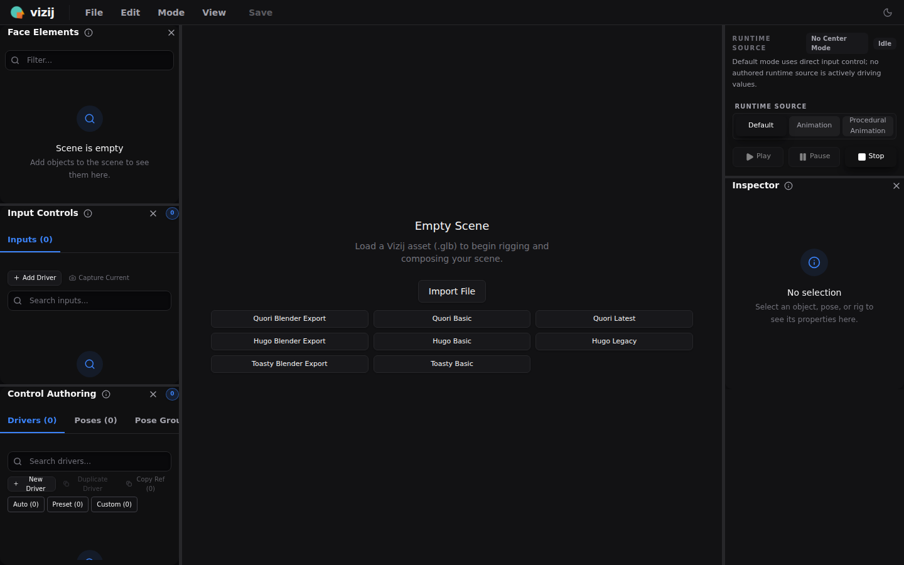
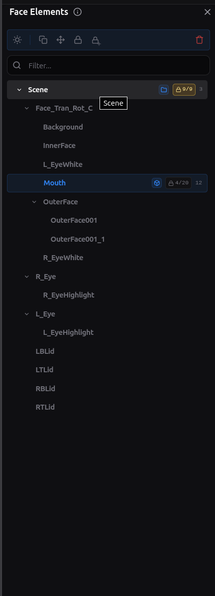
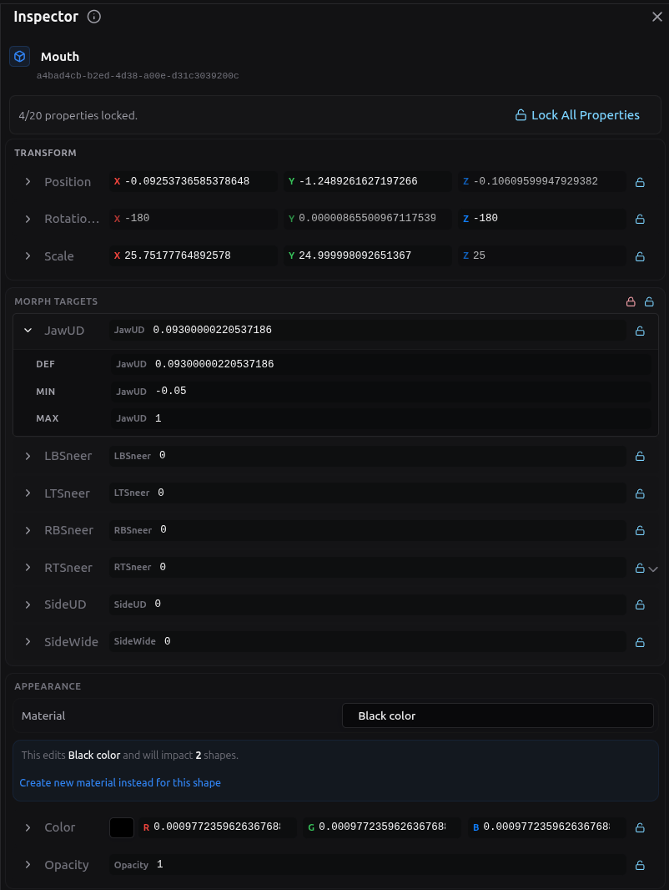
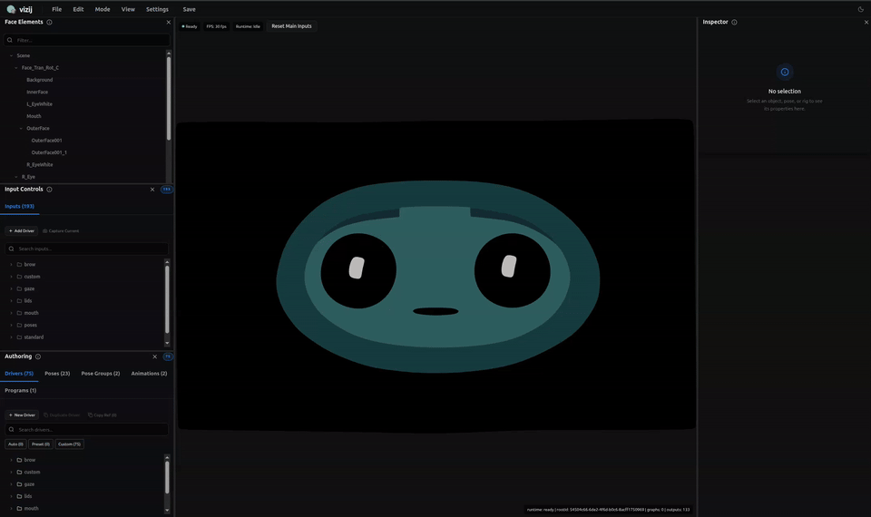
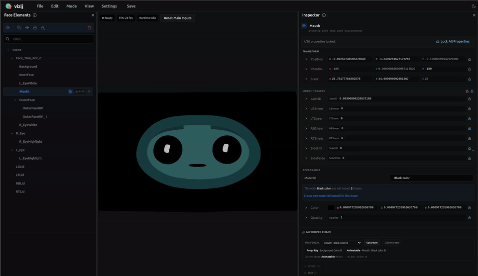

<!-- tags: type=guidebook-module; status=written; topics=guidebook,customize,authoring,presets -->

> **Last updated:** 2026-03-12
> **Purpose:** deliver the smallest believable authoring win by changing an existing face without requiring the full customization pipeline

# Tweak an Existing Face

## Guidebook Context

| Axis | Position |
| --- | --- |
| Bucket chain | Previous: [Control](../control/README.md)<br>Current: [Customize](README.md)<br>Next: [Integrate](../integrate/README.md) |
| Depth ladder in this bucket | Above: none, this is the entry depth in this bucket<br>Current: `Surface`<br>Below: [Import](import.md), [Reference-Face Transfer](reference-face-transfer.md), [Rigging](rigging.md), [Poses](poses.md), [Animations](animations.md), [Procedural Programs](procedural-programs.md), [Export](export.md), [Deep Custom Pipeline](deep-custom-pipeline.md) |
| Module position in this bucket | Previous in bucket: start at [Customize](README.md)<br>Current module: `Tweak an Existing Face`<br>Next in bucket: [Import](import.md) |
| Reference bridges | [Renderer and Rigging Reference](../reference/renderer-and-rigging-reference.md)<br>[Validation Checkpoints](../support/validation-checkpoints.md)<br>[Troubleshooting Matrix](../support/troubleshooting-matrix.md) |
| Module type | walkthrough |
| Bucket overview | [Customize](README.md) |

## Reader Outcome

After this page, you should be able to open a maintained preset face in `vizij-authoring`, make one small visible change to the loaded face, and explain why that already counts as real customization work.

## Starting State

Use the `vizij-web` workspace root:

```bash
cd /home/chris/Code/Semio/vizij_ws/vizij-web
pnpm run dev:vizij-authoring
```

Open the local URL shown by Vite.

This walkthrough uses the preset-based path because it removes import and rigging uncertainty from the first customization success.

## What You Should See Before Loading Anything

The authoring app starts in an empty-scene state with preset buttons in the center of the screen.

Current visual anchor:



_Caption: the preset-based empty-scene loader that gives this page its lowest-friction first customization path._

Expected result before you continue:

1. the main canvas says `Empty Scene`
2. preset buttons such as `Quori Latest` are visible
3. the side panels are present even though no face is loaded yet

## Walkthrough

### 1. Load a maintained preset face

Click `Quori Latest`.

You are intentionally starting with a known-good preset because this page is about editing an existing face, not about debugging import.

Expected result:

1. the loader leaves the empty-scene state
2. the face appears in the main preview
3. the `Face Elements` panel populates with scene objects
4. the authoring panels stop looking empty

If the preset never finishes loading, use [Validation Checkpoints](../support/validation-checkpoints.md) or [Troubleshooting Matrix](../support/troubleshooting-matrix.md) before trying to edit anything.

### 2. Find one editable surface in the loaded face

In the left `Face Elements` panel, expand the scene tree and select `Mouth` or another obvious facial element.

Useful visual anchors:



_Caption: the face-element tree where you choose the part of the loaded face you want to inspect or edit._



_Caption: the inspector that turns the selected face element into an editable authoring surface._

Motion anchors:



_Caption: clicking from the scene tree into inspection so the editable target is explicit._



_Caption: following a face-element selection through to the property view that supports the first visible tweak._

These short loops show the exact move you are trying to learn here: pick a real scene element on the left, watch the selection settle, then use the inspector on the right as the authoring surface that turns a loaded face into an editable one.

Expected result:

1. the selected element is highlighted in the scene tree
2. the `Inspector` panel on the right fills with properties for that element
3. you can now see the difference between loading a face and editing a face

### 3. Make one small visible change

Inside the `Inspector`, adjust one existing property on the selected element.

Good first choices:

1. a mouth-related morph target such as `JawUD`
2. another unlocked facial morph target on the selected element
3. a small transform value if that is the clearest editable property on the current preset

Keep the change modest. The goal is not to redesign the face. The goal is to create one believable visible delta.

Expected result:

1. the face preview updates immediately
2. the change is clearly tied to the element and property you selected
3. you can reverse or soften the change by returning the value closer to its starting point

### 4. Notice what this first customization step teaches

You just crossed a meaningful boundary:

1. in `Experience`, you drove a prebuilt face from a tutorial runtime
2. here, you changed the authored state of an existing face in the authoring surface itself

That is why this page counts as customization even though you did not import a new asset or build a new rig.

### 5. Connect the edit back to the owning app

Open these implementation anchors after you make the visible change:

1. `vizij-web/apps/vizij-authoring/README.md`
2. `vizij-web/apps/vizij-authoring/src/App.tsx`
3. `vizij-web/apps/vizij-authoring/src/components/app/Viewer.tsx`

What to notice:

1. the app is built on the same runtime-truthful Vizij stack used by downstream consumers
2. preset loading is a first-class entry path, not a shortcut bolted on later
3. the viewer and inspector surfaces are there so you can validate an edit immediately against the live face

## What This First Win Does Not Require

You did not need to:

1. import a raw asset from disk
2. create a new rig contract
3. load a reference face
4. author a full pose library
5. export a new bundle

Those are real parts of `Customize`, but they come after the first believable edit.

## Fast Recovery If It Fails

Use these shortcuts:

1. if the app stays on `Empty Scene`, reload the preset and wait for the panels to populate
2. if the face loads but the inspector is blank, reselect a scene element from `Face Elements`
3. if the property you picked is locked or not visually obvious, choose a different unlocked mouth or facial morph target
4. if the runtime itself looks unhealthy, use [Validation Checkpoints](../support/validation-checkpoints.md) or [Troubleshooting Matrix](../support/troubleshooting-matrix.md)

## Success Check

You are done with this page when:

1. `vizij-authoring` loads a maintained preset face
2. you select a facial element and see its properties in the inspector
3. you change one existing property and see a visible result in the preview
4. you can explain why this counts as customization rather than just runtime control

## Implementation Anchors

Use these when you need the current implementation truth:

1. `vizij-web/apps/vizij-authoring/README.md`
2. `vizij-web/apps/vizij-authoring/src/App.tsx`
3. `vizij-web/apps/vizij-authoring/src/components/app/Viewer.tsx`
4. `vizij-web/apps/vizij-authoring/src/components/app/ReferenceFaceRuntime.tsx`
5. `vizij-web/apps/vizij-authoring/docs/ARCHITECTURE.md`

## Recommended Next Steps

If you want to understand what can safely come into authoring, continue to [Import](import.md).

If you want to understand how Vizij represents editable face structure more deeply, continue to [Rigging](rigging.md) or [Poses](poses.md).
