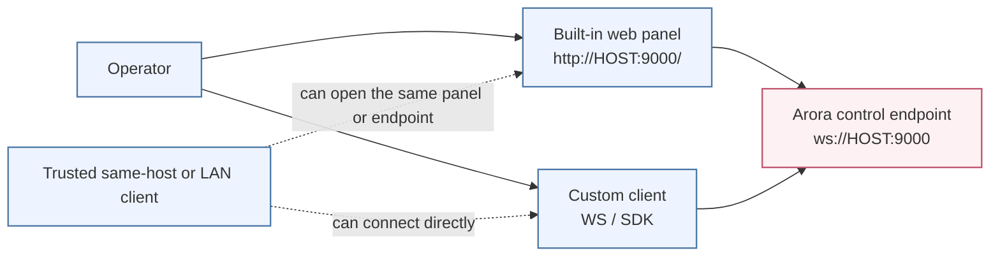
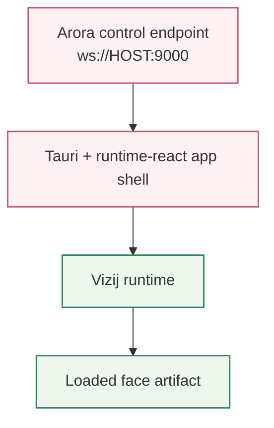

<!-- tags: family=guidebook; type=guidebook-module; editorial_status=completed; publication_status=live; topics=guidebook,deploy,operator,standalone -->

> **Last updated:** 2026-03-31
> **Purpose:** explain what a deployed Vizij runtime consists of and how an operator actually interacts with it

# Operator and Deployment Model

## Guidebook Context

| Axis | Position |
| --- | --- |
| Bucket chain | Previous: [Integrate](../integrate/README.md) Current: [Deploy](README.md) Next: End of guidebook route |
| Depth ladder in this bucket | Above: [Easiest Standalone Deployment](easiest-standalone-deployment.md) Current: `Fundamentals` Below: [Hardware, ROS, and Multi-Screen Topologies](hardware-ros-and-multi-screen-topologies.md) |
| Module position in this bucket | Previous in bucket: [Easiest Standalone Deployment](easiest-standalone-deployment.md) Current module: `Operator and Deployment Model` Next in bucket: [Deployment Checks and Recovery](deployment-checks-and-recovery.md) |
| Reference bridges | [Animation, Integration, and Deployment Reference](../reference/animation-integration-and-deployment-reference.md) [Validation Checkpoints](../support/validation-checkpoints.md) [Troubleshooting Matrix](../support/troubleshooting-matrix.md) |
| Module type | concept page |
| Bucket overview | [Deploy](README.md) |

## Reader Outcome

After this page, you should be able to explain the operational shape of the first Vizij deployment endpoint: what is running, who controls it, what signals move through it, and what counts as a healthy operator path.

## Module Notes

This page is for readers who already understand the first standalone deployment walkthrough and now need the operating model behind it.

The first operator-facing deployment consists of a standalone runtime app, a loaded face asset, a running WebSocket control service, a built-in or external trusted-local-network control client, and a person operating the endpoint. The maintained implementation anchor is `vizij-standalone`.

## What You Need

It helps if you have already completed:

1. [Minimal Web Player](../integrate/minimal-web-player.md),
2. [Easiest Standalone Deployment](easiest-standalone-deployment.md),
3. [Loading, Playback, and Embedding](../integrate/loading-playback-and-embedding.md).

## The First Deployment Model

For the guidebook's first deployment path, the model is intentionally simple:

1. load a face into `vizij-standalone`,
2. expose a control surface over WebSocket,
3. optionally use the built-in web control panel,
4. validate that runtime and control are both healthy.

This keeps deployment concrete without immediately pulling the reader into ROS, custom robotics bridges, or multi-screen topology decisions.

Current deployable floor:

`vizij-standalone` on one host with one clearly exposed operator path, with the built-in panel or another trusted client connecting to the same local control endpoint.

Treat that as the credible baseline before you reason about split surfaces, robot middleware, or broader topology planning.

## Control Topology

### Operator Access Paths

### Host Runtime Chain

## Runtime vs. Provider

It is important to distinguish between the **Face Artifact** (the rig and visuals), the **Vizij runtime** (the thing resolving typed inputs into visible motion), and any upstream logic that happens to drive that runtime.

For the first deployment model, the main operational question is not which upstream provider produced a command. The question is whether the endpoint, runtime, and loaded face all agree on one healthy control path.

## What The Operator Actually Needs

An operator does not need every internal detail of the runtime.

They do need clarity on:

1. whether the face asset loaded successfully,
2. whether the runtime is ready,
3. what port or endpoint the control client should use,
4. whether a control client is connected,
5. whether the face is actually responding to inputs,
6. how to reset or recover when something goes wrong.

That is the practical deployment model.

## Current Operational Facts

Important operational facts from the current standalone app:

1. the default endpoint is `ws://127.0.0.1:9000`,
2. the server currently binds to `0.0.0.0`,
3. the built-in web control panel is served on the same port,
4. the control panel behaves like a regular WebSocket client,
5. the connection manager enforces one active client at a time.

This is why deployment is not just about rendering. The runtime has to expose a believable control surface for an operator.

## Path Contract At The Deployment Boundary

Keep these three strings separate when you validate or debug the standalone endpoint:

| What you are looking at | Example | Trust it for |
| --- | --- | --- |
| runtime path | `rig/{faceId}/standard/vizij/left_eye/pos/x` | internal runtime reasoning and bundle-to-renderer diagnostics |
| deployment slot | `standard/vizij/left_eye/pos/x` | external client writes and operator-facing control |
| observer key | `{runtime_namespace}/rig/{faceId}/standard/vizij/left_eye/pos/x` | shared-runtime or orchestrator-level inspection |

The practical rule is simple:

1. copy deployment slots from the endpoint when writing through WebSocket or the built-in panel,
2. use the full runtime path when you are inspecting runtime internals,
3. use the observer-key form only when a shared runtime or diagnostics surface actually shows it.

## Recommended First Deployment Choice

Use this before you jump into deeper topology pages:

| If your real constraint is... | Best current route | Readiness label | Why |
| --- | --- | --- | --- |
| one host, one rendered face, one clear operator path | standalone endpoint plus built-in web control | maintained now | matches the current built-in panel plus trusted-network endpoint story directly |
| one machine with the face on one screen and supporting UI on another | single-host multi-monitor deployment | maintained advanced path | display selection, fullscreen, and kiosk-style window options are implemented now |
| separate operator and face surfaces beyond the same host | split control-surface planning | prototype direction | control separation is real, but the current bind and exclusive-client rules still shape the topology tightly |
| ROS or robot middleware as the main system boundary | ROS and hardware comparison route | roadmap direction | the guidebook can frame the topology, but it is not a packaged maintained walkthrough today |

## Healthy Deployment Versus Nearby States

| State | What is true | What is still missing |
| --- | --- | --- |
| useful demo | a face renders and something moves | operator path may be weak or implicit |
| healthy first deployment | runtime, control endpoint, and operator path are all explicit | advanced topology and remote-network concerns |
| unfinished runtime shell | some runtime pieces exist | loading, control, or recovery truth is still hidden |

## Slot-Centric Thinking

In the standalone deployment model, think in deployment slots at the operator boundary:

1. the deployment surface exposes controllable paths,
2. those paths are synchronized into the backend,
3. clients write typed values against them,
4. the runtime updates the face accordingly,
5. reset and value-query behavior are part of normal operation.

That slot model is the deployment-facing expression of the same path-and-value ideas the reader already saw in `Control`.

## Built-In Web Control Panel

The built-in control panel is important because it lowers the first deployment barrier.

It gives the reader:

1. a no-extra-installation operator surface,
2. dynamic slot discovery,
3. real-time slider control,
4. reset behavior,
5. a believable first operator path on the same host as the runtime.

Treat this as part of the first deployment story, not as a side note.

| Feature | What the operator gets |
| :--- | :--- |
| **Control UI** | a browser surface on the host or trusted local network for driving the loaded face without building a separate client first |
| **Discovery** | dynamic slots populate from the loaded model schema |

## Boundary To Advanced Deployment

This page deliberately stops before:

1. ROS integration,
2. internet-exposed or broader multi-operator network claims,
3. multi-screen control setups,
4. hardware-specific transport decisions.

Those are real deployment topics, but they belong in the advanced deployment branch.

## Success Check

You are done with this page when:

1. you can explain the first operator-facing deployment model in plain language,
2. you understand the role of the WebSocket service and the built-in control panel,
3. you can name the minimum conditions for a healthy deployed endpoint,
4. you understand the current trusted-network boundary.

## Implementation Anchors

Use these when you need the current implementation truth:

1. `vizij-web/apps/vizij-standalone/README.md`
2. `vizij-web/apps/vizij-standalone/src/App.tsx`
3. `vizij-web/apps/vizij-standalone/src/hooks/useWebSocketSync.ts`
4. `vizij-web/apps/vizij-standalone/src-tauri/src/lib.rs`
5. `vizij-web/apps/vizij-standalone/src-tauri/src/connection_manager.rs`
6. `vizij-web/apps/vizij-standalone/src/hooks/aroraWsProtocol.ts` (app-local protocol types; formerly `@vizij/arora-types`)

## Recommended Next Steps

1. If you want the first deployment readiness loop and recovery sequence, continue to [Deployment Checks and Recovery](deployment-checks-and-recovery.md).
2. For reusable readiness checks across the route, continue to [Validation Checkpoints](../support/validation-checkpoints.md).
3. For failure recovery patterns, continue to [Troubleshooting Matrix](../support/troubleshooting-matrix.md).
