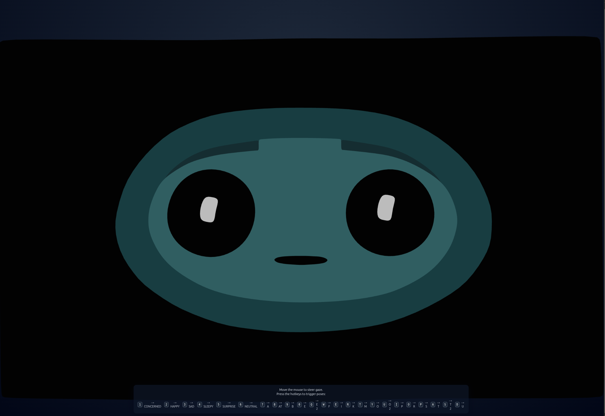
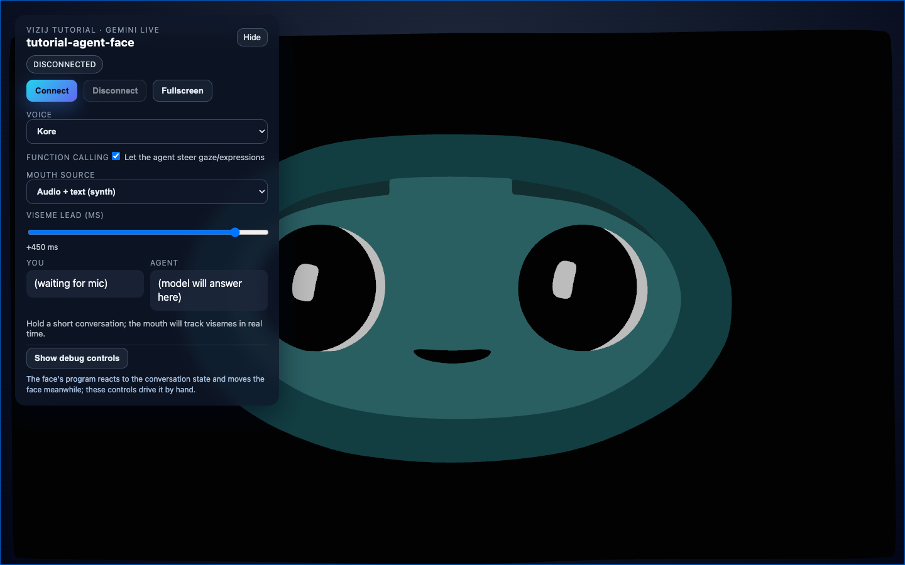

<!-- tags: type=guidebook-module; status=written; topics=guidebook,experience,sandbox,existing-assets -->

> **Last updated:** 2026-03-13
> **Purpose:** explain what the first Vizij sandbox experience is actually proving and what parts are already prebuilt

# Existing Asset Sandbox

## Guidebook Context

| Axis | Position |
| --- | --- |
| Bucket chain | Previous: [Introduction](../introduction/README.md) Current: [Experience](README.md) Next: [Control](../control/README.md) |
| Depth ladder in this bucket | Above: [Hello Face Quickstart](hello-face-quickstart.md), [Richer Interactive Example](richer-interactive-example.md) Current: `Fundamentals` Below: [Sample Asset Exploration](sample-asset-exploration.md) |
| Module position in this bucket | Previous in bucket: [Richer Interactive Example](richer-interactive-example.md) Current module: `Existing Asset Sandbox` Next in bucket: [Sample Asset Exploration](sample-asset-exploration.md) |
| Reference bridges | [Runtime Quickstart Reference](../reference/runtime-quickstart-reference.md) [Validation Checkpoints](../support/validation-checkpoints.md) [Troubleshooting Matrix](../support/troubleshooting-matrix.md) |
| Module type | concept page |
| Bucket overview | [Experience](README.md) |

## Reader Outcome

After this page, you should be able to explain what the existing-asset sandbox gives you for free, what parts of the experience are already prebuilt, and why this bucket comes before `Control`, `Customize`, or `Integrate`.

## Module Notes

### Intended Audience

This page is for readers who have already completed [Hello Face Quickstart](hello-face-quickstart.md) and now want a more accurate mental model of what they just touched.

### Artifact Being Touched

The existing-asset sandbox is not a blank project.

It is a prebuilt runtime experience composed of:

1. a sample face asset,
2. a prepared asset bundle,
3. a runtime provider that loads and wires the asset,
4. a small set of interaction hooks or controls,
5. a UI surface that makes the result immediately visible.

The maintained first sandbox anchor is `tutorial-fullscreen-face`.

## What You Need

It helps if you have already:

1. run `tutorial-fullscreen-face`,
2. seen a working face respond to mouse and hotkey input,
3. looked briefly at the app code without trying to understand the whole runtime yet.

## What The Sandbox Proves

When the sandbox works, it proves several important things quickly:

1. Vizij can load a real face asset and render it live.
2. Runtime input writes can cause visible behavior immediately.
3. The asset, rig, and pose data are aligned enough for the sample interactions to work.
4. A reader can start from a concrete, inspectable implementation instead of a slide or promise.

That is enough for first contact. It is not yet the same thing as understanding the runtime model or making the face your own.

## What Is Already Prebuilt

The sandbox removes several decisions for the reader on purpose.

Already chosen for you:

1. which face asset is loaded,
2. which bundle or rig data the app uses,
3. which inputs are exposed by the tutorial hooks,
4. what counts as the default neutral or startup state,
5. what visible interactions the sample prioritizes.

This is why the sandbox is a good starting point. It reduces the number of variables while still showing a real Vizij surface.

Current sandbox anchors:

_Caption: the smallest maintained sandbox surface, with the face, HUD, and known-good interactions visible in one frame._

_Caption: a richer shell that still starts from a prebuilt runtime experience rather than a reader-owned integration build._

Together these two captures make the boundary easier to see than prose alone.

1. `fullscreen-demo` is the smallest maintained sandbox surface: one face, one runtime, one obvious interaction layer.
2. `tutorial-agent-face` is still an existing-asset experience, but it proves that the same prebuilt runtime can live inside a larger shell before the reader owns `Integrate` or `Customize`.

## What The Sandbox Does Not Prove

The sandbox does not yet prove that you can:

1. author a new face,
2. import your own asset,
3. understand every runtime path or controller,
4. embed the face into your own application,
5. operate a deployment endpoint.

Those are later buckets.

## FAQ: What Bucket Is The Sandbox In?

### Does the sandbox count as authoring?

No. The sandbox is still a prebuilt experience with a maintained asset and maintained interactions.

### Does the sandbox count as integration?

Not in the guidebook route sense. The app is a real integrated surface under the hood, but the reader is still consuming it as a prebuilt proof surface rather than assembling an app shell of their own.

### Does the sandbox count as deployment?

No. It proves a healthy existing-asset experience, not an operator-facing endpoint with exposed control and recovery loops.

## A Useful Way To Read The Sandbox

Treat the first sandbox as a bounded demonstration of a working chain:

1. load an existing asset,
2. let the runtime register what it needs,
3. write a few known-good inputs,
4. observe visible behavior,
5. confirm the sample is healthy.

That makes it easier to ask the right next question:

1. `How do these visible interactions actually work?` Move to [First Control Interactions](../control/first-control-interactions.md).
2. `How do I get this into a usable shell of my own?` Move to [Minimal Web Player](../integrate/minimal-web-player.md).
3. `How do I change the asset or behavior?` Move later to [Tweak an Existing Face](../customize/tweak-an-existing-face.md).

## Where Richer Experiences Fit

Not every sample experience needs to be equally simple.

Some experiences may add live conversation, richer UI, or deeper interaction while still functioning as first-contact surfaces. They are still examples of the same documentation bucket: a prebuilt experience that proves capability before the reader has to build or customize anything.

The important distinction is not whether the sample is simple or rich. It is whether the reader is still touching an existing asset in an existing sandbox rather than building their own system.

## Current Useful Visuals

The most useful current sandbox references are:

1. `tutorial-fullscreen-face.png` when you want the smallest route-faithful first-contact view,
2. `fullscreen-demo.png` when you want the same surface with its interaction HUD visible,
3. `tutorial-agent-face.png` when you want to show how a richer shell can still be an existing-asset experience rather than a build-your-own integration exercise.

## Success Check

You are done with this page when:

1. you can explain what the sandbox is proving,
2. you can name which parts of the first experience are already prebuilt,
3. you can say why the sandbox is useful without mistaking it for customization or deployment.

## Implementation Anchors

Use these when you need the current implementation truth:

1. `vizij-web/apps/tutorial-fullscreen-face/tutorial.md`
2. `vizij-web/apps/tutorial-fullscreen-face/src/FaceApp.tsx`
3. `vizij-web/apps/tutorial-agent-face/README.md`
4. `vizij-web/apps/tutorial-agent-face/src/FaceApp.tsx`
5. `vizij-web/packages/@vizij/runtime-react/README.md`

## Recommended Next Steps

1. If you want the first hands-on teaching page about the sandbox interactions, continue to [First Control Interactions](../control/first-control-interactions.md).
2. If you want the deeper explanation of those runtime writes after that, continue to [Runtime Inputs and Semantics](../control/runtime-inputs-and-semantics.md).
3. If you want to revisit the smallest runnable example first, return to [Hello Face Quickstart](hello-face-quickstart.md).
