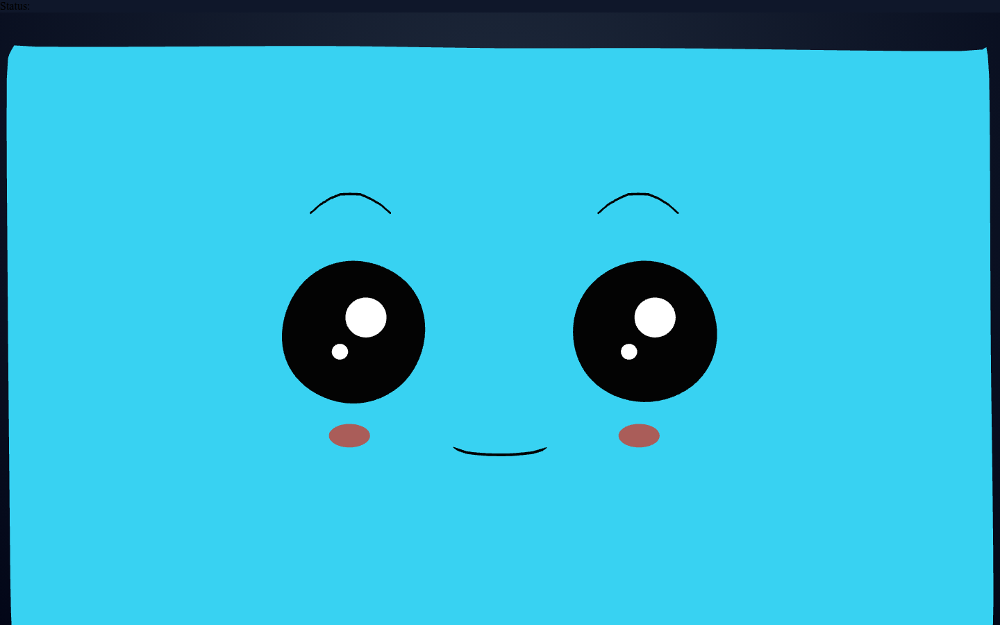
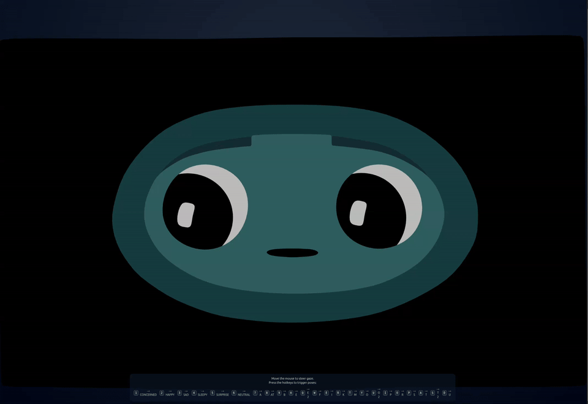

<!-- tags: family=guidebook; type=guidebook-module; editorial_status=completed; publication_status=live; topics=guidebook,experience,hello-face,runtime -->

> **Last updated:** 2026-10-23
> **Purpose:** deliver the fastest convincing first Vizij runtime success with a working face

# Hello Face Quickstart

## Guidebook Context

| Axis | Position |
| --- | --- |
| Bucket chain | Previous: [Introduction](../introduction/README.md)<br>Current: [Experience](README.md)<br>Next: [Control](../control/README.md) |
| Depth ladder in this bucket | Above: none, this is the entry depth in this bucket<br>Current: `Surface`<br>Below: [Existing Asset Sandbox](existing-asset-sandbox.md), [Sample Asset Exploration](sample-asset-exploration.md) |
| Module position in this bucket | Previous in bucket: start at [Experience](README.md)<br>Current module: `Hello Face Quickstart`<br>Next in bucket: [Richer Interactive Example](richer-interactive-example.md) |
| Reference bridges | [Runtime Quickstart Reference](../reference/runtime-quickstart-reference.md)<br>[Validation Checkpoints](../support/validation-checkpoints.md)<br>[Troubleshooting Matrix](../support/troubleshooting-matrix.md) |
| Module type | walkthrough |
| Bucket overview | [Experience](README.md) |

## Reader Outcome

After this page, you should be able to launch the maintained Hello Face app, confirm that the runtime is actually live, trigger visible behavior with the keyboard, and point to the small runtime skeleton that makes the app work.

## Starting State

Use the `vizij-web` workspace root:

```bash
cd path/to/vizij-web
```

This walkthrough uses `apps/tutorial-fullscreen-face`, which is the smallest maintained Vizij runtime app in the workspace.

## What You Need

Install dependencies once:

```bash
pnpm install
```

Start the tutorial app:

```bash
pnpm run dev:tutorial-fullscreen-face
```

Open the local Vite URL that appears in the terminal.

## Quick term bridge

Keep these four labels distinct while you work through the first run:

| Term | What it means on this page | What it does not mean yet |
| --- | --- | --- |
| `face artifact` | the bundled sample face being loaded | your own authored face |
| `runtime bundle` | the face GLB, with its bundle, handed to `VizijRuntimeProvider` | the whole application shell |
| `app shell` | the tutorial app that hosts the face and hooks | a deployed operator endpoint |
| `deployment endpoint` | a later `Deploy` concern with an exposed control path | this first-run tutorial surface |

## What Success Looks Like Up Front

Before you inspect any code, know what a healthy first run should look like:

1. the page opens without a blank canvas or crash
2. the face becomes visible after loading finishes
3. holding an expression key fades that expression in, and releasing it fades it out
4. pressing a viseme key moves the mouth

If the face never appears, stop and use [Validation Checkpoints](../support/validation-checkpoints.md) or [Troubleshooting Matrix](../support/troubleshooting-matrix.md) before continuing.

## Walkthrough

### 1. Launch the maintained runtime tutorial

From `vizij-web`, run:

```bash
pnpm run dev:tutorial-fullscreen-face
```

When the browser opens, wait for the face to settle into its ready state.

Expected result:

1. you briefly see a loading bar while the runtime downloads and the face loads
2. the face appears centered on screen
3. the app stops looking transitional and starts behaving like a live face surface

Current visual anchor:



_Caption: the settled ready-state view of the smallest maintained runtime tutorial._

Use this still to confirm the baseline face state before you test motion or hotkey-driven changes.

### 2. Prove that the face is live, not static

Move the pointer over the page to show the key hints, then do two checks immediately:

1. hold one of the expression keys (`1`–`0`, `Q`–`P`, `A`–`J`) and watch the expression fade in, then release it
2. press one of the viseme keys (`L`, `Z`–`M`) and watch the mouth take that shape (`K` plays `sil`, the mouth at rest)

Expected result:

1. an expression fades in over about two seconds while its key is held, and back out when released
2. a viseme plays once per key press
3. repeated interactions continue working, which proves the face's device is actively taking writes rather than showing a prerecorded asset

With `?autoplay` added to the URL, the face's own program also runs from load, moving the face between your key presses.

This is the first useful Vizij confidence test. A rendered face is not enough. The face has to respond.

Motion anchor:



_Caption: the face responding to input, proving that it is not static._

The still screenshot above proves the settled ready state. This loop is the stronger proof that the surface is live.

### 3. Inspect the runtime skeleton in code

Open these files:

1. `vizij-web/apps/tutorial-fullscreen-face/src/FaceApp.tsx`
2. `vizij-web/apps/tutorial-fullscreen-face/src/hooks/useFaceHotkeys.ts`

In `FaceApp.tsx`, find the three pieces that define the app:

```tsx
export function FaceApp() {
  return (
    <>
      <VizijCanvas style={CANVAS_STYLE} />
      <VizijRuntimeProvider
        glb={faceAssetUrl}
        options={{ program: autoplay ? "auto" : "none" }}
      >
        <FaceRuntime />
      </VizijRuntimeProvider>
    </>
  );
}
```

What each piece is doing:

1. `<VizijCanvas>` is the page's one canvas, on which `@vizij/runtime`'s Bevy view draws the face
2. `VizijRuntimeProvider` fetches the face GLB, loads the face as an Arora device, steps it every frame, and reports its `status`
3. `FaceRuntime` renders `VizijRuntimeFace`, the slot the face draws over, and binds the hotkeys once the face is ready

If you understand those three pieces, you understand the core shape of the maintained Hello Face path.

### 4. Connect the visible behavior to the maintained hook

Open `useFaceHotkeys.ts`.

You are looking for two different control patterns:

1. an expression key fades the face standard's expression weight, `runtime.path("standard/vizij/expression/<name>")`, up while held and back down when released
2. a viseme key calls the face's `play_viseme` method, which plays one mouth shape through the face's lipsync envelope

The hook reads its bindings from the face standard's profile, `vizij-face`, in the profile's order, and assigns them to its 36 keys: the 27 expressions take `1`–`0`, `Q`–`P` and `A`–`J`, and the first nine of the 15 visemes (`sil`, `PP`, `FF`, `TH`, `DD`, `kk`, `CH`, `SS`, `nn`) take `K`, `L` and `Z`–`M`; the other six visemes have no key. You do not need to memorize every line yet. You do need to notice that both behaviors are driven through the face's own API, not through one-off DOM tricks.

Expected result:

1. the hook explains why holding a key fades an expression in and out
2. the hook explains why a viseme key moves the mouth once
3. the code lines up cleanly with the behavior you already saw in the browser

### 5. Name the maintained runtime pattern

At this point, you should be able to say:

1. this app loads one existing face GLB
2. the runtime provider loads the face as a device and keeps track of readiness
3. a small hook writes the face's keys and calls its methods
4. the face is drawn by the same Bevy view and runtime every other Vizij app builds on

That is the entire reason this app is the first maintained route through the guidebook.

## Why This Page Matters

`Hello Face` is not trying to teach all of Vizij.

It is trying to remove the first doubt:

1. can I run a real Vizij face locally
2. can I make it do something visible
3. can I find the code path that produced what I just saw

Once those are true, later control, integration, and deployment pages have something solid to build on.

## What This Page Is Not Proving Yet

This page proves a live runtime surface. It does not yet prove:

1. that you understand path semantics in detail,
2. that you have an application integration shell of your own,
3. that you have authored or customized the face,
4. that you have a deployment endpoint an operator can drive.

## Choose Your Next Route

The canonical next step is [First Control Interactions](../control/first-control-interactions.md).

Use one of these branch points after that:

| If your next goal is... | Open this next |
| --- | --- |
| understand the visible interactions before going deeper | [First Control Interactions](../control/first-control-interactions.md) |
| get to a player shell and keep the fast route | [Minimal Web Player](../integrate/minimal-web-player.md) after `Control` |
| start owning the face and its behavior | [Tweak an Existing Face](../customize/tweak-an-existing-face.md) after `Control` |

## Fast Recovery If It Fails

Use these shortcuts instead of guessing:

1. if dependencies are missing or stale, rerun `pnpm install`
2. if the page loads but the face never appears, use [Validation Checkpoints](../support/validation-checkpoints.md)
3. if the face appears but does not respond, continue to [First Control Interactions](../control/first-control-interactions.md) and compare the expected behavior there
4. if the app shows an error state, use [Troubleshooting Matrix](../support/troubleshooting-matrix.md)

## Success Check

You are done with this page when:

1. `tutorial-fullscreen-face` runs locally
2. the face renders and reaches a stable ready state
3. expression keys fade visible expressions in and out and viseme keys move the mouth
4. you can point to the canvas, the provider, the face's slot, and the hotkey hook in code

## Implementation Anchors

Use these when you need the current implementation truth:

1. `vizij-web/apps/tutorial-fullscreen-face/README.md`
2. `vizij-web/apps/tutorial-fullscreen-face/tutorial.md`
3. `vizij-web/apps/tutorial-fullscreen-face/src/FaceApp.tsx`
4. `vizij-web/apps/tutorial-fullscreen-face/src/hooks/useFaceHotkeys.ts`
5. `vizij-web/packages/@vizij/runtime-react/README.md`

## Recommended Next Steps

Continue to [First Control Interactions](../control/first-control-interactions.md).

That page uses the same app, but it slows down and explains what the two maintained interaction patterns are actually doing.
