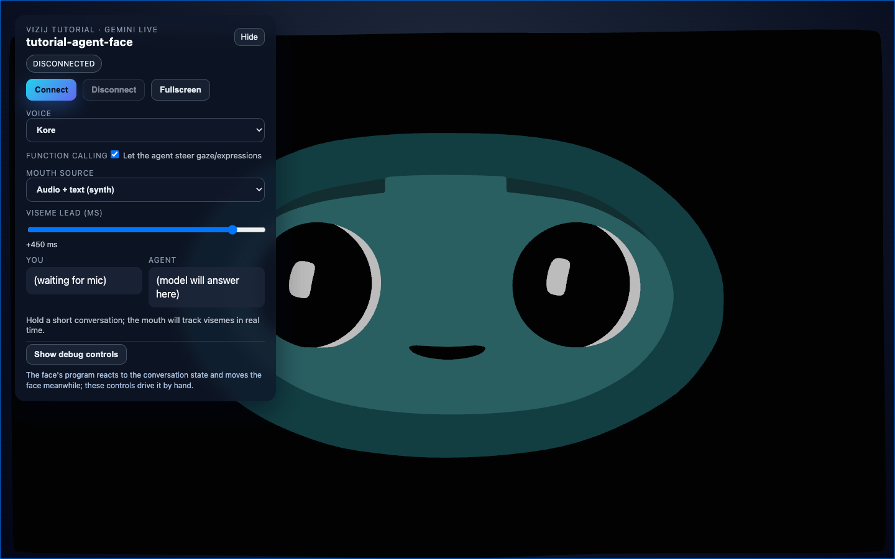

<!-- tags: family=guidebook; type=guidebook-module; editorial_status=completed; publication_status=planned; topics=guidebook,experience,richer-example,tutorial-agent-face -->

> **Last updated:** 2026-10-12
> **Purpose:** show one maintained richer first-contact example without replacing the main beginner route

# Richer Interactive Example

## Guidebook Context

| Axis | Position |
| --- | --- |
| Bucket chain | Previous: [Introduction](../introduction/README.md)<br>Current: [Experience](README.md)<br>Next: [Control](../control/README.md) |
| Depth ladder in this bucket | Above: none, this is the entry depth in this bucket<br>Current: `Surface`<br>Below: [Existing Asset Sandbox](existing-asset-sandbox.md), [Sample Asset Exploration](sample-asset-exploration.md) |
| Module position in this bucket | Previous in bucket: [Hello Face Quickstart](hello-face-quickstart.md)<br>Current module: `Richer Interactive Example`<br>Next in bucket: [Existing Asset Sandbox](existing-asset-sandbox.md) |
| Reference bridges | [Runtime Quickstart Reference](../reference/runtime-quickstart-reference.md)<br>[Validation Checkpoints](../support/validation-checkpoints.md)<br>[Troubleshooting Matrix](../support/troubleshooting-matrix.md) |
| Module type | demo page |
| Bucket overview | [Experience](README.md) |

## Reader Outcome

After this page, you should be able to explain what a richer first-contact Vizij experience looks like, what it proves beyond `Hello Face`, and why it is still an optional branch rather than the canonical first step.

## Module Notes

- Use this optional page after [Hello Face Quickstart](hello-face-quickstart.md) if you want a more product-shaped example before choosing your route.
- The page is still an `Experience` stop: it compares what the richer sample proves without teaching provider setup, control wiring, or deployment semantics.
- Treat it as an observation page, not the main learning spine.

## What You Need

You do not need to run the richer example to use this page well.

The point here is to look at the example, notice what it adds, and decide which page you actually want next.

If you do want to launch the maintained richer example later, the current anchor is `vizij-web/apps/tutorial-agent-face`:

```bash
pnpm run dev:tutorial-agent-face
```

The face surface can be inspected locally without a live session.

The current live conversation loop requires `VITE_GEMINI_API_KEY`.

## Quick Contrast With `Hello Face`

| Dimension | `Hello Face` | `tutorial-agent-face` |
| --- | --- | --- |
| Teaching job | fastest first proof | richer optional branch |
| Shell complexity | low | medium to high |
| Runtime model | one canvas, one provider, one face, driven through the face standard | the same, plus the face's own program and a session layer |
| External dependency | none required | live loop is optional, API key required only for that layer |
| What it proves | the runtime is real | the same runtime can live inside a product-shaped shell |

Current visual anchor:



_Caption: a richer app shell with connection controls, voice settings, and transcript placeholders wrapped around the same face runtime._

This capture is useful because it shows the richer shell honestly in a disconnected state: the face is already live, but the optional session layer, voice controls, and agent-facing UI are visible as separate concerns instead of being collapsed into one vague "smart demo."

## What To Notice In This Example

Compared with `Hello Face`, the maintained richer example adds:

1. a larger HUD around the face,
2. explicit connection controls,
3. transcript and session feedback,
4. optional function-calling behavior for gaze and expression,
5. more visible tuning surfaces such as voice and mouth mode.

That makes the example feel closer to an actual interactive application instead of a focused runtime tutorial.

Read those additions as evidence of capability, not as required setup.

## What This Example Proves From The Reader Side

This example proves:

1. a Vizij face can live inside a richer app shell,
2. the same provider-based runtime can support a more expressive experience,
3. richer interaction can combine local behavior and optional service-backed behavior,
4. the face can remain understandable even when the UI around it becomes more product-like.

## What This Example Does Not Prove

This example does not prove:

1. that conversation or live service integration is required for Vizij,
2. that the app is the canonical first route,
3. that provider-specific configuration is the main thing new readers should learn,
4. that the example is already the deployment story.

Those are the boundaries that keep this page in `Experience` instead of letting it drift into `Integrate` or `Deploy`.

## How To Read This Example Correctly

Read the example in this order:

1. notice that the face still starts from the same runtime shell as `Hello Face`,
2. notice that the shell exposes more status, controls, and feedback than the smallest example,
3. treat the live session as an optional outer layer rather than the lesson itself,
4. move to `Control` when you want to understand the visible interaction patterns,
5. move to `Integrate` only when you want to understand how a richer shell is assembled.

The important learner-facing sentence is:

`same runtime shell, larger shell around it, optional live layer`

## A Good Reason To Choose This Branch

Use this richer example branch when you want:

1. a more product-shaped first impression,
2. a stronger sense of how a face can participate in a larger interactive loop,
3. motivation before committing to the deeper integration pages.

Do not choose it because you think it is the required setup for using Vizij at all.

## Success Check

You are done with this page when:

1. you can explain why this example is richer than `Hello Face`,
2. you can explain why it is still optional,
3. you can describe what it proves without over-claiming production or deployment readiness,
4. you know that the next teaching step is `Control` if you want to understand the visible interaction patterns, or `Integrate` if you want to understand how the richer shell is built.

## Implementation Anchors

Use these when you need the current implementation truth:

1. `vizij-web/apps/tutorial-agent-face/README.md`
2. `vizij-web/apps/tutorial-agent-face/tutorial.md`
3. `vizij-web/apps/tutorial-agent-face/src/FaceApp.tsx`
4. `current_documentation/guidebook/integrate/api-backed-interactive-application.md`
5. `current_documentation/guidebook/integrate/rich-interactive-applications.md`

## Recommended Next Steps

1. If you want to feel the smaller maintained experience for yourself, continue to [Hello Face Quickstart](hello-face-quickstart.md).
2. If you want the first teaching page about how the visible interactions work, continue to [First Control Interactions](../control/first-control-interactions.md).
3. If you later want to understand how a richer shell like this is assembled, continue to [API-Backed Interactive Application](../integrate/api-backed-interactive-application.md).
