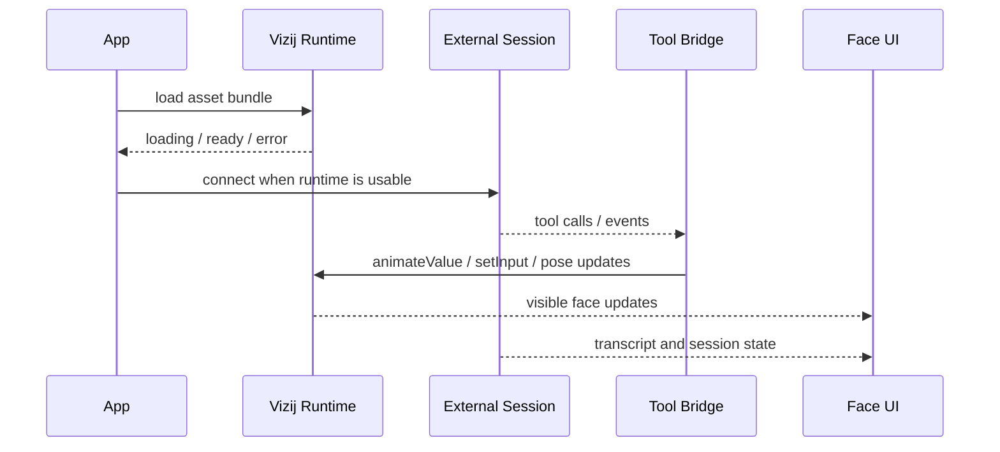

<!-- tags: type=guidebook-module; status=written; topics=guidebook,integrate,api-backed,interactive-application,runtime-react -->

> **Last updated:** 2026-03-12
> **Purpose:** teach how a richer API-backed Vizij application is assembled without confusing external service behavior with a different runtime model

# API-Backed Interactive Application

## Guidebook Context

1. **Bucket:** [Integrate](README.md)
2. **Depth:** `Advanced`
3. **Module type:** walkthrough
4. **Bucket overview:** [Integrate](README.md)
5. **Useful previous module:** [Application Integration Patterns](application-integration-patterns.md)
6. **Useful next module:** [Rich Interactive Applications](rich-interactive-applications.md)

## Reader Outcome

After this page, you should be able to explain how a richer API-backed Vizij application is assembled:

1. the Vizij runtime shell becomes ready,
2. an external session becomes ready,
3. service events are translated into runtime tool calls,
4. the face and surrounding UI reflect those results honestly.

You should also be able to explain why this is still the same Vizij runtime model, not a different system.

## Module Notes

### Intended Audience

This page is for readers who already understand:

1. [Loading, Playback, and Embedding](loading-playback-and-embedding.md),
2. [Application Integration Patterns](application-integration-patterns.md),
3. [Orchestration and Diagnostics](../control/orchestration-and-diagnostics.md) if they want the deepest runtime framing.

It is for readers who now need one concrete advanced integration pattern, not just a comparison page.

### Artifact Being Touched

The artifact here is the application layer around a Vizij face runtime:

1. a `VizijAssetBundle` and `VizijRuntimeProvider`,
2. a visible face surface rendered through `VizijRuntimeFace`,
3. an external API or live-service session,
4. a tool bridge that translates service events into runtime actions,
5. UI state that exposes readiness, transcripts, controls, and failures.

## What You Need

It helps if you can inspect the current maintained example in `vizij-web`:

1. `apps/tutorial-agent-face/README.md`,
2. `apps/tutorial-agent-face/tutorial.md`,
3. `apps/tutorial-agent-face/src/FaceApp.tsx`,
4. `apps/tutorial-agent-face/src/hooks/useGeminiLive.ts`,
5. `apps/tutorial-agent-face/src/hooks/useAgentFaceTools.ts`.

If you want to run that example locally:

```bash
pnpm run dev:tutorial-agent-face
```

The live session layer currently requires `VITE_GEMINI_API_KEY`.

## One Stable Runtime Shell

The current maintained example still starts with the same stable runtime shell:

1. define a `VizijAssetBundle`,
2. mount `VizijRuntimeProvider`,
3. render `VizijRuntimeFace`,
4. wait for `loading`, `error`, and `ready` to settle,
5. stage a neutral pose baseline before richer interaction begins.

The app does not bypass the runtime because it talks to an API.

It still waits for the runtime to load the asset, initialize the orchestrator, and expose a healthy face surface first.

## Integration Flow



The important rule is that readiness and ownership change by layer.

## Readiness Boundaries

### 1. Runtime readiness comes first

In `FaceApp.tsx`, the app distinguishes:

1. `Loading face…`,
2. `Initialising orchestrator…`,
3. runtime error,
4. ready runtime.

If the runtime is not ready, the tool layer should not pretend the face can respond.

### 2. Session readiness is separate

Once the face runtime is healthy, the app can establish its external session.

In the current example, `useGeminiLive` manages separate states such as:

1. disconnected,
2. connecting,
3. connected,
4. error.

A face can be runtime-ready while the external session is disconnected or failing.

That is one of the main lessons of this page.

## The Tool Bridge Is The Real Application Layer

The richest part of the pattern is the tool bridge between the service and the Vizij runtime.

In the maintained example:

1. the session emits tool calls such as gaze or expression requests,
2. `useGeminiLive` receives those calls,
3. `useAgentFaceTools` validates and translates them,
4. the translation layer calls runtime helpers such as `animateValue`,
5. the face updates through the normal orchestration path.

That boundary keeps the pattern coherent.

The service decides what it wants the face to do.

The app decides how that request maps into valid Vizij runtime actions.

The runtime decides how those staged actions become visible behavior.

## Tool Parameters Are Not Direct Renderer Writes

Tool parameters are not direct renderer writes.

In the current example, gaze and emotion requests are translated into runtime paths and helper calls, not direct renderer mutation.

That means the richer application still uses the same runtime vocabulary taught in `Control` and the earlier `Integrate` pages.

## UI Feedback Is Part Of The Pattern

An API-backed face app is not just a face with an invisible backend.

The app also owns surrounding surfaces such as:

1. session status chips,
2. connect and disconnect actions,
3. transcript display,
4. toggles for function calling,
5. voice or mouth-mode selection,
6. visible error messages.

Those surfaces matter because they tell the reader what failed:

1. runtime setup,
2. session connection,
3. tool execution,
4. or face behavior itself.

## What This Pattern Prevents

When assembled correctly, this pattern prevents several common advanced mistakes:

1. treating a richer app as if it needs a different Vizij runtime,
2. collapsing runtime readiness and session readiness into one ambiguous state,
3. letting service calls bypass the runtime contract,
4. assuming any emotion or gaze request is valid without checking the loaded face.

## Success Check

You are done with this page when:

1. you can describe the API-backed pattern as `runtime shell + external session + tool bridge`,
2. you can explain why tool calls are translated into runtime helpers instead of direct renderer writes,
3. you can explain the difference between runtime readiness and session readiness,
4. you can explain why the maintained example is a pattern anchor, not the only valid provider choice.

## Implementation Anchors

Use these when you need the current implementation truth:

1. `vizij-web/apps/tutorial-agent-face/README.md`
2. `vizij-web/apps/tutorial-agent-face/tutorial.md`
3. `vizij-web/apps/tutorial-agent-face/src/FaceApp.tsx`
4. `vizij-web/apps/tutorial-agent-face/src/hooks/useGeminiLive.ts`
5. `vizij-web/apps/tutorial-agent-face/src/hooks/useAgentFaceTools.ts`
6. `vizij-web/packages/@vizij/runtime-react/README.md`

## Next Step

1. If you want the broader advanced picture beyond this one pattern, continue to [Rich Interactive Applications](rich-interactive-applications.md).
2. If you realize you still need the fundamentals route, go back to [Application Integration Patterns](application-integration-patterns.md) or [Loading, Playback, and Embedding](loading-playback-and-embedding.md).
3. If your next concern is operator-facing deployment rather than richer app behavior, continue to [Operator and Deployment Model](../deploy/operator-and-deployment-model.md).
