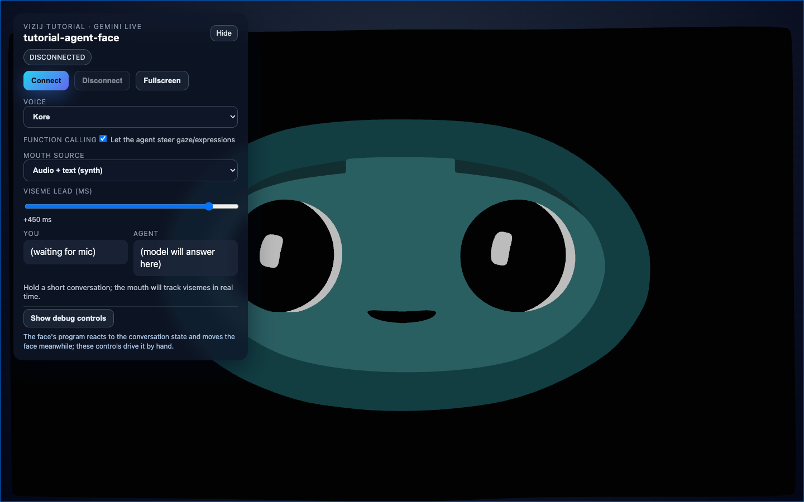

<!-- tags: family=guidebook; type=guidebook-module; editorial_status=completed; publication_status=live; topics=guidebook,integrate,api-backed,interactive-application,runtime-react -->

> **Last updated:** 2026-10-12
> **Purpose:** teach how a richer API-backed Vizij application is assembled without confusing external service behavior with a different runtime model

# API-Backed Interactive Application

## Guidebook Context

| Axis | Position |
| --- | --- |
| Bucket chain | Previous: [Control](../control/README.md) on the fast route or [Customize](../customize/README.md) on the customization route<br>Current: [Integrate](README.md)<br>Next: [Deploy](../deploy/README.md) |
| Depth ladder in this bucket | Above: [Minimal Web Player](minimal-web-player.md), [Loading, Playback, and Embedding](loading-playback-and-embedding.md), [Application Integration Patterns](application-integration-patterns.md)<br>Current: `Advanced`<br>Below: none, this is the deepest current depth in this bucket |
| Module position in this bucket | Previous in bucket: [Application Integration Patterns](application-integration-patterns.md)<br>Current module: `API-Backed Interactive Application`<br>Next in bucket: [Rich Interactive Applications](rich-interactive-applications.md) |
| Reference bridges | [Runtime Quickstart Reference](../reference/runtime-quickstart-reference.md)<br>[Animation, Integration, and Deployment Reference](../reference/animation-integration-and-deployment-reference.md)<br>[Validation Checkpoints](../support/validation-checkpoints.md) |
| Module type | walkthrough |
| Bucket overview | [Integrate](README.md) |

## Reader Outcome

After this page, you should be able to run the maintained richer integration example, separate runtime readiness from session readiness, and explain how an external service loop becomes visible face behavior through a tool bridge instead of bypassing the Vizij runtime.

## Starting State

Use the `vizij-web` workspace root:

```bash
cd path/to/vizij-web
```

This walkthrough uses `apps/tutorial-agent-face`, the maintained Vizij example that layers a live service loop on top of the same runtime foundation used in `tutorial-fullscreen-face`.

## Scope note

Open this page only if your product really has an external session or service loop.

If you only need a local embedded face:

1. stay with [Minimal Web Player](minimal-web-player.md),
2. use [Application Integration Patterns](application-integration-patterns.md) to choose the lighter app shape,
3. come back here only when a separate session layer is a real requirement.

## Required And Optional Setup

Install dependencies once:

```bash
pnpm install
```

If you want the full live-session path, create the app-local env file:

```bash
cat > apps/tutorial-agent-face/.env.local <<'EOF'
VITE_GEMINI_API_KEY=your_google_ai_studio_key
EOF
```

Then start the app:

```bash
pnpm run dev:tutorial-agent-face
```

Two valid ways to use this page:

1. without `VITE_GEMINI_API_KEY`, inspect the runtime shell and local interaction layers
2. with `VITE_GEMINI_API_KEY`, complete the full runtime-plus-session walkthrough

## What You Can Validate Without The API Key

The missing API key only blocks the live session layer. It does not erase the rest of the maintained app.

| If `VITE_GEMINI_API_KEY` is missing | You can still validate | You cannot validate yet |
| --- | --- | --- |
| session connection is intentionally unavailable | runtime loading, ready, and error states | live Gemini session connection |
| the face shell should still render | the provider/bootstrap shape in `FaceApp.tsx` | transcript or model-audio flow |
| the UI should still distinguish runtime status from session status | the boundary between `useGeminiLive` and `useAgentFaceTools` | tool-call round trips from the external service |
| the disconnected state is expected | local interaction layers and runtime-owned behavior | service-driven gaze, emotion, or mouth behavior |

If the page loads, the face becomes ready, and the UI reports a missing key or disconnected session separately from runtime readiness, the app is still teaching the right advanced-integration boundary.

## The Pattern You Are Learning

This page teaches one reusable application shape:

1. a stable Vizij runtime shell
2. a separate external session layer
3. a tool bridge that translates service events into Vizij runtime actions
4. UI state that tells you which layer is healthy or failing

That is the whole advanced-integration idea.

## Walkthrough

### 1. Launch the richer app and identify the runtime shell

Run:

```bash
pnpm run dev:tutorial-agent-face
```

Open the local URL shown by Vite.

Expected result:

1. the face appears on the page's canvas through the same provider used by the simpler tutorial
2. the UI has more controls and session-facing chrome than `tutorial-fullscreen-face`
3. the app is clearly more product-shaped without being a different runtime model

Current visual anchor:



_Caption: the runtime face remaining visible and healthy even while the outer session layer is disconnected._

That is the point of using this capture here: it lets the page separate runtime readiness from session readiness before the live service path enters the story.

### 2. Separate runtime readiness from session readiness

Before connecting any live session, inspect the UI and app behavior.

What to look for:

1. the face runtime can become ready even if the external session is disconnected
2. a missing API key or disconnected session does not mean the runtime failed
3. local behavior such as the face's own idle motion, the debug controls, and UI shell rendering still prove that the Vizij layer is healthy

This is the first advanced lesson:

1. runtime readiness answers `can the face load and respond`
2. session readiness answers `can the external service connect and drive richer behavior`

Do not collapse those into one state.

### 3. Inspect how the app keeps the runtime foundation small

Open:

1. `vizij-web/apps/tutorial-agent-face/src/FaceApp.tsx`
2. `vizij-web/apps/tutorial-agent-face/src/hooks/useGeminiLive.ts`
3. `vizij-web/apps/tutorial-agent-face/src/hooks/useAgentFaceTools.ts`

The runtime bootstrap still looks like this:

```tsx
export function FaceApp() {
  return (
    <>
      <VizijCanvas style={CANVAS_STYLE} />
      <VizijRuntimeProvider glb={faceAssetUrl}>
        <AgentFaceRuntime />
      </VizijRuntimeProvider>
    </>
  );
}
```

`<VizijCanvas>` is the page's one canvas, on which the face draws; `VizijRuntimeProvider` loads the face and runs it as a device. The face carries a program that keeps it alive and reacts to what the app tells it. That small bootstrap matters. The app becomes rich by adding layers around the runtime, not by replacing it.

### 4. Follow the live-service bridge in code

Inside `FaceApp.tsx`, look for the boundary between session logic and runtime logic:

```tsx
const { tools, handleFunctionCalls } = useAgentFaceTools({
  enabled: ready,
  expressions,
  allowEmotionTools: debugControlsOpen,
});

const {
  status: geminiStatus,
  userSpeaking,
  thinking,
  modelSpeaking,
  connect,
  disconnect,
} = useGeminiLive(audioManager, voiceName, {
  enableTools: toolsEnabled,
  tools,
  handleFunctionCalls: toolsEnabled ? handleFunctionCalls : undefined,
  systemInstruction,
  initialUserTurn,
});

useConversationState(ready, {
  speaking: modelSpeaking,
  userSpeaking,
  thinking,
});
```

What this means:

1. `useGeminiLive` owns the external session
2. `useAgentFaceTools` owns the translation from tool calls into Vizij runtime actions
3. the face moves through its Vizij face standard keys and methods: the conversation state (`standard/vizij/conversation/*`) that the face's program reacts to, the gaze target (`standard/vizij/gaze/target/*`) that `set_gaze` steers, the expression weights (`standard/vizij/expression/<name>`) that `express_emotion` fades, and `play_viseme`, which plays the lips from the agent's audio

This translation layer is the part you copy into your own advanced app.

### 5. Complete the full live-session path if you configured the API key

If `VITE_GEMINI_API_KEY` is configured:

1. connect the session from the UI
2. trigger a short interaction
3. watch for transcript or session-state feedback
4. observe gaze, expression, or mouth behavior update through the face surface

Expected result:

1. the session state changes independently from runtime readiness
2. tool-driven actions become visible face changes
3. the UI tells you whether the problem is in the runtime layer, the session layer, or the tool layer

If you did not configure the API key, stop after step 4 and treat the disconnected session as an intentional boundary, not a failed tutorial.

## Why This Example Teaches Well

This app is the best maintained advanced guide because it shows all of these at once:

1. the runtime shell remains recognizable
2. a live service loop is clearly separate from runtime loading
3. the tool bridge is explicit in code
4. the surrounding UI helps diagnose where the system is healthy or failing

That combination is what makes it a reusable integration pattern instead of just a flashy demo.

## Fast Recovery If It Fails

Use these shortcuts:

1. if the face never loads, treat that as a runtime problem and compare against [Hello Face Quickstart](../experience/hello-face-quickstart.md)
2. if the face loads but the session will not connect, check whether `VITE_GEMINI_API_KEY` is configured
3. if the session connects but the face does not react, inspect `useAgentFaceTools.ts` and `useConversationState.ts` and compare the expected bridge shape in this page
4. if you need route-level healthy-state checks, use [Validation Checkpoints](../support/validation-checkpoints.md)
5. if you need failure-driven recovery, use [Troubleshooting Matrix](../support/troubleshooting-matrix.md)

## Success Check

You are done with this page when:

1. `tutorial-agent-face` runs locally
2. you can explain the difference between runtime readiness and session readiness
3. you can point to the tool bridge that translates external events into Vizij runtime actions
4. if the API key is configured, you can trigger a live interaction and see the face respond through that bridge

## Implementation Anchors

Use these when you need the current implementation truth:

1. `vizij-web/apps/tutorial-agent-face/README.md`
2. `vizij-web/apps/tutorial-agent-face/tutorial.md`
3. `vizij-web/apps/tutorial-agent-face/src/FaceApp.tsx`
4. `vizij-web/apps/tutorial-agent-face/src/hooks/useGeminiLive.ts`
5. `vizij-web/apps/tutorial-agent-face/src/hooks/useAgentFaceTools.ts`
6. `vizij-web/apps/tutorial-agent-face/src/hooks/useConversationState.ts`
7. `vizij-web/packages/@vizij/runtime-react/README.md`
8. `vizij-web/packages/@vizij/render/README.md`

## Recommended Next Steps

Continue to [Rich Interactive Applications](rich-interactive-applications.md) if you want the broader family of advanced integration patterns.

If you want to return to the simpler integration spine, go back to [Minimal Web Player](minimal-web-player.md).
