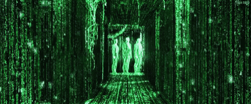
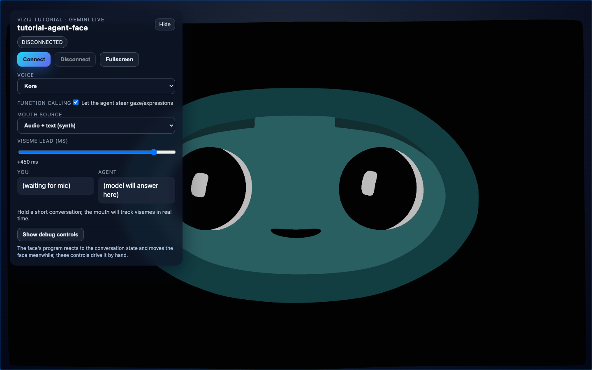
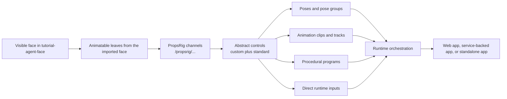
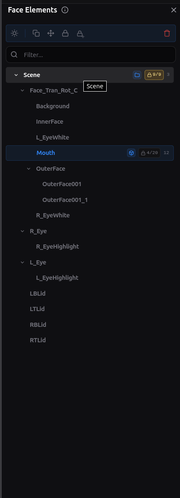
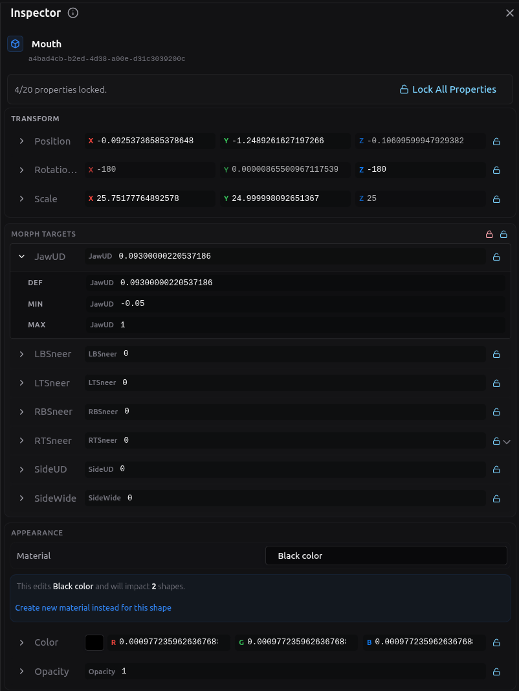
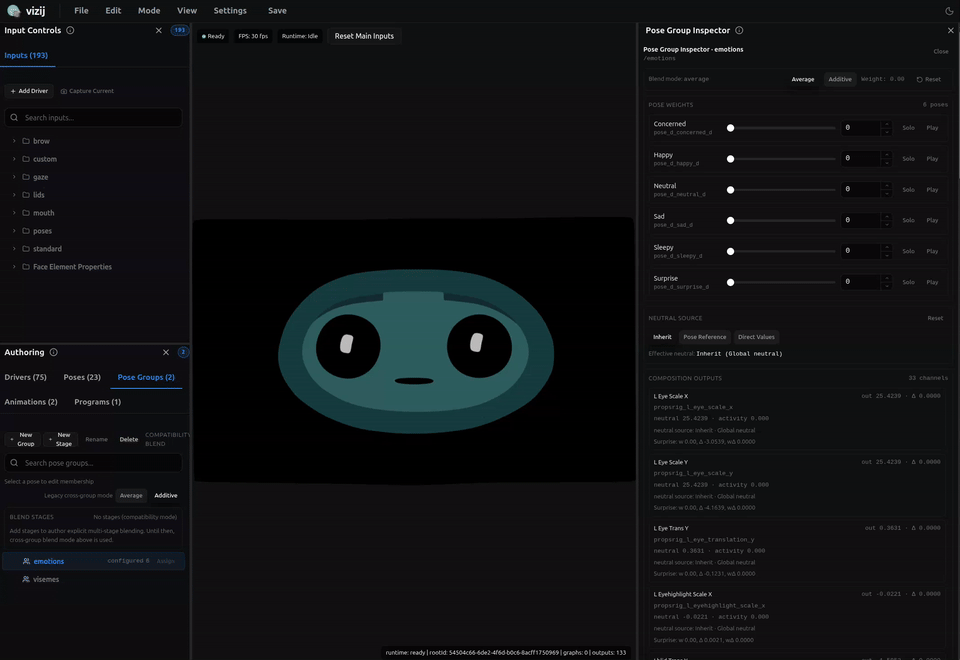
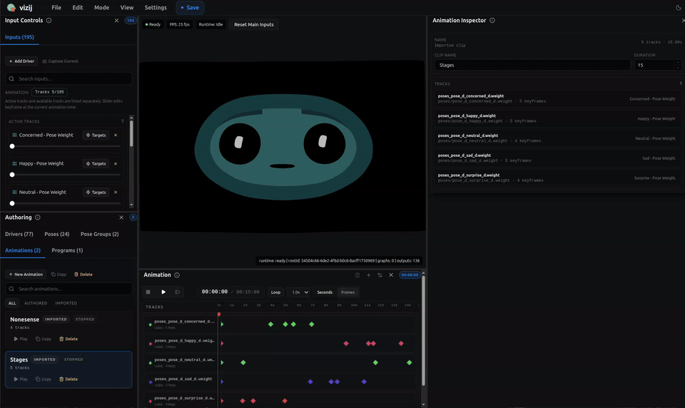
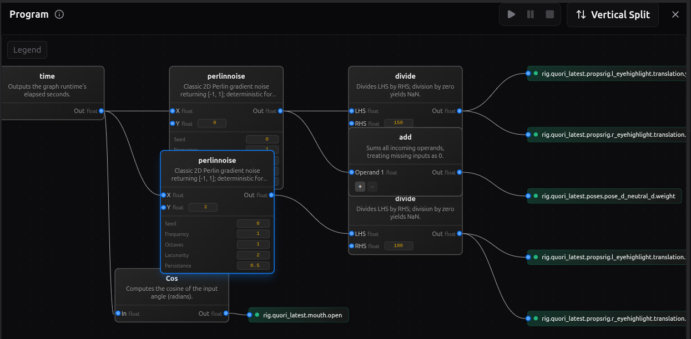
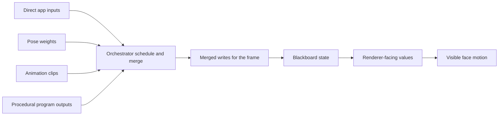
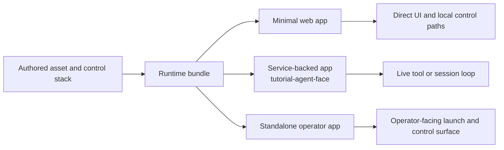

<!-- tags: type=guidebook-module; status=written; topics=guidebook,integrate,agent-face,authoring,orchestration -->

> **Last updated:** 2026-03-16
> **Purpose:** unpack the maintained face stack from rendered shape properties up through runtime orchestration and deployment

# Behind the face

## Guidebook Context

| Axis | Position |
| --- | --- |
| Bucket chain | Previous: [Control](../control/README.md) on the fast route or [Customize](../customize/README.md) on the customization route Current: [Integrate](README.md) Next: [Deploy](../deploy/README.md) |
| Depth ladder in this bucket | Above: [Minimal Web Player](minimal-web-player.md), [Loading, Playback, and Embedding](loading-playback-and-embedding.md), [Application Integration Patterns](application-integration-patterns.md) Current: `Advanced` Below: none, this is the deepest current depth in this bucket |
| Module position in this bucket | Previous in bucket: [API-Backed Interactive Application](api-backed-interactive-application.md) Current module: `Behind the Face` Next in bucket: [Rich Interactive Applications](rich-interactive-applications.md) |
| Reference bridges | [Renderer and Rigging Reference](../reference/renderer-and-rigging-reference.md) [Animation, Integration, and Deployment Reference](../reference/animation-integration-and-deployment-reference.md) [Troubleshooting Matrix](../support/troubleshooting-matrix.md) |
| Module type | walkthrough |
| Bucket overview | [Integrate](README.md) |

## Vizij - What's in a name?

> "That which we call a face, by any other name would look as sweet." - _Shakespeare, probably_

## Seeing behind the face

_Caption: Cracking the Vizij code_

What looks like one animated face is actually the final result of several layers working together:

1. renderable shape properties discovered from the asset,
2. low-level rig channels that can write those properties,
3. higher-level authored controls such as blink, gaze, and smile,
4. named states, motion clips, and graph-driven behaviors,
5. a runtime that resolves all of those into one frame,
6. an application shell that decides why the face should do anything at all.

Keep two app surfaces in view while you read:

1. `tutorial-agent-face` shows the live result,
2. `vizij-authoring` shows how that result is built and edited.

_Caption: the visible agent face is the end of the chain, not the beginning._

That ladder is the rest of the walkthrough.

## A face is made up shapes and their properties

At the lowest visual layer, a face is a hierarchy tree of shapes and their properties discovered from the imported asset.

In practice, we parse the tree for properties to control such as:

1. transform components,
2. material or shader parameters,
3. morph targets and any other renderable property the renderer can move.

This is where the Blender export matters. Blender does not export "a smile" or "a blink" as first-class behavior. It exports shapes, meshes, weights, transforms, and related properties that can later be driven.

That is why the Face Elements surfaces in `vizij-authoring` matter so much. They show the leaves that actually exist in the face.

_Caption: the Face Elements panel exposes discovered scene-facing leaves, not yet reader-friendly expression controls._

_Caption: the inspector lets you look at the properties behind one selected face element and see what can actually be driven._

The important boundary is simple:

1. animatable leaves are the renderer-facing sinks,
2. they are real and necessary,
3. they are too low-level to be the main control language for a face.

If you stop here, every behavior has to be expressed as raw property editing. Vizij adds rig layers above this so the same face can be controlled semantically instead of one property at a time.

## _"PropsRig"_: the first drivable layer

We call the first driver layer above animatable leaves the property rig or PropsRig for short. By _driver_ we mean something the user or system can control.

A PropsRig channel is a low-level rig variable created to write one animatable target or one precise part of that target. It is the first place where the system stops thinking in renderer internals and starts thinking in controllable inputs.

Every PropsRig channel carries the metadata that makes it usable:

1. a stable path under `/propsrig/...`,
2. a `min` and `max` range,
3. a `defaultValue`,
4. the mapping back to the animatable property it ultimately drives.

In authoring, the canonical namespace is `/propsrig/...`. At runtime, that same authored path is resolved under the active face identity, so the write becomes part of the loaded `rig/{faceId}/...` space.

This layer is deliberately low-level. It is where you decide:

1. what the allowable control range is,
2. what neutral or default means for the channel,
3. which exact face property the channel owns.

That makes PropsRig the right place for precise eye translation values, eyelid offsets, jaw offsets, and other direct 'mechanical' controls.

Locking also matters here. A locked face property or locked PropsRig target is treated as a sealed boundary while you are authoring. You can still read it and use it as the owned destination, but you do not add new child drivers underneath it until you unlock it. Unlocking means "this low-level channel can be restructured again." Locking means "hold this boundary steady."

So the PropsRig is the lowest level that is still meaningfully authorable:

1. below it are scene leaves,
2. at it are controlled rig variables with ranges and defaults,
3. above it come the more semantic or abstract authored controls.

## Abstract controls: blink, gaze, smile, and standard inputs

Above PropsRig sits the abstract driver layer.

This is where the face starts to feel like a face instead of a bag of numbers.

An abstract control is a higher-level authored input that can drive one or more PropsRig channels together. A blink control might move both eyelids. A gaze control might coordinate both eyes. A smile control might touch several mouth and cheek channels at once.

This is also where custom controls and shared controls meet.

Custom controls are face-specific. They exist because one face may need a control that another face does not.

Shared controls exist because it is useful for faces to expose common intent with a stable vocabulary. In current maintained language, that shared vocabulary is expressed through:

1. standard controls,
2. standard inputs,
3. standard feature spaces.

Those shared control vocabularies are what let different faces answer to the same kind of intent even when the underlying meshes or PropsRig channels differ.

That matters for things like:

1. blink,
2. gaze,
3. smile,
4. mouth openness,
5. other reusable face behaviors that applications want to ask for consistently.

The rule that keeps this layer clean is important:

1. abstract controls can drive PropsRig channels,
2. abstract controls can drive other abstract controls,
3. abstract controls *do not* directly write animatable leaves.

That boundary prevents the semantic control layer from collapsing back into raw renderer editing.

Once this layer exists, a host application no longer has to know which exact eyelid weight or transform component should move. It can ask for a blink-like or gaze-like behavior and let the face's mapping handle the details.

## Poses: named states and blend groups

A pose is a named facial state defined over the control layer above PropsRig.

The key word is named.

A pose is not just "the current slider values." It is a reusable authored state with a stable identity. That identity is what lets the same state be stored, blended, triggered, exported, and driven later in runtime.

The main parts of the pose model are:

1. a pose id,
2. the authored target values for the controls that matter to that pose,
3. one or more pose groups,
4. a weight that says how strongly the pose contributes.

Pose groups exist because several named states may need to blend locally before the larger system blends them with everything else.

The blend stages are:

1. blend pose weights inside a group,
2. compute a group result for each affected control,
3. blend group results across groups,
4. feed the resulting pose aggregate back into the control stack.

That is how Vizij keeps "smile," "blink," "viseme," or other named authored states semantic without making them isolated presets.

_Caption: pose blending shows named states acting as weighted contributors, not as one-shot slider snapshots._

This is the clean difference between a pose and the layers around it:

1. PropsRig defines low-level controllable channels,
2. abstract controls define semantic handles,
3. poses define named states over those handles,
4. pose groups define how those named states combine.

Because poses are weight-driven, they can coexist with direct control instead of replacing it. A runtime can keep a direct gaze input live while also blending an emotion pose or a speech-related pose on top.

## Animations: motion over time

An animation is authored change over time.

If a pose answers "what state do I want," an animation answers "how does the face change through time."

The animation layer has a few core parts:

1. a clip, which is the whole motion unit,
2. tracks, which usually target one control path each,
3. frames in time where the clip is evaluated,
4. keyframes, which are the authored key points on the timeline,
5. interpolation or transitions, which decide how values move between keyframes.

That means an animation is not just a list of values. It is a structured timed description of motion.

A clip can drive:

1. PropsRig drivers,
2. Abstract drivers,
3. Pose weights,
3. _Future_ - other runtime-facing control paths that make sense for authored motion.

The transport in `vizij-authoring` exists to preview that motion the way a reader actually experiences it:

1. play,
2. pause,
3. stop,
4. seek,
5. loop,
6. inspect the timeline as it evolves.

_Caption: the animation player makes tracks, timeline position, and transitions visible as motion instead of as static numbers._

The important boundary is again simple:

1. a pose stores a reusable state,
2. an animation stores a reusable path through time.

You can animate into a smile, through a blink, across a viseme sequence, or between several expressions, but the thing that makes it an animation is still the timed structure of clips, tracks, and keyframes.

## Procedural programs: graph-driven behavior

A procedural program is authored logic that computes driver outputs from inputs.

This is the layer to use when the interesting part is the rule, not just the state and not just the timeline.

The working pieces are:

1. enabled inputs, which are the values the program is allowed to read,
2. nodes, which transform or combine values,
3. edges, which define how values flow between nodes,
4. enabled outputs, which are the targets the program is allowed to drive.

That makes a procedural program different from both poses and clips:

1. a pose stores a named state,
2. an animation stores a timed motion,
3. a procedural program computes behavior from current conditions.

_Caption: the program editor shows enabled inputs, graph logic, and enabled outputs as one authored behavior surface._

Use this layer when you want behavior such as:

1. one value reacting continuously to another,
2. a time-based oscillation without keyframing every beat,
3. a thresholded or conditional response,
4. a derived control that should keep responding while inputs change.

This is still authored behavior. The graph is designed in `vizij-authoring`, previewed there, and then handed to runtime as one more source of control logic.

## Orchestration: how everything resolves together

Once direct controls, poses, animation clips, and procedural programs all exist, the runtime needs one place that resolves them into a single frame.

That job belongs to orchestration.

At runtime, several sources may want the face at once:

1. a direct control from the host app,
2. a pose weight change,
3. an animation that is currently playing,
4. a procedural program that is evaluating continuously.

Those requests do not jump straight to the renderer. They are staged, scheduled, merged, and then applied.

The key concepts are:

1. staged writes: requested values collected for the current frame,
2. schedule: the order in which runtime controllers are evaluated,
3. merged writes: the resolved outputs that survive conflict handling,
4. blackboard: the shared path-value state that controllers read and write,
5. renderer output: the resolved values finally applied to the loaded face.

The blackboard is the shared runtime memory of the current control state. It is what makes composition possible. One system can write a gaze input, another can react to it, another can blend animation over it, and the runtime still has one coherent place where that state lives for the frame.

This is also the layer that explains why `tutorial-agent-face` can stay clean. The agent demo does not bypass the face stack. It feeds requests into the runtime, and the runtime resolves those requests with the same orchestration model used for other authored behavior.

If you only remember one rule here, make it this one:

The visible face is the last proof in the chain, not the first. First the runtime stages and merges the frame. Then the renderer shows the result.

## From runtime to application and deployment

Once the stack is authored, it can be hosted in different application shells without changing what a face fundamentally is.

Three maintained deployment shapes matter most:

1. a minimal web app, where the runtime loads the bundle and exposes direct control in the smallest believable shell,
2. a service-backed app such as `tutorial-agent-face`, where an external live loop asks the runtime to drive the face,
3. a standalone app such as `vizij-standalone`, where the same runtime stack is packaged into an operator-facing surface.

The important rule is that deployment changes how requests arrive, not what the face is.

The face is still:

1. animatable leaves,
2. PropsRig channels,
3. abstract controls,
4. poses,
5. animations,
6. procedural programs,
7. orchestration.

What changes from one application shell to another is the source of intent:

1. a local UI can write direct values,
2. a richer app can trigger clips, poses, or direct controls from a live session,
3. a standalone deployment can expose operator controls and packaged runtime behavior without changing the lower layers.

That is why the same conceptual model carries from browser embedding to a desktop operator surface.

## Beyond the maintained stack

Higher-level modalities still fit into the same ladder.

Camera-driven gaze can be understood as another source of gaze-related control requests. Audio-driven or LLM-driven behavior can be understood as another source of pose, animation, procedural, or direct-control requests.

What does not change is the stack underneath:

1. the request still has to land on real controls,
2. those controls still resolve through orchestration,
3. the renderer still needs the same face asset and rig structure.

Behavior Trees are still proposal-level, not a maintained guidebook path. Treat them as a future way to decide when behavior should be requested, not as a replacement for rigs, poses, animations, programs, or orchestration.
