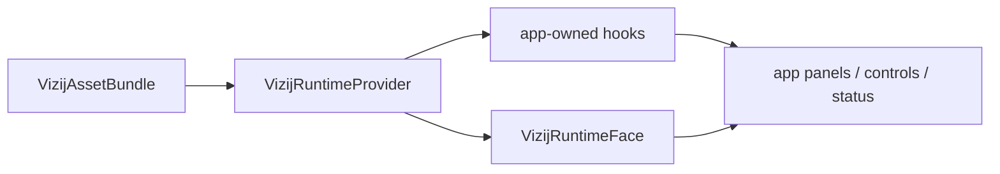

<!-- tags: type=guidebook-module; status=written; topics=guidebook,integrate,loading,embedding,playback -->

> **Last updated:** 2026-03-12
> **Purpose:** explain the basic mechanics of getting a Vizij face loaded into a usable application surface and keeping that surface honest

# Loading, Playback, and Embedding

## Guidebook Context

| Axis | Position |
| --- | --- |
| Bucket chain | Previous: [Control](../control/README.md) on the fast route or [Customize](../customize/README.md) on the customization route<br>Current: [Integrate](README.md)<br>Next: [Deploy](../deploy/README.md) |
| Depth ladder in this bucket | Above: [Minimal Web Player](minimal-web-player.md)<br>Current: `Fundamentals`<br>Below: [API-Backed Interactive Application](api-backed-interactive-application.md), [Rich Interactive Applications](rich-interactive-applications.md) |
| Module position in this bucket | Previous in bucket: [Minimal Web Player](minimal-web-player.md)<br>Current module: `Loading, Playback, and Embedding`<br>Next in bucket: [Application Integration Patterns](application-integration-patterns.md) |
| Reference bridges | [Runtime Quickstart Reference](../reference/runtime-quickstart-reference.md)<br>[Animation, Integration, and Deployment Reference](../reference/animation-integration-and-deployment-reference.md)<br>[Validation Checkpoints](../support/validation-checkpoints.md) |
| Module type | concept page |
| Bucket overview | [Integrate](README.md) |

## Reader Outcome

After this page, you should be able to explain the three core integration ideas in the guidebook route: loading, playback, and embedding.

## Module Notes

### Intended Audience

This page is for readers who already understand the minimal player stage and now need a clearer model of what the runtime is doing when an app becomes a usable Vizij surface.

### Artifact Being Touched

The artifact here is the integration chain itself:

1. a GLB or bundled face asset,
2. a runtime bundle description,
3. a provider that boots the runtime,
4. a face component or equivalent rendering surface,
5. optional hooks or application logic layered on top.

### What This Bucket Actually Needs To Teach

For the guidebook route, the `Integrate` bucket does not need to teach every possible application pattern at once.

At the fundamentals level, it needs to teach:

1. what is being loaded,
2. how the runtime surface reports loading, ready, and error states,
3. what counts as healthy playback,
4. how a face is embedded into a simple application shell,
5. where the boundary is between integration and deployment.

### What This Page Should Prevent

Readers often confuse:

1. loading with playback,
2. a richer application example with a different runtime model entirely,
3. integration with deployment,
4. an application shell with an authoring or operator surface.

Keeping these terms separate prevents that confusion.

## What You Need

It helps if you have already:

1. completed [Minimal Web Player](minimal-web-player.md),
2. read [Runtime Inputs and Semantics](../control/runtime-inputs-and-semantics.md),
3. seen at least one app built on `@vizij/runtime-react`.

## Three Terms That Need To Stay Distinct

### 1. Loading

Loading is the moment the app acquires the asset and prepares the runtime.

That usually includes:

1. reading a GLB or equivalent asset source,
2. extracting or attaching rig, pose, and animation metadata,
3. creating the runtime bundle the provider will use,
4. surfacing loading or error states honestly.

### 2. Playback

Playback is what happens when the runtime actually drives the face over time.

This includes:

1. playing authored animations,
2. tweening values such as gestures or eye movement,
3. exposing a ready state where the face can respond predictably.

### 3. Embedding

Embedding is how a Vizij runtime surface lives inside a broader application.

In React terms, the basic embedded pattern is:

```tsx
import {
  VizijRuntimeProvider,
  VizijRuntimeFace,
  useVizijRuntime,
} from "@vizij/runtime-react";

export function FaceFeature({ assetBundle }) {
  return (
    <VizijRuntimeProvider assetBundle={assetBundle} autostart>
      <FaceView />
    </VizijRuntimeProvider>
  );
}

function FaceView() {
  const { loading, ready, error } = useVizijRuntime();

  if (loading) return <p>Loading face…</p>;
  if (error) return <p>Runtime failed: {error.message}</p>;
  if (!ready) return <p>Initialising orchestrator…</p>;

  return <VizijRuntimeFace />;
}
```

The provider owns the runtime shell.

The app owns only the hooks and UI that serve the page's purpose.

## How The Maintained Route Demonstrates These Ideas

`demo-vizij-player` demonstrates restrained application integration:

1. it loads a known-good face artifact,
2. it makes bootstrap and error states visible,
3. it exposes playback and diagnostics clearly,
4. it proves that a face can live in an application shell without becoming authoring or deployment.

`tutorial-agent-face` demonstrates that richer apps still build on the same base:

1. a runtime provider,
2. a runtime face,
3. application hooks,
4. an additional session and tool layer.

## A Small Integration Anatomy



The smallest recurring anatomy in the current repo is:

1. `VizijAssetBundle`
2. `VizijRuntimeProvider`
3. `VizijRuntimeFace`
4. application-specific hooks or panels

If a reader can identify those pieces, they can usually orient themselves in any maintained Vizij web app.

## Healthy Surface-Level Signals

At the surface level of this bucket, a reader should be able to confirm:

1. the asset actually loaded,
2. the runtime reached a usable state,
3. the face is visible,
4. a small amount of playback or interaction works,
5. errors are surfaced clearly when something fails.

If those signals are not visible, the application shell is not yet a trustworthy integration example.

## Why The Two Maintained Visual Anchors Both Matter

Use the two maintained app surfaces for different teaching jobs:

1. `demo-vizij-player` is the primary anchor for shell anatomy, bootstrap visibility, and honest runtime state.
2. `tutorial-agent-face` is the comparative anchor for showing that the same runtime shell can live inside a richer app-shaped surface.

The first teaches restraint.

The second teaches extensibility without implying a different runtime model.

## Implementation Anchors

Use these when you need the current implementation truth:

1. `vizij-web/packages/@vizij/runtime-react/README.md`
2. `vizij-web/apps/demo-vizij-player/README.md`
3. `vizij-web/apps/tutorial-agent-face/README.md`
4. `vizij-web/apps/tutorial-agent-face/src/FaceApp.tsx`
5. `current_documentation/guidebook/reference/runtime-quickstart-reference.md`

## Recommended Next Steps

1. If you need to choose the right simple app shape next, continue to [Application Integration Patterns](application-integration-patterns.md).
2. If you want to see the richer advanced build path after the fundamentals, continue later to [API-Backed Interactive Application](api-backed-interactive-application.md).
3. If you only need the first practical shell, keep [Minimal Web Player](minimal-web-player.md) as the compact route anchor.
