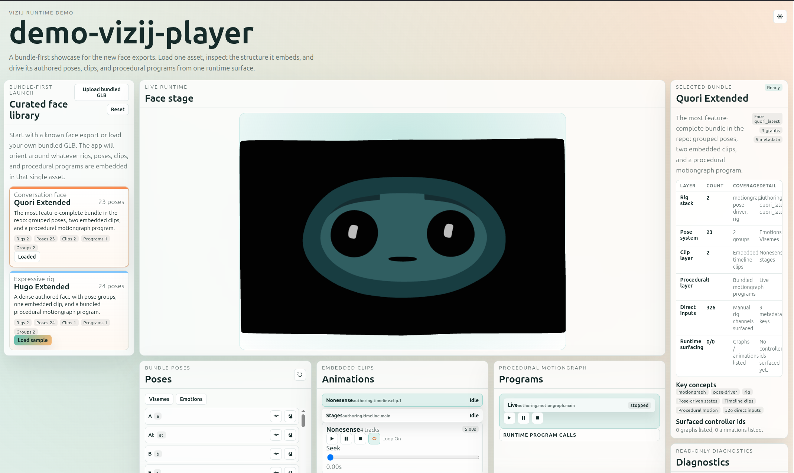
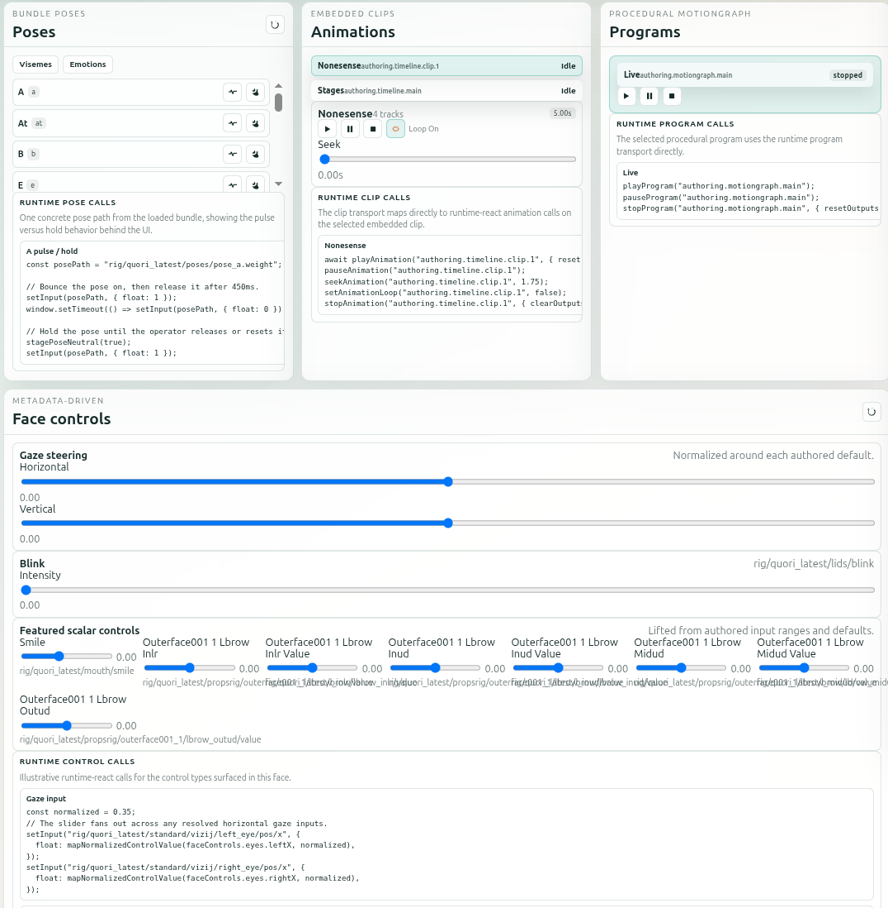
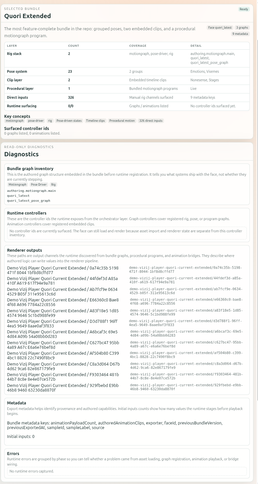

<!-- tags: family=guidebook; type=guidebook-module; editorial_status=completed; publication_status=live; topics=guidebook,integrate,player,runtime-shell -->

> **Last updated:** 2026-03-31
> **Purpose:** establish the smallest believable player-stage runtime surface in the guidebook route

# Minimal Web Player

## Guidebook Context

| Axis | Position |
| --- | --- |
| Bucket chain | Previous: [Control](../control/README.md) on the fast route or [Customize](../customize/README.md) on the customization route<br>Current bucket: [Integrate](README.md)<br>Next bucket after this one: [Deploy](../deploy/README.md) |
| Depth ladder in this bucket | Above: none, this is the entry depth in this bucket<br>Current: `Surface`<br>Below: [Loading, Playback, and Embedding](loading-playback-and-embedding.md), [Application Integration Patterns](application-integration-patterns.md), [API-Backed Interactive Application](api-backed-interactive-application.md), [Rich Interactive Applications](rich-interactive-applications.md) |
| Module position in this bucket | Previous in bucket: start at [Integrate](README.md)<br>Current module: `Minimal Web Player`<br>Next in bucket: [Loading, Playback, and Embedding](loading-playback-and-embedding.md) |
| Reference bridges | [Runtime Quickstart Reference](../reference/runtime-quickstart-reference.md)<br>[Animation, Integration, and Deployment Reference](../reference/animation-integration-and-deployment-reference.md)<br>[Validation Checkpoints](../support/validation-checkpoints.md) |
| Module type | walkthrough |
| Bucket overview | [Integrate](README.md) |

## Reader Outcome

After this page, you should be able to launch the maintained player-stage app, explain what makes it a trustworthy runtime shell instead of just another demo, and identify the code shape you would reuse in your own first player.

## Starting State

Use the `vizij-web` workspace root:

```bash
cd /home/chris/Code/Semio/vizij_ws/vizij-web
pnpm run dev:demo-vizij-player
```

Open the local URL shown by Vite.

This walkthrough uses `demo-vizij-player` because it is the strongest maintained example of a bundle-first player surface in the workspace.

## Scope note

This walkthrough assumes a React app built on `@vizij/runtime-react`.

Keep the distinction clear:

1. the lifecycle and validation lessons here are the portable part,
2. the concrete code examples are React-specific,
3. this page is about integration, not deployment.

## Route Handoff From This Page

Use this page as the last stop before you branch, not as proof that every next step must stay inside `Integrate`.

| If this describes you... | Treat this page as successful when... | Open this next |
| --- | --- | --- |
| you are not building in React | you can explain the `VizijAssetBundle`, provider-owned readiness states, and one working control path | [Loading, Playback, and Embedding](loading-playback-and-embedding.md), then repo-local implementation docs for your framework |
| your next real question is operator control or deployment topology | you have one healthy player shell and one visible control path reaching the face | [Deploy](../deploy/README.md), then [Easiest Standalone Deployment](../deploy/easiest-standalone-deployment.md) or [Hardware, ROS, and Multi-Screen Topologies](../deploy/hardware-ros-and-multi-screen-topologies.md) |

## What A Minimal Player Must Prove

For this route, a player is only believable if it makes four things obvious:

1. what face asset is loaded
2. whether the runtime is healthy
3. what the viewer is currently showing
4. whether at least one control path reaches the face successfully

## What This Page Does Not Solve Yet

This page does not yet solve:

1. service-backed or session-backed behavior loops,
2. non-React implementation details,
3. operator-facing endpoint exposure,
4. deployment topology choices.

That is the standard you are checking as you walk through the app.

## Walkthrough

### 1. Launch the maintained player anchor

Run:

```bash
pnpm run dev:demo-vizij-player
```

When the app opens, choose one of the curated sample faces if it is not already selected.

Expected result:

1. the app presents a clear player workspace rather than a fullscreen-only tutorial
2. the face viewer, bootstrap state, and side panels are all visible
3. you can tell that the app is built to host a bundle, not just show one canned animation

Current visual anchor:



_Caption: the full bundle-first player shell with library, face stage, controls, and selected-bundle detail visible together._

Use this overview to orient yourself before you zoom into the specific control and diagnostic surfaces below.

### 2. Read the player shell before touching controls

Look for the app surfaces that make the runtime honest:

1. bootstrap or readiness checklist
2. face viewer
3. diagnostics and controller inventory
4. pose, animation, or face-control panels

Expected result:

1. you can see whether the GLB loaded
2. you can see whether the runtime is ready
3. you can tell the difference between loading, empty, ready, and error states

This is the core difference between a player and a thin tutorial surface. A player must explain its state while it is running.

Current shell-detail anchors:



_Caption: the control side of the player, where poses, clips, programs, and surfaced face controls become testable._



_Caption: the diagnostic side of the player, where bundle summary, runtime outputs, and surfaced-controller state stay inspectable._

These two crops are useful because they separate the two teaching jobs that the full player screenshot compresses:

1. `player-demo-controls` shows the bundle poses, clip transport, procedural program controls, and metadata-driven face controls that prove a control path is really present,
2. `player-demo-details` shows the selected bundle summary and diagnostics surfaces that make runtime state inspectable instead of mysterious.

### 3. Prove that a control reaches the face

Use one maintained control path in the player:

1. trigger a pose from the pose panel
2. or trigger a simple animation or program if the currently loaded face exposes one
3. or move a face-control value that the UI surfaces from runtime metadata

Expected result:

1. the face changes visibly
2. the app still reports a healthy runtime state
3. the control feels like part of the player shell rather than an invisible side effect

That is the minimal player confidence test: one known-good control path has to work through the visible runtime shell.

### 4. Inspect how the app builds the runtime surface

Open:

1. `vizij-web/apps/demo-vizij-player/src/App.tsx`
2. `vizij-web/apps/demo-vizij-player/src/data/samples.ts`
3. `vizij-web/apps/demo-vizij-player/src/components/DiagnosticsPanel.tsx`
4. `vizij-web/apps/demo-vizij-player/src/components/PosePanel.tsx`

The runtime shape to notice is:

```tsx
<VizijRuntimeProvider
  key={source.id}
  assetBundle={assetBundle}
  autostart
  orchestratorScope="isolated"
>
  <WorkspaceSurface sourceLabel={sourceLabel} sourceMeta={sourceMeta} />
</VizijRuntimeProvider>
```

What this shows:

1. the player still starts with one `VizijAssetBundle`
2. the provider owns runtime startup and controller registration
3. the app shell then builds panels from the resolved runtime state

That is the reusable pattern for a first player. The shell grows around the runtime instead of bypassing it.

### 5. Notice why this app is still restrained

`demo-vizij-player` is richer than `tutorial-fullscreen-face`, but it is still deliberately focused.

It is not trying to be:

1. a full authoring environment
2. a live conversation shell
3. a deployment endpoint

It is trying to be a trustworthy bundle-first player. That scope discipline is part of why it teaches well.

## What To Reuse In Your Own First Player

If you are building a first integration surface, copy these ideas before you copy visual polish:

1. construct one `VizijAssetBundle` from a known source
2. mount one `VizijRuntimeProvider`
3. make loading, ready, empty, and error states explicit
4. build controls from resolved runtime data instead of hard-coded assumptions
5. prove one known-good control path before adding more product UI

## Fast Recovery If It Fails

Use these shortcuts:

1. if the face does not load, inspect the bootstrap and diagnostics panels before touching controls
2. if the runtime is unclear, use [Validation Checkpoints](../support/validation-checkpoints.md)
3. if the player reaches an error state, use [Troubleshooting Matrix](../support/troubleshooting-matrix.md)
4. if you need the lower-level runtime explanation behind the shell, use [Loading, Playback, and Embedding](loading-playback-and-embedding.md)

## Success Check

You are done with this page when:

1. `demo-vizij-player` runs locally
2. you can identify the shell surfaces that expose runtime truth
3. at least one maintained control path visibly reaches the face
4. you can explain why this app is a player-stage shell rather than just another runtime demo

## When To Move On

Use these branch points once the player shell feels trustworthy:

1. If you still need the runtime vocabulary behind loading, playback, and embedding, continue to [Loading, Playback, and Embedding](loading-playback-and-embedding.md).
2. If your own app needs local hooks, diagnostics panels, or sample-selection behavior, continue to [Application Integration Patterns](application-integration-patterns.md).
3. If your product depends on an external session or live service loop, branch to [API-Backed Interactive Application](api-backed-interactive-application.md).
4. If you are not building in React, stop here once the runtime shell model is clear, then switch to repo-local implementation docs for framework-specific assembly.
5. If your next question is operator control, exposed endpoints, or deployment topology, jump to [Deploy](../deploy/README.md) and continue from the deployment route there.

## Implementation Anchors

Use these when you need the current implementation truth:

1. `vizij-web/apps/demo-vizij-player/README.md`
2. `vizij-web/apps/demo-vizij-player/docs/runtime-react-walkthrough.md`
3. `vizij-web/apps/demo-vizij-player/src/App.tsx`
4. `vizij-web/apps/demo-vizij-player/src/data/samples.ts`
5. `vizij-web/apps/demo-vizij-player/src/components/DiagnosticsPanel.tsx`
6. `vizij-web/packages/@vizij/runtime-react/README.md`

## Recommended Next Steps

Continue to [Loading, Playback, and Embedding](loading-playback-and-embedding.md) if you want the fundamentals behind the player shell.

If your goal is a richer application pattern, continue later to [API-Backed Interactive Application](api-backed-interactive-application.md).

If your goal is operator-facing deployment instead of more integration depth, jump next to [Deploy](../deploy/README.md).
