<!-- tags: type=guidebook-module; status=written; topics=guidebook,introduction,architecture,repo-map,documentation-authority -->

> **Last updated:** 2026-03-12
> **Purpose:** connect the guidebook’s learner-facing route model to the real cross-repo architecture and documentation authority model without confusing either one for the other

# Architecture Bridge

## Guidebook Context

| Axis | Position |
| --- | --- |
| Bucket chain | Previous: Start of guidebook Current: [Introduction](README.md) Next: [Experience](../experience/README.md) |
| Depth ladder in this bucket | Above: [What Is Vizij?](what-is-vizij.md), [How To Use This Guidebook](how-to-use-this-guidebook.md), [System Mental Model](system-mental-model.md), [Customization Concepts Primer](customization-concepts-primer.md) Current: `Advanced` Below: none, this is the deepest current depth in this bucket |
| Module position in this bucket | Previous in bucket: [Customization Concepts Primer](customization-concepts-primer.md) Current module: `Architecture Bridge` Next in bucket: none, this is the last module in the bucket sequence |
| Reference bridges | [Guidebook Learning Model](../learning-model.md) [Guidebook Module Inventory](../module_inventory-reference.md) [Glossary and Terminology Bridge](../support/glossary-and-terminology-bridge.md) |
| Module type | reference bridge |
| Bucket overview | [Introduction](README.md) |

## Reader Outcome

After this page, you should be able to explain:

1. why the guidebook buckets are a teaching system rather than the repo map,
2. which repos and docs own which kinds of implementation truth,
3. how the maintained public route maps onto the deeper cross-repo platform,
4. when to stay in the guidebook and when to move into repo-local implementation docs.

## Module Notes

### Intended Audience

This page is for readers who already understand:

1. [What Is Vizij?](what-is-vizij.md),
2. [System Mental Model](system-mental-model.md),
3. the main route through `Experience`, `Control`, `Customize`, `Integrate`, and `Deploy`.

It is especially for contributors, facilitators, and advanced readers who are starting to cross the boundary between learner-facing explanation and implementation-facing documentation.

### Artifact Being Touched

The artifact here is the documentation boundary itself:

1. learner-facing guidebook structure,
2. cross-repo architecture framing,
3. documentation authority mapping,
4. route-to-implementation handoff.

### What This Page Does And Does Not Cover

This page does cover:

1. the difference between teaching structure and platform structure,
2. the current authority map for major documentation surfaces,
3. the bridge from learner route to repo reality.

This page does not cover:

1. ABI details,
2. crate or package signatures,
3. detailed runtime internals,
4. operational hardening decisions,
5. current bug-by-bug implementation status.

Those belong in architecture docs, repo-local docs, or project-tracking docs.

## What You Need

It helps if you can inspect these internal anchors:

1. `vizij-docs/current_documentation/ARCHITECTURE.md`,
2. `vizij-docs/current_documentation/concepts/ARCHITECTURE_PRIMER.md`,
3. `vizij-docs/current_documentation/ROADMAP.md`,
4. `guidebook/reference/README.md`.

You do not need crate-by-crate or package-by-package detail to use this page well.

## Teaching View vs. Platform View

Vizij is easiest to navigate when you keep two views in mind at the same time:

```mermaid
flowchart TD
    subgraph TeachingView ["Guidebook / Teaching View"]
        t1["Experience\n(Proof of Life)"] --> t2["Control\n(Runtime Specs)"]
        t2 --> t3["Customize\n(Authoring)"]
        t3 --> t4["Integrate\n(App Shells)"]
        t4 --> t5["Deploy\n(Endpoints)"]
    end

    subgraph PlatformView ["Platform / Implementation View"]
        p1["vizij-rs\n(Rust Cores / WASM)"]
        p2["vizij-web\n(TS Packages / Apps)"]
        p3["vizij-assets\n(Binary Sources)"]
        p4["vizij-docs\n(Architecture / Roadmap)"]
    end

    t1 -.-> p2
    t2 -.-> p1
    t3 -.-> p2
    t4 -.-> p2
    t5 -.-> p2
    p1 -.-> p2
    p3 -.-> p2
    p4 -.-> TeachingView

    style TeachingView fill:#161a33,stroke:#2d3356
    style PlatformView fill:#0b0d18,stroke:#7c4dff,stroke-width:2px
```

The teaching view organizes concepts in the order that helps readers learn.
The platform view organizes implementation truth by repo, app, package, and asset ownership.

Both views are real. The bridge ensures you can transition from "learning a concept" to "finding the code" without losing the narrative thread.

## The Guidebook Is A Teaching Structure

The guidebook buckets answer questions like:

1. what should a reader learn first,
2. what misunderstanding should a page prevent,
3. what should the next step be,
4. how should the route feel coherent.

They do not answer:

1. which package owns a type,
2. which repo defines a contract,
3. which app is the deepest implementation source,
4. how every runtime subsystem is wired internally.

That is why the guidebook can be canonical for teaching without pretending to be the canonical implementation spec.

## Documentation Authority Matrix

| Surface | Owns this kind of truth | Best used for | Not the right source for |
| --- | --- | --- | --- |
| `vizij-docs/current_documentation` | cross-repo architecture, roadmap framing, decisions, known issues | understanding stable platform direction | app-by-app behavior or package usage details |
| `vizij-web` app docs | maintained app behavior, setup, shell anatomy, operator flow | understanding the current route anchors | cross-repo architectural decisions |
| `vizij-web` package docs | package contracts and usage surfaces | integration details and API shape | learner route framing |
| `vizij-rs` docs | runtime semantics, WASM boundaries, crate-level truth | low-level runtime ownership | public route teaching |
| `vizij-assets` | asset files and provenance | source asset truth | runtime or app behavior |
| guidebook | learner path, terminology, concept boundaries, next steps | teaching and routing | exact implementation truth |

## Mapping The Maintained Route To The Platform

### Experience and Control

These buckets are mostly taught through maintained apps and guidebook language.

The strongest maintained anchors are:

1. `tutorial-fullscreen-face` for the minimal runtime shell,
2. `tutorial-agent-face` for the richer optional branch,
3. `@vizij/runtime-react` for the provider and hook surface.

### Customize

This bucket is still learner-facing, but its strongest implementation truth lives in `vizij-web/apps/vizij-authoring` and its local docs.

The guidebook teaches the route through import, rigging, poses, animations, procedural programs, and export.

The app and local authoring docs own the fine-grained implementation behavior.

### Integrate

This bucket teaches runtime provider, embedding, application shells, and richer app patterns.

The concrete implementation truth lives mostly in:

1. `vizij-web/packages/@vizij/runtime-react`,
2. `vizij-web/apps/demo-vizij-player`,
3. `vizij-web/apps/tutorial-fullscreen-face`,
4. `vizij-web/apps/tutorial-agent-face`.

### Deploy

This bucket teaches the endpoint and operator model.

Its deeper current truth is spread across:

1. `vizij-web/apps/vizij-standalone`,
2. the related standalone source,
3. `vizij-docs` runtime and deployment planning docs.

## When To Stay In The Guidebook

Stay in the guidebook when your main question is:

1. what does this concept mean,
2. what should I learn next,
3. what artifact am I touching,
4. how does this bucket connect to the larger route.

## When To Leave The Guidebook

Leave the guidebook when your main question becomes:

1. which repo or package owns this behavior,
2. what is the current code contract,
3. what does this app or package actually implement,
4. where is the authoritative implementation detail.

For the maintained route, that usually means switching to repo-local docs before switching to raw source files.

## Success Check

You are done with this page when:

1. you can explain why the guidebook bucket model is not the repo map,
2. you can identify which documentation surface owns which type of truth,
3. you can route from a learner-facing question to the right implementation-facing source,
4. you can describe the public route and the deeper platform view without treating them as conflicting stories.

## Implementation Anchors

Use these when you need the current implementation truth:

1. `vizij-docs/current_documentation/ARCHITECTURE.md`
2. `vizij-docs/current_documentation/concepts/ARCHITECTURE_PRIMER.md`
3. `vizij-docs/current_documentation/ROADMAP.md`
4. `current_documentation/guidebook/introduction/system-mental-model.md`
5. `current_documentation/guidebook/learning-model.md`
6. `current_documentation/guidebook/content-model-reference.md`
7. `current_documentation/guidebook/reference/README.md`

## Recommended Next Steps

1. If you want to return to learner-facing system framing, go to [System Mental Model](system-mental-model.md).
2. If you want the route-first builder path, go to [How To Use This Guidebook](how-to-use-this-guidebook.md) and then [Hello Face Quickstart](../experience/hello-face-quickstart.md).
3. If you need stable vocabulary before leaving the guidebook, go to [Glossary and Terminology Bridge](../support/glossary-and-terminology-bridge.md).
