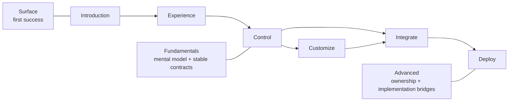

<!-- tags: type=guidebook-module; status=written; topics=guidebook,introduction,routing -->

> **Last updated:** 2026-03-12
> **Purpose:** help readers choose the right Vizij learning route and know when to stay in the guidebook versus when to switch to implementation docs

# How To Use This Guidebook

## Guidebook Context

| Axis | Position |
| --- | --- |
| Bucket chain | Previous: Start of guidebook Current: [Introduction](README.md) Next: [Experience](../experience/README.md) |
| Depth ladder in this bucket | Above: none, this is the entry depth in this bucket Current: `Surface` Below: [System Mental Model](system-mental-model.md), [Customization Concepts Primer](customization-concepts-primer.md), [Architecture Bridge](architecture-bridge.md) |
| Module position in this bucket | Previous in bucket: [What Is Vizij?](what-is-vizij.md) Current module: `How To Use This Guidebook` Next in bucket: [System Mental Model](system-mental-model.md) |
| Reference bridges | [Guidebook Learning Model](../learning-model.md) [Guidebook Module Inventory](../module_inventory-reference.md) [Glossary and Terminology Bridge](../support/glossary-and-terminology-bridge.md) |
| Module type | decision guide |
| Bucket overview | [Introduction](README.md) |

## Reader Outcome

After this page, you should be able to choose the right Vizij learning route for your goal, pick the right depth, and know when to leave the guidebook for repo-local implementation docs.

## Module Notes

### Intended Audience

This page is for:

1. newcomers who want the shortest path to a working Vizij face,
2. builders who want to know where customization fits,
3. contributors who need to understand the guidebook structure before going deeper.

### Artifact Being Touched

The guidebook is the artifact here.

It is the canonical teaching system for Vizij. It is not the same thing as the internal architecture of the platform.

## What You Need

You do not need to understand Vizij architecture before using this page.

It is enough to know that Vizij can load and control expressive faces and that the guidebook is organized to help you learn that system in stages.

## Route Map

The guidebook is organized around six documentation buckets:

1. `Introduction`
2. `Experience`
3. `Control`
4. `Customize`
5. `Integrate`
6. `Deploy`

Each bucket supports three depth levels:

1. `Surface`
   - get oriented and succeed quickly
2. `Fundamentals`
   - learn the mental models and practical basics
3. `Advanced`
   - go deeper into ownership, extension, or more complex implementation patterns

Use the route to choose *where to learn next*.

Use the depth to choose *how much detail you need right now*.

## Start Here If

### You want the fastest believable route to a working deployment

Follow:

`Introduction -> Experience -> Control -> Integrate -> Deploy`

Use this route if you want to:

1. prove that Vizij works,
2. understand the control model,
3. get a face into a player or runtime shell,
4. reach a real endpoint quickly.

### You want to make the face your own before deploying it

Follow:

`Introduction -> Experience -> Control -> Customize -> Integrate -> Deploy`

Use this route if you want to:

1. modify an existing face,
2. work on rigs, poses, animations, or export,
3. carry an authored artifact into integration,
4. deploy something you now own.

### You only need one concept right now

Jump directly to the bucket that matches the problem you are trying to solve:

1. `Experience` if you need first contact with a working face,
2. `Control` if you need to understand paths, standard controls, or runtime inputs,
3. `Customize` if you need authoring and export,
4. `Integrate` if you need a runtime shell or application embedding,
5. `Deploy` if you need a real endpoint, operator flow, or standalone path.

## Route Chooser

| Route | Choose it when | First maintained anchor | What it intentionally skips |
| --- | --- | --- | --- |
| Fast deployment route | You need proof, control understanding, a player, and a first deployed endpoint | `tutorial-fullscreen-face`, `demo-vizij-player`, `vizij-standalone` | deep customization and authoring ownership |
| Customization route | You need to change the face or its behavior before integrating it | `vizij-authoring` and its local docs | the fastest path to a deployed endpoint |
| Single-bucket jump-in | You already know the route and only need one concept or recovery page | the bucket that matches the immediate problem | route-level context and sequencing |

## When To Stay In The Guidebook

Stay in the guidebook when your question is primarily:

1. what does this concept mean,
2. what should I learn next,
3. what artifact am I touching,
4. what misunderstanding should I avoid,
5. which maintained app is the right example to inspect.

## When To Leave The Guidebook

Leave the guidebook when your question becomes implementation-specific:

1. which app or package owns this behavior,
2. what the current code contract is,
3. how a maintained example is assembled,
4. which runtime or authoring document is authoritative.

For the maintained route, the usual implementation docs are:

1. `vizij-web/apps/tutorial-fullscreen-face`
2. `vizij-web/apps/tutorial-agent-face`
3. `vizij-web/apps/demo-vizij-player`
4. `vizij-web/apps/vizij-authoring`
5. `vizij-web/apps/vizij-standalone`
6. `vizij-web/packages/@vizij/runtime-react`

## What This Guidebook Does Not Replace

This guidebook is deliberately reader-facing.

It does not replace:

1. repo-local implementation docs in `vizij-web` and `vizij-rs`,
2. internal roadmap and architecture authority docs in `vizij-docs/current_documentation`,
3. detailed app-level runbooks when the implementation surface matters more than the teaching abstraction.

When you need engineering truth, use the implementation anchors provided in each module.

## Suggested First Step

If you are new to Vizij, start with [Hello Face Quickstart](../experience/hello-face-quickstart.md).

That page is the fastest way to see a working face, trigger visible changes, and build trust in the runtime before you learn the deeper vocabulary.

## Success Check

You are done with this page when:

1. you can name the route you want to follow,
2. you know whether you need `Surface`, `Fundamentals`, or `Advanced` depth first,
3. you know which page you are opening next,
4. you know when to switch from the guidebook to repo-local docs.

## Implementation Anchors

Use these when you need the canonical framing behind this page:

1. `current_documentation/guidebook/README.md`
2. `current_documentation/guidebook/learning-model.md`
3. `current_documentation/ROADMAP.md`
4. `current_documentation/ARCHITECTURE.md`

## Recommended Next Steps

1. New reader: [Hello Face Quickstart](../experience/hello-face-quickstart.md)
2. Reader who wants the bucket overview first: [Introduction](README.md)
3. Reader who already saw a demo and needs semantics: [Paths and Standard Controls](../control/paths-and-standard-controls.md)
