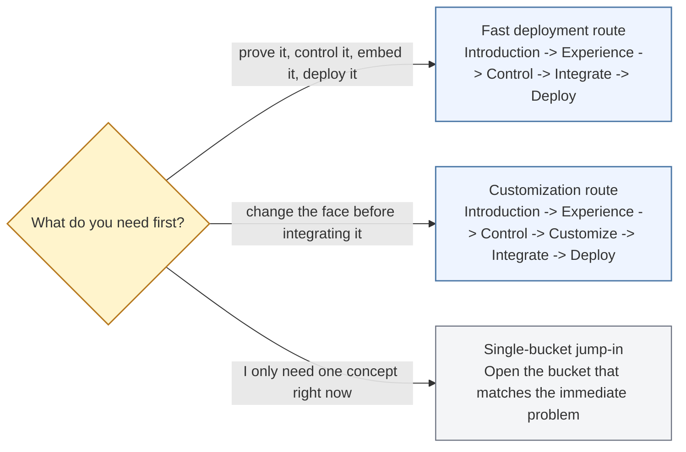
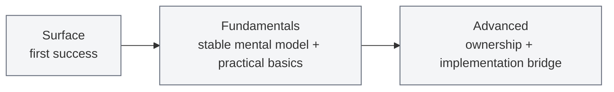

<!-- tags: type=guidebook-module; status=written; topics=guidebook,introduction,routing -->

> **Last updated:** 2026-03-15
> **Purpose:** help readers get oriented in the docs, choose the right learning path, and know when to switch to implementation docs

# Choose a Learning Path

## Page Context

| Axis | Position |
| --- | --- |
| Bucket chain | Previous: Start of docs path Current: [Introduction](README.md) Next: [Experience](../experience/README.md) |
| Depth ladder in this bucket | Above: none, this is the entry depth in this bucket Current: `Surface` Below: [System Mental Model](system-mental-model.md), [Customization Concepts Primer](customization-concepts-primer.md), [Architecture Bridge](architecture-bridge.md) |
| Module position in this bucket | Previous in bucket: [What Is Vizij?](what-is-vizij.md) Current module: `Choose a Learning Path` Next in bucket: [System Mental Model](system-mental-model.md) |
| Reference bridges | [Guidebook Learning Model](../learning-model.md) [Guidebook Module Inventory](../module_inventory-reference.md) [Glossary and Terminology Bridge](../support/glossary-and-terminology-bridge.md) |
| Module type | decision guide |
| Bucket overview | [Introduction](README.md) |

## Reader Outcome

After this page, you should be able to choose the right learning path for your goal, pick the right depth, and know when to switch from overview pages to repo-local implementation docs.

## Module Notes

This page is for newcomers who want the shortest path to a working Vizij face, builders who want to know where customization fits, and contributors who need the docs map before going deeper.

The artifact here is the reader-facing docs map. Use it to decide what to learn next, not as a substitute for the internal architecture of the platform.

## What You Need

You do not need to understand Vizij architecture before using this page.

It is enough to know that Vizij can load and control expressive faces and that these docs are organized to help you move from first proof to deeper ownership.

## Learning Paths

The docs are organized around six documentation buckets:

1. `Introduction`
2. `Experience`
3. `Control`
4. `Customize`
5. `Integrate`
6. `Deploy`

Each bucket supports three depth levels:

1. `Surface`
   - get oriented and succeed quickly
2. `Fundamentals`
   - learn the mental models and practical basics
3. `Advanced`
   - go deeper into ownership, extension, or more complex implementation patterns

### Route Choice

### Depth Ladder

Use the path to choose *where to learn next*.

Use the depth to choose *how much detail you need right now*.

## Choose A Path

### Fast path: you want the fastest believable path to a working deployment

Follow:

`Introduction -> Experience -> Control -> Integrate -> Deploy`

Choose this first if you want to:

1. prove that Vizij works,
2. understand the control model,
3. get a face into a player or runtime shell,
4. reach a real endpoint quickly.

Most first-time builders should start here.

### Customization path: you want to make the face your own before deploying it

Follow:

`Introduction -> Experience -> Control -> Customize -> Integrate -> Deploy`

Choose this first if you want to:

1. modify an existing face,
2. work on rigs, poses, animations, or export,
3. carry an authored artifact into integration,
4. deploy something you now own.

### You only need one concept right now

Jump directly to the bucket that matches the problem you are trying to solve:

1. `Experience` if you need first contact with a working face,
2. `Control` if you need to understand paths, standard controls, or runtime inputs,
3. `Customize` if you need authoring and export,
4. `Integrate` if you need a runtime shell or application embedding,
5. `Deploy` if you need a real endpoint, operator flow, or standalone path.

## Path Chooser

| Path | Choose it when | First maintained anchor | What it intentionally skips |
| --- | --- | --- | --- |
| Fast deployment path | You need proof, control understanding, a player, and a first deployed endpoint | `tutorial-fullscreen-face`, `demo-vizij-player`, `vizij-standalone` | deep customization and authoring ownership |
| Customization path | You need to change the face or its behavior before integrating it | `vizij-authoring` and its local docs | the fastest path to a deployed endpoint |
| Single-bucket jump-in | You already know the path and only need one concept or recovery page | the bucket that matches the immediate problem | path-level context and sequencing |

## Quick chooser

Use this if you are hesitating at the first fork:

| If your immediate question is... | Open this next | Why |
| --- | --- | --- |
| `Can I make a face run at all?` | [Hello Face Quickstart](../experience/hello-face-quickstart.md) | fastest maintained proof |
| `What do these runtime interactions actually mean?` | [First Control Interactions](../control/first-control-interactions.md) | same maintained app, slower explanation |
| `How do I change the face or its behavior before integrating it?` | [Tweak an Existing Face](../customize/tweak-an-existing-face.md) | lowest-friction authoring entry |
| `How do I embed a face in my app?` | [Minimal Web Player](../integrate/minimal-web-player.md) | first practical integration shell |
| `How do I get to a same-host operator endpoint?` | [Easiest Standalone Deployment](../deploy/easiest-standalone-deployment.md) | first maintained deployment floor |

## When To Stay In The Overview Docs

Stay in the overview docs when your question is primarily:

1. what does this concept mean,
2. what should I learn next,
3. what artifact am I touching,
4. what misunderstanding should I avoid,
5. which maintained app is the right example to inspect.

## When To Switch To Implementation Docs

Switch to implementation docs when your question becomes implementation-specific:

1. which app or package owns this behavior,
2. what the current code contract is,
3. how a maintained example is assembled,
4. which runtime or authoring document is authoritative.

For the maintained path, the usual implementation docs are:

1. `vizij-web/apps/tutorial-fullscreen-face`
2. `vizij-web/apps/tutorial-agent-face`
3. `vizij-web/apps/demo-vizij-player`
4. `vizij-web/apps/vizij-authoring`
5. `vizij-web/apps/vizij-standalone`
6. `vizij-web/packages/@vizij/runtime-react`

## What These Pages Do Not Replace

These overview pages are deliberately reader-facing.

They do not replace:

1. repo-local implementation docs in `vizij-web` and `vizij-rs`,
2. internal roadmap and architecture authority docs in `vizij-docs/current_documentation`,
3. detailed app-level runbooks when the implementation surface matters more than the teaching abstraction.

When you need engineering truth, use the implementation anchors provided in each module.

## Suggested First Step

If you are new to Vizij, start with [Hello Face Quickstart](../experience/hello-face-quickstart.md).

That page is the fastest way to see a working face, trigger visible changes, and build trust in the runtime before you learn the deeper vocabulary.

## Success Check

You are done with this page when:

1. you can name the path you want to follow,
2. you know whether you need `Surface`, `Fundamentals`, or `Advanced` depth first,
3. you know which page you are opening next,
4. you know when to switch from overview pages to repo-local docs.

## Implementation Anchors

Use these when you need the canonical framing behind this page:

1. `current_documentation/guidebook/README.md`
2. `current_documentation/guidebook/learning-model.md`
3. `current_documentation/ROADMAP.md`
4. `current_documentation/ARCHITECTURE.md`

## Recommended Next Steps

1. New reader: [Hello Face Quickstart](../experience/hello-face-quickstart.md)
2. Reader who wants the bucket overview first: [Introduction](README.md)
3. Reader who already saw a demo and needs semantics: [Paths and Standard Controls](../control/paths-and-standard-controls.md)
