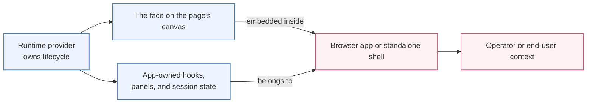

<!-- tags: family=guidebook; type=guidebook-module; editorial_status=completed; publication_status=live; topics=guidebook,introduction,architecture,mental-model -->

> **Last updated:** 2026-10-23
> **Purpose:** give readers the stable system mental model that makes later guidebook buckets easier to interpret correctly

# System Mental Model

## Guidebook Context

| Axis | Position |
| --- | --- |
| Bucket chain | Previous: Start of guidebook Current: [Introduction](README.md) Next: [Experience](../experience/README.md) |
| Depth ladder in this bucket | Above: [What Is Vizij?](what-is-vizij.md), [How To Use This Guidebook](how-to-use-this-guidebook.md) Current: `Fundamentals` Below: [Architecture Bridge](architecture-bridge.md) |
| Module position in this bucket | Previous in bucket: [How To Use This Guidebook](how-to-use-this-guidebook.md) Current module: `System Mental Model` Next in bucket: [Customization Concepts Primer](customization-concepts-primer.md) |
| Reference bridges | [Guidebook Learning Model](../learning-model.md) [Guidebook Module Inventory](../module_inventory-reference.md) [Glossary and Terminology Bridge](../support/glossary-and-terminology-bridge.md) |
| Module type | concept page |
| Bucket overview | [Introduction](README.md) |

## Reader Outcome

After this page, you should be able to explain the major parts of Vizij, how authored assets and runtime control relate, and which conceptual contracts stay stable as a face moves from authoring into integration and deployment.

## Module Notes

- Read this after [What Is Vizij?](what-is-vizij.md) if you need the system layers separated before going deeper.
- The page keeps five concepts distinct: the face artifact, authored behavior, runtime coordination, application surface, and deployment surface.
- Detailed path semantics, authoring workflows, package ownership, and deployment procedures stay in later modules.

## What You Need

You do not need package-level or crate-level knowledge to use this page.

It helps if you have already:

1. read [What Is Vizij?](what-is-vizij.md),
2. seen a running face in the public demos or the `Hello Face` tutorial.

## The Stable System Map

At the most useful learner level, Vizij is a relationship between four things:

1. authored assets,
2. runtime control,
3. integration surfaces,
4. deployment surfaces.

Those are connected by a small set of stable contracts rather than by one single app.

### Asset To Runtime Relationship

```mermaid
flowchart LR
    classDef asset fill:#fff4e5,stroke:#c97a00,stroke-width:1.5px
    classDef runtime fill:#eef7ee,stroke:#2f855a,stroke-width:1.5px
    classDef app fill:#eef4ff,stroke:#4e79a7,stroke-width:1.5px

    asset["1. Face asset\nGLB"]
    bundle["2. Vizij bundle metadata\nrig, poses, animations, programs"]
    provider["3. VizijRuntimeProvider\nloads the face as a device"]
    inputs["4. Typed inputs\npaths + values"]
    device["5. The face's device steps\ncomposed graph, runs, modules"]
    board["6. The face's store\n(its blackboard)"]
    render["7. The Bevy view draws the pose\non the page's canvas"]
    face["8. The face, over its slot\n(VizijRuntimeFace)"]

    asset --- bundle
    asset -->|"loaded as the face's GLB"| provider
    bundle -->|"composed into the device's behavior"| provider
    provider -->|"app writes keys"| inputs
    inputs --> board --> device --> board
    device --> render --> face

    class asset,bundle asset
    class inputs,device,board,render runtime
    class provider,face app
```

### App And Deployment Boundary

The first diagram explains where the stable runtime contracts live.

The second explains where application ownership starts and where deployment becomes operational rather than architectural.

### 1. Authored assets

An authored Vizij face is more than mesh data.

At runtime, the system expects a face asset, typically a GLB, plus Vizij-authored metadata that can include:

1. rig structure,
2. pose information,
3. animation information,
4. graph-driven behavior or related runtime definitions.

This is why authoring matters. It produces a face that is not only visible, but controllable and portable.

### 2. Runtime control

The runtime is the part that turns authored structure into live behavior.

Each face runs as an Arora device of its own, and the architecture stays intentionally small:

1. the `store` (the face's blackboard) holds its shared typed state,
2. the face's graphs, composed into one, read and write that store each step, with programs, skills such as `say`, and animations running beside them,
3. the device's step loop coordinates them, one step after another,
4. the `view`, the Bevy renderer of the vizij-rs `vizij` crate, reads the face's pose and draws it.

The important learner-level point is that Vizij does not treat a face as a passive clip player. It treats the face as something live graphs and programs drive step by step. The same device runs the face in a browser page and in the native `vizij` app.

### 3. Integration surfaces

An integration surface is the application shell that loads a face and exposes it in a usable app context.

That shell is not the same thing as the asset and not the same thing as the runtime contracts underneath it.

Its job is usually to:

1. load the asset and its bundle,
2. boot the runtime,
3. render the face,
4. expose the controls, state, or interactions the app actually needs.

### 4. Deployment surfaces

A deployment surface is where the integrated system is actually run for an end user or operator.

In the current docs and roadmap, that includes browser/runtime deployments and the standalone branch.

Deployment is therefore a real endpoint of the builder path, not just another demo.

## One Face, Multiple Layers

A useful sentence to keep in mind is:

`the asset carries structure, the runtime executes behavior, the app exposes a use case, and deployment makes that use case real`

That sentence prevents several later confusions:

1. a player is not the same thing as the face,
2. a runtime provider is not the same thing as authoring,
3. deployment is not merely "opening the demo somewhere else."

### Comparison of Layers

| Layer | Primary Role | Key Artifact | Stability |
| :--- | :--- | :--- | :--- |
| **Asset** | Structure & Metadata | GLB / Vizij Bundle | Foundational |
| **Runtime** | Execution & Logic | The face's Arora device (WASM in a browser) | Predictable |
| **App Shell** | Use Case & UI | React Component / Shell | Context-Specific |
| **Deployment** | Endpoint & Operator | Executable / Web URL | Operational |

This separation ensures that a face can move from a simple tutorial into a high-stakes deployment without changing the underlying architecture.

## The Runtime Contracts That Stay Stable

Later pages go deeper into control vocabulary, but this page should name the contracts that make the whole system coherent.

### Typed paths

Vizij addresses values through stable paths.

In the architecture docs, this contract is named `TypedPath`.

A path says what a value means and where it belongs in the system. Graphs, animations, runtime inputs, and renderer-facing writes all rely on that idea.

This is one reason later control pages care so much about path shape: paths are the shared addressing system.

### Values and shapes

Vizij moves typed values through the runtime rather than untyped loose payloads.

At a learner level:

1. a `Value` is the actual typed payload,
2. a `Shape` is the expected structure of that payload,
3. a `TypedPath` tells the runtime what semantic slot that value belongs to.

You do not need every encoding detail yet. You do need to know that Vizij depends on these typed contracts to keep authoring, runtime, and integration aligned.

### The blackboard

The blackboard is the shared runtime state where the face's graphs, programs and modules read and write typed-path values; Arora calls it the device's store.

You can think of it as the coordination surface between authored behavior and the visible face:

1. the app and the face's graphs and programs write there,
2. each step, the device evaluates the composed graph over it, and each key keeps the last value written to it in the step,
3. the view ultimately draws the resulting pose.

That is why the blackboard matters conceptually even if you never inspect it directly in early workflows.

## Where Authoring Fits

Authoring belongs before integration because it defines the controllable structure a later runtime can load.

At a fundamentals level, the key idea is simple:

1. rigs define what can be controlled,
2. poses define named states over those controls,
3. animations define authored motion over time,
4. procedural or graph-driven behavior defines computed behavior,
5. export packages the result into an artifact later runtime surfaces can use.

This page does not teach how to perform those steps. It only gives the conceptual placement of authoring inside the larger system.

For that vocabulary in more detail, the next page is usually [Customization Concepts Primer](customization-concepts-primer.md).

## Where Control Fits

Control is the bridge between authored capability and live behavior.

If authoring answers "what can this face do?", control answers "what values are being driven right now?"

That includes:

1. standard controls,
2. pose weights,
3. animation playback,
4. other typed runtime inputs.

This page intentionally does not teach the detailed control taxonomy. It only establishes that control is not a separate world from authoring or rendering. It is the live use of the authored structure through shared runtime contracts.

## Where The Public Route Fits

The maintained public route uses the guidebook bucket chain:

`Introduction -> Experience -> Control -> Customize -> Integrate -> Deploy`

This page should help you interpret that route correctly:

1. `Introduction` gets the reader oriented before they start building,
2. `Experience` proves the runtime is real,
3. `Control` explains what is being driven and why it is stable,
4. `Customize` changes the artifact and its behavior definitions when needed,
5. `Integrate` shows the runtime inside an application shell,
6. `Deploy` makes that application usable in a real operating context.

App names such as `Hello Face`, `vizij-authoring`, `demo-vizij-player`, and `vizij-standalone` are anchors inside that route. The route itself is a teaching sequence, not the literal architecture diagram.

## Misunderstandings This Page Should Prevent

1. thinking the first demo or player surface is the whole system,
2. confusing the face asset with the application shell that hosts it,
3. treating authoring concepts as separate from runtime control,
4. assuming deployment is only a UI packaging step,
5. assuming the guidebook buckets are the same thing as engineering boundaries.

## Success Check

You are done with this page when:

1. you can describe Vizij as authored assets plus runtime coordination plus application and deployment surfaces,
2. you can explain the distinct roles of the view, the device's step, the composed graph, and the store at a high level,
3. you can explain why typed paths, values, and shapes matter even before learning their detailed syntax,
4. you can place the public buckets and their current app anchors in the overall system without confusing them for one another.

## Implementation Anchors

Use these when you need the current implementation truth behind this page:

1. `vizij-docs/current_documentation/concepts/REFERENCE_GUIDE.md`
2. `vizij-docs/current_documentation/ARCHITECTURE.md`
3. `vizij-docs/current_documentation/ROADMAP.md`
4. `vizij-web/apps/vizij-authoring/README.md`
5. `vizij-web/apps/vizij-authoring/docs/Authoring_Blueprint.md`
6. `vizij-web/apps/vizij-authoring/docs/pose_grouping_explainer.md`

## Recommended Next Steps

1. If you want the customization vocabulary behind rigs, poses, animations, and export, continue to [Customization Concepts Primer](customization-concepts-primer.md).
2. If you want the control vocabulary behind runtime addresses and standard controls, continue to [Paths and Standard Controls](../control/paths-and-standard-controls.md).
