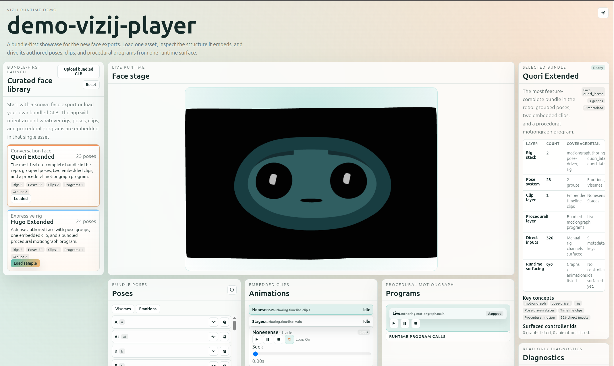
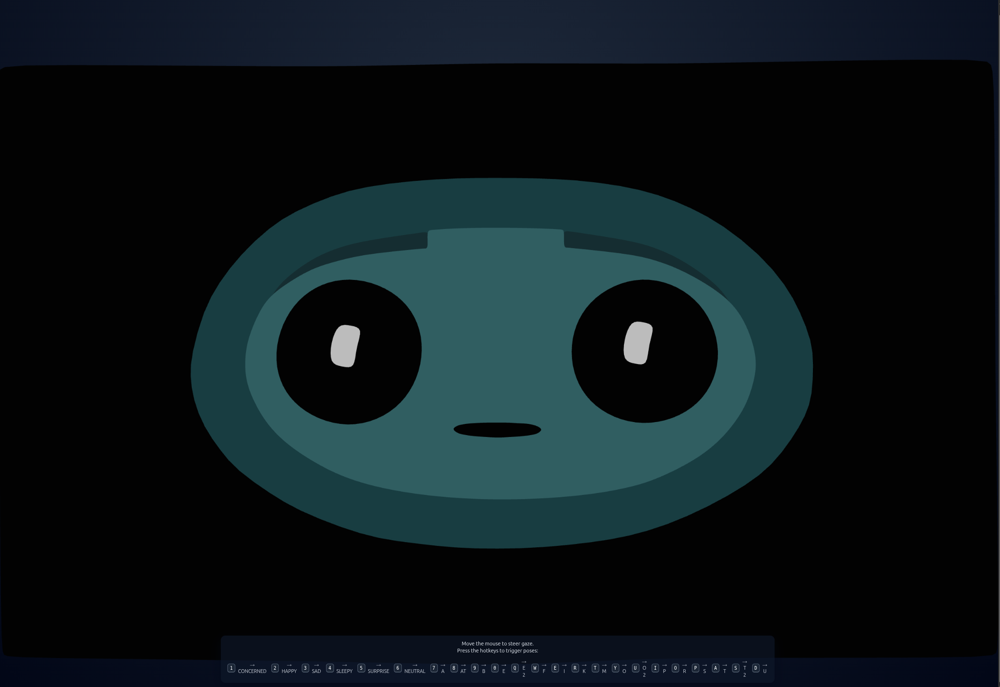

<!-- tags: family=guidebook; type=guidebook-module; editorial_status=completed; publication_status=planned; topics=guidebook,support,media,screenshots,video,operations -->

> **Last updated:** 2026-03-31
> **Purpose:** define how screenshots and videos should be classified, selected, and reused so the guidebook and its downstream projections stay route-faithful and current

# Media Intake and Usage Guide

## Guidebook Context

1. **Bucket:** [Guidebook Support](README.md)
2. **Depth role:** cross-cutting reusable support layer
3. **Module type:** operational guide
4. **Bucket overview:** [Guidebook Support](README.md)
5. **Useful previous module:** [Glossary and Terminology Bridge](glossary-and-terminology-bridge.md)
6. **Useful next module:** [Guidebook Support](README.md)

## Reader Outcome

After this page, you should be able to:

1. classify screenshots and videos by their teaching role,
2. decide whether media belongs in the evergreen guidebook asset system or in a temporary workshop or event pack,
3. avoid using media that misrepresents the current maintained route,
4. choose the right next support surface when a capture is stale or misleading.

## Module Notes

- This support page is for documentation maintainers, facilitators, and anyone choosing screenshots or clips for the guidebook route.
- The teaching job is media classification and route-faithful reuse: decide whether a capture is evergreen, temporary, or superseded without turning this page into a production-media handbook.
- Design-system styling, editing workflows, hosting, and automation tooling stay outside the scope here.

## What You Need

It helps if you have already read:

1. [Guidebook Assets](../assets/README.md),
2. [Validation Checkpoints](validation-checkpoints.md),
3. [Troubleshooting Matrix](troubleshooting-matrix.md),
4. [Glossary and Terminology Bridge](glossary-and-terminology-bridge.md).

It also helps if you understand the maintained route order from the guidebook and roadmap.

## The First Question: What Teaching Job Does This Media Serve

Before classifying a screenshot or clip, ask:

1. what page or module is this helping,
2. what claim is it proving,
3. is it showing the maintained route or an optional branch,
4. will this still be true after the next normal guidebook update.

If you cannot answer those questions clearly, the media is not ready for evergreen placement.

## The Core Classification System

| Class | Reuse test | Good current example | Storage outcome |
| --- | --- | --- | --- |
| Evergreen screenshot | proves a maintained route state without depending on event framing | [player-demo.png](../assets/screenshots/player-demo.png), [fullscreen-demo.png](../assets/screenshots/fullscreen-demo.png) | keep in the guidebook asset tree and reuse across route pages |
| Evergreen video or GIF | motion is the teaching point and the capture still matches the maintained route | [authoring-program-editing.gif](../assets/gifs/authoring-program-editing.gif), [authoring-animation-player.gif](../assets/gifs/authoring-animation-player.gif) | keep the source clip plus the guidebook GIF derivative |
| Workshop-only media | useful for facilitation, but too dependent on teaching context or pacing | workshop handout crops and facilitator-only screenshots, not part of the current evergreen asset tree | keep with the workshop packet |
| Event-only media | tied to one talk, class, or one-off framing | event decks, booth demos, talk-specific screenshots | keep outside the evergreen guidebook asset tree |
| Superseded or misleading media | no longer route-faithful, or records a broken or ambiguous intermediate state | [authoring-input-driver-creation-buggy.gif](../assets/gifs/authoring-input-driver-creation-buggy.gif) | hold out of route pages or archive as a cautionary example only |

The current guidebook asset policy already points toward five useful classes.

### 1. Evergreen screenshots

Use this class when the capture supports a maintained concept, workflow, or route page and is likely to stay accurate with only normal maintenance.

Examples:

1. a stable runtime status surface,
2. a clearly labeled authoring panel used in the maintained route,
3. a deployment or validation state that matches current guidebook language.

These belong in the guidebook asset tree once classified.

### 2. Evergreen video

Use this class when motion or sequence is the point and a still image would mis-teach the step.

Examples:

1. a short control interaction,
2. a multi-step authoring flow,
3. a deployment or operator interaction where timing matters.

These also belong in the guidebook asset system once the storage decision is clear.

### 3. Workshop-only media

Use this class when the capture is useful for facilitation but not stable enough for the canonical guidebook route.

Examples:

1. workshop-specific pacing screens,
2. facilitator rescue steps,
3. event-specific setup snapshots.

These should stay with workshop materials unless they are deliberately promoted later.

### 4. Event-only media

Use this class when the capture is tied to a specific talk, class, or event context.

These should not be treated as evergreen proof for the maintained route.

### 5. Superseded or duplicate media

Use this class when the capture:

1. teaches an older route,
2. duplicates a stronger existing capture,
3. shows UI that no longer matches the maintained guidebook language,
4. comes from a surface that is no longer canonical for the concept being taught.

These should not be kept in the evergreen asset layer as if they were active proof.

## Route Faithfulness Matters More Than Visual Appeal

Route-faithfulness example:

Visually strong but route-misleading for the beginner path:

_Caption: a strong-looking player shell that would overstate the complexity of the beginner route if used too early._

Plainer but route-faithful for the beginner path:

_Caption: the simpler but route-faithful first-contact capture for the maintained Hello Face path._

Why this comparison matters:

1. `player-demo` is a stronger-looking shell, but it would mis-teach the earliest route if it replaced the Hello Face proof surface,
2. `fullscreen-demo` is simpler, but it matches the maintained first-contact story exactly,
3. the evergreen choice depends on the page's teaching claim, not on which capture looks more impressive in isolation.

A polished capture can still be wrong for the guidebook.

The main question is not:

`Does this look impressive?`

It is:

`Does this accurately support the maintained route and current implementation truth?`

That means:

1. use captures from maintained surfaces when possible,
2. prefer the main route over optional side branches,
3. clearly label optional richer examples when you do use them,
4. do not let historical workshop material quietly redefine the core story.

## How To Decide Whether A Capture Is Evergreen

Use this decision guide when triaging a new capture:

| If the capture... | Decision | Current example |
| --- | --- | --- |
| shows a maintained route state clearly and the surrounding prose can describe it honestly | promote into the guidebook asset tree | [player-demo-controls.png](../assets/screenshots/player-demo-controls.png) for the player shell, [authoring-loading.gif](../assets/gifs/authoring-loading.gif) for the import boundary |
| is useful, but only as context or comparison inside support material | hold as support-only reuse | [tutorial-agent-face.png](../assets/screenshots/tutorial-agent-face.png) on route-comparison pages |
| records a buggy intermediate state, unresolved mapping, or obsolete route | reject as evergreen proof and keep only if it teaches the rejection rule itself | [authoring-input-driver-creation-buggy.gif](../assets/gifs/authoring-input-driver-creation-buggy.gif) |

Treat a capture as evergreen only if all of these are true:

1. it matches the current maintained route or an explicitly labeled optional branch,
2. the UI state and terminology align with current guidebook pages,
3. the capture does not rely on temporary event framing,
4. the implementation surface is still maintained enough to trust publicly,
5. the capture would still make sense if reused in a website, tutorial, or workshop packet later.

If any of those fail, classify the media lower rather than forcing it into the evergreen set.

## Intake Checklist

When new screenshots or clips arrive, evaluate them in this order:

1. identify the bucket and module they support,
2. classify them as evergreen screenshot, evergreen video, workshop-only, event-only, or superseded,
3. check that the visible terminology matches the guidebook,
4. check that the route implication is correct,
5. check whether a stronger existing media item already covers the same teaching job,
6. place or reference the asset in the guidebook asset system only after that classification is clear.

## Success Check

You are done with this page when:

1. you can classify a new screenshot or clip into the right media class,
2. you can explain why a visually strong capture might still be wrong for the guidebook,
3. you can decide whether media belongs in the evergreen guidebook assets or a temporary workshop/event pack,
4. you know which support page to use when a capture is stale or misleading.

## Implementation Anchors

Use these when you need the current implementation truth:

1. `current_documentation/guidebook/assets/README.md`
2. `current_documentation/guidebook/support/validation-checkpoints.md`
3. `current_documentation/guidebook/support/guidebook-quality-criteria.md`
4. `current_documentation/guidebook/support/troubleshooting-matrix.md`
5. `current_documentation/guidebook/support/glossary-and-terminology-bridge.md`
6. `vizij-docs/current_documentation/ROADMAP.md`
7. `vizij-docs/current_documentation/ARCHITECTURE.md`

## Next Step

If the issue is whether a page’s success state is being shown clearly enough, continue to [Validation Checkpoints](validation-checkpoints.md).

If the issue is that a capture is hiding or confusing a failure state, continue to [Troubleshooting Matrix](troubleshooting-matrix.md).

If you need to place or classify evergreen media next, continue to [Guidebook Assets](../assets/README.md).
