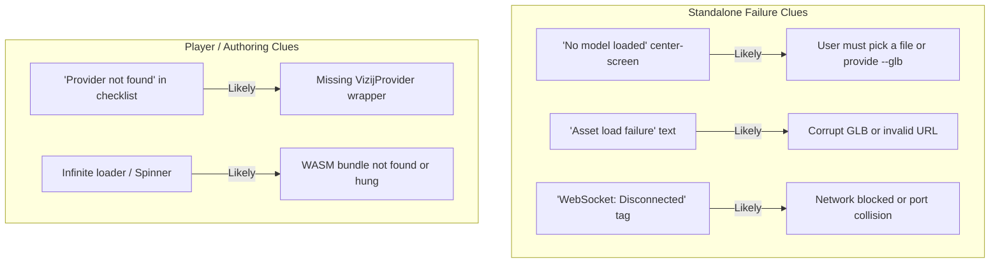
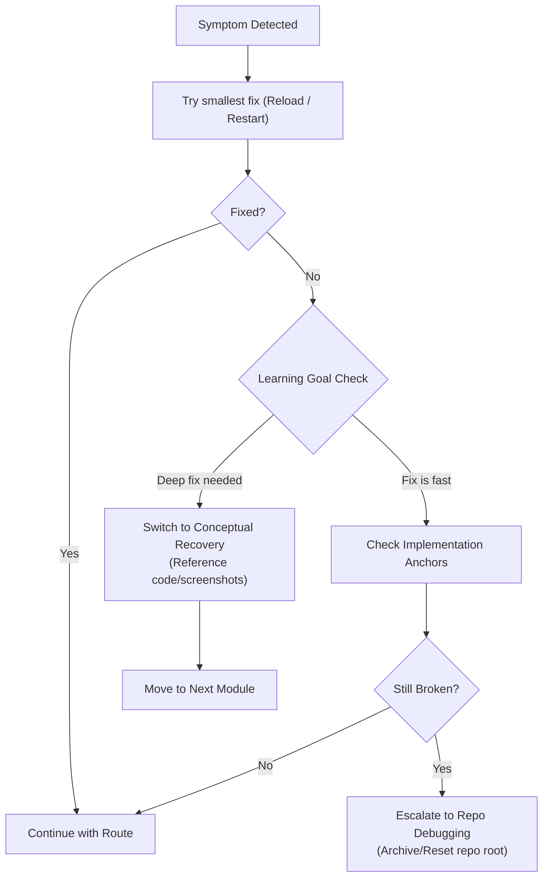

<!-- tags: type=guidebook-module; status=written; topics=guidebook,support,troubleshooting,matrix -->

> **Last updated:** 2026-03-12
> **Purpose:** collect the common route-level failure patterns and the fastest guidebook-aligned recovery paths

# Troubleshooting Matrix

## Guidebook Context

1. **Bucket:** [Guidebook Support](README.md)
2. **Depth role:** cross-cutting reusable support layer
3. **Module type:** support guide
4. **Bucket overview:** [Guidebook Support](README.md)
5. **Useful previous module:** [Validation Checkpoints](validation-checkpoints.md)
6. **Useful next module:** [Glossary and Terminology Bridge](glossary-and-terminology-bridge.md)

## Reader Outcome

After this page, you should be able to recognize common failure patterns across the maintained route, identify the most likely cause, and choose a fast recovery path that keeps the learner moving.

## Module Notes

### Intended Audience

This page is for guidebook authors, facilitators, and builders who need a practical recovery layer behind the main route.

### Artifact Being Touched

The artifact here is the route-level recovery model:

1. symptom recognition,
2. likely causes,
3. where to inspect next,
4. the fastest recovery path,
5. when to keep going and when to branch around a broken segment.

## What You Need

This page works best after [Validation Checkpoints](validation-checkpoints.md), because troubleshooting is easier once the expected healthy state is clear.

## Matrix

## Visual Recognition of Failure

When something goes wrong, the Vizij runtime usually gives explicit visual clues.

| Symptom | Likely cause | Where to inspect | Fast recovery |
| --- | --- | --- | --- |
| Face does not render | missing asset, missing WASM, wrong repo root, broken dev environment | app terminal output, app loading state, current working directory | restart the app, verify repo root, confirm asset path and WASM setup |
| `tutorial-fullscreen-face` renders but mouse or hotkeys do nothing | pointer not over app, missing pose data, hook not active, bundle mismatch | `useMouseGaze.ts`, `usePoseHotkeys.ts`, face bundle configuration | reload the page, verify pointer focus, inspect hotkey mapping in code and continue conceptually if needed |
| `tutorial-agent-face` will not connect | missing `VITE_GEMINI_API_KEY`, missing mic permissions, no network | app status chips, local env vars, browser permissions | treat the page as a richer example only, explain the UI states, and continue with non-live runtime concepts |
| `demo-vizij-player` starts but feels ambiguous | loader state unclear to the reader, panels not yet understood, asset health not checked | bootstrap checklist, face viewer, diagnostics | narrow the reader back to loading, ready, error, and visible face states before exploring the rest of the app |
| `vizij-authoring` feels too heavy or slow | machine load, too much tooling for the current teaching goal | system load, participant goal, presenter machine | switch to observation mode, use screenshots, and keep the reader focused on concepts instead of deep editing |
| Standalone app loads but does not feel deployed | runtime visible but no operator path confirmed | port display, WebSocket state, control panel availability | confirm the endpoint, connect with the built-in panel or a client, and demonstrate one successful control action |
| Deployment section feels too heavy | packaging or Tauri setup is unrealistic for the current context | room constraints, machine readiness, available time | keep the teaching goal at operator-model understanding and defer binary shipping to a later session |

## How To Read The Matrix

## Escalation Flow

Use this flow to decide whether to keep technical debugging or move to a conceptual fallback.

Use the matrix in this order:

1. confirm the symptom is real,
2. check the smallest plausible cause first,
3. inspect the named anchor surface,
4. choose the fastest recovery that preserves the learning goal.

The goal is not to debug every problem to perfection in the moment. The goal is to preserve the route and keep the next concept teachable.

## When To Recover Conceptually Instead Of Technically

Some failures are not worth solving live.

Good reasons to switch into conceptual recovery:

1. the app surface is flaky but the implementation anchor is still readable,
2. the room or machine cannot support the heavier tooling path,
3. credentials or network are missing for a richer example,
4. the learning objective does not require a full fix to stay useful.

In those cases, use screenshots, code anchors, and the simpler maintained route pages rather than letting the session stall.

## Escalation Rule

Escalate beyond this matrix when:

1. multiple route stages fail the same way,
2. the runtime never reaches a ready state,
3. the same asset fails across several maintained apps,
4. the deployment endpoint cannot expose a working control path after basic checks.

That usually means the issue belongs in repo-level debugging or implementation work, not in guidebook-level support alone.

## Current Useful Visuals

The best support visuals for troubleshooting are the diagnostic states in our core apps:

1. **Healthy minimal runtime**: [fullscreen-demo](../assets/screenshots/fullscreen-demo.png)
2. **Player diagnostics**: [player-demo-details](../assets/screenshots/player-demo-details.png)
3. **Visible control paths**: [player-demo-controls](../assets/screenshots/player-demo-controls.png)
4. **Authoring empty-state recovery**: [authoring-loading-page](../assets/screenshots/authoring-loading-page.png)

For the standalone deployment route, prefer the explicit runtime, endpoint, and same-host operator checks in [Easiest Standalone Deployment](../deploy/easiest-standalone-deployment.md) over screenshot-only verification.

## Success Check

You are done with this page when:

1. you can match a common symptom to a likely cause,
2. you know the fastest recovery path for the maintained route,
3. you know when to shift from live debugging into conceptual recovery.

## Implementation Anchors

Use these when you need the current implementation truth:

1. `vizij-web/packages/@vizij/runtime-react/README.md`
2. `vizij-web/apps/tutorial-fullscreen-face/tutorial.md`
3. `vizij-web/apps/tutorial-agent-face/tutorial.md`
4. `vizij-web/apps/vizij-standalone/README.md`
5. `vizij-web/apps/vizij-standalone/src-tauri/src/lib.rs`
6. `vizij-web/apps/vizij-standalone/src-tauri/src/connection_manager.rs`

## Next Step

1. If you need the expected healthy states again, return to [Validation Checkpoints](validation-checkpoints.md).
2. If you need to put the support layer back into the route, return to [Guidebook Support](README.md).
