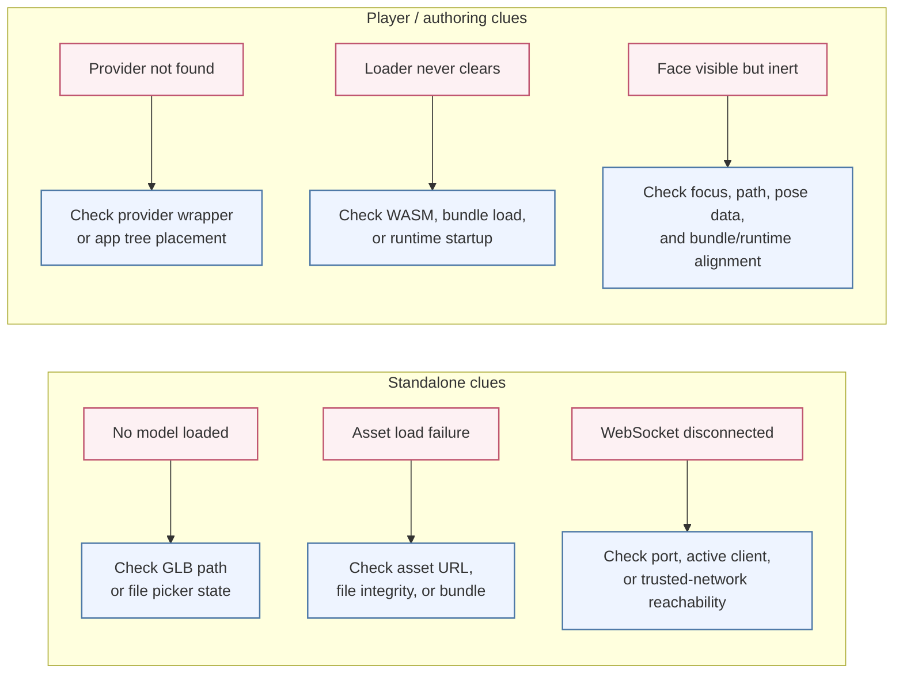
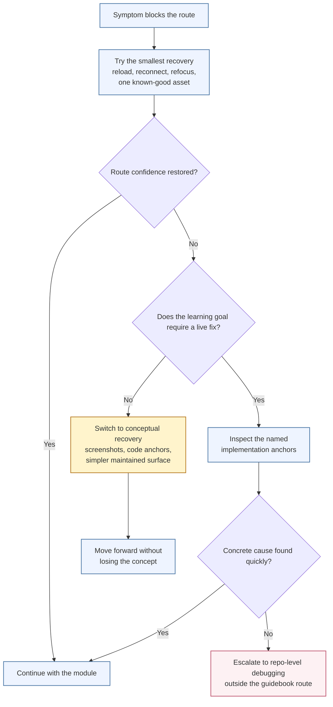

<!-- tags: family=guidebook; type=guidebook-module; editorial_status=completed; publication_status=planned; topics=guidebook,support,troubleshooting,matrix -->

> **Last updated:** 2026-10-23
> **Purpose:** collect the common route-level failure patterns and the fastest guidebook-aligned recovery paths

# Troubleshooting Matrix

## Guidebook Context

1. **Bucket:** [Guidebook Support](README.md)
2. **Depth role:** cross-cutting reusable support layer
3. **Module type:** support guide
4. **Bucket overview:** [Guidebook Support](README.md)
5. **Useful previous module:** [Validation Checkpoints](validation-checkpoints.md)
6. **Useful next module:** [Glossary and Terminology Bridge](glossary-and-terminology-bridge.md)

## Reader Outcome

After this page, you should be able to recognize common failure patterns across the maintained route, identify the most likely cause, and choose a fast recovery path that keeps the learner moving.

## Module Notes

This page is for guidebook authors, facilitators, and builders who need a practical recovery layer behind the main route.

The artifact here is the route-level recovery model: symptom recognition, likely causes, where to inspect next, the fastest recovery path, and when to keep going versus branch around a broken segment.

## What You Need

This page works best after [Validation Checkpoints](validation-checkpoints.md), because troubleshooting is easier once the expected healthy state is clear.

## Matrix

| Route stage | Symptom | Most likely interpretation | Inspect next | Fast recovery |
| --- | --- | --- | --- | --- |
| Experience | face never becomes visible | asset load, dev shell, or startup state failed before teaching can even begin | app load state, terminal output, selected asset | reload the app or choose another known-good asset before reading farther |
| Experience or Control | face renders but hotkeys do nothing | the route is visible but the control proof is missing | page focus, the face's `ready` status, the hotkey hook, the face's standard adaptation | retry focus and input once, then use code anchors if the teaching goal is conceptual |
| Customize | the reader cannot tell whether they should import, rig, pose, animate, or write procedural behavior | routing failure, not merely missing detail | current authoring goal and the next-page chooser tables | return to the closest chooser page and pick one layer explicitly before editing more |
| Customize | an authored pose, clip, or program exists but runtime behavior still does not change | export, layer choice, or runtime handoff is unclear | exported artifact, bundle/runtime handoff, chosen authoring layer | verify which layer changed, then re-test with one concrete runtime or player proof |
| Integrate | app compiles but readiness still feels ambiguous | the shell exists but health proof is weak | loading, ready, and error surfaces; provider placement | narrow back to one visible readiness path before adding richer UI |
| Integrate | service or session is failing while the face runtime seems healthy | session truth and runtime truth are being collapsed | app session status, runtime status, translation boundary | treat runtime and session as separate checks and recover the failing layer only |
| Deploy | face is visible but runtime never reaches `ready` | deployment has not crossed the control boundary yet | runtime panel, error state, constraints | stop socket testing and recover runtime readiness first |
| Deploy | socket is reachable but slot discovery fails or returns nothing useful | endpoint is up, but control certainty is not | discovered slots, constraints, path hint | use the built-in panel or list slots again; do not guess slot names |
| Deploy | `set_slot_values` reports success but nothing visible changes | transport succeeded, but runtime/render proof did not | normalized slot name, `Face ID`, runtime snapshots, output paths | trace the slot into the runtime path and inspect bundle/render target mismatch next |
| Deploy | reset behaves strangely or the face snaps back unexpectedly | defaults, neutral staging, or reset lifecycle is fighting the visible result | constraint defaults, reset path, neutral-stage flow | compare against defaults, then re-run one small write and one reset |

## Visual Recognition of Failure

When something goes wrong, the Vizij runtime usually gives explicit visual clues.

| Symptom | Likely cause | Where to inspect | Fast recovery |
| --- | --- | --- | --- |
| Face does not render | missing asset, missing WASM, wrong repo root, broken dev environment | app terminal output, app loading state, current working directory | restart the app, verify repo root, confirm asset path and WASM setup |
| `tutorial-fullscreen-face` renders but hotkeys do nothing | page not focused, face not yet `ready` (the hotkeys bind only then), a key with no binding, a face without the standard adaptation | the key hints shown on pointer move, `useFaceHotkeys.ts`, the face's bundle | reload the page, focus it, press a key the hints list, inspect the hotkey mapping in code and continue conceptually if needed |
| authoring route feels directionless | the reader is mixing import, rigging, pose, animation, and procedural layers | chooser tables in `Customize`, current immediate goal | route back to one explicit authoring layer and postpone the others |
| authored export exists but a player or runtime still does not reflect it | authored layer changed, but the runtime or export handoff is unclear | export output, chosen authoring layer, runtime shell | verify the exported artifact boundary, then retest with one concrete player or runtime proof |
| `tutorial-agent-face` will not connect | missing `VITE_GEMINI_API_KEY`, missing mic permissions, no network | app status chips, local env vars, browser permissions | treat the page as a richer example only, explain the UI states, and continue with non-live runtime concepts |
| `demo-vizij-player` starts but feels ambiguous | loader state unclear to the reader, panels not yet understood, asset health not checked | bootstrap checklist, face viewer, diagnostics | narrow the reader back to loading, ready, error, and visible face states before exploring the rest of the app |
| `vizij-authoring` feels too heavy or slow | machine load, too much tooling for the current teaching goal | system load, participant goal, presenter machine | switch to observation mode, use screenshots, and keep the reader focused on concepts instead of deep editing |
| Standalone app loads but does not feel deployed | runtime visible but no operator path confirmed | port display, WebSocket state, control panel availability | confirm the endpoint, connect with the built-in panel or a client, and demonstrate one successful control action |
| WebSocket is up but the face still does not move | slot discovery, runtime identity, or render-target alignment is still wrong | discovered slot names, `Face ID`, runtime path hint, output paths | copy one real discovered slot, trace it into the runtime path, and test one visible channel only |
| Deployment section feels too heavy | packaging or Tauri setup is unrealistic for the current context | room constraints, machine readiness, available time | keep the teaching goal at operator-model understanding and defer binary shipping to a later session |

## How To Read The Matrix

1. Match the first failing condition, not the loudest later symptom.
2. Prefer the smallest recovery that restores route confidence before you escalate into repo debugging.
3. If the issue is really "I do not know which layer I am in," route back to the nearest chooser page instead of searching for a deeper technical fix.
4. If the route can stay teachable through screenshots, code anchors, or a simpler maintained surface, use conceptual recovery instead of forcing a live fix.

## Escalation Flow

Use this flow to decide whether to keep technical debugging or move to a conceptual fallback.

Use the matrix in this order:

1. confirm the symptom is real,
2. check the smallest plausible cause first,
3. inspect the named anchor surface,
4. choose the fastest recovery that preserves the learning goal.

The goal is not to debug every problem to perfection in the moment. The goal is to preserve the route and keep the next concept teachable.

## When To Recover Conceptually Instead Of Technically

Some failures are not worth solving live.

Good reasons to switch into conceptual recovery:

1. the app surface is flaky but the implementation anchor is still readable,
2. the room or machine cannot support the heavier tooling path,
3. credentials or network are missing for a richer example,
4. the learning objective does not require a full fix to stay useful.

In those cases, use screenshots, code anchors, and the simpler maintained route pages rather than letting the session stall.

## Escalation Rule

Escalate beyond this matrix when:

1. multiple route stages fail the same way,
2. the runtime never reaches a ready state,
3. the same asset fails across several maintained apps,
4. the deployment endpoint cannot expose a working control path after basic checks.

That usually means the issue belongs in repo-level debugging or implementation work, not in guidebook-level support alone.

## Current Useful Visuals

The best support visuals for troubleshooting are the diagnostic states in our core apps:

1. **Healthy minimal runtime**: [fullscreen-demo](../assets/screenshots/fullscreen-demo.png)
2. **Player diagnostics**: [player-demo-details](../assets/screenshots/player-demo-details.png)
3. **Visible control paths**: [player-demo-controls](../assets/screenshots/player-demo-controls.png)
4. **Authoring empty-state recovery**: [authoring-loading-page](../assets/screenshots/authoring-loading-page.png)

For the standalone deployment route, prefer the explicit runtime, endpoint, and same-host operator checks in [Easiest Standalone Deployment](../deploy/easiest-standalone-deployment.md) over screenshot-only verification.

## Success Check

You are done with this page when:

1. you can match a common symptom to a likely cause,
2. you know the fastest recovery path for the maintained route,
3. you know when to shift from live debugging into conceptual recovery.

## Implementation Anchors

Use these when you need the current implementation truth:

1. `vizij-web/packages/@vizij/runtime-react/README.md`
2. `vizij-web/apps/tutorial-fullscreen-face/tutorial.md`
3. `vizij-web/apps/tutorial-agent-face/tutorial.md`
4. `vizij-web/apps/vizij-standalone/README.md`
5. `vizij-web/apps/vizij-standalone/src-tauri/src/lib.rs`
6. `vizij-web/apps/vizij-standalone/src-tauri/src/connection_manager.rs`

## Next Step

1. If you need the expected healthy states again, return to [Validation Checkpoints](validation-checkpoints.md).
2. If you need to put the support layer back into the route, return to [Guidebook Support](README.md).
